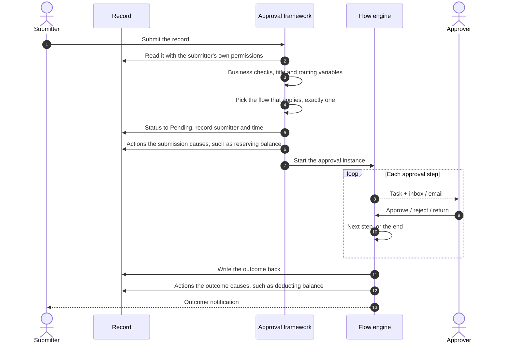
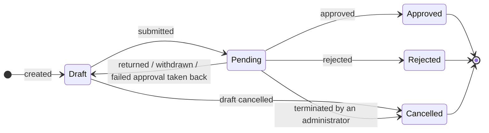
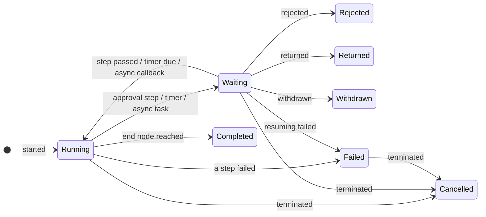

# Approval Flows

An approval flow (scenario `APPROVAL`) approves one business record: its submitter submits it, the framework picks the approval flow that applies and starts it, approvers act step by step, the outcome is written back to the record, and the business module does what follows. This page goes in that order; to put a business model through approval, see [Integration](./integration).

## Participants

| Role | Who | What they can do |
|---|---|---|
| Submitter (initiator) | The user who presses Submit — the instance's `initiator` | Submit, withdraw as the withdraw policy allows, urge, comment, cancel a draft; after a return, edit and submit again |
| Subject | The employee the record is about — the record's `employeeId` by default | Not necessarily the submitter (someone may submit on their behalf). Organisation-based approvers are resolved from them |
| Approver | The login account a step resolved | Approve, reject, return, transfer, delegate, add signers, CC, comment; batch approve / return / reject |
| CC recipient | Someone an approver CC'd by hand, or the flow settings' CC rules CC'd | View, mark read, comment |
| Delegate | The stand-in a delegation rule names | While the delegation is active, tasks that would go to the delegator go to them |
| Administrator | A user granted the monitor, within their `FlowInstance` data scope | Monitor instances; terminate, reassign, delegate on someone's behalf, urge as an administrator |

## The main path

Steps 1–7 happen in one submission: if any of them fails, the whole submission rolls back and the record stays a draft. Steps 8–10 repeat for every approval step. The approver's action and the 11 and 12 that follow commit or roll back together: an exception in 12 vetoes the action. Steps 3, 6 and 12 are the approval handler's `validate` / `submission`, `afterSubmitted` and `afterOutcome` (see [Integration](./integration#approving-business-records)); dashed arrows are notifications.

## Record approval status

Every approval model shares one state machine, and only the framework writes `approvalStatus`.

| `approvalStatus` | What may happen | Where it goes |
|---|---|---|
| `Draft` | Edited; submitted; cancelled by its applicant | Submit → `Pending`; cancel → `Cancelled` |
| `Pending` | Frozen. Approvers approve, reject or return it; its submitter withdraws it within the flow's `withdrawPolicy`; an administrator terminates it | Approved → the next step or `Approved`; rejected → `Rejected`; returned or withdrawn → **`Draft`** again; terminated → `Cancelled` |
| `Approved`, `Rejected`, `Cancelled` | Final and frozen: never edited, submitted or cancelled | — |

A return or a withdrawal is not a status a record stays in: the record is a draft again, to edit and submit as a new approval, and its approval history keeps what happened. An administrator terminating its approval (`POST /flow/monitor/instances/terminate`) makes the record `Cancelled`. What happens to a record after its approval — paid, in effect, voided — is not an approval status and goes in the model's own status field; where a change takes effect later, the handler's `effectStatuses` tells the monitoring console how it stands. The boot fails when a handler's model lacks the three fields in its metadata.

### The approval lock

`ApprovalLockValidator` (a `ModelWriteValidator`, order 10) holds at the write roots, where every write lane meets — the record's form, the generic endpoints, an import, a flow's write node:

- a record that is not a draft — `Pending`, `Approved`, `Rejected`, `Cancelled` — is neither changed nor deleted, and neither is anything it owns: the records of a model whose to-one field straight onto it cascades its deletion (`onDelete = CASCADE`), like an expense claim's lines — nor is a new one filed under it;
- the approval fields are the framework's: a new record is a `Draft` with no submitter, and no write changes them. Sending back the stored value is not a change.

Writes made with permission checks off are exempt: the writer's own, the fields an approval step lets its approver edit (*Approver's writes*), the handler's follow-up actions. The lock only says when nobody may change a record; who may change it otherwise — its owner, in which of its other states — stays with the model's own validator. The approval fields are not `readonly` in metadata, which would drop the framework's own writes too; a form shows them read-only.

## Instance status

While the instance is `Running` or `Waiting` the record stays `Pending`. When the instance ends, the outcome is written back: `Completed` → `Approved`, `Rejected` → `Rejected`, `Returned` / `Withdrawn` → `Draft`, `Cancelled` → `Cancelled`; `Failed` writes nothing and the record stays `Pending`.

Defined `FlowExecutionStatus` values:

- `Pending`
- `Running`
- `Waiting` — parked on one or more waits (a pending approval and/or timer / async callback). The specific reasons live in the instance's pending-approval list and wait-token list, so a single status covers parallel branches suspended for different reasons at once.
- `Rejected`
- `Returned` — sent back to the initiator; ends the instance like a rejection, but its record is a draft again. The initiator edits and submits it again, which starts a new instance from the beginning
- `Withdrawn` — taken back by the initiator; ends the instance, and its record is a draft again
- `Cancelled` — ended by an administrator (*terminate*, see [Monitor](./api#monitor)); a record's approval cancels its record with it
- `Completed`
- `Failed` — a step could not run. It stays failed unless an administrator terminates it (→ `Cancelled`); the submitter of a record's approval can instead take the record back (see [Approving Business Records](./integration#approving-business-records))

`FlowStatusTransitions` checks every status change: any status may move to `Failed`, and a self-transition is legal (a parallel branch parking again is still `Waiting`); any other change outside the diagram fails with `Illegal flow status transition`. A rejection, return, withdrawal or termination closes the steps still waiting on every parallel branch.

> [!NOTE]
> When a later node fails during an approver's action — the next step resolving no approver, say — the instance does **not** fail: the action is refused and rolled back, the instance stays on its step, and the approver sees the error.

## Flow settings

Flow-level settings live in the designer's Flow settings panel (shown when no node is selected on the canvas). They belong to approval flows only; set on another scenario they fail compilation.

| Approval setting | Values | Default |
|---|---|---|
| `withdrawPolicy` | Until when the initiator may withdraw: `Never`, `BeforeFirstAction` (until an approver first approves, rejects, returns, transfers, delegates or adds a signer — an automatic approval does not count), `UntilCompleted` | `Never` |
| `urgeEnabled` | Whether the initiator may urge; administrators may either way | on |
| `urgeIntervalMinutes` | How often, in minutes, each waiting step may be urged, by the initiator and administrators alike; at least 1 | `240` |
| `approverDedup` | `Global`, `Contiguous`, `None` — see [Approver Resolution](#approver-resolution) | `Global` |
| `selfApproval` | `AutoApprove`, `RequireApproval` — see [Approving Business Records](./integration#approving-business-records) | `AutoApprove` |
| `emailNotification` | Whether its notices are also emailed — see [Notifications](#notifications) | on |
| `cc` | CC rules: who is copied in on submit, once approved, once rejected — see [CC](#cc) | no one |

The flow's `withdrawPolicy` decides until when the submitter may withdraw: `Never` (the default), `BeforeFirstAction` — until an approver first approves, rejects, returns, transfers, delegates or adds a signer at any step; an automatic approval does not count — or `UntilCompleted`. Whatever the policy, only the initiator withdraws, and only while the approval waits on its approvers. `WithdrawPolicyGuard` is the one rule: the withdraw action enforces it, and the preview, `GET /flow/instances/{instanceId}/withdraw` and the instance search's `withdrawable` report it, so a Withdraw button is offered exactly when the withdrawal would be accepted.

### CC

CC is the whole approval's setting, set only in the flow settings; an approval step has no CC configuration of its own. The rules (`cc`, a list of `FlowCcRule`) are published with each revision, and an instance follows the rules of the revision it runs on. Each rule says:

- **When**: on submit (`OnSubmit`); once approved (`OnApproved`, as the whole approval ends approved); once rejected (`OnRejected`, as it ends rejected — a rejection the step's reject threshold does not yet carry is not the end).
- **Who**: named people (`recipients`), or people found the way approvers are (`recipientSource`, in an approval step's `approverSource` shape — the subject's supervisor, a department leader, a role, a position, a department's members…), never both. They are found as in [Approver Resolution](#approver-resolution), past the submitter's data permissions.

A rule's CC is recorded like a manual one: one `CC` entry per recipient, with no actor — no person sent it — on the start node (on submit, and once approved when every step passed on its own) or on the step whose action ended the approval, in that node's current cycle. So the recipient has a CC task in their CC list, an inbox notice, and is a participant: they view and comment. Someone already CC'd on the same node and cycle — by a rule or by hand — is not CC'd again.

Approvers can also CC by hand as they act, one person or several at once — see [Approval Actions](#approval-actions).

### One record, exactly one flow

On submission the framework looks through the tenant's **active** Approval flows for those whose `Submit` trigger names the record's model and whose condition holds for the record:

- exactly one: it starts the approval;
- none: the submission is refused — no approval flow is configured for the record;
- more than one: the submission is refused and the matching flows are listed, so an administrator can narrow their conditions.

To route records to different flows (leave over 3 days to another flow, say), create several flows with mutually exclusive conditions — or branch inside one flow with conditional edges. Every submission picks the flow afresh, so a record submitted again after a return may go to a different flow if its contents changed.

## Approval Model

### Approval And Reject Thresholds

- Approval modes: `ANY_ONE`, `UNANIMOUS`, `MIN_COUNT`, `PERCENTAGE`
- Reject modes: `ANY_ONE`, `UNANIMOUS`, `MIN_COUNT`, `PERCENTAGE`
- One actor can only cast one effective vote per cycle.
- Compile-time validators reject impossible threshold combinations.

- Vote counts are fixed when a step starts: `MIN_COUNT` takes the configured number (`minCount` / `rejectMinCount`) and is not capped by how many approvers a dynamic source resolved; `PERCENTAGE` is approvers × percentage ÷ 100, rounded up. Adding a signer recounts; a transfer or delegation does not; an administrator reassignment that merges two seats caps the approvals needed at the approvers left.
- Approvals and rejections are counted separately, and **whichever side reaches its threshold first decides**; only the counting side refuses a second vote — under "everyone approves + anyone rejects", an approver who already approved may still reject and end the approval.
- When a dynamic source resolves fewer approvers than the threshold (at least 3 required, 2 resolved, say), the step waits indefinitely; only a return, withdrawal, termination or timeout moves it.

### Approver Resolution

Approval nodes support:

- static approvers via `config.approvers`
- dynamic approvers via `config.approverSource`
- empty-approver strategies via `config.emptyApproverStrategy`

Supported dynamic source types:

- from start variables: `VariableList`, `Expression`, `InitiatorManager` (`initiatorManagerId`), `Role` (`roleApprovers`)
- from the organization: `Supervisor` (the N-th level supervisor), `DeptLeader` and `DeptHrbp` (of a department), `RoleQuery` (holders of the roles named by `roleIds`, by `roleCodes`, or both — optionally narrowed to a department), `Position`, `Department` (its members)

The organization is read relative to the record's **subject** — the employee it is about (*Approving Business Records*) — so a request filed on someone's behalf goes to their approvers, not the submitter's. `Supervisor` takes `relativeTo`: `SUBJECT` (default) or `INITIATOR`. The department-based sources take one `deptScope`:

| `deptScope` | Department | Default of |
|---|---|---|
| `SUBJECT_DEPT` | the subject's | `DeptLeader`, `DeptHrbp` |
| `INITIATOR_DEPT` | the submitter's | |
| `SPECIFIC_DEPT` | the one named in `deptId` (`deptIds` for `Department`) | `Department` |
| `VARIABLE_DEPT` | the id(s) held by the variable named in `deptVariable` — a transfer's receiving department | |
| `ALL` | none: every holder (`RoleQuery` only) | `RoleQuery` |

A department that cannot be told — no subject department, an empty variable — resolves to nobody, never to every holder; the step then follows its empty-approver strategy. An instance without a record (a debug run) has no subject and starts from its initiator. The compiler refuses a scope a source does not take and a scope missing what it needs (`INVALID_DEPT_SCOPE`, `MISSING_DEPT_IDS`, `MISSING_DEPT_VARIABLE`, `INVALID_RELATIVE_TO`).

Approvers are **login account ids**. The organization is read through the `OrganizationService` SPI, whose default `FlowOrgService` follows the HR conventions permission-starter already reads, so an application on those models configures nothing:

| Purpose | Model.field |
|---|---|
| Account → employee (the initiator's) | `Employee.userId` |
| Name, department, position | `Employee.fullName`, `departmentId`, `jobPositionId` |
| Supervisor (an employee id) | `Employee.piEmployeeId` |
| Department leader, HRBP (employee ids), parent, name | `Department.picEmpId`, `hrbpEmpId`, `parentId`, `name` |
| Role holders, role codes | `UserRoleRel.userId` / `roleId`, `Role.code` |

An employee without an account counts as nobody, so a step resolving only to such employees is empty and follows its empty-approver strategy; a role holder is an account and approves even without an employee profile. A department without a leader (or HRBP) defers to its parent's. Lookups skip row scope — who approves must not depend on what the initiator may see. Every model and field name can be overridden under `softa.flow.org.*` (`OrganizationServiceProperties`); an application with another organization system provides its own `OrganizationService` bean.

Role codes, unlike role ids, are the same in every tenant, so a flow seeded to many tenants names its built-in roles by code (`roleCodes`); the designer offers both lists, since roles an administrator creates have no code and are picked by id.

Approver dedup (`approverDedup`): the default policy is **`Global`** — a user who already approved an earlier node is auto-passed on later nodes (recorded as `AUTO_APPROVE`). Residual risk: a mid-flow form edit is still auto-endorsed by that earlier approval; set the policy to `Contiguous` or `None` on flows where a re-look matters.

### Approver's writes

Once the actor is validated as the node's approver, the approval's form edits and every node it resumes run with the actor's own row scope set aside. Approving is the grant: an approver rarely holds update on the record they approve, and with row scope granted per action (permission-starter) that would refuse the approval itself. Host endpoints that apply an approval outside the engine do the same, after an entry check that the approver can see the request (`@RequirePermission`). A record's write rules (`ModelWriteValidator`) therefore see these writes as the system's: the approval lock (`ApprovalLockValidator`, see *Approving Business Records*), which freezes a record while it is in approval, still lets through the fields a node marks editable.

Set aside means **every** permission check, not only row scope — sensitive-field write checks included. The node's form configuration (its field permissions, `formPermissions`) is the only authorization for the fields the approver edits. Only the fields it marks `EDITABLE` or `REQUIRED` are written back; any other key in the approve request's `formData` — a `HIDDEN` or `READONLY` field, or one the node does not list — is dropped, and a node with no `formPermissions` writes nothing. A `REQUIRED` field must hold a value once the edits land — the one sent, or else the one the record stores — so an approve that sends nothing is still refused when the record lacks it. After the write, a record's approval reads its routing variables again from the edited record — its own fields, then its handler's `submission` on top — and they replace the ones the flow started with: a later route sees what the approver changed, a cleared field included. An approver whose roles hold no sensitive field set covering a field can therefore still write it if the node's form exposes it as editable. Flow designers must not make a sensitive field (pay, bank details, identity numbers, …) editable on an approval form unless every approver that node can resolve to is meant to edit it; show it read-only, or leave it off the form.

### Approval actions

Every action's actor is the logged-in user; the instance must be waiting on approval, and the actor must be an approver of the current step whose turn it is (not held back by a signer added before them).

| Action | Extra conditions / required | Effect | Notified |
|---|---|---|---|
| Approve | Comment optional; may carry field values (only editable / required fields are written) | Writes the fields and recomputes the routing variables; under a counting mode records a vote, and at the threshold — or under "anyone" — moves to the next step. Approving twice returns the instance unchanged | The next step's approvers get tasks; the initiator when it ends |
| Reject | Comment required | At the threshold → instance `Rejected`, every branch ends, record `Rejected` | Initiator |
| Return | The step allows it (`returnEnabled`); comment required | Instance `Returned`, record back to draft. Always returns to the submitter, never to an earlier step | Initiator |
| Transfer / delegate | Not yet voted; the target is neither the actor nor already on the step | The target takes the actor's seat, votes needed unchanged; the two differ only in the ledger and task status (`Transferred` / `Delegated`) | New approver |
| Add signer before / after | Not yet voted; the target is not on the step; one open pair per step at a time | The signer goes before the actor (who waits for their approval) or after (they wait for the actor's); even an "anyone" step needs both to approve | Signers are not notified separately |
| CC | Not yet voted; one person or several at once. Whoever already sees the approval from the step — its approvers, the actor among them, and anyone CC'd on it this cycle — is skipped; refused when nobody is left | The targets become participants who can view and comment | CC recipients (inbox only) |
| Comment | Any participant; instance not ended | Writes one entry, changes no status | Nobody |

What the initiator can do:

| Action | Conditions | Result |
|---|---|---|
| Withdraw | Initiator only; instance waiting on approval; `withdrawPolicy` allows it | Instance `Withdrawn`, record back to draft, open tasks closed; **nobody is notified** |
| Take back a failed approval | Submitter only; instance `Failed`; not limited by the withdraw policy | Record back to draft; the failed instance stays for troubleshooting |
| Urge | Initiator only; instance waiting on approval; the flow's `urgeEnabled` not turned off | Reminds the current step's approvers who have not acted. Each step can be urged once per the flow's `urgeIntervalMinutes` (default 240), an interval shared with administrators |
| Comment | Participant; instance not ended | Written to the approval history |
| Edit and submit again | The record is a draft after a return or withdrawal | A new instance, from the first step, with the flow picked afresh |

What administrators can do (in the [monitor](./api#monitor), within the caller's own `FlowInstance` permissions):

| Action | Conditions | Result |
|---|---|---|
| Terminate | Instance running, waiting or failed; reason required; up to 100 at a time | Closes the pending approvals, instance `Cancelled`, record cancelled; a `TERMINATE` entry; initiator notified |
| Reassign | From-approver, to-approver (not the same) and a reason; affected tasks can be previewed first | Moves the from-approver's current pending tasks to the new approver, recorded as the from-approver's `TRANSFER` with the administrator as `operatorId`; merges the two seats when the new approver is already on the step; steps not yet reached are untouched |
| Delegate on behalf | A permission of its own, not limited by data scope | Creates a delegation rule for an approver, who sees it among their own delegations and can cancel it |
| Urge as administrator | Can read the instance; not bound by the flow's `urgeEnabled` | As the initiator's urge, sharing its interval |

### Batch actions

`POST /flow/instances/batch/{approve,return,reject}` (`BatchApprovalExecutor`) runs one approver action over up to 100 of the caller's pending tasks with one comment — required to return or reject. Each task is its own engine call and so its own transaction: one refused task changes nothing for the others, and every engine rule holds as for a single action. A batch fills in nothing, so before the engine is asked it skips a task whose step makes a field `REQUIRED` — fields to fill in need the record opened — and, for a return, a step without `returnEnabled` (whether the step may be returned to the initiator at all) — the same rule that sets a task's `batchable` flag. The result (`FlowBatchActionResult`) gives the succeeded / skipped / failed counts and each task's outcome with the reason, in request order.

### Timeout Handling

An approval node's `timeout` gives its step a deadline, `timeoutHours` after the step opens; without `timeoutHours` the step has none and the rest of `timeout` is ignored. At the deadline `timeoutStrategy` applies:

| Strategy | At the deadline | Uses |
|---|---|---|
| `Remind` (default) | Reminds the approvers still to act, then every `remindIntervalHours`, at most `maxRemindTimes` times (3 unless set) — with no interval, once. No automatic action | `remindIntervalHours`, `maxRemindTimes` |
| `AutoApprove` | Approves for the approvers still to act | — |
| `AutoReject` | Rejects the approval | — |
| `Escalate` | Hands the step to `escalateToUserId`, with a new deadline | `escalateToUserId` (required) |

Nothing is sent before the deadline. Reminders belong to `Remind`: set on another strategy they fail the compile (`REMINDERS_OUTSIDE_REMIND`), and the designer clears them when another strategy is chosen; an interval or a most below 1 fails it too (`INVALID_REMIND_INTERVAL`, `INVALID_MAX_REMINDERS`). The reminder is an inbox notice ("Approval overdue"), not emailed.

`ApprovalTimeoutScheduler` handles the steps past their deadline against persisted pending approvals.

It runs off a cron row, `flow_approval_timeout_handle`. The starter's maintenance crons (approval timeouts, delegation expiry, timer sweep, stuck-instance scan, debug bundle purge, automation run purge) ship switched off in `data-system/SysCron.FlowMaintenance.json`. The app lists that file under `platform` in its `seed-manifest.yml`, or the rows never exist; then switch on the ones it uses.

## Writing the outcome back

Results reach the record through one listener, `ApprovalOutcomeListener`, and one writer, `ApprovalStatusWriter`: when a record's approval completes, is rejected, returned, withdrawn or cancelled (terminated by an administrator), the writer sets `approvalStatus` to the result — `Draft` after a return or a withdrawal — and calls `handler.afterOutcome(record, outcome)` with the type, the deciding user and their comment (none for an automatic approval; the administrator and their reason for a termination) — in the action's transaction, with permission checks skipped, so a handler that throws vetoes the action. A result lands only on a record still `Pending`: a finished instance saved again (on a comment or a CC read) changes nothing, and `afterOutcome` runs once per result. Keep it to writes in this database that belong with the result; anything that leaves it — a payment, an external system — goes after the commit. A failed instance writes nothing and leaves its record `Pending`, with two ways out: its submitter takes the record back by withdrawing it (a draft again), or an administrator terminates the approval (the record `Cancelled`). The record becomes `Pending` before the instance starts because a flow with no approval step completes while it starts. A step whose approver resolves to nobody fails at runtime under its empty-approver strategy (`Error` by default); the record's approval preview shows where before anyone submits.

### Auto-approval

On a submit flow the record's own people are approved for by default: when a step's approvers include the submitter, or the user of the employee the record is about, they are counted as having approved — recorded as `AUTO_APPROVE` ("Auto-approved (submitter)" / "Auto-approved (subject)") in the approval history — and the step's approval mode decides the rest: an any-one step passes, an all-approve step still waits for the others. The flow setting `selfApproval` decides it: `AutoApprove` (the default) or `RequireApproval`, which asks them like any other approver. An empty step whose strategy is `AutoApprove` is recorded the same way, with no actor ("Auto-approved (no approver)").

## Previewing a record's approval

`GET /flow/instances/preview?modelName=&rowId=` (`FlowClient.previewRecord`) answers what submitting the record would do now, without submitting it — for a record page that shows the approval path before anyone presses Submit. It makes the submission's own checks and choice of flow: the record's approval status and its approvals, `handler.validate` and `handler.submission` with the requester's own permissions, the submit triggers. A refusal, no applicable flow or several are reported in `status` (`Refused`, `NoFlow`, `SeveralFlows`, with the flows that apply in `candidates`) and `message` — the message the submission would be refused with — rather than raised. `afterSubmitted` is never called.

For a record whose approval is in progress, the preview is the rest of that approval (`InProgress`): the step it waits on now, as it stands (`current`, with the approvers still asked), then the steps after it, walked as below from the instance's own variables and approvals on a copy of the instance — never the instance itself. `withdrawable` says whether the requester may withdraw the record now: its submitter, while the approval waits on its approvers and the flow's `withdrawPolicy` permits it (`WithdrawPolicyGuard`), or after its approval failed — so a Withdraw button needs no rule of its own.

When one flow applies (`Ready`), `ApprovalPathPreviewer` walks it from its start node the way the engine runs it, every approval step assumed approved: routes are decided by `FlowGatewayRouter` over the variables the submission would start with, approvers by `PendingApprovalFactory` (auto-delegation included) and automatic approvals by `ApproverDedupService`, on a state that is never saved. `steps` lists the approval steps in the order the approval reaches them, each with an `outcome`:

| Outcome | The step |
|---|---|
| `Waiting` | Waits for `approvers`, of whom `requiredApprovals` must approve |
| `AutoApproved` | Passes on its own: `autoApprovals` counts as having approved the submitter (`Submitter`), the employee the record is about (`Subject`) — under the flow's `selfApproval` — or someone who approved an earlier step, under the flow's approver dedup (`EarlierApproval`) |
| `NoApproverApproved`, `NoApproverSkipped` | Resolves to nobody; its empty-approver strategy approves it on record or skips it |
| `NoApproverFails` | Resolves to nobody under strategy `Error`: the approval would stop there, as `failure` says |
| `Undetermined` | Who approves it, or whether it passes on its own, depends on data only known once the approval runs |

Nothing is guessed. The preview runs no node: once the walk passes a script, a task or a subflow, the variables that node writes are unknown — all of them for a task without an output variable and for an async task — and the instance id is unknown from the start. A route whose conditions read an unknown variable is listed in `undecided` and not followed; a step whose approvers come from a dynamic source, reached after such a node, is `Undetermined`; with approver dedup on, so is a step whose approver may or may not have approved an earlier step, one of several there who could pass it. An error the engine would fail on — a route matching no edge or several, a condition that cannot be evaluated — ends the walk in `failure`.

Nothing is written: no instance, task, ledger row or notification, and no delegation's use is counted. The preview is allowed to whoever can read the record with their own permissions (`FlowInstanceAccessGuard.requireRecordReader`) and is never waived from row scope; taking part in the record's earlier approvals is not enough. Users are named as in the approval history. It runs in no transaction of its own, and `FlowClient.previewRecord` should be called outside one: a refusal thrown through a transactional method marks the transaction it joins rollback-only.

## Constraints and errors

### Caught at publish

The designer's Validate and Publish both compile the flow; errors are listed per node, and a flow with errors cannot be published:

- **Structure**: missing flow name or scenario; an empty canvas; not exactly one start node; a missing or duplicate node or edge id, or an edge to a node that does not exist; a cycle.
- **Scenario and trigger**: a node not allowed in the scenario; a missing trigger, or one the scenario does not allow; a `Submit` trigger without a model; an empty or unparseable cron expression; approval settings (CC included) on a non-approval flow; an urge interval below 1; a CC rule that says not when, names no recipients, or names both people and a rule to find them by; `sync` on the wrong scenario, a sync flow with nodes that wait, `rollbackOnFail` without `sync`.
- **Approval nodes**: an unknown approver source type; a supervisor level below 1 or an invalid `relativeTo`; a department scope the source does not accept, or a missing department, variable, role or position it needs; a blank or duplicate static approver; a counting mode with no approvers; `minCount` outside 1 to the number of approvers; a percentage outside 1–100; approve + reject thresholds above approvers + 1; timeout hours ≤ 0; a reminder interval or a most reminders below 1; reminders on a timeout strategy other than `Remind`; escalation with no target (without timeout hours, the rest of the timeout is not checked).
- **Routing**: an edge expression that does not parse; an edge with both a rule and an expression; a rule on a flow that starts on no record; a rule that reads a field the record lacks or its approvals do not route on, a to-many field, orders an option or a relation, or uses `PARENT OF` / `CHILD OF`; a gateway with fewer than two outgoing edges or a join with fewer than two incoming; more than one default edge.
- **Task nodes**: missing or malformed configuration, a missing required input; a node type not supported yet.

**Not checked** at compile time — found only at runtime: whether every node is reachable from the start; timer configuration; the subflow target and its trigger; the syntax of scripts, return values, expression sources and trigger conditions; an approval node with no approvers configured at all (handled at runtime by its empty-approver strategy); whether the fields in `formPermissions` exist; `declaredOutputs`.

Compile error codes

- Structure: `MISSING_FLOW_NAME` `MISSING_SCENARIO` `EMPTY_GRAPH` `NO_START_NODE` `MULTIPLE_START_NODES` `DUPLICATE_NODE_ID` `DUPLICATE_EDGE_ID` `UNKNOWN_EDGE_SOURCE` `UNKNOWN_EDGE_TARGET` `GRAPH_CYCLE`
- Scenario and trigger: `INVALID_SCENARIO_NODE` `MISSING_TRIGGER` `TRIGGER_NOT_ALLOWED` `SUBMIT_MISSING_MODEL` `CRON_MISSING_EXPRESSION` `CRON_INVALID_EXPRESSION` `APPROVAL_SETTING_OUTSIDE_APPROVAL` `INVALID_URGE_INTERVAL` `INVALID_CC_RULE` `SYNC_OUTSIDE_AUTOMATION` `SYNC_FLOW_WAITS` `ROLLBACK_WITHOUT_SYNC`
- Approval nodes: `UNKNOWN_APPROVER_SOURCE_TYPE` `INVALID_SUPERVISOR_LEVEL` `INVALID_RELATIVE_TO` `INVALID_DEPT_SCOPE` `MISSING_DEPT_IDS` `MISSING_DEPT_VARIABLE` `MISSING_ROLE_IDS` `MISSING_POSITION_IDS` `BLANK_APPROVER` `DUPLICATE_APPROVER` `*_NEEDS_APPROVERS` `INVALID_MIN_COUNT` `INVALID_PERCENTAGE` `DEADLOCK_THRESHOLD` `INVALID_TIMEOUT_HOURS` `INVALID_REMIND_INTERVAL` `INVALID_MAX_REMINDERS` `REMINDERS_OUTSIDE_REMIND` `MISSING_ESCALATE_TARGET`
- Routing: `INVALID_CONDITION_EXPR` `CONFLICTING_EDGE_CONDITIONS` `RULE_WITHOUT_RECORD` `INVALID_RULE_CONDITION` `INSUFFICIENT_GATEWAY_EDGES` `MULTIPLE_DEFAULT_EDGES`
- Task nodes: `MISSING_TASK_CONFIG` `INVALID_TASK_CONFIG` `MISSING_REQUIRED_INPUT` `UNSUPPORTED_NODE_TYPE`

### Runtime rules

| Rule | When broken |
|---|---|
| Only a draft can be submitted or cancelled; a record has at most one approval in progress | Submission / cancellation refused |
| A non-draft record is frozen, and so are the rows it owns by cascade, which also cannot be added under it | Write refused by the approval lock |
| The framework alone writes the approval fields; a new record is always a draft with no submitter | Write refused (sending back the stored value is not a change) |
| A submission must match exactly one active flow; the subject cannot be empty | Submission refused with the reason |
| Only an approver of the current step, on their turn, can act; one vote per user per cycle | Action refused |
| Reject, return, terminate and reassign need a comment or reason | Action refused |
| Return only where the step allows it, always to the submitter | Action refused; a batch return skips the task |
| Withdrawal by the initiator only, while the `withdrawPolicy` allows it | Action refused |
| Each step has an urge interval | Urge refused, with when it next can be |
| Comments by participants only, not after the instance ends | Action refused |
| Terminate only running, waiting or failed instances; terminate and reassign only within the caller's data scope | A failure reason per instance |
| Batch: no steps with required fields; up to 100 tasks | The task is skipped |
| An approver writes only editable / required fields; a required field must have a value afterwards | Other fields dropped; an empty required field refuses the approval |

### When things go wrong

| Situation | What the framework does | How to recover |
|---|---|---|
| Submission refused: no flow applies, several do, no subject, a failed business check, already in approval, already final | Refuses with the reason; no instance is created | Fix the configuration or the record as the message says |
| A flow error on submission (a step resolving no approver under `Error`, say) | The whole submission rolls back and the record stays a draft; a failed instance is kept for troubleshooting; the initiator and the failure-notification roles are notified at once | Fix the flow or the organisation data, then submit again |
| A later node fails after an approver's action | The action is refused and rolled back, the instance stays on its step; no failed instance, no failure notification | Act again once fixed, or have an administrator reassign or terminate |
| Resuming from a timer or async task fails | Instance `Failed`, record stays `Pending`; the initiator and the failure-notification roles are notified | The submitter takes it back (draft again), or an administrator terminates it (cancelled) |
| The handler's `afterSubmitted` / `afterOutcome` throws | The action is vetoed — submit, approve, reject, return, withdraw, terminate and cancel can all be — and everything rolls back; the actor sees the reason | Resolve the business problem and try again |
| Two users act on one instance at the same time | Optimistic locking: the later save fails, saying the data was changed | Refresh and try again |
| The same user approves / rejects twice | Returns the current state, no error and no second entry | — |
| One record submitted twice concurrently | The unique index stops the second | — |
| A dynamic source resolves fewer approvers than the threshold | The step waits indefinitely | Return, withdraw, terminate or time out |
| A notification cannot be sent | Logged only, the action stands; nothing is sent when the action rolls back | Check the log |

Common error messages

| Situation | Message |
|---|---|
| Submitted twice | `This record is already in approval.` |
| No flow / several flows apply | `No approval flow is configured for this {0} record. Ask your administrator to set one up.` / `Several approval flows apply to this {0} record ({1}). Ask your administrator to narrow their submit conditions so that exactly one applies.` |
| No subject | `This record names no employee in {0}, so its approvers cannot be found.` |
| A final record submitted again | `This record is approved and cannot be submitted again.` (rejected and cancelled records add `Raise a new one.`) |
| Editing / deleting a record in approval | `This record is in approval and cannot be changed. Withdraw it first to edit it.` / `A record in approval cannot be deleted. Withdraw it first.` |
| Cancelling a record in approval | `This record is in approval. Withdraw it first, then cancel the draft.` |
| Reject / return without a comment | `A comment is required to reject approval node: {node}` (return likewise) |
| The step does not allow a return | `Approval node does not allow return: {node}` |
| Withdrawal refused | `Flow instance does not allow initiator withdrawal: {id}` / `An approver has already acted on this approval, so it can no longer be withdrawn: {id}` |
| No approver resolved | `Approval node '{node}' resolved an empty approver list (strategy=ERROR)` |
| Concurrent change | `Data version does not match, may have been modified, please refresh and try again!` |

Every endpoint answers HTTP 200 with the error code in the body: `BAD_REQUEST` for a broken rule or argument, `PERMISSION_DENIED` for a missing permission, `ERROR` for a runtime failure.

## Who can see an approval

- **By default**: the initiator, and everyone the instance gave a task to (approvers, whether or not they acted; CC recipients; transfer, delegation and signer targets).
- **Anyone else** through the standard roles and data scopes: they can read the `FlowInstance` row with their own permissions, or — for a record's approval — read the record itself.
- An approver reading the record bypasses their own row scope, but the current step's field permissions hide fields.
- Whether someone may act is decided by the action handlers from who they are, not by data permissions; identity always comes from the login context, and whatever a client sends is ignored.

For the API side, see [Instance APIs](./api#instance-apis) and [Monitor](./api#monitor).

## Notifications

The default `ApprovalNotificationService` is `CompositeApprovalNotificationService`, which tells two channels, each on its own — one failing neither silences the other nor touches the action:

- **Inbox** (`InboxApprovalNotificationService`), the news: Workflow-type inbox messages through message-starter that point at the flow instance (`sourceModel` = `FlowInstance`, `sourceId` = its instance id; the client opens the instance and goes on from there). Titles longer than the inbox's 200 characters are cut; texts are translated into the tenant's default language. A to-do — a task to act on, a CC to read — is not put in the inbox: My Tasks lists it, and the client counts it in its header, so nothing is counted twice.
- **Email** (`MailApprovalNotificationService`), on a flow whose `emailNotification` is not turned off: a mail through message-starter to each recipient's account email (`UserAccount.email`; a recipient without one is skipped), worded by the tenant's mail template of the notice's code (see [Email](../message/email)). The template's variables are `subject` (the instance title, else the flow name), `content` (the comment or reason, when there is one), `flowName`, `recordCode` and `link` — the approval's page, `system.site-url` + `/approvals/{instanceId}`, empty when the site URL is not configured. flow-starter ships no mail templates: a tenant without a template of the code gets no email, and the failure is logged.

One mapping (`ApprovalNotices`) decides who is told what, on both channels, and whether it is a to-do or news:

| Event | Told | Inbox | Mail template |
|---|---|---|---|
| A step's approvers still to act are assigned; a task is transferred, delegated or reassigned to someone | The approvers still to act; the new holder | no — a to-do, in My Tasks | `flow.task-assigned` |
| A CC | Its recipients | no — a to-do, in My Tasks | — (not emailed) |
| An urge | The approvers urged | yes | `flow.urged` |
| A step past its deadline, under the `Remind` timeout strategy | Its approvers still to act | yes | — (not emailed) |
| Approved; rejected or returned (with the comment) | The initiator | yes | `flow.approved`, `flow.rejected`, `flow.returned` |
| Terminated, or a step reassigned, by an administrator (with the reason) | The initiator | yes | `flow.terminated`, `flow.reassigned` |
| A record's approval fails (with the error) | The initiator and the holders of the roles in `flow.notification.failure-role-codes` (default `TENANT_ADMIN`) | yes | `flow.failed` |

Only an Approval flow announces its completion: an Automation run is not something the user whose write triggered it asked to hear about, and an automation run that fails is the operators' to watch. Messages are written after the action commits, in a transaction of their own: a rolled-back action sends nothing, and a message that cannot be written is logged without failing the action. A failure is told at once, since the failed attempt's own transaction rolls back.

`InboxReadMarker` keeps the inbox current: once an approver acts on an approval — approves, rejects, returns, transfers, delegates, adds a signer or reads a CC — their unread inbox messages about that instance (an urge, a timeout reminder) are marked read after the action commits, so the bell counts what is still news to them (an urge, a comment or a CC sent does not count as acting). The task itself was never in the inbox: My Tasks is the work list.

An application `ApprovalNotificationService` bean replaces the default, both channels with it; to add a channel — SMS, IM — declare a `CompositeApprovalNotificationService` of your own that lists the inbox and email channels with yours.
