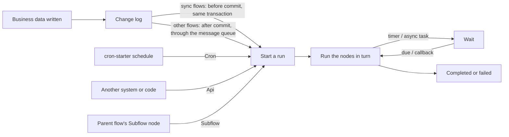
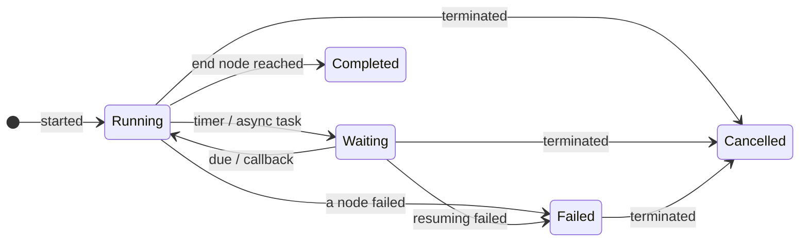

# Automation

An automation flow (scenario `AUTOMATION`) runs by itself when data changes, on a schedule, when called explicitly or from a parent flow, with no human approval step: syncing business data, sending notifications, calling external systems, generating files. As with approvals, every run is a persisted instance that can wait part-way (a timer, an async callback) and carry on; finished runs are purged after a retention period.



## How a run starts

An automation flow declares one trigger and starts from that one entry only:

| Trigger | Starts when | Notes |
|---|---|---|
| `EntityChange` | Rows of the given model are created, updated or deleted | May listen to some of those events only (`events`, empty = all) and carry a condition (AviatorScript) that must hold. Driven by change logs, so a model declared `@Model(enableAuditLog = false)` never fires it. One change log starts a flow at most once |
| `Cron` | The flow's own Quartz schedule comes round | Needs cron-starter and `mq.topics.cron-task.topic`; every fire is a new run — see [Cron-triggered flows](#cron-triggered-flows) |
| `Api` | Started explicitly by id | `POST /flow/instances/start`, or `FlowClient.start` / `publishAndStart` in process; matches no event |
| `Subflow` | Called by a parent flow's Subflow node | Must complete synchronously; no recursion |

`POST /flow/automation/trigger` posts a trigger event by hand (`Submit`, `Cron`, `Api` and `Subflow` events are refused); a debug run of a draft ignores the trigger.

## Sync and async

An automation flow started by a data change runs **asynchronously** by default; with `sync` it runs inside the business transaction:

| | Async (default) | Sync (`sync = true`) |
|---|---|---|
| When it runs | After the business transaction commits, through the message queue | Before the business transaction commits, inside it |
| When it fails | Only the run fails; the business write stands | The failure is recorded; with `rollbackOnFail` as well, the exception reaches the caller and the triggering write rolls back with it |
| Nodes it may use | Timers, async tasks, subflows and the rest | No timers, async tasks or approval steps — nothing that waits |
| Needs | `mq.topics.change-log.topic`; with `mq.topics.flow-event.topic` as well, matching and running move to the event consumer's thread pool | Nothing more |

Use sync for follow-up work or checks that must succeed together with the write; use async for the rest, so business writes are neither slowed nor broken by it. A write whose context turns flow triggering off (`triggerFlow = false`) starts neither kind.

## Running, waiting and resuming



- **Timer**: waits for a duration, a cron (Spring's 6-field format, not the trigger's Quartz) or a deadline, and is woken by a message on `mq.topics.flow-timer.topic`. The module ships only the consuming side; the scheduler that publishes `FlowTimerMessage` comes from the host application, and the overdue-timer sweep among the maintenance crons picks up wake-ups that were missed.
- **Async task** (`AsyncTask`): hands the work to something outside (`mq.topics.flow-async-task.topic`) and carries on from where it stopped when the callback arrives.
- **Subflow**: calls an automation flow with a `Subflow` trigger, running its active revision at the time; the subflow must complete synchronously — once it waits, the parent fails.
- **Parallel**: `ParallelFork` branches run one after another in a fixed order; the gateway models routing, not concurrency.
- Timers and async tasks resume by calling the engine in process; there is no REST endpoint for either.

## Errors, retries and troubleshooting

- A failing node follows its `errorStrategy`: `Fail` (default) fails the run; `Retry` retries `retryCount` times at once, then fails. It is set in the flow JSON only.
- A failed run stays `Failed` until an administrator terminates it; `GET /flow/monitor/health` reports instance counts per status and overdue timers.
- Every fire writes an event-log entry (`FlowEvent`, see [Event Logs](./api#event-logs)): which flow it matched and whether it succeeded; a single event carries the raw trigger parameters, for "why did it not run / how many times did it run".
- Finished automation runs, with their trace, parallel branches and event log, are purged by a maintenance cron after `flow.automation.retention-days` (default 30); approval instances are kept.
- Automation runs send no completion notification: the user whose write fired one need not hear about it, and failures are for operators to watch in the monitor.
- The designer can debug-run the current draft: it never joins the revision list, but **its writes are real**; debug runs are purged after `flow.debug.retention-days` (default 7).

## Validation and compute flows

The `VALIDATION` and `COMPUTE` scenarios are **evaluated on the spot**: the engine walks the nodes the same way but creates no instance, keeps no trace and writes no event log; business writes their task nodes make still join the caller's transaction, so a failed evaluation rolls back. Both declare their output variable names (`declaredOutputs`) and end with a `ReturnValue` node that returns the result.

| Scenario | For | Triggers | Called through |
|---|---|---|---|
| `VALIDATION` | Synchronous checks before saving | `EntityChange`, `Cron` | `POST /flow/automation/validate`: runs against candidate row data and returns each flow's declared outputs by `flowId` |
| `COMPUTE` | Synchronous computation, form onchange | `FieldChange`, `EntityChange`, `Cron` | `POST /flow/automation/onchange`: returns the variable diff |

## Task Execution Model

Executor-backed task nodes use `TaskNodeConfig`. The node **`FlowNodeType`** selects the executor — there is no separate `executor` field in config.

```json
{
  "input": {
    "to": ["{{ applicantEmail }}"],
    "subject": "Order {{ orderId }} confirmed",
    "htmlBody": "<h1>Thank you for your order!</h1>"
  },
  "outputVariable": "taskResult"
}
```

- `input` supports `{{ expr }}` interpolation; resolution is owned by the executor (type-aware for data executors, recursive interpolation for free-shape payloads)
- `options` is executor-specific
- `outputVariable`, when present, stores the raw executor result under one variable name

Every task node type has a **typed input config DTO** registered in `TaskConfigTypes`: the compiler parses `config.input` into the DTO at publish time and rejects missing required keys (`MISSING_REQUIRED_INPUT`), so a misconfigured node fails at publish instead of mid-execution. `DefaultTaskExecutorRegistry` asserts at boot that every registered executor's node type has such an entry.

### Bundled Task Executors

| Node type | Executor bean | Notes |
|---|---|---|
| `CREATE_RECORD` | `CreateDataTaskExecutor` | Built in |
| `GET_RECORD` | `GetDataTaskExecutor` | Built in |
| `UPDATE_RECORD` | `UpdateDataTaskExecutor` | Built in |
| `DELETE_RECORD` | `DeleteDataTaskExecutor` | Built in |
| `QUERY_RECORDS` | `QueryRecordsTaskExecutor` | Built in; opt-out via `flow.task.builtin.query-records.enabled=false` to register a custom executor |
| `VALIDATE_DATA` | `ValidateDataTaskExecutor` | Built in |
| `TRANSFORM` | `ExtractTransformTaskExecutor` | Built in |
| `CALL_WEBHOOK` | `WebHookTaskExecutor` | Built in |
| `CALL_SERVICE` | `CallServiceTaskExecutor` | **Disabled by default**. Opt-in via `flow.task.builtin.call-service.enabled=true`; a non-empty `flow.task.call-service.allow-list` of permitted bean-name prefixes is then mandatory |
| `SEND_EMAIL` | `SendEmailTaskExecutor` | Registered only when `MessageService` is available |
| `SEND_SMS` | `SendSmsTaskExecutor` | Registered only when `MessageService` is available |
| `SEND_INBOX_NOTIFICATION` | `SendInboxNotificationTaskExecutor` | Registered only when `MessageService` is available |
| `QUERY_AI` | `QueryAiTaskExecutor` | Registered only when `AiRobotService` is available |
| `ASYNC_TASK` | `AsyncTaskExecutor` | Registered only when `FlowAsyncTaskProducer` is available |
| `GENERATE_FILE` | `GenerateFileTaskExecutor` | Registered only when `DocumentTemplateService` (file-starter) is available |

Current module notes:

- `CALL_SERVICE` ships a bundled executor but is **disabled by default**: it invokes an arbitrary Spring bean method by name, so it must be explicitly enabled and given a non-empty bean-name allow-list.

## Trigger And Messaging Integration

Supported trigger sources (`TriggerSource` sealed sub-types), each the start contract of the flows that declare it (see [Flow Scenarios](./index#flow-scenarios) for which scenario takes which):

- `EntityChange` — a change log of the model. Each change log starts a run at most once per flow: its `uuid` travels as the event id onto `FlowInstance.triggerEventId` (unique with the flow), so a redelivered change log returns the run it already started, while distinct changes of one row each start their own
- `Cron` — the flow's own Quartz schedule; started only by it (see [Cron-triggered flows](#cron-triggered-flows)): other cron jobs' ticks never start it, and `POST /flow/automation/trigger` refuses the type
- `FieldChange` (COMPUTE scenario only)
- `Api` (AUTOMATION scenario only) — started explicitly by id; no event matches it, and `POST /flow/automation/trigger` refuses the type
- `Subflow` (AUTOMATION scenario only) — run only from a parent's Subflow node; refused as an event likewise
- `Submit` (APPROVAL scenario only) — names the model whose records the flow approves and, optionally, a condition over the record. Started only by record submission (see Approving Business Records); change logs never produce it and `POST /flow/automation/trigger` refuses it

`EntityChange` is fired from the change log, so a model declared `@Model(enableAuditLog = false)` never triggers it, synchronously or asynchronously — see [Audit log switch](../../backend_dev/model_dev/annotation#audit-log-switch-enableauditlog).

Pulsar-connected components are conditionally registered:

| Property | Component | Purpose |
|---|---|---|
| `mq.topics.flow-event.topic` | `FlowEventProducer`, `FlowEventConsumer` | Async trigger fire and consume |
| `mq.topics.flow-async-task.topic` | `FlowAsyncTaskProducer`, `FlowAsyncTaskConsumer` | Async task dispatch and callback resume |
| `mq.topics.change-log.topic` | `ChangeLogFlowConsumer` | Entity change driven flow triggers |
| `mq.topics.cron-task.topic` | `CronFlowJobProvider`, `CronTaskFlowConsumer` | Cron-triggered flows on the cron schedule, and their start |
| `mq.topics.flow-timer.topic` | `FlowTimerConsumer` | Timer wake-up consume side |

Important timer note:

- The module includes the timer resume consumer.
- A scheduler or producer that publishes `FlowTimerMessage` still has to be provided by the host application or another integration module.

### Cron-triggered flows

A Cron-triggered flow owns its schedule: the trigger's `cronExpression`, in the Quartz format cron-starter runs (`second minute hour day-of-month month day-of-week [year]`, e.g. `0 0 9 ? * MON-FRI` for 09:00 on weekdays, in the scheduler's time zone). Publishing parses it the way the scheduler does: a blank expression fails with `CRON_MISSING_EXPRESSION`, one the scheduler cannot run with `CRON_INVALID_EXPRESSION`. Automation, Validation and Compute flows may run on a schedule, Approval flows may not (see [Flow Scenarios](./index#flow-scenarios)); a scheduled Validation or Compute flow is evaluated transiently, like any of their runs.

- **Scheduling.** `CronFlowJobProvider` is a cron-starter `CronJobProvider`: the scheduling leader reads every tenant's active Cron-triggered revisions (`FlowBundle.cronExpression`, copied from the trigger at publish) when it starts scheduling and again every 30 seconds, and runs one job per revision, named `flow:<bundleId>`. Publishing, activating another revision (rollback or roll-forward) and switching to another trigger therefore move or remove the schedule within 30 seconds, whichever instance did it — an execution due in between is skipped, never run twice; no `SysCron` row is written. Nothing is scheduled while `mq.topics.cron-task.topic` is not configured.
- **Tenants.** A tenant's flow runs in that tenant's context, and only while the tenant is active; a platform-shared flow (`tenantId = 0`) runs once in every active tenant, each run in that tenant's context. Without multi-tenancy (`system.enable-multi-tenancy=false`), every flow runs once, with no tenant.
- **Starting.** `CronTaskFlowConsumer` starts the revision a `flow:<bundleId>` message names (`FlowAutomationService.fireCron`), and only while it is still its flow's active revision: the job of a replaced revision firing before the leader's next read starts nothing. Every other cron message — the maintenance crons, other modules' jobs, a `SysCron` row whatever its name — is ignored, and no trigger event matches a Cron flow. The flow starts with no initiator and the time the schedule fired as variable `triggerTime`, and an Automation flow's fire is logged in `FlowEvent` like any other.
- **Every execution starts its own run**, even while the previous one is still running or waiting. An execution carries no event id, so unlike a change log, a redelivered cron message is not recognized as one that already ran.
