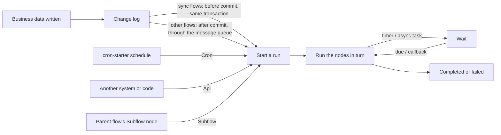
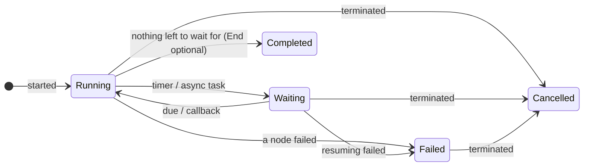

# Automation

<Lead>

An automation flow (scenario `AUTOMATION`) runs by itself when data changes, on a schedule, when called explicitly or from a parent flow, with no human approval step: syncing business data, sending notifications, calling external systems, generating files.

</Lead>

<RoleCards>
<RoleCard title="Administrators" href="#how-a-run-starts">Choosing a trigger, sync or async; how timers and async tasks wait and carry on, and how a subflow runs inside its caller in one go</RoleCard>
<RoleCard title="Operators" href="#errors-retries-and-troubleshooting">Failed runs, retries, the event log, and when finished runs are purged</RoleCard>
<RoleCard title="Developers" href="#task-execution-model">Task node configuration and its publish checks, the bundled executors, trigger sources and message topics</RoleCard>
</RoleCards>

As with approvals, every run is a persisted instance that can wait part-way (a timer, an async callback) and carry on; finished runs are purged after a retention period.



## How a run starts

<Lead>

An automation flow declares one trigger and starts from that one entry only: a data change, its own schedule, an explicit start by id, or a parent flow's call.

</Lead>

| Trigger | Starts when | Notes |
|---|---|---|
| `EntityChange` | Rows of the given model are created, updated or deleted | May listen to some of those events only (`events`, empty = all) and carry a condition that must hold — a rule over the record's fields or an AviatorScript expression, one or the other; on an update it sees the changed fields' new values only. This condition reads the changed record's own fields only; the flow's edge rules may also read on through relations, up to two levels, read when the run starts (see [two kinds of condition](./index#the-two-kinds-of-condition)). A condition that cannot be evaluated starts nothing and logs a failed fire. Driven by change logs, so a model declared `@Model(enableAuditLog = false)` never fires it. One change log starts a flow at most once |
| `Cron` | The flow's own Quartz schedule comes round | Needs cron-starter and `mq.topics.cron-task.topic`; every fire is a new run — see [Cron-triggered flows](#cron-triggered-flows) |
| `Api` | Started explicitly by id | `POST /flow/instances/start`; matches no event |
| `Subflow` | Called by a parent flow's Subflow node | Runs inside its caller, in one go: no nodes that wait — a timer, an async task (checked on publish, `SUBFLOW_WAITS`); no calling a flow already running above it |

`POST /flow/automation/trigger` posts a trigger event by hand (`Submit`, `Cron`, `Api` and `Subflow` events are refused).

### Cron-triggered flows

A Cron-triggered flow owns its schedule: the trigger's `cronExpression`, in the Quartz format cron-starter runs (`second minute hour day-of-month month day-of-week [year]`, e.g. `0 0 9 ? * MON-FRI` for 09:00 on weekdays, in the scheduler's time zone). Automation flows may run on a schedule, Approval flows may not (see [Flow Scenarios](./index#flow-scenarios)).

- **At most once a minute**: the second field is a single value (`0`, say), so `* * * * * ?` or `0/10 * * * * ?` is refused. Publishing parses the expression the way the scheduler does: one that is blank, that the scheduler cannot run, that fires more than once a minute or that never fires again, cannot be published. Publishing judges the expression; a revision published before the rule keeps its schedule until it is published again.
- **The designer shows the same judgment**: beside the expression, with its meaning in words and its next runs in the server's zone; a Timer node's cron is read the same way.
- **The schedule follows the flow**: only enabled flows are scheduled. Publishing, activating another revision (rollback or roll-forward), switching to another trigger and disabling or enabling the flow move, add or remove the schedule within 30 seconds, whichever instance did it — an execution due in between is skipped, never run twice.
- **Tenants**: a tenant's flow runs in that tenant's context, and only while the tenant is active; a platform-shared flow (`tenantId = 0`) runs once in every active tenant, each run in that tenant's context. Without multi-tenancy (`system.enable-multi-tenancy=false`), every flow runs once, with no tenant.
- **Started by its own schedule only**: other cron jobs' ticks never start it, and no trigger event matches a Cron flow. The flow starts with no submitter and the time the schedule fired as variable `triggerTime`, and an Automation flow's fire is logged in `FlowEvent` (the event log) like any other.
- **Every execution starts its own run**, even while the previous one is still running or waiting. An execution carries no event id, so unlike a change log, a redelivered cron message is not recognized as one that already ran.

<Dev title="Diagnostics and scheduling internals (CronFlowJobProvider, CronTaskFlowConsumer)">

- On publish, a blank expression fails with `CRON_MISSING_EXPRESSION`, one the scheduler cannot run — or that fires more than once a minute, or never again — with `CRON_INVALID_EXPRESSION`. The designer's judgment comes from `GET /flow/cron/preview`.
- **Scheduling.** `CronFlowJobProvider` is a cron-starter `CronJobProvider`: the scheduling leader reads every tenant's active Cron-triggered revisions (`FlowBundle.cronExpression`, copied from the trigger at publish) when it starts scheduling and again every 30 seconds, and runs one job per revision, named `flow:<bundleId>`, for the enabled flows only; no `SysCron` row is written. Nothing is scheduled while `mq.topics.cron-task.topic` is not configured.
- **Starting.** `CronTaskFlowConsumer` starts the revision a `flow:<bundleId>` message names (`FlowAutomationService.fireCron`), and only while it is still its flow's active revision: the job of a replaced revision firing before the leader's next read starts nothing. Every other cron message — the maintenance crons, other modules' jobs, a `SysCron` row whatever its name — is ignored.

</Dev>

## Sync and async

<Lead>

An automation flow started by a data change runs asynchronously by default, after the business transaction commits; with `sync` it runs before the commit, inside the same transaction.

</Lead>

| | Async (default) | Sync (`sync = true`) |
|---|---|---|
| When it runs | After the business transaction commits, through the message queue | Before the business transaction commits, inside it |
| When it fails | Only the run fails; the business write stands | The failure is recorded; with `rollbackOnFail` as well, the exception reaches the caller and the triggering write rolls back with it |
| Nodes it may use | Timers, async tasks, subflows and the rest | No timers, async tasks or approval steps — nothing that waits |

Use sync for follow-up work or checks that must succeed together with the write; use async for the rest, so business writes are neither slowed nor broken by it. A write whose context turns flow triggering off (`triggerFlow = false`) starts neither kind.

<Dev title="Topics it needs">

Async needs `mq.topics.change-log.topic`; with `mq.topics.flow-event.topic` as well, matching and running move to the event consumer's thread pool. Sync needs nothing more.

</Dev>

## Running, waiting and resuming

<Lead>

A run stops to wait at a timer or an async task and carries on from where it stopped when it is due or the callback arrives; a subflow runs inside its caller in one go, and parallel branches run one after another in a fixed order.

</Lead>



- **Timer**: waits one way — a duration (`durationSeconds`, at least a second), a cron (`cronExpression`) or a deadline (`deadlineExpression`, an AviatorScript expression resolving to a time) — else it cannot be published. Its cron is written the way a Cron trigger's is, in the scheduler's Quartz format, so a flow has one cron language: one the scheduler cannot run, that fires more than once a minute (its second field not a single value), or that never fires again, cannot be published; nor can a deadline that does not compile. It is woken by a message, which the module both sends and receives (see [Message topics](#message-topics)); the overdue-timer sweep among the maintenance crons picks up wake-ups that were missed.
- **Async task** (`AsyncTask`): hands the work to something outside and carries on from where it stopped when the callback arrives.
- **Subflow**: calls an enabled automation flow with a `Subflow` trigger, running its active revision at the time. A subflow is an automated step like any other, run inside its caller in one go: the designer offers only the flows it can call, and a flow with a `Subflow` trigger is refused on publish when it has a timer or an async task node (`SUBFLOW_WAITS`). What still goes wrong at run time — a target switched off or given another trigger since, a call back into a flow already running above it, a revision published before the rule stopping to wait — throws, and fails the automation run as any failing step does.
- **Parallel**: `ParallelFork` branches run one after another in a fixed order; the gateway models routing, not concurrency.
- Timers and async tasks resume by calling the engine in process; there is no REST endpoint for either.

<Dev title="Timer diagnostics and topics">

- A Timer that does not wait one of the three ways is `INVALID_TIMER_CONFIG` on publish; a cron it cannot accept is `INVALID_TIMER_CRON`; a deadline that does not compile, `INVALID_TIMER_DEADLINE`.
- A Timer is woken by a message on `mq.topics.flow-timer.topic`; an async task goes out through `mq.topics.flow-async-task.topic`.

</Dev>

## Errors, retries and troubleshooting

<Lead>

A failing node fails the run or is retried first; a failed run stays until an administrator terminates it, and every fire leaves an event-log entry for "why did it not run / how many times did it run".

</Lead>

- A failing node follows its `errorStrategy`: `Fail` (default) fails the run; `Retry` retries `retryCount` times at once, then fails. It is set in the flow JSON only.
- A failed run stays <Status>Failed</Status> until an administrator terminates it (running again is for an approval whose steps after an approval failed, see [When a step after an approval fails](./approval#when-a-step-after-an-approval-fails)).
- Every fire writes an event-log entry (the `FlowEvent` model, read through the generic model API — see [Event Logs](./api#event-logs)): which flow it matched, whether it succeeded, and the raw trigger parameters, for "why did it not run / how many times did it run".
- Finished automation runs, with their trace and event log, are purged after `flow.automation.retention-days` (default 30) by the maintenance cron `flow_automation_purge` — which ships switched off, so nothing is purged until it is switched on; approval instances are kept.
- Automation runs send no completion notification: the user whose write fired one need not hear about it, and failures are for operators to watch in the monitor.
- Automation flows have no test run: a run of one does what its nodes do. The designer's Test run is for approval flows only (see [Testing a draft](./approval#testing-a-draft)).

## Task Execution Model

<Lead>

A task node's executor is chosen by its node type; placeholders and required inputs are checked at publish the way they will run, so a misconfigured node fails at publish instead of mid-execution.

</Lead>

Executor-backed task nodes use `TaskNodeConfig`. The node **`FlowNodeType`** selects the executor — there is no separate `executor` field in config.

```json
{
  "input": {
    "to": ["{{ applicantEmail }}"],
    "subject": "Order {{ orderId }} confirmed",
    "htmlBody": "<h1>Thank you for your order!</h1>"
  },
  "outputVariable": "taskResult"
}
```

- `input` supports `{{ expr }}` interpolation; resolution is owned by the executor (type-aware for data executors, recursive interpolation for free-shape payloads). Publishing checks every placeholder in any node's settings the way it will run: an expression that compiles, a variable path, or a reserved reference `{{ @name }}` — closed and not empty — else it refuses the publish, naming the node and the setting
- `options` is executor-specific
- `outputVariable`, when present, stores the raw executor result under one variable name
- The input may also sit at the top of the config, one key per field, beside the node's own keys (`outputVariable`, `outputMapping`, `options`) — the way the designer writes it, field by field as the executor's descriptor (`getConfigSchema`) lists them

Every task node type has a typed definition of its input: the compiler parses the input with it at publish time and rejects missing required keys, naming the field where it sits, so a misconfigured node fails at publish instead of mid-execution. A node with no input filled in at all is no exception: each required key it lacks is reported.

A record node (`CreateRecord`, `GetRecord`, `UpdateRecord`, `DeleteRecord`, `QueryRecords`) is also checked against its model's metadata: the model must be one of the application's, and the paths its filters, orders and fields name must be ones the query can use — a mistyped field, a relation the path cannot go through, ordering by a to-many field or a condition on a field with no stored column is reported at publish, on the setting that names it, rather than when a run reaches the node. Placeholders in values are resolved by the run and do not affect the check.

<Dev title="Input parsing and publish checks (NodeConfigParser, TemplatePlaceholderValidator, TaskConfigTypes)">

- With no `input` map, everything else at the top is the input (`NodeConfigParser`); either form may also be wrapped in `task`. Read only from `input` before, a designed task node ran with no input and published without its required fields checked.
- `TemplatePlaceholderValidator` checks the placeholders; a bad one is `INVALID_TEMPLATE_PLACEHOLDER`, naming the setting as `to[1]` or `templateVariables.owner`.
- Every task node type has a **typed input config DTO** registered in `TaskConfigTypes`: the compiler parses the input into the DTO at publish time and rejects missing required keys (`MISSING_REQUIRED_INPUT`), naming the field where it sits — `config.input.url` in a nested config, `config.url` in a designed one. A node with no input — an empty config, or one holding only the node's own keys — is checked as an empty input, one diagnostic per missing required key. Before, only six types (`CallService`, `CallWebhook`, `SendEmail`, `SendSms`, `SendInboxNotification`, `AsyncTask`) were refused, with `MISSING_TASK_CONFIG`, and the rest published unchecked and failed when a run reached them; that code is gone.
- `DefaultTaskExecutorRegistry` asserts at boot that every registered executor's node type has such an entry.
- `TaskConfigValidator` checks the record nodes too: a model that does not exist is `UNKNOWN_MODEL` (`config.modelName`); the paths go to softa-orm's `FieldPaths` — filters by the WHERE's rules, orders by the ORDER BY's, fields by the read's — and each one that cannot be used is an `INVALID_FIELD_PATH` (`config.filters` / `config.orders` / `config.fields`); filters or orders that cannot be read the way the executor reads them (`AbstractTaskExecutor`) are `INVALID_TASK_CONFIG`. softa-orm's `FieldPathsMatchBuildersTest` keeps `FieldPaths` and the query builders to the same rules.

</Dev>

### Bundled Task Executors

| Node type | Executor bean | Notes |
|---|---|---|
| `CREATE_RECORD` | `CreateDataTaskExecutor` | Built in |
| `GET_RECORD` | `GetDataTaskExecutor` | Built in |
| `UPDATE_RECORD` | `UpdateDataTaskExecutor` | Built in |
| `DELETE_RECORD` | `DeleteDataTaskExecutor` | Built in |
| `QUERY_RECORDS` | `QueryRecordsTaskExecutor` | Built in; opt-out via `flow.task.builtin.query-records.enabled=false` to register a custom executor |
| `VALIDATE_DATA` | `ValidateDataTaskExecutor` | Built in |
| `TRANSFORM` | `ExtractTransformTaskExecutor` | Built in |
| `CALL_WEBHOOK` | `WebHookTaskExecutor` | Built in |
| `CALL_SERVICE` | `CallServiceTaskExecutor` | **Disabled by default**. Opt-in via `flow.task.builtin.call-service.enabled=true`; a non-empty `flow.task.call-service.allow-list` of permitted bean-name prefixes is then mandatory |
| `SEND_EMAIL` | `SendEmailTaskExecutor` | Registered only when `MessageService` is available |
| `SEND_SMS` | `SendSmsTaskExecutor` | Registered only when `MessageService` is available |
| `SEND_INBOX_NOTIFICATION` | `SendInboxNotificationTaskExecutor` | Registered only when `MessageService` is available |
| `QUERY_AI` | `QueryAiTaskExecutor` | Registered only when `AiRobotService` is available |
| `ASYNC_TASK` | `AsyncTaskExecutor` | Registered only when `FlowAsyncTaskProducer` is available |
| `GENERATE_FILE` | `GenerateFileTaskExecutor` | Registered only when `DocumentTemplateService` (file-starter) is available |

`CALL_SERVICE` ships a bundled executor but is **disabled by default**: it invokes an arbitrary Spring bean method by name, so it must be explicitly enabled and given a non-empty bean-name allow-list.

## Trigger And Messaging Integration

<Lead>

Each trigger source is the start contract of the flows that declare it and starts them from its own entry only; the Pulsar-connected components register only when their topic is set.

</Lead>

The supported trigger sources are `TriggerSource` sealed sub-types; see [Flow Scenarios](./index#flow-scenarios) for which scenario takes which:

| Source | Start contract |
|---|---|
| `EntityChange` | A change log of the model. Each change log starts a run at most once per flow: a redelivered change log returns the run it already started, while distinct changes of one row each start their own |
| `Cron` | The flow's own Quartz schedule; started only by it (see [Cron-triggered flows](#cron-triggered-flows)): other cron jobs' ticks never start it, and `POST /flow/automation/trigger` refuses the type |
| `Api` (AUTOMATION scenario only) | Started explicitly by id; no event matches it, and `POST /flow/automation/trigger` refuses the type |
| `Subflow` (AUTOMATION scenario only) | Run only from a parent's Subflow node; refused as an event likewise |
| `Submit` (APPROVAL scenario only) | Started when a record of the flow's model (its document) is submitted; it may also name, by a condition, which of its records it takes. Started only by record submission (see [Approving Business Records](./integration#approving-business-records)); change logs never produce it and `POST /flow/automation/trigger` refuses it |

`EntityChange` is fired from the change log, so a model declared `@Model(enableAuditLog = false)` never triggers it, synchronously or asynchronously — see [Audit log switch](../../backend_dev/model_dev/annotation#audit-log-switch-enableauditlog).

<Dev title="How a redelivered change log is recognized">

Each change log's `uuid` travels as the event id onto `FlowInstance.triggerEventId` (unique with the flow), which is how a redelivery finds the run it already started.

</Dev>

### Message topics

Pulsar-connected components are conditionally registered:

| Property | Component | Purpose |
|---|---|---|
| `mq.topics.flow-event.topic` | `FlowEventProducer`, `FlowEventConsumer` | Async trigger fire and consume |
| `mq.topics.flow-async-task.topic` | `FlowAsyncTaskProducer`, `FlowAsyncTaskConsumer` | Async task dispatch and callback resume |
| `mq.topics.change-log.topic` | `ChangeLogFlowConsumer` | Entity change driven flow triggers |
| `mq.topics.cron-task.topic` | `CronFlowJobProvider`, `CronTaskFlowConsumer` | Cron-triggered flows on the cron schedule, and their start |
| `mq.topics.flow-timer.topic` | `FlowTimerProducer`, `FlowTimerConsumer` | Timer wake-up: a delayed message per Timer node, and the resume |

Important timer note:

- With `mq.topics.flow-timer.topic` set, a Timer node schedules its own wake-up — `FlowTimerProducer` sends a delayed `FlowTimerMessage` for the instant the node computes — and `FlowTimerConsumer` resumes the instance when it arrives. Nothing else has to publish it.
- Without the topic, or for a wake-up lost on the way, only the maintenance cron `flow_timer_sweep` resumes the timers that are due (up to 200 a run, once per tenant); like the other maintenance crons it ships switched off.
