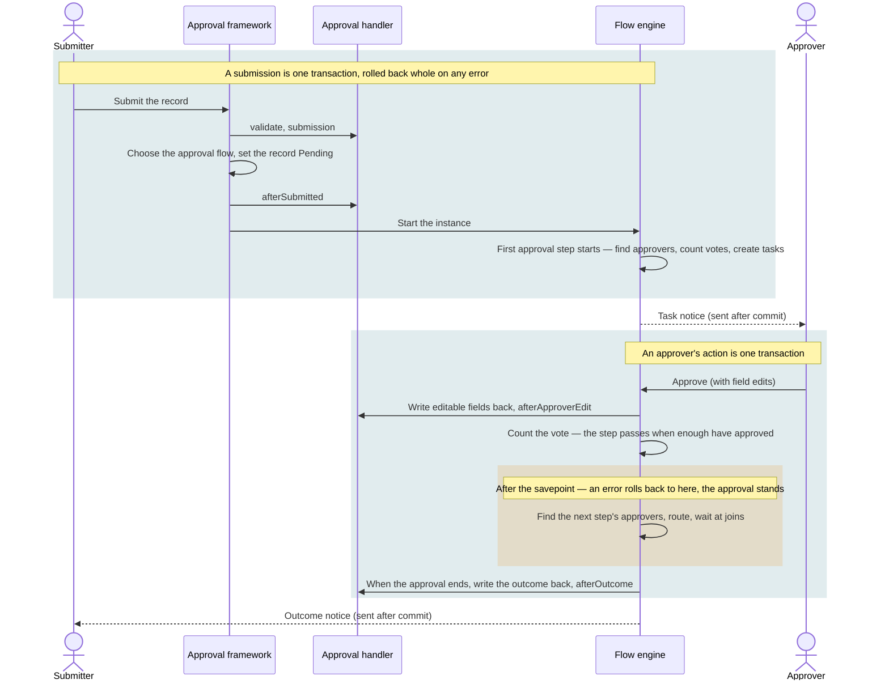

# Design notes

<Lead>

This page draws and tabulates a few parts of the approval design: which transaction a submission and an approval each run in, how branches are taken, and in what order an approval step decides who gets it — plus a glossary, known limitations and test points.

</Lead>

The rules themselves live in [Approval Flows](./approval), the [Overview](./index), [Automation](./automation), [Integration](./integration) and [API & Data](./api); this page does not repeat them and links to them instead.

## Glossary

<Lead>

The table gives the terms the Flow pages use and their names in the code; the submitter and the employee are not always the same person — when HR submits on an employee's behalf, the submitter is HR, while approvers looked up through the organization start from the employee.

</Lead>

| Term | In the code | Meaning |
|---|---|---|
| Flow (draft) | `FlowDesign` | The copy the designer edits; its id is the `flowId` everything refers to |
| Revision | `FlowBundle` | One per publish, immutable; an instance keeps the revision it started on, whatever is published later |
| Instance | `FlowInstance` | One run; every submission of a record is a new instance |
| Scenario | `FlowScenario` | Approval flow (`Approval`) or automation flow (`Automation`), chosen when the flow is created and fixed from then on |
| Trigger | `trigger` | The flow's one way to start, configured on its start node |
| Step | an approval node; `PendingApproval` at run time | One stay of an approval node in an instance |
| Submitter | the record's `submitterId`, the instance's `initiatorId` | The account that pressed Submit — possibly HR submitting on an employee's behalf. Only they withdraw, urge, or take back a failed approval |
| Employee | the handler's `subject()` (default `employeeId`), the instance's `subjectId` | The employee the record is about; approvers are found from them — their supervisor, their department. Not "applicant": on documents HR raises (a salary adjustment, a transfer) the employee applied for nothing |
| Approver | a login account id | Someone the current step found; they need an account that signs in |
| CC recipient | a CC task (`Cc`) | Someone an approver copied, or a CC rule did |
| Participant | `FlowParticipants` | The submitter and everyone the instance gave a task: they see the instance without any grant and comment while it runs. An administrator's actions make nobody a participant |
| Delegation rule, delegate | `FlowDelegation` | Within its period, routes the tasks arriving for an approver to the delegate; tasks already waiting stay where they are |
| Default approval flow | a `Submit` trigger without a condition | The document's approval flow with no submit condition; it takes a record when none of the conditioned flows does. At most one enabled per document |
| Effective | `enabled` + an active revision | Published and enabled; a submission chooses among these only |
| Default edge | the default edge (shown as Other) | The edge without a condition, always tried last |
| Fill-in step | `fillIn` on the task | A step with required fields: its approver's button reads Submit (still recorded as an approval), and it cannot be batch-processed |
| Take back | `takesBack` | After an approval failed, its submitter takes the record back to draft, whatever the withdraw policy |
| Run again | `RETRY`, `retryAfterNodeId` | An administrator carries an instance that failed after an approval on from the approval step before the failure |
| Assign to role | `AssignToRole` | A step that finds nobody goes to those who can act in the chosen roles; any one of them decides |
| Summary | `summary` | The handler's one-line description (at most 256 characters), copied onto the instance and its tasks at submission |
| Approval lock | `ApprovalLockValidator` | The write check that freezes a non-draft record and the lines it owns |
| Approval handler | `ModelApprovalHandler` | What a business module implements for each approval model — see [Integration](./integration) |
| Failure notice | `TENANT_ADMIN` | Besides the submitter, the tenant's administrators (the built-in `TENANT_ADMIN` role) hear that an approval failed; not configurable |

## Transaction boundaries

<Lead>

A submission is one transaction, an approver's action another; the steps after an approval run in the action's transaction behind a savepoint, so an error there rolls back to the savepoint only and the approval stands.

</Lead>

- **Submission**: the business checks, choosing the flow, setting the status, the after-submit action, starting the instance and the first approval step all run in the caller's one transaction. Any failure — the handler's check refusing, no approval flow applying, a step finding nobody under the `Error` strategy — rolls the whole submission back: the record stays a draft, no instance is kept and nobody is told. See [The main path](./approval#the-main-path).
- **An approver's action**: field edits that `afterApproverEdit` refuses, or an `afterOutcome` that throws (an insufficient balance, say), refuse the whole action; the record and the approval are as they were before it. What the approver can put right themselves (a step someone else already handled, a required field left empty) is refused the same way.
- **The exception: the steps after the savepoint** (the amber block). Nobody to approve the next step, no route out of a step, branches meeting a step wrongly roll back to the savepoint only: the approval stands, the instance becomes <Status>Failed</Status>, the record stays <Status>Pending</Status>, and the approver's request still succeeds. An approval flow holds people and routes only, so these steps write nothing, call nothing and send nothing. See [When a step after an approval fails](./approval#when-a-step-after-an-approval-fails).
- **Notices** are written after the action commits, in a transaction of their own: an action rolled back sends nothing, and a notice that cannot be written is only logged. A failure notice is the exception and goes out at once, since the failing attempt itself rolls back.
- **An administrator's terminate, run-again and reassign**, and **batch approvals**, act on each item in a transaction of its own: one failing leaves the others alone.

## Branching rules illustrated

<Lead>

A plain node takes one of its outgoing edges, in order; an inclusive gateway takes every edge that holds; a parallel fork takes them all; and branches that may run together meet only at a join or an end.

</Lead>

The rules are in the [Overview · Routing: Edge Conditions](./index#routing-edge-conditions) and [Caught at publish](./approval#caught-at-publish).

<FlowFigure name="branchesEn">

Each row is one example, matching one rule below. A diamond is a gateway: a circle inside marks an inclusive gateway, a plus a parallel fork, and the diamond paired with it on the right is its join. A dashed line is one not taken.

</FlowFigure>

- **A plain node's several outgoing edges: one is taken, in order.** The edges are tried by their number, and the first whose condition holds is taken — the rest are not read; when none holds, the default edge (Other) is. A node with several conditional edges must have a default edge.
- **Inclusive gateway: every edge that holds is taken, then they meet.** Other is taken only when none holds. A branch not taken counts as arrived at the paired join, which waits only for the branches taken and goes on once.
- **Parallel: all are taken, the join waits for all.** A parallel fork reads no conditions and takes every edge (in a fixed order, one after another); its join goes on once every incoming edge has arrived.
- **Refused at publish: branches meeting without a join.** Branches that may run together (a parallel fork's edges, an inclusive gateway's conditional edges) may meet only at a join or an end, else `CONCURRENT_BRANCHES_MEET`: the HR review in the figure would run once per branch, asking its reviewer twice. Route them into a join first, then to the review.

## When an approval step starts

<Lead>

When an approval step starts, the engine finds approvers by its rules, counts the votes, gives a delegate the seat of an approver who has one, counts the submitter and earlier approvers as approved where the flow's settings say so, and creates tasks for those yet to act — all within the request that moved the instance into the step (at submission, inside the submission's transaction).

</Lead>

<FlowFigure name="stepStartEn">

Left to right is what the step does, in order. Two cases need nobody to wait for, create no task and go straight on to the next step: the step found nobody and its strategy approves automatically, or the automatic approvals already make the votes it needs.

</FlowFigure>

1. **Find approvers**: the people each group names or finds make one pool, each once; accounts that cannot sign in are dropped silently, and a supervisor or department head who cannot approve passes the step up. See [Approver Resolution](./approval#approver-resolution).
2. **Nobody found**: the step's strategy decides — `Error` (the default), `AutoApprove` (recorded as `Auto-approved (no approver)`), or `AssignToRole` (those who can act in the roles, any one deciding; a submitter or employee among them is an approver like any other; votes are counted on). A step that only names its people stops with an error whatever it holds.
3. **Count votes**: the approval mode gives how many must approve, capped by the approvers the step has. See [Approval Threshold](./approval#approval-threshold).
4. **Apply delegation**: an approver with a delegation rule in force has the task go to the delegate, the votes unchanged; not when the delegate cannot act or is already on the step.
5. **Submitter and dedup**: a submitter among the approvers is counted as approved under the flow's "when the submitter is an approver" setting (the employee is not, when someone else submitted); someone who approved an earlier step is, under approver dedup. See [Auto-approval](./approval#auto-approval).
6. **Create tasks**: the approvers yet to act get tasks and notices, and the instance waits.

## Known limitations

<Lead>

The table lists the known limitations and what to do about each — the small error and wording gaps are not scheduled yet — and the requests that are not planned follow it.

</Lead>

| Topic | Today | Suggestion |
|---|---|---|
| Sensitive fields are not routing variables | Encrypted or masked fields are not handed to the flow, so edge rules cannot read them, through a relation either | To branch on one, have the approval handler work out a non-sensitive value and add it to the routing variables (see [Routing variables](./integration#routing-variables)) |
| Accounts that stop working | Tasks already assigned to someone who later leaves or is frozen are not moved; a delegate who later cannot act makes the delegation lapse, recorded in the trace only, with no notice | An administrator reassigns them |
| Revisions published earlier | They keep running and are refused only when published again: an approval flow still holding nodes other than people and routes runs them, a failure there fails the approval (the approval kept), and running it again may resend an email or webhook sent before the failure; a cron whose second field is not a single value keeps its schedule | After upgrading, find such flows; before publishing again, remove those nodes and move what an approval's outcome should set off into an automation flow started by the approval's result; make the cron fire at most once a minute |
| No list snapshot on older approvals | The employee, department, effective date, record number and summary are copied onto the instance and its tasks at submission, so only approvals submitted since have them; an approval without a department is invisible to an administrator scoped by department | The deploying application's release script backfills them |
| Small error and wording gaps | A submit condition that cannot be evaluated at run time (comparing text with a number), and a branch error on a revision published before the checks, return a system error with the reason only in the log; the missing-comment refusal for reject and return names the node id, not its label; withdrawing through the record endpoint (`POST /{Model}/withdraw`) does not limit the comment to 256 characters; the designer's node expression control still shows the placeholder `{{ amount > 1000 }}` (the same result as without braces, only unlike the edge's) | Not scheduled |

### Not planned

- Returning to a step in the middle: a return always goes back to the submitter, who edits and submits again, from the first step.
- Acting on overdue steps (silence as consent, automatic rejection or hand-over), working-day calendars, warnings before a step falls due, telling an administrator at the last reminder: an overdue step only sends reminders — see [Overdue Reminders](./approval#overdue-reminders).
- Cancelling requests nobody acted on for a long time.
- A "Rejected" tab, or a separate task type for "waiting on the submitter".
- A generic workflow table and a global approval serial number.
- Draft collections across document types.
- Administrator comments: an administrator's actions make nobody a participant.
- Rewriting steps of a running approval not reached yet: such a step finds its approvers by its configuration when reached.
- One-click approval from an email.
- Other notice channels (DingTalk, say): an application adds them — see [Notifications](./approval#notifications).

## Test points

<Lead>

Design cases as combinations of status × role × configuration; each point below follows one rule.

</Lead>

### Record status

- A draft can be edited, deleted, submitted and cancelled; editing, deleting or adding lines under a record in approval is refused.
- Approved, rejected and cancelled are final: every change is refused.
- A return or a withdrawal makes the record a draft again; submitting it again starts a new approval from the first step, the record number unchanged.
- A failed approval: the record stays in approval; the submitter takes it back → draft; an administrator terminates it → cancelled; after a failure in the steps after an approval, an administrator runs it again → the approval goes on.

### Submitting and choosing the flow

- No flow applying, several applying, no employee on the record: each refused with a clear reason.
- Default approval flow: when no conditioned flow holds, the one without a condition takes the record; after copying the default flow and giving the copy a condition, matching records go to the copy and the rest still to the default; with no default flow and no condition holding, the submission is refused.
- Two enabled approval flows of one document with the same condition (or both without one): publishing, enabling and rolling back are refused.
- A step finds nobody at submission under `Error`: the submission fails and the record stays a draft; no failed approval is kept and nobody is told; the message names the step and why.
- When the preview shows a step that finds nobody, the form's Submit shows the reason instead.
- The same record submitted twice at once: only one succeeds.
- A record the submitter cannot reach within the range their roles may edit it in cannot be submitted or cancelled (a read-only range is not enough), reported as not existing.
- The approval path preview matches the steps after the real submission.

### Finding approvers

- The N-th supervisor, from the employee or from the submitter (they differ when HR submits on someone's behalf); a level who cannot approve passes the step to the first one above who can.
- A missing department head, or one who cannot approve, defers to the parent department's; by role, by position, department members.
- An account that cannot sign in (none, not activated, invitation not accepted, frozen, left) counts as nobody; the three strategies when nobody is found: error, auto-approve, assign to role.
- A step that only names its people stops with an error when none of them can act.
- Assign to role: any role member decides; a submitter or employee among them is an approver like any other (the submitter's own step goes as "when the submitter is an approver" has it).
- While a delegation rule is in force, new tasks go to the delegate; not when the delegate's account cannot act; tasks already waiting are untouched.

### Votes and automatic approval

- Any one, unanimous, at least N and percentage govern approval only, and show and apply only where a step may have several approvers; with one named person, or a supervisor, department head or HRBP, one approval passes the step.
- One rejection rejects, whatever the step's votes; an approver who already approved the step cannot reject it.
- Fewer approvers found than the threshold: capped by headcount, never stuck.
- One person, one vote per step.
- Submitter as approver: auto-approve or require approval; a general manager's own request on a step naming the general manager passes by default. When someone else submitted and the employee is an approver of a step, they always approve themselves.
- Approver dedup: global, contiguous, none.

### Approver actions

- Approving with field edits: only editable and required fields are saved; an empty required field is refused; hidden fields are not shown; a refusal by `afterApproverEdit` refuses the whole action.
- A step with required fields shows Submit, is recorded as an approval, and cannot be batch-processed.
- Reject and return need a comment; a comment over 256 characters is refused; without returns on the flow, there is no Return button and the API refuses it.
- Transfer and CC (several people at once; those already on the step are skipped) and marking read; an unusable target is refused with the reason; the approver's menu has no add-approver and no delegate.
- Acting on a step someone else already handled asks to refresh.
- Comments only from participants, none after the approval ends; administrators cannot comment.

### Failures after an approval

- Nobody for the next step, no route, branches meeting wrongly: the approver's approval succeeds, the instance fails, the record stays in approval, and the submitter and the failure-notice roles are told.
- The submitter can take the record back to draft.
- After an administrator runs it again it goes on, writes the outcome back as usual, and sends the Approved notice and the once-approved CCs.
- No run-again once the record was taken back or submitted again.

### Withdrawing and urging

- Three withdraw policies; "before the first action" closes at the first human action, an automatic approval not counting.
- Only the submitter withdraws; the Withdraw button shows exactly when the API would accept it.
- Urging again within the urge interval (hours, default 4) is refused with the time it may be urged again; with urging switched off, the submitter cannot urge, an administrator still can.

### Batch approval

- Tasks with required fields, approvals not waiting, and tasks not the user's own cannot be batch-processed, and the reason is shown.
- One at a time, a result each: the succeeded leave the list, the skipped and failed stay.
- A batch return skips approvals whose flow allows no return, and says how many beforehand.
- At most 100 at once.

### Administrators

- The monitor lists only approvals within the caller's data scope; scoped by department (the employee's department copied onto the instance), they see and act on those departments' approvals only; approvals without a department (automation runs, older approvals) only an "all" scope sees.
- Terminate only a running, waiting or failed approval; a reason is required; the record is cancelled and the submitter told; an approver whose task the termination closed can still open the approval from the email.
- Reassign: the preview counts the affected tasks; a reason is required; the original approver can be someone who left; a new approver already on the step merges with the old seat, and when that leaves the step with every approval it needs (an all-approve step of A, B and C, A and B approved, C reassigned to A) the step passes there and then and the approval goes on; the history shows the administrator.
- Delegation on behalf: the approver sees the rule among theirs and can cancel it.
- Every delegation: each rule of the tenant is listed (the ended and cancelled ones included), filtered by approver, delegate and status; a status filter holds the rules showing that status; one set up on someone's behalf shows the administrator as who set it up.

### Notices and CC

- Each event's recipients and content; with email switched off on the flow, inbox only.
- A user without an email address gets inbox notices only; without a site URL the email has no link; without the tenant's mail template no email is sent.
- A failure after the approval started tells the submitter and the failure-notice roles at once; a failure at submission tells nobody.
- After acting on an approval, or opening its page, the user's unread inbox notices about it become read, and their CCs read.
- CC rules: on submit, once approved, once rejected; recipients found by rule; a rule's CC has no actor.
- The once-approved CC goes out however the approval ends (the last approval, a run-again, a reassignment that completes the step), recorded on the approval step completed last.

### Designer and publishing

- A node without a name, an unreachable node, an approval node without approvers, a field without a permission, assign-to-role without a role: not publishable.
- A node choosing one of several edges without a default edge, or with the default before a conditional edge: not publishable; conditional edges are tried in order and the default always last (shown as Other).
- Branches meeting at a node without a join, an inclusive gateway's branches not paired with a join, a join with several outgoing edges, a parallel branch bypassing its join: not publishable.
- A new flow is either an approval flow or an automation flow; an approval flow holding nodes other than people and routes is not publishable.
- A cron firing more than once a minute (`* * * * * ?`, `0/10 * * * * ?`) is not publishable, and the designer's preview says so; second `0` is fine.
- Approver and CC sources are specific people, supervisor, department head, department HRBP, role, position and department members only.
- A document without an approval handler can get no new approval flow and publishes none.
- Named approvers or CC recipients who cannot act are warnings only; an approval flow without an approval step is a warning only.
- Values such as `ANY_ONE` or `ERROR` saved by an earlier designer are reported as unreadable; choosing them again makes the flow publishable.
- After publishing, approvals in progress keep their revision; after a rollback new submissions use the older one; a copy is an unpublished draft; a flow with unfinished instances cannot be disabled; a published flow cannot be deleted.
- Opening a flow validates it, and the diagnostics bar shows the result (No issues when there are none).
- Test run (approval flows only): changing the submitter or a field changes the route and each step's approvers; a submit condition that does not hold is flagged first; afterwards there are no new instances, tasks, inbox notices or emails, and the revision list is unchanged.

### Visibility and pickers

- A sensitive field a step lists as read-only is shown to its approver; hidden fields stay hidden from CC recipients and earlier approvers too; a one-to-many listed as visible comes with complete lines.
- People pickers list only accounts that sign in, within the role's scope on the directory model; calling `/flow/directory/people` without the matching page permission is refused.
- Someone neither a participant nor able to read the instance or the record cannot open the approval; an administrator who can read only the instance sees the approval but not the record.
- Opening an approval link after the session expired → sign in → back on that page; external addresses are not followed.

### Boundary values

- Batch approval at most 100 tasks; batch terminate and run-again at most 100 instances each.
- Comments, reasons and run-again notes at most 256 characters; the summary at most 256 (cut beyond); inbox titles over 200 characters are cut.
- At most 3 overdue reminders (not configurable); urge interval and reminder hours at least 1.
- The directory returns at most 200 people per page (default 20).
- A cron fires at most once a minute.

<Dev title="Other error messages (for checking)">

The common ones are in [Approval Flows · When things go wrong](./approval#when-things-go-wrong); these are the rest.

| Case | Message |
|---|---|
| Out of scope / no such record | `The {0} record {1} does not exist.` |
| Cancelling a non-draft | `Only a draft can be cancelled; this record is {0}.` |
| Editing or deleting a finished record | `This record is approved and cannot be changed.` (rejected and cancelled read `was rejected` / `was cancelled`) / `An approved record cannot be deleted.` (`A rejected…` / `A cancelled…`) |
| Editing lines of a record in approval / an approval field | `The record this belongs to is in approval and cannot be changed. Withdraw it first to edit it.` / `This field is set by the approval and cannot be edited.` |
| Creating outside one's data scope | `The record is outside your data scope.` |
| Step no longer waiting | `This step no longer waits for approval: it may have been handled already. Refresh to see where the approval stands.` |
| People and steps | `{name} is not an approver of step '{label}'.` / `{name} has already approved step '{label}'.` (rejected likewise) |
| CC | `Choose at least one person to CC` / `Nobody to CC: everyone chosen is an approver of this step or has been CC'd on it already` |
| Required field empty | `Form validation failed: Field '{field}' is required` (several joined with `; `) |
| Reason or note too long / batch too large | `reason: The reason can be at most 256 characters` (terminate, reassign) / `comment: The note can be at most 256 characters` (run again) / `tasks: At most 100 tasks can be acted on at once` |
| Batch skips | `This step has fields to fill in: open it to act on it.` / `This approval does not allow returns.` |
| Withdrawal refused (others) | `Flow instance is not waiting for approval and cannot be withdrawn: {id}` / `Only the initiator can withdraw this flow instance: {id}` / `This record has no approval in progress to withdraw.` / `Only the submitter can withdraw the record after its approval failed: {model} {rowId}` |
| Urging | `The pending approvers of instance {id} were urged recently and may be urged again after {time}` / `Flow instance does not allow its initiator to urge the approvers: {id}` / `Only the initiator can urge the approvers of flow instance: {id}` |
| Comments | `Flow instance has ended and takes no more comments: {id}` / `Only the initiator and the people flow instance {id} gives a task to may comment on it` |
| Terminate | `A reason is required to terminate flow instance {id}` / `Only an instance that is running, waiting or failed can be terminated; {id} is {status}` |
| Run again | `Only an approval whose steps after an approval failed can be run again; terminate any other failed instance instead.` / `The record was submitted again after this approval failed: it waits on its new approval, and this one cannot run again.` / `The record is no longer in this approval — its submitter took it back, or it was removed — so the approval cannot run again.` |
| Reassign | `A reason is required to reassign approval tasks` / `The new approver must be someone else` |
| Delegation rules (others) | `Choose the approval flow the delegation is for` / `Choose the approval step the delegation is for` |
| Managing flows | `Flow '{0}' would take the same {1} records as '{2}': neither has a submit condition. Give it a condition of its own, or disable '{2}'.` (with equal conditions: `their submit conditions are the same`) / `Flow '{0}' cannot be disabled: {n} of its instances have not finished — records still in approval among them. Let them finish, or end them in Flow Instances, first.` / `Flow '{0}' cannot be disabled: {callers} call it as a subflow. Disable or change them first.` / `A published flow cannot be deleted: its revisions, instances and approval history refer to it. Disable it instead.` |

</Dev>
