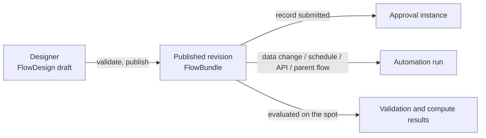

# Flow

`flow-starter` is Softa's metadata-driven flow engine starter. It covers:

- design-time graph documents for a visual editor
- compile-time validation and transformation into runtime bundles
- published bundle revisions by `flowId`
- runtime execution for approval, automation, validation, and compute flows
- persistent projections for instances, approval tasks, approval records, delegations, CC rules, and trigger events
- optional Pulsar-based trigger and async-task integration

The pages in this section document the current backend contract of `flow-starter`:

| Page | What it covers |
|---|---|
| [Approval Flows](./approval) | How a record enters approval, how its status moves, what approvers can do, how the outcome is written back, and the constraints, errors and notifications |
| [Automation](./automation) | How automation flows start (data change, schedule, API, subflow), sync and async runs, waiting and resuming, task nodes; validation and compute flows |
| [Integration](./integration) | Putting a business model through approval: model, controller, approval handler, default flows as seeds, and the host application checklist |
| [API & Data](./api) | REST APIs, instance search, approval projections, the monitor, the persistence model, node descriptors |

## Current Model

### Design, Publish, Runtime

| Layer | Main types | Notes |
|---|---|---|
| Design time | `DesignFlowDefinition`, `FlowGraphDocument`, `FlowGraphNode`, `FlowGraphEdge` | Editor-facing graph DTOs |
| Publish time | `FlowCompiler`, `CompiledFlowDefinition`, `FlowPublishService` | Compile, validate, publish revisions, rollback |
| Runtime | `FlowRuntimeEngine`, `FlowExecutionState` | Execute published bundles, suspend/resume, persist projections |

### Flow Identity And Revisions

- `FlowDesign` is the draft working copy. Its `id` (a distributed string id) is the flow's identity everywhere: bundles, instances, tasks, approval records, events, delegations and CC rules reference it as `flowId`, and lists show the flow's name through that reference.
- `flowName` is unique within a tenant; there is no separate flow code.
- `FlowBundle` is the compiled published snapshot; published revisions are keyed by `flowId`.
- `FlowStartRequest` resolves bundles in this order:
  1. `bundleId` — pin to an exact published revision
  2. `flowId` — start the current active revision
- To start a specific historical revision, look up its `bundleId` via the revisions listing endpoint and pass that as `bundleId`.
- `FlowBundle.designJson` keeps the design snapshot used at publish time so the editor can restore a historical canvas.

### Flow Scenarios

A single `FlowScenario` enum declares what a flow is. It is chosen when the flow is created and fixed from then on (`FlowDesign.scenario` is readonly on update; the design document follows the column).

| Scenario | Meaning | Triggers it may declare |
|---|---|---|
| `APPROVAL` | A record's approval: started by submitting the record, approval steps, the outcome written back to the record. Persisted instances, kept as the record's approval history | `Submit` |
| `AUTOMATION` | Started by a change, a cron, an explicit start or a parent flow; no approval steps. Persisted runs, purged after their retention period | `EntityChange`, `Cron`, `Api`, `Subflow` |
| `VALIDATION` | Stateless synchronous validation flow — evaluated transiently: no instance row, no trace, no event log | `EntityChange`, `Cron` |
| `COMPUTE` | Stateless synchronous compute/onchange flow — evaluated transiently, same zero-footprint rules | `FieldChange`, `EntityChange`, `Cron` |

The scenario decides the execution strategy: `APPROVAL` / `AUTOMATION` flows go through `FlowRuntimeEngine.start` (persisted, resumable); `VALIDATION` / `COMPUTE` flows go through `evaluate` — the same traversal with zero flow footprint. Business writes made by task nodes still join the caller's transaction, so a failed evaluation rolls them back.

Every flow declares a trigger, and **the trigger is the flow's start contract** — one way in each:

| Trigger | How the flow starts |
|---|---|
| `Submit` | Only by submitting a record (`FlowClient.submitRecord`) — see [Approving Business Records](./integration#approving-business-records) |
| `EntityChange` / `FieldChange` | Only by their events |
| `Cron` | Only on its own schedule — see [Cron-triggered flows](./automation#cron-triggered-flows) |
| `Api` | Only explicitly, by id: `POST /flow/instances/start`, `FlowClient.start` / `publishAndStart` |
| `Subflow` | Only from a parent flow's Subflow node |

An explicit start and a Subflow call both run an Automation flow, so `Api` and `Subflow` belong to Automation alone. Debug runs of a draft ignore the trigger.

Settings belong to one scenario too: `withdrawPolicy`, `approverDedup`, `selfApproval` and `emailNotification` to Approval flows; `sync` / `rollbackOnFail` to Automation flows, and a sync flow — which runs inside the writer's transaction — may not contain a Timer, AsyncTask or Approval node. The compiler rejects a flow that breaks any of these rules.

### Node Types

Current `FlowNodeType` values:

- Control: `Start`, `End`, `Timer`
- Routing: `InclusiveGateway`, `ParallelFork`, `ParallelJoin`
- Human: `Approval`, `HumanTask`*
- Task: `Script`, `CreateRecord`, `GetRecord`, `UpdateRecord`, `DeleteRecord`, `QueryRecords`, `ValidateData`, `Transform`, `CallService`, `CallWebhook`, `SendEmail`, `SendSms`, `SendInboxNotification`, `QueryAI`, `AsyncTask`, `GenerateFile`
- Subflow: `Subflow`
- Data: `ForEach`*, `ReturnValue`

\* `HumanTask` and `ForEach` are defined but **not yet runtime-supported**: they are omitted from the node palette and rejected at compile time (`UNSUPPORTED_NODE_TYPE`), so a flow containing them cannot publish.

Each `FlowNodeType` declares the scenarios that may use it (`FlowNodeType.getScenarios()`); the palette and the compiler (`INVALID_SCENARIO_NODE`) both read it:

| Node types | Scenarios |
|---|---|
| `Start`, `End`, `Script`, `ReturnValue`, `CreateRecord`, `GetRecord`, `UpdateRecord`, `DeleteRecord`, `QueryRecords`, `CallService`, `CallWebhook` | all four |
| `Timer`, the gateways, `Subflow`, `ValidateData`, `Transform`, `SendEmail`, `SendSms`, `SendInboxNotification`, `QueryAI`, `AsyncTask`, `GenerateFile`, `ForEach` | Approval, Automation |
| `Approval`, `HumanTask` | Approval |

Node-behavior invariants:

- **`Subflow` is synchronous-only**: the orchestrator fails the parent if a child enters a waiting state (`TIMER` / `ASYNC`), and recursive subflow invocation is rejected. The child must be an Automation flow with a `Subflow` trigger, else the parent fails. Model human steps in an Approval flow, not a child.
- **`ParallelFork` branches execute serially** (deterministic order), not wall-clock-parallel — the gateway models routing topology, not concurrency.

## Flow Concept

Flow is a more generalized concept for business processes.

Relationship:
Flow > BP = Workflow > BPMN

Expression Engine is mainly used to solve data computation problems, implementing a calculation engine such as
QLExpress. BPMN scenarios are better suited to workflow or rule engines like Flowable. For example, Flowable
integrates JUEL to support simple expression parsing. DMN rule engines are better for true/false decision scenarios,
for example, the sequenceFlow routing conditions in BP. Drools focuses more on rule configuration and management.

Example scenarios:
- Import: better suited to BPMN. Each action is a data update node; actions have an order but can be processed
  asynchronously.
- Approval: BPMN + DMN. BPMN handles the approval process and path. DMN handles complex approval routing. DQL
  solves complex approver queries.
