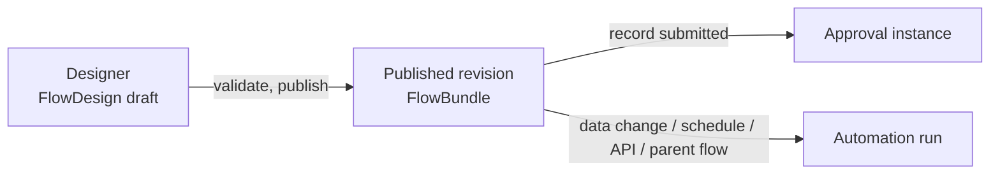

# Flow

<Lead>

Flow is Softa's metadata-driven flow engine (`flow-starter`): a flow drawn in the designer runs once published — an approval flow approves one record, and an automation flow runs by itself when data changes, on a schedule, when called explicitly or from a parent flow.

</Lead>

The pages in this section document the current backend contract of `flow-starter`:

<RoleCards>
<RoleCard title="Approval Flows" href="/en-US/docs/features/flow/approval/">Approving one record: how it enters approval, how its status moves, who approves each step and the flow's settings, what approvers can do, how the outcome is written back, and the constraints, errors and notifications</RoleCard>
<RoleCard title="Automation" href="/en-US/docs/features/flow/automation/">Runs with no human approval step: how automation flows start (data change, schedule, API, subflow), sync and async runs, waiting and resuming, errors and troubleshooting, task nodes and message topics</RoleCard>
<RoleCard title="Integration" href="/en-US/docs/features/flow/integration/">For developers: putting a business model through approval — model, controller, approval handler, default flows as seeds, and the host application checklist, configuration and extension points</RoleCard>
<RoleCard title="API & Data" href="/en-US/docs/features/flow/api/">For reference: REST APIs, instance search, approval projections, the monitor, the persistence model, node descriptors</RoleCard>
<RoleCard title="Design notes" href="/en-US/docs/features/flow/design/">The approval design drawn and tabulated: transaction boundaries, the branching rules illustrated, how an approval step decides who gets it, plus a glossary, known limitations and test points</RoleCard>
</RoleCards>

## Design, Publish, Runtime

<Lead>

A flow goes through three layers: at design time it is a draft edited in the designer, at publish time it is compiled, validated and published as a revision, and at runtime its published revision runs.

</Lead>

`flow-starter` covers:

- design-time graph documents for a visual editor
- compile-time validation and transformation into runtime bundles
- published bundle revisions by `flowId`
- runtime execution for approval and automation flows
- persistent projections for instances, approval tasks, approval records, delegations, and trigger events
- optional Pulsar-based trigger and async-task integration

<Dev title="The main types of each layer">

| Layer | Main types | Notes |
|---|---|---|
| Design time | `DesignFlowDefinition`, `FlowGraphDocument`, `FlowGraphNode`, `FlowGraphEdge` | Editor-facing graph DTOs |
| Publish time | `FlowCompiler`, `CompiledFlowDefinition`, `FlowPublishService` | Compile, validate, publish revisions, rollback |
| Runtime | `FlowRuntimeEngine`, `FlowExecutionState` | Execute published bundles, suspend/resume, persist projections |

</Dev>

## Flow Identity And Revisions

<Lead>

A flow's id is its identity everywhere and its name is unique within a tenant; a published revision is a compiled snapshot, and a start runs the current active revision by default.

</Lead>

- `FlowDesign` is the draft working copy. Its `id` (a distributed string id) is the flow's identity everywhere: bundles, instances, tasks, approval records, events and delegations reference it as `flowId`, and lists show the flow's name through that reference.
- `flowName` is unique within a tenant; there is no separate flow code.
- `FlowBundle` is the compiled published snapshot; published revisions are keyed by `flowId`.
- `FlowBundle.designJson` keeps the design snapshot used at publish time so the editor can restore a historical canvas.

<Dev title="How a start picks its revision (FlowStartRequest)">

`FlowStartRequest` resolves bundles in this order:

1. `bundleId` — pin to an exact published revision
2. `flowId` — start the current active revision

To start a specific historical revision, look up its `bundleId` via the revisions listing endpoint and pass that as `bundleId`.

</Dev>

## Flow Scenarios

<Lead>

The scenario declares what a flow is, chosen when the flow is created and fixed from then on: an approval flow is started by submitting a record and writes its outcome back to the record, an automation flow is started by a change, a cron, an explicit start or a parent flow.

</Lead>

| Scenario | Meaning | Triggers it may declare |
|---|---|---|
| `APPROVAL` | A record's approval: started by submitting the record; its steps are people and routes only (see [Node Types](#node-types)); the outcome written back to the record. Persisted instances, kept as the record's approval history | `Submit` |
| `AUTOMATION` | Started by a change, a cron, an explicit start or a parent flow; no approval steps. Persisted runs, purged after their retention period | `EntityChange`, `Cron`, `Api`, `Subflow` |

Both are persisted and resumable. A record's validation belongs to its model (field constraints) and a value worked out from others to a computed field — not to a flow. What an approval's outcome should set off — a webhook, a record to write, a message — is an Automation flow's, started by the record's change (its `approvalStatus` becoming `Approved`).

Every flow declares a trigger, and **the trigger is the flow's start contract** — one way in each:

| Trigger | How the flow starts |
|---|---|
| `Submit` | Only by submitting a record (`FlowClient.submitRecord`) — see [Approving Business Records](./integration#approving-business-records) |
| `EntityChange` | Only by its events |
| `Cron` | Only on its own schedule — see [Cron-triggered flows](./automation#cron-triggered-flows) |
| `Api` | Only explicitly, by id: `POST /flow/instances/start` |
| `Subflow` | Only from a parent flow's Subflow node |

An explicit start and a Subflow call both run an Automation flow, so `Api` and `Subflow` belong to Automation alone.

Settings belong to one scenario too: `withdrawPolicy`, `returnEnabled`, `urgeEnabled`, `urgeIntervalHours`, `remindAfterHours`, `approverDedup`, `selfApproval`, `emailNotification` and `cc` to Approval flows; `sync` / `rollbackOnFail` to Automation flows, and a sync flow — which runs inside the writer's transaction — may not contain an AsyncTask or Approval node. The compiler rejects a flow that breaks any of these rules.

<Dev title="How scenarios are implemented, and the scenarios removed">

- The scenario is a single `FlowScenario` enum. `FlowDesign.scenario` is readonly on update; the design document follows the column.
- Both scenarios run through `FlowRuntimeEngine.start`.
- A record's validation on its model is a field constraint or a `ModelWriteValidator`. The Validation and Compute scenarios that once stood for validation and computed values never took effect and are gone, with the `FieldChange` trigger and `declaredOutputs` they used.

</Dev>

## A flow's start: its trigger and the model it names

<Lead>

A flow has one trigger and one Start node — one start contract; a trigger that starts the flow on a record names the record's model, and may carry a condition deciding which records start the flow.

</Lead>

The trigger is configured on the Start node. Several ways in for the same logic are several thin flows calling one Subflow. A trigger that starts the flow on a record names **the record's model** — an Approval flow's document, the model a change trigger watches; one that starts on no record (a schedule, an API call, a parent flow) names none.

- **The model is the trigger's.** A flow touching several models — an automation that reads one and writes others — has no model of its own: its nodes name theirs. The variables the start offers, the edges' rule conditions and an approval's field permissions all follow the trigger's model. Publishing refuses a record trigger without a model.
- **Changing the trigger may change the model** — another trigger kind of the scenario, another model to watch: the next publish checks the graph against it (rule conditions), and the running instances keep their own revision.
- **An Approval flow's document is fixed.** It is chosen when the flow is created and never changes: every save and publish puts that document back into the trigger, whatever the draft says, and keeps the condition the draft gives the trigger.

<Dev title="Where the trigger is stored, its model and FlowDesign.modelName">

- The trigger is stored as the design document's `trigger` beside its graph.
- The model is the trigger's: `SubmitTrigger.modelName`, `EntityChangeTrigger.modelName` (`TriggerSource.modelName()`; `onRecord()` says which kinds must name one). `CompiledFlowDefinition.getModelName()` reads it from the trigger. A record trigger without a model is `MISSING_MODEL`.
- `FlowDesign.modelName` is the trigger's model kept as a column, for lookups — the flow list, a document's approval flow: written on every save and publish, empty for a trigger that starts on no record. It is not edited apart.
- An Approval flow's document is chosen by `POST /flow/designs` with `modelName`; every save and publish puts the trigger's `modelName` back from the column. A design that names its document only in its trigger — a seeded one — has the column taken from it the first time it is published.

</Dev>

**A document may have several approval flows**, told apart by their `Submit` trigger's condition — one of the two kinds an edge takes, never both: a rule over the record (checked at publish against the fields the document's approvals route on) or an AviatorScript expression. The condition is read over what the approval would start with (the record's fields and its handler's variables). A submission goes to the document's enabled approval flow whose condition holds for the record, and exactly one must hold:

| Approval flows whose condition holds | Outcome |
|---|---|
| Exactly one | It approves the record |
| Several | The submission is refused, naming them |
| None | The record goes to the flow without a condition, the document's **default**; with no default either, the submission is refused naming why |

- A leave and its cancellation are two flows of `LeaveRequest` this way, and so is a flow per country or company: copy the default, give the copy the country's condition, and the default keeps taking everyone else.
- **A flow is copied as an unpublished draft** — an approval flow too, for another country or company: the copy approves the same document with the same condition, which it changes before it is published beside the source.
- Conditions that overlap show when a record is submitted or previewed; the very same condition twice — two defaults, or the same rule or expression — is refused when such a flow is published while enabled, enabled, or rolled back.
- An approval flow cannot be created for a document without an approval handler, and publishing refuses one on a model the application cannot approve, which the designer's validation reports too. A new approval flow picks its document from the approvable documents, listed with the names of each one's approval flows.

**A data change starts the flow when its condition holds.** An `EntityChange` trigger may carry a condition of one of the two kinds an edge takes, never both: a rule over the record — judged like an edge's rule by the types of the trigger model's fields and checked at publish the same way — or an AviatorScript expression, compiled at publish. Both read the variables the flow would start with: the change's data — the whole row on a create or a delete, **the changed fields' new values on an update** — with `_triggerType`, `_sourceModel` and `_sourceRowId`. A condition that cannot be evaluated starts nothing and is never a quiet "no": the fire is logged as failed in the event log, and a sync `rollbackOnFail` flow fails the write that fired it.

What a trigger "matches" depends on the scenario: a submission goes to the one approval flow of its document whose condition holds for the record (else to the document's default); a data change or a schedule starts every enabled Automation flow that watches it, each its own run. An API call or a parent names the flow it starts.

<Dev title="The conditions' fields, checks and APIs">

- A submit condition is the `SubmitTrigger`'s `condition` (a rule) or `conditionExpression` (AviatorScript); the very same condition twice is refused by `SubmitConditions`.
- `POST /flow/designs` refuses an approval flow for a document without an approval handler, and publishing refuses one on a model the application cannot approve (`MODEL_NOT_APPROVABLE`, from `ApprovableModelValidator`, a `FlowValidator` bean, so the designer's validation reports it too). `GET /flow/approvalModels` lists the approvable documents, each with the names of its approval flows.
- Copying a flow: `POST /flow/designs/{id}/duplicate`.
- An `EntityChangeTrigger`'s rule is its `condition` (the platform `Filters` JSON) and its expression `conditionExpression`; both at once is `CONFLICTING_TRIGGER_CONDITIONS`, and either failing is `INVALID_TRIGGER_CONDITION`. Both read `FlowTriggerEvent.startVariables`; matching, and what happens when a condition cannot be evaluated, is `DefaultFlowTriggerRegistry.findMatches`.

</Dev>

## Node Types

<Lead>

An approval flow holds people and routes only — Start, End, Approval and the gateways; the tasks, Subflow and ReturnValue are for automation flows.

</Lead>

Current node types:

- Control: `Start`, `End`
- Routing: `InclusiveGateway`, `ParallelFork`, `ParallelJoin` (shown as "Join": it closes a fork's branches, or an inclusive gateway's)
- Human: `Approval`
- Task: `Script`, `CreateRecord`, `GetRecord`, `UpdateRecord`, `DeleteRecord`, `QueryRecords`, `ValidateData`, `Transform`, `CallWebhook`, `SendEmail`, `SendInboxNotification`, `QueryAI`, `AsyncTask`, `GenerateFile` (the send-SMS node `SendSms` is gone; see [Bundled Task Executors](./automation#bundled-task-executors))
- Subflow: `Subflow`
- Data: `ReturnValue`

Each node type declares the scenarios that may use it; the palette and the compiler both read it. **An approval flow holds people and routes only:**

| Node types | Scenarios |
|---|---|
| `Start`, `End`, `InclusiveGateway`, `ParallelFork`, `ParallelJoin` | Approval, Automation |
| `Approval` | Approval |
| every other — the tasks, `Subflow`, `ReturnValue` | Automation |

So the steps after an approval decide nothing but who approves next, and what can stop them is a person's or a route's (see [When a step after an approval fails](./approval#when-a-step-after-an-approval-fails)): nothing an approval runs writes, calls out, sends or waits, nothing a retry could repeat. What an approval's outcome should set off is an Automation flow's, started by the record's change. A revision published before this rule keeps running as it was until it is published again; a draft holding such a node is refused at publish.

Node-behavior invariants:

- **`Subflow` is a step like any other, run in one go**: the child must be an enabled Automation flow with a `Subflow` trigger, it must not call a flow already running above it, and it must not wait — publishing refuses an `AsyncTask` in a flow with a `Subflow` trigger, and the designer offers only the flows a Subflow node can call. What still goes wrong at run time throws, and fails the automation run as any failing step does. Model human steps in an Approval flow, not a child.
- **`ParallelFork` branches execute serially** (deterministic order), not wall-clock-parallel — the gateway models routing topology, not concurrency.

The graph itself has to meet these rules. A draft may break them — saving never validates — but it cannot publish:

- Exactly one `Start` as its entry — a node that merely lacks incoming edges is not one.
- No cycle.
- Every node reachable from the `Start` along the edges. An unreachable node would never run, and a `ParallelJoin` it feeds counts its edge among the arrivals it waits for, so every instance would stop there.
- Every node labelled. A node's label is the step's name people see, in the approval center, the audit trail and a failed instance's message.

Diagnostics name what they are about as people see it on the canvas: a node by its label, an edge by its label or else by the nodes it joins (`Manager → Finance`) — never by the generated ids. The engine's own failure messages name a node the same way; only a revision published before labels were required may still show a node's id.

<Dev title="Scenario declarations, subflow targets and graph diagnostics">

- Each `FlowNodeType` declares the scenarios that may use it with `FlowNodeType.getScenarios()`; a node in a scenario that may not use it is `INVALID_SCENARIO_NODE`.
- An `AsyncTask` in a flow with a `Subflow` trigger is `SUBFLOW_WAITS`; the designer lists the flows a Subflow node can call with `GET /flow/designs?subflowTargets=true`.
- Graph diagnostics: no `Start` or several is `NO_START_NODE` / `MULTIPLE_START_NODES`, a cycle `GRAPH_CYCLE`, an unreachable node `UNREACHABLE_NODE`, a missing label `MISSING_NODE_LABEL` (on the node's `label` field).
- A diagnostic still carries the ids in `nodeId` / `edgeId` for the editor to anchor it; one about a connection — a condition, a default edge — carries its `edgeId` and the `nodeId` it leaves.

</Dev>

## Routing: Edge Conditions

<Lead>

Conditions live on edges; a node carries none: a plain node takes the first of its outgoing edges whose condition holds, in order, and its default edge when none holds; an inclusive gateway takes every edge that holds, and a parallel fork takes all of them.

</Lead>

<FlowFigure name="branchesEn">

Four examples, one per row: one edge taken in order, an inclusive gateway, a parallel fork, and a layout that cannot be published. A diamond is a gateway: a circle inside marks an inclusive gateway, a plus a parallel fork, and the diamond paired with it on the right is its join. A dashed line is one not taken.

</FlowFigure>

### Picking one edge, in order

Every node routes **exclusively** over its outgoing edges, in order: it tries its conditional edges by their `priority` (1 first; edges without one after those with one, in drawing order) and takes the first that holds — the conditions after it are not read — and, when none holds, the one edge without a condition (the default, at most one per node). The default is always tried last: no `priority` may put it before a conditional edge. The exceptions are `InclusiveGateway`, which, like BPMN's inclusive gateway, takes every conditional edge that holds and its default edge only when none holds (at most one default there too), and `ParallelFork`, which takes all of them — neither reads `priority`.

- A node that picks one of several edges by their conditions has a default: publishing refuses one without, so every request has somewhere to go. A node whose only edge has a condition ends its branch when it does not hold.
- Nothing taken at a node with several edges — an inclusive gateway none of whose conditions holds, or a revision published before that check — stops there with a message naming the step and asking for a default route: a submission is refused (`400`); after an approval, the instance fails with it and the approval stands (see [When a step after an approval fails](./approval#when-a-step-after-an-approval-fails)).
- The designer shows a node's order on its edges (1, 2… and "Other" on the default) and moves an edge up or down in it.

### Inclusive gateways and their join

An inclusive gateway's branches either each end on their own, or all meet at one `ParallelJoin` — its paired join: every branch, the default included, goes on to that join and enters it by one edge, never ending or reaching another join first; branches share no node, and no edge from outside enters a branch or the join. Otherwise publishing refuses it, saying which rule the graph breaks.

When the gateway routes, the branches it did not take count as arrived at the join: the join waits for the branches taken and goes on once, after the last of them — "finance if over 1,000, travel if abroad, then HR" asks HR once, after whichever ran. A rejection anywhere ends the whole approval, as always. Gateways and forks nest, each with its own join. The approval path preview counts the same way.

### Branches that may run at the same time

Branches that may run at the same time — every edge of a `ParallelFork`, every conditional edge of an `InclusiveGateway` — meet only at a `ParallelJoin` or an end (`End`, `ReturnValue`), else publishing refuses them: any other node they share runs once for each branch that reaches it, so HR is asked twice and every step after it runs twice.

- A conditional edge and the default never run together, so an extra check that rejoins the default path ("finance if over 1,000, then HR") is fine, and a fork or a gateway with its join nested inside one branch is seen through.
- A join goes on by one edge: with more it stops waiting, and each branch goes on by itself.
- A fork's branch that goes on to a join enters it by one edge on every path, never an end or another join instead: the join waits for as many arrivals as it has incoming edges, and one that never comes lets the instance complete there.

Revisions published before these checks are stopped as they run: a node other than an end entered a second time in one instance, or a join still short of branches when nothing is left to wait for, throws an error naming the node, never completing the instance. On a record's submission, the submission is refused and rolls back; after an approval — the approval kept — and on an automation start or a timer or async resume, the instance fails, as on any node failure (see [When a step after an approval fails](./approval#when-a-step-after-an-approval-fails)).

### The two kinds of condition

An edge's condition is one of two kinds, never both:

| Kind | Field | Use | Judged |
|---|---|---|---|
| Rule | `condition` — the platform Filters JSON, `["days", ">", 3]` / `[[…], "AND", […]]` | The fields of the record the flow starts on; the designer builds it with the model's own filter builder | Like a field condition (`requiredWhen`): typed by the record model's fields, an empty value equals `""`, ordering needs two values (`days < 3` is false for an empty `days`), options compare by item code, relations by id |
| Expression | `conditionExpression` — AviatorScript | What a rule cannot say: arithmetic, functions, what an earlier node produced | By AviatorScript over the instance's variables, with its own semantics (`nil` is smaller than any number) |

A rule needs a flow that starts on a record — a `Submit` or `EntityChange` trigger. Publishing checks it the way a field condition is checked: a field the model lacks, a to-many field, ordering an option or a relation, `PARENT OF` / `CHILD OF` (they need a query), an unresolvable placeholder and `@mode` / `@userId` (they describe a write) are refused, and an approval's rule reads only the fields its approvals route on (see [routing variables](./integration#routing-variables)).

A rule may also read on through the record's many-to-one and one-to-one relations, up to two levels, written as a path: `["employeeId.departmentId", "=", 30]` is "the leave request's employee is in department 30", and `["employeeId.departmentId.costCentreId", "=", 7]` is "the leave request's employee's department has cost centre 7". Every relation the path goes through must be a field its record routes on, and the path must end on a field the last related record would route on — identity, bookkeeping, approval state and sensitive fields stay out there too, and publishing checks the rule against the field it reaches (ordering a relation is still refused). A path going a level further is refused at publish.

- **When it is read**: a path's value is read from the related record when the flow starts and kept in the instance's variables beside the record's own. An Approval flow reads at submission: choosing a flow reads the paths every candidate's submit condition names, and the start reads those the chosen flow's rules name; an approver's edits read them again, from the new related record if they changed the relation. An entity-change flow reads when it starts; an update carries only what it changed, so a relation the event lacks is read from the stored record.
- **Decided on the snapshot**: every route then decides on those values without asking the related record again — an employee who moves department halfway through an approval does not reroute it, and the path the submitter was shown is the one it takes.
- **Only what is used**: only the paths the flow's rules name are read, not every field of the related records; the reads do not go by the submitter's data permissions, as the read of the record itself does not.
- **Not a change trigger's own condition**: an entity-change trigger's condition is decided on the change itself before any run starts, so it reads the changed record's own fields only and may not name a path; an Approval flow's submit condition may.

<Dev title="Compiled order, join counting and diagnostics">

- A `priority` putting the default before a conditional edge is `DEFAULT_EDGE_NOT_LAST`; a node that picks one of several edges by their conditions without a default is `NO_DEFAULT_EDGE`; nothing taken throws a `FlowActionValidationException`.
- The compiler lists each node's `outgoingEdgeIds` in that order; a revision compiled before priorities lists them in drawing order, and two conditions holding there no longer fail the instance — the one drawn first is taken.
- An inclusive gateway whose branches do not pair with one join is `INCLUSIVE_JOIN_UNPAIRED`. The compiler names the paired join on the gateway (`CompiledFlowNode.pairedJoinId`), and when the gateway routes, the engine counts the branches it did not take as arrived there (`joinArrivalCounts`).
- Branches that may run at the same time meeting anywhere but a join or an end is `CONCURRENT_BRANCHES_MEET`; a join with several outgoing edges `JOIN_MULTIPLE_OUTGOING`; a fork's branch entering a join by more than one edge, or going to an end or another join instead, `BRANCH_ENTERS_JOIN_TWICE` / `BRANCH_SKIPS_JOIN`.
- Older revisions are stopped as they run by `FlowExecutionOrchestrator`, which throws a `FlowRuntimeException`.
- A rule refused at publish is `INVALID_RULE_CONDITION`; an entity-change trigger's condition that names a path is `INVALID_TRIGGER_CONDITION`.
- The path rule is `RecordVariables.routedPathField` (at most `RecordVariables.MAX_HOPS` levels, each through a routed relation, ending on a routed field) and the read is `RecordVariables.readPaths` (level by level: one query per relation per level, for the fields that level needs); a flow's paths come from `CompiledFlowDefinition.rulePaths()` (its edge rules plus an Approval flow's submit condition), and the paths a choice of flow needs from `DefaultFlowTriggerRegistry.submitConditionPaths`. The variable catalog lists `ruleFields` on each routed relation variable, from which the designer opens the relation.

</Dev>

## Enabling and disabling a flow

<Lead>

A flow has an on/off switch, apart from which revision is effective: off, nothing starts it, and a flow is switched off only once nothing of it is left running.

</Lead>

A flow is on when created.

- **Off**, nothing starts it: no submission picks it, no data change or schedule fires it, and an API start (by `flowId`, or pinned to a revision by `bundleId`) and a parent flow's Subflow node are refused — "it was never published, or it is disabled". With several app instances, choosing the flow at submission and matching data changes read each instance's own cache: the instance that switched it off sees it at once, the others within 60 seconds.
- The effective revision stays as it is, so switching it back on runs the same one; activating another revision and publishing leave the switch as it is — a flow can be prepared and published while off, then switched on.
- **A flow is switched off only once nothing of it is left running**: refused while any of its instances has not finished — pending, running or waiting, a record still in approval among them — and, for an automation flow, while a flow that may still run it as a subflow calls it: an enabled flow's effective revision, or the revision an unfinished instance of another flow runs on (an instance keeps the revision it started on). The refusal says how many instances are left, or names the callers. A failed instance has ended: it does not hold the flow on.
- **A published flow is never deleted**: its revisions, instances and approval history refer to it; a flow that was never published is deleted freely.

<Dev title="The switch, its APIs and the delete guard">

- The switch is `FlowDesign.enabled`. `POST /flow/designs/{id}/disable` / `enable` switch it; `GET /flow/designs/{id}/status` reports it.
- Unfinished instances are counted by `FlowInstanceService.countUnfinished`.
- The refusal to delete a published flow is a write validator (`PublishedFlowDeleteGuard`), so it holds for the generic `/FlowDesign` API as well as for `POST /flow/designs/{id}/delete`.

</Dev>

## Flow Concept

<Lead>

Flow is a more generalized concept for business processes; the relationship is Flow > BP = Workflow > BPMN.

</Lead>

Expression Engine is mainly used to solve data computation problems, implementing a calculation engine such as QLExpress. BPMN scenarios are better suited to workflow or rule engines like Flowable. For example, Flowable integrates JUEL to support simple expression parsing. DMN rule engines are better for true/false decision scenarios, for example, the sequenceFlow routing conditions in BP. Drools focuses more on rule configuration and management.

Example scenarios:

- Import: better suited to BPMN. Each action is a data update node; actions have an order but can be processed asynchronously.
- Approval: BPMN + DMN. BPMN handles the approval process and path. DMN handles complex approval routing. DQL solves complex approver queries.
