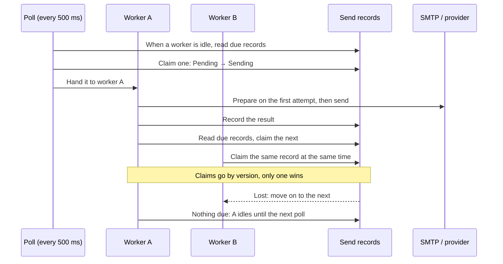

# Delivery & Retries

<Lead>

The delivery loop sends mail and SMS send records in the background. This page first covers how a record is claimed, prepared and sent, how a failed send is retried or stopped depending on the cause, and how a stuck send recovers; then what operators can do: resend by hand, handle dead letters, adjust quotas and rate limits, read the metrics, and troubleshoot "never arrived".

</Lead>

## The delivery loop

<Lead>

Each instance has a pool of workers per channel, by default 4 for mail and 10 for SMS. A worker that finishes a record goes straight on to claim the next due record; it idles only when nothing is due, and a poll every 500 ms hands newly due records to idle workers.

</Lead>

- **Due**: <Status>Pending</Status>, or <Status>Retry</Status> whose `next_retry_at` has passed.
- **Claim**: set the record to <Status>Sending</Status> by its version number. When two workers or two instances claim the same record at once, only one succeeds and the loser moves on to the next, so a multi-instance deployment never sends twice. Each scan reads a few records per worker and tries them in random order, so the workers do not all go for the oldest one.
- **Throughput**: a backlog drains on each instance at concurrency ÷ time per send. For more, raise `softa.message.mail.send-concurrency` / `softa.message.sms.send-concurrency`; for mail, stay within the server's limit on concurrent connections per account, as each mail worker holds one connection.
- **Shutdown**: an instance shutting down claims nothing more and waits at most 30 seconds for sends in flight; those not finished stay <Status>Sending</Status> and the [stuck-send sweep](#stuck-sends) handles them: a mail is put back to retry, an SMS is marked <Status>Failed</Status>.
- No message queue sits in the delivery path, and Spring `@Async` is not used.

<Dev title="How a scan reads, and why it is two queries">

Each scan is two reads: <Status>Pending</Status> by `updated_time`, oldest first (that is when the record was written: nothing changes it before the claim), and due <Status>Retry</Status> by `next_retry_at`. Each walks an index that starts with the status (`idx_mail_send_status_updated` and `idx_mail_send_status_retry` for mail, `idx_sms_send_status_updated` and `idx_sms_send_status_retry` for SMS) and reads only the rows it will return; the two are then merged by how long each record has been due, and the first n taken: on a poll n is the number of idle workers × 4, and when a worker claims its own next record n is 4. The scan is cross-tenant; claiming and delivery run in the record's own tenant, under the trace id of the request that submitted it, with permission checks skipped.

It cannot be one `status = ? OR (status = ? AND next_retry_at <= ?)` ordered by id: on PostgreSQL, once the same statement has run a few times the JDBC driver switches to a server-side prepared statement, and the planner then takes a generic plan that cannot see the parameter values. That plan walks the primary key from the oldest record and filters the whole history to find the few rows wanted, several times a second even when idle. The scan runs after every send, so its cost must not depend on how much history there is.

</Dev>

## First attempt: preparing the record

<Lead>

On a record's first delivery attempt, the processor turns the caller's request into a message that can be sent and writes it back to the record. Retries replay it as it is: no second render, no second choice of server, no second charge to the quota. A record that cannot be prepared goes straight to <Status>Failed</Status>, with a marker code saying why.

</Lead>

| Step | Mail | SMS |
|---|---|---|
| 1 | Find the template, in the send scope's tier: with a `templateId`, that row (a test send from the editor: what was previewed is what goes out, a disabled template included); otherwise the enabled template with that `templateCode` | The enabled template with that `templateCode`; SMS templates exist once, on the platform, whatever the send scope |
| 2 | Render the subject and body the caller did not give; fill in the template's priority, Reply-To, attachments and preferred server, a value the caller gave always winning | When the caller gave no content, render it from the template |
| 3 | Check the content: a body present and within the length limit, a well-formed Reply-To | Content present |
| 4 | Choose the server: the caller's, else the template's preferred one, else the send scope's default server (relayed through the platform's when the tenant has none); record the server's owner, `serverOwner`; fill in the server's Reply-To and read-receipt settings; the from address and name are read from the server configuration at each send | Choose providers by the recipient's country, intersect them with the template's provider bindings, and settle the provider, external template id and signature |
| 5 | Charge the day's and the month's quota when a platform send server carries the mail, relayed tenant mail included; a tenant's own server is not charged. It comes last, so a message that cannot go out uses none | Charge the day's and the month's quota for every SMS, last as well |
| 6 | Write the result back to the record | Same as mail |

| Marker code | When | What to do |
|---|---|---|
| `TEMPLATE_NOT_RESOLVABLE` | The template does not exist, none is enabled under the code, or rendering fails; for a mail template in the other tier, the message names the scope to use | Create, enable or fix the template, or send with the right scope |
| `CONFIG_NOT_RESOLVABLE` | No send server is available; the server named is not in the send scope's table; the server has neither a from address nor a username; a tenant server's host is inside the deployment; no SMS provider serves the recipient's country | Complete the configuration |
| `DAILY_QUOTA_EXCEEDED` | Today's cap is reached | Retry the next day, or raise the daily cap, see [Send quotas](#send-quotas) |
| `MONTHLY_QUOTA_EXCEEDED` | This month's quota is used up | Raise the quota, see [Send quotas](#send-quotas) |
| `CONTENT_INVALID` | The render comes out empty, the body is over the limit, or the Reply-To is malformed | Fix the template or the content the caller gave |
| (no marker code) | A database or cache error during preparation | Classified by keywords in the error message; most come out as unknown errors and are retried automatically |

Every failure with a marker code is logged at ERROR with the record id and tenant, so log-based alerting reaches a developer. Once the cause is fixed, press Retry on the record: a record that failed before it was prepared is prepared afresh.

## Failures and retries

<Lead>

A failed send's error is classified first, then handled by its category: a temporary error is retried after a back-off, at most 5 times; one that a retry would not fix goes straight to <Status>Failed</Status>; a send whose 5 retries all fail goes to <Status>DeadLetter</Status>. Sending a text again can deliver it twice, so an SMS is retried only when it certainly did not go out: one the provider may already have sent (outcome unknown) goes straight to <Status>Failed</Status>, and a failed one-time code is never retried.

</Lead>

| Category | How an error falls into it | Handling |
|---|---|---|
| `TRANSIENT` | An SMTP 4xx reply (`SMTP_421`, `SMTP_451` and so on), an `SMTP_MailSendException` with no reply code (the server could not be reached, say), or an error code starting with 421 or 450–452; an error message containing timeout, connection reset, unavailable or try again (contention on the quota count falls here); for SMS, `CONNECT_FAILED` (the provider was not reached: the host did not resolve, the connection was refused or timed out), `HTTP_408` and `HTTP_503`, Infobip's `REJECTED_SYSTEM_ERROR` and `UNDELIVERABLE_REJECTED_PLATFORM`, and Aliyun's `isp.SYSTEM_ERROR`, `isp.GATEWAY_ERROR`, `InvalidTimeStamp.Expired` and `SignatureNonceUsed` (a retry signs afresh) | Retry |
| `QUOTA` | An error code containing LIMIT, QUOTA or THROTTL (`QUOTA_EXCEEDED` when a local rate-limit window is full); an error message containing rate limit, too many requests, quota or throttle; for SMS, `HTTP_429`, and Aliyun's `isv.BUSINESS_LIMIT_CONTROL` (the per-number frequency limit), `isv.DAY_LIMIT_CONTROL` and `Throttling.User` | Retry, after at least 5 minutes |
| `OUTCOME_UNKNOWN` | SMS only: the marker code `OUTCOME_UNKNOWN` (connected but no answer came back: a read timeout, a connection reset halfway, an answer that could not be read, one the provider does not document, an exception the adapter did not expect; an SMS the stuck-send sweep handles); for SMS, `HTTP_500`, `HTTP_502`, `HTTP_504` and any other 5xx | <Status>Failed</Status>: the provider may have sent it — check its console first, and retry by hand if it did not go out |
| `UNKNOWN` | An error not recognized (for SMS: the provider answered with a code that is not recognized, so it refused the message and resending cannot duplicate it) | Retry |
| `PERMANENT` | An SMTP 5xx reply (`SMTP_550`, `SMTP_554` and so on, except for the two classes below), or an error code starting with 550, 551 or 553; an error message containing no such user, user unknown or does not exist; Infobip's blocked recipient or sender: `REJECTED_DND`, `REJECTED_DESTINATION_BLOCKLISTED`, `REJECTED_SENDER`, `REJECTED_FLOODING_FILTER`, `SIGNALS_BLOCKED`; Aliyun's `isv.CUSTOMER_REFUSED` (the recipient unsubscribed from promotions) | <Status>Failed</Status> |
| `INVALID_INPUT` | `SMTP_552` (message too large), `SMTP_AddressException`, an error code starting with 552, or `CONTENT_INVALID`; an error message containing invalid address, malformed, bad recipient or no recipient; for SMS, `HTTP_400`, `HTTP_404`, `HTTP_413` and `HTTP_422`, and Infobip's wrong number or content: `REJECTED_PREFIX_MISSING`, `REJECTED_DESTINATION`, `MISSING_TO`, `REJECTED_MESSAGE_TOO_LONG`, `REJECTED_INVALID_UDH`; Aliyun's wrong number, content or parameter, such as `isv.MOBILE_NUMBER_ILLEGAL`, `InvalidParameter.To`, `isv.SMS_CONTENT_ILLEGAL`, `isv.BLACK_KEY_CONTROL_LIMIT` (a blocked keyword) and `isv.PARAM_LENGTH_LIMIT`; OneWaySMS's `ONEWAYSMS_-300` (invalid number), `ONEWAYSMS_-400` and `ONEWAYSMS_-500` (invalid characters in the text) | <Status>Failed</Status> |
| `AUTH` | `SMTP_530`, `SMTP_534`, `SMTP_535`, `SMTP_538`, `SMTP_MailAuthenticationException`, or an error code starting with 530 or 535; an error message containing unauthorized, forbidden, invalid credentials or authentication failed; for SMS, `HTTP_401` and `HTTP_403`; Aliyun's `SignatureDoesNotMatch`, `InvalidAccessKeyId.NotFound`, `isp.RAM_PERMISSION_DENY`, `Forbidden.Operation` and the like; OneWaySMS's `ONEWAYSMS_-100` (wrong username or password) | <Status>Failed</Status> |
| `CONFIG` | The marker codes `CONFIG_NOT_RESOLVABLE`, `TEMPLATE_NOT_RESOLVABLE`, `DAILY_QUOTA_EXCEEDED` and `MONTHLY_QUOTA_EXCEEDED`; Infobip's account problems: `REJECTED_SOURCE` (sender not registered), `REJECTED_NOT_ENOUGH_CREDITS`, `REJECTED_PREPAID_PACKAGE_EXPIRED`, `REJECTED_ROUTE_NOT_AVAILABLE`, `REJECTED_NETWORK`, `REJECTED_DESTINATION_NOT_REGISTERED`; Aliyun's account, balance, activation, country and sender problems, such as `isv.AMOUNT_NOT_ENOUGH`, `isv.OUT_OF_SERVICE`, `isv.NOT_SUPPORTED_COUNTRY`, `isv.DOMESTIC_NUMBER_NOT_SUPPORTED` and `InvalidParameter.SenderId`, and Mainland's signature and template errors, such as `isv.SMS_TEMPLATE_ILLEGAL`; OneWaySMS's `ONEWAYSMS_-200` (invalid senderid) and `ONEWAYSMS_-600` (insufficient credit) | <Status>Failed</Status> |

The error code is looked at first, and the error message only when the code is not recognized. Mail is sent through Spring, which wraps an SMTP failure as a `MailSendException` or a `MailAuthenticationException`; `SmtpMailTransport` digs the server's reply code out of the refused messages and the exception chain and records the error code as `SMTP_` followed by it (`SMTP_550` for a recipient that does not exist), or as `SMTP_` followed by the exception's class name when there is none. So a refused recipient or a failed login goes straight to <Status>Failed</Status>, while a temporary refusal (4xx) is retried as usual.

An SMS error code comes from the adapter. When a provider answers with an HTTP error and the adapter reads no code of the provider's own from it, the code is `HTTP_` followed by the status, classified by the status; the Infobip adapter always records `HTTP_` followed by the status and puts Infobip's `errorCode`, `description` and first `violations` entry in the message. An SMS Infobip refuses at submission has its status name as the code (`REJECTED_SOURCE`, say), classified as in the table above. Aliyun's codes (`ResponseCode` or `Code`) are classified by a table of the send-related codes, of which the table above lists a part; a code outside it still goes by keywords. A negative number OneWaySMS answers is recorded as `ONEWAYSMS_` followed by it; the six its API documents are classified as in the table above, any other is `UNKNOWN`. Other providers' codes are still classified by words such as LIMIT, AUTH and INVALID, and one not recognized is `UNKNOWN` and retried.

An SMS call that got no answer is coded by the adapter by whether it can have gone out: one that never reached the provider is `CONNECT_FAILED`, retried as a temporary error; anything else (a read timeout, a connection reset halfway, an answer that could not be read) is `OUTCOME_UNKNOWN`, not retried. OneWaySMS sends with a GET, so after a read timeout the gateway may well have sent the text — exactly the case to avoid.

**A one-time code is not retried.** An SMS record whose category is `OTP` goes straight to <Status>Failed</Status> on any failure: the code expires in 5 minutes, so a retry after the back-off mostly arrives dead; and if the person asked for another code meanwhile, the new one has replaced it and the late one is refused when typed. Asking for a new code is how a one-time code is retried.

Logging follows outcomes, not attempts: an adapter logs each failed attempt at WARN (ERROR, with the stack, only for an exception it did not expect); a retry is logged at WARN; and a record ending <Status>Failed</Status> or <Status>DeadLetter</Status> logs one ERROR, whatever the category, an opted-out or unknown number included. With sentry-starter, that ERROR is the Sentry event, one per record that will not go out; while it is logged, the channel, provider, category and code are `tag.*` MDC entries, so the event carries the tags `message_channel`, `message_provider`, `error_category` and `error_code` to filter and alert on.

An error code longer than 100 characters, or an error message longer than 1000, is cut to that length, ending in "…", before it is written to the record, so that a long one does not keep the failure from being recorded; the dead-letter table's `last_error_msg` is cut at 1000 characters too.

| Retry | Approximate wait |
|---|---|
| 1 | 30 seconds |
| 2 | 1 minute |
| 3 | 2 minutes |
| 4 | 4 minutes |
| 5 | 8 minutes |
| The 5th fails too | Dead-lettered, about a quarter of an hour after the first failure |

Each wait varies at random by ±50%, and a rate-limited send waits at least 5 minutes. The schedule applies only to failures that are retried: an SMS whose outcome is unknown and a one-time code are not. Each failure's error code and reason go on the record's `error_code` and `error_message`, the retries made so far on `retry_count`; a retry is logged at WARN, <Status>Failed</Status> and <Status>DeadLetter</Status> at ERROR.

<Dev title="How classification and retries are implemented">

`ErrorClassifier` looks at the error code first: a marker code, `SMTP_<ExceptionClassName>` (`AuthenticationFailedException` → AUTH, `SendFailedException` → PERMANENT, `MessagingException` / `MailSendException` / `MailException` → TRANSIENT, anything else → UNKNOWN), an error code starting with an SMTP reply code, LIMIT / QUOTA / THROTTL in a provider's error code; when the error code yields no category, it looks at keywords in the error message (timeout, try again → TRANSIENT; rate limit, quota → QUOTA; unauthorized → AUTH; and so on); what neither recognizes is UNKNOWN. `ExponentialBackoffPolicy` turns the category, the retries so far and whether the record may be retried at all (an `OTP` SMS may not) into a `RetryDecision` (`Retry` / `Fail` / `DeadLetter`, a sealed type, so the `switch` that handles it is exhaustive). `SendFailureHandler` carries out the transition: a retry writes `next_retry_at` and `retry_count + 1`; a dead letter is also archived into `dead_letter_message`. Transitions go by version: when another update has taken the version first, it does nothing, and records no second metric or log.

Below the record, the `smsRestClient` the SMS adapters share retries at the HTTP level too: its Resilience4j instance `sms-provider` (`SmsRestClientConfig`) tries once more, 500 ms later, only when the call failed to connect — not after a read timeout or a 5xx. A `resilience4j.retry.instances.sms-provider` block in the application's configuration takes precedence; with neither, Resilience4j's defaults would retry any exception 3 times.

</Dev>

## Stuck sends

<Lead>

When an instance crashes or restarts after claiming a record, the record stays at <Status>Sending</Status>. Every instance checks once a minute for records stuck for more than 5 minutes: a mail is put back to <Status>Retry</Status>, due at once, or goes straight to <Status>DeadLetter</Status> when its retries are already used up; an SMS is marked <Status>Failed</Status> and not sent again.

</Lead>

- 5 minutes is far longer than any send: the connect timeout defaults to 5 seconds and the read timeout to 30. The application does not start when a channel's connect plus read timeout exceeds 2 minutes 30 seconds (half the window), or either is 0 (no timeout): a send that is only slow would otherwise be taken for a stuck one while in flight and sent again.
- **Mail at least once.** When the server has accepted a message but the record has not yet been changed to <Status>Sent</Status> (the database write failed, or the instance went down), the message is sent again 5 minutes later. A failure to write <Status>Sent</Status> is not a send failure: it does not go through retry; it is only logged at ERROR and left to the stuck-send sweep.
- **SMS at most once.** A stuck SMS may already be on the phone (the provider accepted it and only the record was not changed to <Status>Sent</Status>, or the call was cut off halfway); sending it again means two texts, and a second sign-in code voids the first. So the sweep marks it <Status>Failed</Status> with the error code `OUTCOME_UNKNOWN` and logs it at ERROR; once the provider's console shows it did not go out, retry it by hand.

<Dev title="ZombieRecordSweeper">

Runs on every instance at the start of every minute (`0 * * * * *`). It reads, across tenants, the records with `status = Sending AND updated_time < now - 5 minutes` (by `updated_time`, at most 200 per run) and transitions each in its own tenant: a mail put back to retry gets the error code `ZOMBIE_RECOVERED`, and one whose `retry_count` has reached 5 becomes a dead letter with the error code `ZOMBIE_EXHAUSTED`, archived into the dead-letter table the same way; an SMS is handed to `SendFailureHandler` and failed as `OUTCOME_UNKNOWN`. When several instances read the same record at once, the version lets only one transition succeed.

</Dev>

## Manual retry

<Lead>

Once the cause is fixed, press Retry on the send record to send it again. The record goes back to <Status>Retry</Status>, due at once, and the next poll claims it; one that failed before it was prepared is prepared afresh.

</Lead>

- **One record**: the platform's pages use `POST /MailSendRecord/retry?id=` / `POST /SmsSendRecord/retry?id=`, a tenant's mail send log page `POST /TenantMailSendRecord/retry?id=`. <Status>Pending</Status>, <Status>Retry</Status>, <Status>Failed</Status> and <Status>DeadLetter</Status> can all be retried; <Status>Sent</Status> and in-flight <Status>Sending</Status> are refused.
- **In bulk**: `POST /MailSendRecord/retryByIds` / `POST /SmsSendRecord/retryByIds` / `POST /TenantMailSendRecord/retryByIds`, body `{"ids": [...]}`. Retryable records are requeued; <Status>Sent</Status>, <Status>Sending</Status> and records a worker claimed meanwhile are skipped without an error; it returns how many were actually requeued. Use it to resend a batch once the mail server is back or the missing configuration is in place.
- **Who can retry what**: the platform can retry any record on its pages, whose two endpoints (`/MailSendRecord`, `/SmsSendRecord`) refuse a tenant caller. A tenant, on its mail send log page (`/TenantMailSendRecord`), can retry only the records filed under it; another tenant's record answers like a missing one, and a bulk retry skips it.
- Pressing it again is safe: the claim goes by version, so nothing is sent twice.
- `retry_count` keeps counting, and a manual retry itself counts as one. A record whose retries are already used up (a dead letter, say) gets just this one chance, and another failure returns it to <Status>DeadLetter</Status>; one with retries left goes on retrying automatically on later temporary failures as usual, until 5 have been made in all.

The admin UI offers Retry on a send record's detail page and on its list rows; on the list page several rows can also be selected and retried together, the confirmation saying how many will be skipped. These actions need the page's Retry permission.

## Dead letters

<Lead>

A send record whose retries are used up becomes <Status>DeadLetter</Status> and also leaves a row in the dead-letter table `dead_letter_message`, for operators to handle in one place; poison messages a Pulsar consumer cannot process go into the same table.

</Lead>

| Source (`source`) | When | What the row holds |
|---|---|---|
| `SendExhausted` | A mail or SMS send used up its retries, or a mail's retries were already used up when the stuck-send sweep found it | The record id (`event_id`); the channel, provider, error code and reason, and the attempt count (`payload`) |
| `BrokerPoison` | A Pulsar consumer still cannot process a message after the broker redelivered it `softa.message.dlq.max-redeliver` times | The original message |

- A dead-letter row's triage status: `Pending` → `Resolved` or `Discarded`. Marking a dead-letter row handled does not resend the message; to resend, use the send record's Retry.
- When a poison message is archived and `softa.message.dlq.alert.recipients` is set, an alert mail goes to those addresses. For other alerting (Slack, PagerDuty), consume the DLQ topic or watch the table.
- For a listener to send its poison messages to the dead-letter table, give its `@PulsarListener` `deadLetterPolicy = "commonDlqPolicy"` and set `softa.message.dlq.topic`.

## Send quotas

<Lead>

The platform can give each tenant two ceilings on mail and SMS sends, a monthly allowance and a daily cap, both counting the sends that go through the platform's infrastructure. A send record is charged to the day and the month once, when it is prepared, and retries are not charged again. Once the day's cap is reached, new sends fail with `DAILY_QUOTA_EXCEEDED`; once the month's quota is used up, with `MONTHLY_QUOTA_EXCEEDED`. The next day, or after raising the limit, press Retry to send them.

</Lead>

- Quotas are set per tenant on `TenantMessageQuota` (`mailMonthlyLimit`, `smsMonthlyLimit`, `mailDailyLimit`, `smsDailyLimit`) and maintained by the platform operator: every write can be made only by the platform, single rows, batches and imports alike (`TenantMessageQuotaWriteValidator`); a tenant without one uses `softa.message.quota.mail-monthly-default` / `sms-monthly-default` / `mail-daily-default` / `sms-daily-default`, and when that is unset there is no limit (sends are still counted, for reporting).
- **Why a daily cap**: the platform's send servers and SMS providers are shared by every tenant, and their own daily limits (see [Rate limits](#rate-limits)) count all tenants together. Without a day of its own, one tenant's burst could take the whole day, leaving the others unable to send until midnight.
- **What is counted**: every SMS, and mail a platform send server carries, the platform's own and tenants' relayed mail alike. A tenant's mail through its own send server costs the platform nothing and is not counted.
- The quota bucket is the tenant the record is filed under, whatever the scope: a platform notice made for a tenant (a security notice about one of its accounts, the sign-in code or password reset of someone with an account in that one company, a subscription reminder) draws on that tenant's quota and is refused once it is spent. A send no tenant can be named for draws on the platform's own (`tenant_id = -1`; set it very large: it is there to stop runaway or malicious mass sending).
- It is a commercial ceiling, not rate limiting: a send over the quota is not queued or delayed; it fails. The day's count starts again at midnight (server time zone).
- `GET /TenantMessageQuota/usage?tenantId=` returns a bucket's usage this month and today, with the ceilings currently in force; a tenant can read only its own bucket. Each bucket has one usage row per month, never deleted, so past usage is a plain query; daily usage keeps no history.

<Dev title="How the count works, and how conflicts are handled">

The count lives in the database: one `TenantMessageUsage` row per bucket per calendar month, read, checked against the ceiling and incremented under the ORM's optimistic lock (`versionLock`), each attempt in its own `REQUIRES_NEW` transaction. When a bucket's sends are prepared in a burst, every delivery worker on every instance is updating the same row, so losing the race is common: a loser rereads and tries again, and after 5 losses in a row this preparation gives up as a temporary error; the record goes to <Status>Retry</Status> and is not taken for a used-up quota. When the quota was charged but the preparation could not be written back, that charge stays: a small over-count, which can be reconciled against the send records.

The daily count lives in Redis: one key per bucket per channel per day (`quota:{channel}:daily:{tenantId}:{yyyy-MM-dd}`, expiring after two days), checked against the cap and incremented in one Lua script, shared by every instance. The day is charged before the month: a send the day refuses costs the month nothing, and a send the month refuses, or one given up over counter contention, is handed back to the day. If Redis is flushed, the day's count starts again from zero.

</Dev>

## Rate limits

<Lead>

Each send server and each SMS provider can have two windows: a daily send limit and a per-minute send limit. When a window is full, the send fails as rate-limited and is tried again after at least 5 minutes.

</Lead>

- The fields are `daily_send_limit` and `rate_limit_per_minute` on the send servers (a tenant's `MailSendServerConfig`, the platform's `PlatformMailSendServer`) and on `SmsProviderConfig`; empty or 0 means no limit for that window.
- The counters live in Redis, one per config (`rl:{channel}:{daily|min}:{configId}:{window}`), shared by every instance and not split by tenant: when several tenants share a platform send server or an SMS provider, the limit caps the total sent through it. How much each tenant may send is the [send quotas](#send-quotas)' business.
- The check comes after preparation and before the send: a rate-limited record is already prepared, and is sent straight away when tried again.
- It protects the external service's quota. How much of it one tenant may take is the daily cap's business, in [Send quotas](#send-quotas).

## Monitoring and troubleshooting

### Metrics

When Micrometer is on the classpath, `MessageMetrics` emits two counter families:

| Name | Tags | When incremented |
|---|---|---|
| `softa.message.sent` | `channel` (mail / sms), `provider` | The server or provider accepted a send |
| `softa.message.failed` | `channel`, `provider`, `outcome` (retry / failed / dead_letter) | An attempt failed, a failure during preparation included |

A steadily growing `softa.message.failed{outcome=dead_letter}` means a batch of messages cannot go out; look at their dead-letter rows and error codes first.

### Logs

Retries are logged at WARN; <Status>Failed</Status> and <Status>DeadLetter</Status> at ERROR, with the record id and tenant; failures to write <Status>Sent</Status> and unexpected errors during preparation at ERROR too, with the record id. Delivery runs under the trace id of the request that submitted the record (the context carries it), but log lines from the background threads do not include it automatically; the record stores that `trace_id`, by which the record can be matched to its business request.

### A user says it never arrived

1. Find the record: a tenant looks in its own mail send log (`TenantMailSendRecord`); the platform in Mail Send Record (or SMS Send Record), SMS records being on the platform's side only. Search mail by recipient or subject, filter SMS by number.
2. Look at its status:
   - <Status>Pending</Status> or <Status>Sending</Status> for a long time: check that the delivery loop is running and its workers are not all tied up by a slow server; a record <Status>Sending</Status> for more than 5 minutes is put back to retry automatically if it is a mail, and marked <Status>Failed</Status> (error code `OUTCOME_UNKNOWN`) if it is an SMS.
   - <Status>Retry</Status>: read the error code and reason; it is tried again when `next_retry_at` comes.
   - <Status>Sent</Status>: the server accepted it, so the problem is further along. For mail, check the record's bounce flag (a bounce received changes the status to <Status>Failed</Status>), then have the user check their spam folder. A bounce is matched only by a receive server of the same owner: mail sent through a tenant's own server shows no bounce unless the tenant has configured a receive server; for relayed mail, the bounce itself is among the platform's received mail. For SMS, check the provider's receipt.
   - <Status>Failed</Status> or <Status>DeadLetter</Status>: fix the cause the error code points to, see [First attempt: preparing the record](#first-attempt-preparing-the-record) and [Failures and retries](#failures-and-retries).
3. Once it is fixed, press Retry.
