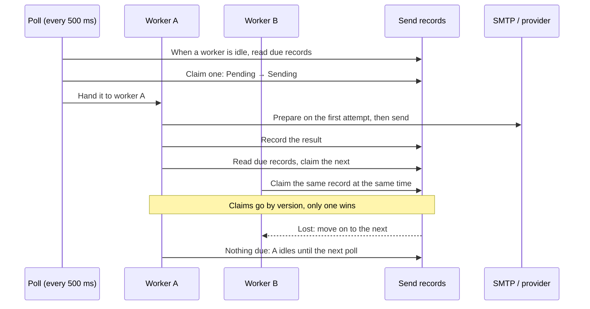

# Delivery & Retries

<Lead>

The delivery loop sends mail and SMS send records in the background. This page first covers how a record is claimed, prepared and sent, how a failed send is retried or stopped depending on the cause, and how a stuck send recovers; then what operators can do: resend by hand, handle dead letters, adjust quotas and rate limits, read the metrics, and troubleshoot "never arrived".

</Lead>

## The delivery loop

<Lead>

Each instance has a pool of workers per channel, by default 4 for mail and 10 for SMS. A worker that finishes a record goes straight on to claim the next due record; it idles only when nothing is due, and a poll every 500 ms hands newly due records to idle workers.

</Lead>

- **Due**: <Status>Pending</Status>, or <Status>Retry</Status> whose `next_retry_at` has passed.
- **Claim**: set the record to <Status>Sending</Status> by its version number. When two workers or two instances claim the same record at once, only one succeeds and the loser moves on to the next, so a multi-instance deployment never sends twice. Each scan reads a few records per worker and tries them in random order, so the workers do not all go for the oldest one.
- **Throughput**: a backlog drains on each instance at concurrency ÷ time per send. For more, raise `softa.message.mail.send-concurrency` / `softa.message.sms.send-concurrency`; for mail, stay within the server's limit on concurrent connections per account, as each mail worker holds one connection.
- **Shutdown**: an instance shutting down claims nothing more and waits at most 30 seconds for sends in flight; those not finished stay <Status>Sending</Status> and the [stuck-send sweep](#stuck-sends) puts them back to retry.
- No message queue sits in the delivery path, and Spring `@Async` is not used.

<Dev title="How a scan reads, and why it is two queries">

Each scan is two reads: <Status>Pending</Status> by `updated_time`, oldest first (that is when the record was written: nothing changes it before the claim), and due <Status>Retry</Status> by `next_retry_at`. Each walks an index that starts with the status (`idx_mail_send_status_updated` and `idx_mail_send_status_retry` for mail, `idx_sms_send_status_updated` and `idx_sms_send_status_retry` for SMS) and reads only the rows it will return; the two are then merged by how long each record has been due, and the first n taken: on a poll n is the number of idle workers × 4, and when a worker claims its own next record n is 4. The scan is cross-tenant; claiming and delivery run in the record's own tenant, under the trace id of the request that submitted it, with permission checks skipped.

It cannot be one `status = ? OR (status = ? AND next_retry_at <= ?)` ordered by id: on PostgreSQL, once the same statement has run a few times the JDBC driver switches to a server-side prepared statement, and the planner then takes a generic plan that cannot see the parameter values. That plan walks the primary key from the oldest record and filters the whole history to find the few rows wanted, several times a second even when idle. The scan runs after every send, so its cost must not depend on how much history there is.

</Dev>

## First attempt: preparing the record

<Lead>

On a record's first delivery attempt, the processor turns the caller's request into a message that can be sent and writes it back to the record. Retries replay it as it is: no second render, no second choice of server, no second charge to the quota. A record that cannot be prepared goes straight to <Status>Failed</Status>, with a marker code saying why.

</Lead>

| Step | Mail | SMS |
|---|---|---|
| 1 | Find the template: with a `templateId`, that row (a test send from the editor: what was previewed is what goes out, a disabled template included); otherwise the enabled template with that `templateCode` in the send scope's tier | The enabled template with that `templateCode` in the send scope's tier |
| 2 | Render the subject and body the caller did not give; fill in the template's priority, Reply-To, attachments and preferred server, a value the caller gave always winning | When the caller gave no content, render it from the template |
| 3 | Check the content: a body present and within the length limit, a well-formed Reply-To | Content present |
| 4 | Choose the server: the caller's, else the template's preferred one, else the default server; fill in the server's Reply-To and read-receipt settings; the from address and name are read from the server configuration at each send | Choose providers by the recipient's country, intersect them with the template's provider bindings, and settle the provider, external template id and signature |
| 5 | Charge the monthly quota. It comes last, so a message that cannot go out uses none | Same as mail |
| 6 | Write the result back to the record | Same as mail |

| Marker code | When | What to do |
|---|---|---|
| `TEMPLATE_NOT_RESOLVABLE` | The template does not exist, none is enabled under the code, or rendering fails | Create, enable or fix the template |
| `CONFIG_NOT_RESOLVABLE` | No send server is available; the server has neither a from address nor a username; no SMS provider serves the recipient's country | Complete the configuration |
| `MONTHLY_QUOTA_EXCEEDED` | This month's quota is used up | Raise the quota, see [Monthly quotas](#monthly-quotas) |
| `CONTENT_INVALID` | The render comes out empty, the body is over the limit, or the Reply-To is malformed | Fix the template or the content the caller gave |
| (no marker code) | A database or cache error during preparation | Classified by keywords in the error message; most come out as unknown errors and are retried automatically |

Every failure with a marker code is logged at ERROR with the record id and tenant, so log-based alerting reaches a developer. Once the cause is fixed, press Retry on the record: a record that failed before it was prepared is prepared afresh.

## Failures and retries

<Lead>

A failed send's error is classified first, then handled by its category: a temporary error is retried after a back-off, at most 5 times; one that a retry would not fix goes straight to <Status>Failed</Status>; a send whose 5 retries all fail goes to <Status>DeadLetter</Status>.

</Lead>

| Category | How an error falls into it | Handling |
|---|---|---|
| `TRANSIENT` | An error code starting with 421 or 450–452, or `SMTP_MailSendException`; an error message containing timeout, connection reset, unavailable or try again (contention on the monthly quota count falls here) | Retry |
| `QUOTA` | An error code containing LIMIT, QUOTA or THROTTL (`QUOTA_EXCEEDED` when a local rate-limit window is full); an error message containing rate limit, too many requests, quota or throttle | Retry, after at least 5 minutes |
| `UNKNOWN` | An error not recognized, `SMTP_MailAuthenticationException` included | Retry |
| `PERMANENT` | An error code starting with 550, 551 or 553; an error message containing no such user, user unknown or does not exist | <Status>Failed</Status> |
| `INVALID_INPUT` | An error code starting with 552, or `CONTENT_INVALID`; an error message containing invalid address, malformed, bad recipient or no recipient | <Status>Failed</Status> |
| `AUTH` | An error code starting with 530 or 535; an error message containing unauthorized, forbidden, invalid credentials or authentication failed | <Status>Failed</Status> |
| `CONFIG` | The marker codes `CONFIG_NOT_RESOLVABLE`, `TEMPLATE_NOT_RESOLVABLE` and `MONTHLY_QUOTA_EXCEEDED` | <Status>Failed</Status> |

The error code is looked at first, and the error message only when the code is not recognized. Mail is sent through Spring, so by the time an SMTP failure gets here it has been wrapped as a `MailSendException` (a refusal by the server, a mail too large and a temporary fault all become this) or a `MailAuthenticationException` (an authentication failure); its error code is `SMTP_` followed by the exception's class name, with no SMTP reply code. So **for now, mail whose recipient is refused or whose authentication fails is retried too, and dead-lettered after 5 retries**, instead of failing at once; the actual cause is in the record's `error_message`.

| Retry | Approximate wait |
|---|---|
| 1 | 30 seconds |
| 2 | 1 minute |
| 3 | 2 minutes |
| 4 | 4 minutes |
| 5 | 8 minutes |
| The 5th fails too | Dead-lettered, about a quarter of an hour after the first failure |

Each wait varies at random by ±50%, and a rate-limited send waits at least 5 minutes. Each failure's error code and reason go on the record's `error_code` and `error_message`, the retries made so far on `retry_count`; a retry is logged at WARN, <Status>Failed</Status> and <Status>DeadLetter</Status> at ERROR.

<Dev title="How classification and retries are implemented">

`ErrorClassifier` looks at the error code first: a marker code, `SMTP_<ExceptionClassName>` (`AuthenticationFailedException` → AUTH, `SendFailedException` → PERMANENT, `MessagingException` / `MailSendException` / `MailException` → TRANSIENT, anything else → UNKNOWN), an error code starting with an SMTP reply code, LIMIT / QUOTA / THROTTL in a provider's error code; when the error code yields no category, it looks at keywords in the error message (timeout, try again → TRANSIENT; rate limit, quota → QUOTA; unauthorized → AUTH; and so on); what neither recognizes is UNKNOWN. `ExponentialBackoffPolicy` turns the category and the retries so far into a `RetryDecision` (`Retry` / `Fail` / `DeadLetter`, a sealed type, so the `switch` that handles it is exhaustive). `SendFailureHandler` carries out the transition: a retry writes `next_retry_at` and `retry_count + 1`; a dead letter is also archived into `dead_letter_message`. Transitions go by version: when another update has taken the version first, it does nothing, and records no second metric or log.

</Dev>

## Stuck sends

<Lead>

When an instance crashes or restarts after claiming a record, the record stays at <Status>Sending</Status>. Every instance checks once a minute: a record stuck for more than 5 minutes is put back to <Status>Retry</Status>, due at once; one whose retries are already used up goes straight to <Status>DeadLetter</Status>.

</Lead>

- 5 minutes is far longer than any send: the connect timeout defaults to 5 seconds and the read timeout to 30.
- **At least once.** When the server has accepted a message but the record has not yet been changed to <Status>Sent</Status> (the database write failed, or the instance went down), the message is sent again 5 minutes later. A failure to write <Status>Sent</Status> is not a send failure: it does not go through retry; it is only logged at ERROR and left to the stuck-send sweep.

<Dev title="ZombieRecordSweeper">

Runs on every instance at the start of every minute (`0 * * * * *`). It reads, across tenants, the records with `status = Sending AND updated_time < now - 5 minutes` (by `updated_time`, at most 200 per run) and transitions each in its own tenant: one put back to retry gets the error code `ZOMBIE_RECOVERED`; one whose `retry_count` has reached 5 becomes a dead letter with the error code `ZOMBIE_EXHAUSTED`, archived into the dead-letter table the same way. When several instances read the same record at once, the version lets only one transition succeed.

</Dev>

## Manual retry

<Lead>

Once the cause is fixed, press Retry on the send record to send it again. The record goes back to <Status>Retry</Status>, due at once, and the next poll claims it; one that failed before it was prepared is prepared afresh.

</Lead>

- **One record**: `POST /MailSendRecord/retry?id=` / `POST /SmsSendRecord/retry?id=`. <Status>Pending</Status>, <Status>Retry</Status>, <Status>Failed</Status> and <Status>DeadLetter</Status> can all be retried; <Status>Sent</Status> and in-flight <Status>Sending</Status> are refused.
- **In bulk**: `POST /MailSendRecord/retryByIds` / `POST /SmsSendRecord/retryByIds`, body `{"ids": [...]}`. Retryable records are requeued; <Status>Sent</Status>, <Status>Sending</Status> and records a worker claimed meanwhile are skipped without an error; it returns how many were actually requeued. Use it to resend a batch once the mail server is back or the missing configuration is in place.
- Pressing it again is safe: the claim goes by version, so nothing is sent twice.
- `retry_count` keeps counting, and a manual retry itself counts as one. A record whose retries are already used up (a dead letter, say) gets just this one chance, and another failure returns it to <Status>DeadLetter</Status>; one with retries left goes on retrying automatically on later temporary failures as usual, until 5 have been made in all.

The admin UI offers Retry on a send record's detail page and on its list rows; on the list page several rows can also be selected and retried together, the confirmation saying how many will be skipped. These actions need the page's Retry permission.

## Dead letters

<Lead>

A send record whose retries are used up becomes <Status>DeadLetter</Status> and also leaves a row in the dead-letter table `dead_letter_message`, for operators to handle in one place; poison messages a Pulsar consumer cannot process go into the same table.

</Lead>

| Source (`source`) | When | What the row holds |
|---|---|---|
| `SendExhausted` | A mail or SMS send used up its retries, or its retries were already used up when the stuck-send sweep found it | The record id (`event_id`); the channel, provider, error code and reason, and the attempt count (`payload`) |
| `BrokerPoison` | A Pulsar consumer still cannot process a message after the broker redelivered it `softa.message.dlq.max-redeliver` times | The original message |

- A dead-letter row's triage status: `Pending` → `Resolved` or `Discarded`. Marking a dead-letter row handled does not resend the message; to resend, use the send record's Retry.
- When a poison message is archived and `softa.message.dlq.alert.recipients` is set, an alert mail goes to those addresses. For other alerting (Slack, PagerDuty), consume the DLQ topic or watch the table.
- For a listener to send its poison messages to the dead-letter table, give its `@PulsarListener` `deadLetterPolicy = "commonDlqPolicy"` and set `softa.message.dlq.topic`.

## Monthly quotas

<Lead>

The platform can give each tenant a monthly ceiling on mail and SMS sends. A send record is charged once, when it is prepared, and retries are not charged again; once the quota is used up, new sends fail with `MONTHLY_QUOTA_EXCEEDED`: raise the quota, then press Retry to send them.

</Lead>

- Quotas are set per tenant on `TenantMessageQuota` and maintained by the platform operator (the single-record create, update and delete endpoints can be called only from the platform tier); a tenant without one uses `softa.message.quota.mail-monthly-default` / `sms-monthly-default`, and when that is unset there is no limit (sends are still counted, for reporting).
- The quota bucket follows the send scope: a `TENANT` send draws on the tenant's own quota, a `PLATFORM` send on the platform's own (`tenant_id = -1`; set it very large: it is there to stop runaway or malicious mass sending).
- It is a commercial ceiling, not rate limiting: a send over the quota is not queued or delayed; it fails.
- `GET /TenantMessageQuota/usage?tenantId=` returns a bucket's usage this month and the ceiling currently in force; a tenant can read only its own bucket. Each bucket has one usage row per month, never deleted, so past usage is a plain query.

<Dev title="How the count works, and how conflicts are handled">

The count lives in the database: one `TenantMessageUsage` row per bucket per calendar month, read, checked against the ceiling and incremented under the ORM's optimistic lock (`versionLock`), each attempt in its own `REQUIRES_NEW` transaction. When a bucket's sends are prepared in a burst, every delivery worker on every instance is updating the same row, so losing the race is common: a loser rereads and tries again, and after 5 losses in a row this preparation gives up as a temporary error; the record goes to <Status>Retry</Status> and is not taken for a used-up quota. When the quota was charged but the preparation could not be written back, that charge stays: a small over-count, which can be reconciled against the send records.

</Dev>

## Rate limits

<Lead>

Each send server and each SMS provider can have two windows: a daily send limit and a per-minute send limit. When a window is full, the send fails as rate-limited and is tried again after at least 5 minutes.

</Lead>

- The fields are `daily_send_limit` and `rate_limit_per_minute` on `MailSendServerConfig` / `SmsProviderConfig`; empty or 0 means no limit for that window.
- The counters live in Redis, kept apart by tenant and config (`rl:{channel}:{daily|min}:{tenantId}:{configId}:{window}`), so several instances share one budget.
- The check comes after preparation and before the send: a rate-limited record is already prepared, and is sent straight away when tried again.
- It protects the external service's quota and has nothing to do with [monthly quotas](#monthly-quotas).

## Monitoring and troubleshooting

### Metrics

When Micrometer is on the classpath, `MessageMetrics` emits two counter families:

| Name | Tags | When incremented |
|---|---|---|
| `softa.message.sent` | `channel` (mail / sms), `provider` | The server or provider accepted a send |
| `softa.message.failed` | `channel`, `provider`, `outcome` (retry / failed / dead_letter) | An attempt failed, a failure during preparation included |

A steadily growing `softa.message.failed{outcome=dead_letter}` means a batch of messages cannot go out; look at their dead-letter rows and error codes first.

### Logs

Retries are logged at WARN; <Status>Failed</Status> and <Status>DeadLetter</Status> at ERROR, with the record id and tenant; failures to write <Status>Sent</Status> and unexpected errors during preparation at ERROR too, with the record id. Delivery runs under the trace id of the request that submitted the record (the context carries it), but log lines from the background threads do not include it automatically; the record stores that `trace_id`, by which the record can be matched to its business request.

### A user says it never arrived

1. Find the record in Mail Send Record (or SMS Send Record): search mail by recipient or subject, filter SMS by number.
2. Look at its status:
   - <Status>Pending</Status> or <Status>Sending</Status> for a long time: check that the delivery loop is running and its workers are not all tied up by a slow server; a record <Status>Sending</Status> for more than 5 minutes is put back to retry automatically.
   - <Status>Retry</Status>: read the error code and reason; it is tried again when `next_retry_at` comes.
   - <Status>Sent</Status>: the server accepted it, so the problem is further along. For mail, check the record's bounce flag (a bounce received changes the status to <Status>Failed</Status>), then have the user check their spam folder; for SMS, check the provider's receipt.
   - <Status>Failed</Status> or <Status>DeadLetter</Status>: fix the cause the error code points to, see [First attempt: preparing the record](#first-attempt-preparing-the-record) and [Failures and retries](#failures-and-retries).
3. Once it is fixed, press Retry.
