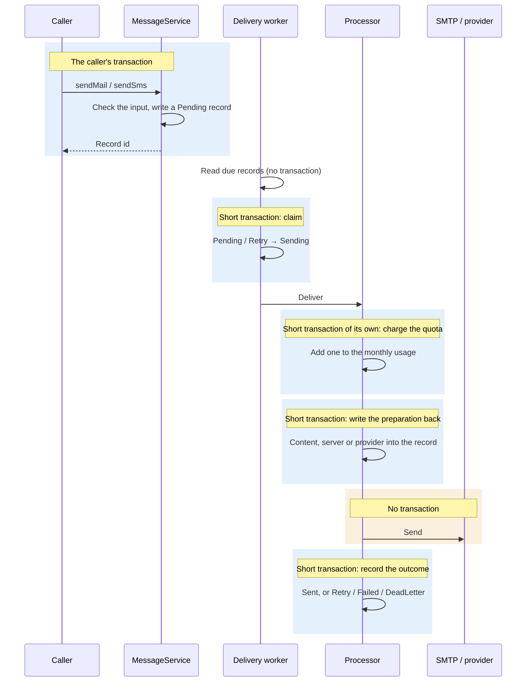

# Design notes

<Lead>

This page tabulates and draws a few parts of the message design: the terms the pages use, which transaction acceptance and delivery each run in, and why the send record itself is the queue — plus known limitations and test points.

</Lead>

The rules themselves live in the [Overview](./index), [Delivery & Retries](./delivery), [Email](./email), [SMS](./sms) and [Inbox](./inbox); this page does not repeat them and links to them instead.

## Glossary

| Term | In the code | Meaning |
|---|---|---|
| Send record | `MailSendRecord`, `SmsSendRecord` | Everything that happens to one email or SMS; it is itself the delivery queue |
| Acceptance | `MessageService.sendMail` / `sendSms` | Checks the caller's input, writes a <Status>Pending</Status> record and returns its id; runs in the caller's transaction |
| Delivery loop | `DeliveryPoller` | A pool of workers per instance and per channel, claiming due records and handing them to the processor |
| Due | `PENDING`, or `RETRY` with `next_retry_at <= now` | A record that can be claimed |
| Claim | `markSending` | Moves a record from <Status>Pending</Status> / <Status>Retry</Status> to <Status>Sending</Status> by its version; of claims made at the same time, only one succeeds |
| Preparation | `prepare` + `markPrepared` | On the first attempt, renders the template, chooses the server or provider and charges the quota, then writes the result back to the record; retries replay it as is |
| Marker code | `CONFIG_NOT_RESOLVABLE` and others | Why preparation failed — see [First attempt: preparing the record](./delivery#first-attempt-preparing-the-record) |
| Error category | `ErrorCategory` | Decides whether a failure is retried, fails or becomes a dead letter — see [Failures and retries](./delivery#failures-and-retries) |
| Stuck-send sweep | `ZombieRecordSweeper` | Puts records stuck in <Status>Sending</Status> for over 5 minutes back to retry |
| Dead letter | the `DEAD_LETTER` status, the `dead_letter_message` table | Records whose retries are used up, and poison messages Pulsar could not process |
| Send scope | `MessageScope`: `TENANT`, `PLATFORM` | Which tier the template is looked up in and which quota is charged; for mail with no server named, also which tier's default server is used |
| Platform tier | `tenant_id = -1` | The platform operator's configuration and templates, invisible to tenants |
| Quota bucket | one row of `TenantMessageUsage` | One tenant's (or the platform's) usage count for one month |
| Daily / per-minute window | `dailySendLimit`, `rateLimitPerMinute` | Each server's and each provider's daily and per-minute caps, counted in Redis |
| Route row | `SmsProviderRegion` | Which SMS providers a country may use |
| Provider binding | `SmsTemplateProviderBinding` | An SMS template's template id and signature at one provider |

## Transaction boundaries

<Lead>

Acceptance runs in the caller's transaction; after that, each write in the delivery loop is a short transaction of its own, and sending to the external service runs in no transaction at all. So a caller that rolls back leaves no record, and a slow send does not hold a database connection.

</Lead>

- **Acceptance**: the checks and the record write both run in the caller's transaction. If the caller rolls back, the record goes with it and nothing is sent. A mail or SMS rejection is thrown before anything is written and does not mark the caller's transaction rollback-only.
- **Claim**: a conditional update on the version, in one short transaction. When two threads or instances claim the same record at once, only one update succeeds.
- **Charging the quota** commits in its own transaction, separate from the write-back that follows: when the quota was charged but the write-back fails, the count stays (a slight overcount, which can be reconciled).
- **Writing the preparation back** and **recording the outcome** are one short transaction each, both on the version: if another update changed the record meanwhile (the stuck-send sweep put it back to retry, say), this write does not take effect, and the newer status stands.
- **The send** runs in no transaction and holds no database connection while it sends. When the send succeeds but recording the outcome fails, the record stays in <Status>Sending</Status> until the stuck-send sweep puts it back to retry: this is the price of "at least once".

## Why the send record is the queue

Earlier releases prepared the record at acceptance, then handed its id to a send consumer through the `message_outbox` table and Pulsar topics. Now acceptance only writes the record, and the delivery loop reads the record tables directly:

- **One set of statuses fewer.** The outbox row and the send record each had a set of statuses, kept consistent by transactions and compensation; now there is only the send record's, and the record alone tells which step a message is at and why it stopped.
- **Throughput is unaffected.** It is capped by the number of SMTP connections and by the providers' rates, not by the queue; a worker claims the next record as soon as it has sent one, and a backlog drains at concurrency ÷ time per send.
- **Safe with several instances.** A claim is a version comparison on the record; it needs neither a distributed lock nor a broker consumer group.
- **The scan's cost does not grow with the history.** A scan for due records runs for every send; it is two queries, each along its own status index, reading only the rows it returns — see [The delivery loop](./delivery#the-delivery-loop).

## Known limitations

- **No switching servers or providers.** Once a record has its server or provider, a failure is retried on that same one only, and a manual Retry of a prepared record goes to it too. When a provider is down for a long time, changing the default server or a template's preferred server only affects sends not yet prepared; to move prepared mail to another route, point the server config it uses at the backup provider (host and credentials), and the retries go out with the new settings.
- **Permanent mail failures are retried too, for now.** Once Spring has wrapped an SMTP failure, only the exception's class name is left, so an authentication failure or a refused recipient is handled as an unknown or temporary error, retried 5 times and then dead-lettered — see [Failures and retries](./delivery#failures-and-retries).
- **Server and provider configs changed in the UI take up to 5 minutes to take effect.** Configs are cached for 5 minutes, and saving in the admin UI does not evict the cache.
- **At least once.** When the send succeeds but recording the outcome fails, the message is sent again.
- **No synchronous send.** The caller gets no "sent" result; it can only look at the record.
- **Configuration problems are not reported at acceptance.** No server, a missing template or a used-up quota fails the record at delivery, and the caller gets no exception; ERROR-log alerts are how they are found.
- **SMS receipts and providers' mail events are not wired in automatically.** The application adds its own endpoints to receive what they push.
- **The mail fetch runs on one global schedule.** Every mailbox shares one `mail-fetch` scheduled task.
- **One number per SMS; at most 500 per batch.**

## Test points

### Acceptance

- No recipient, a malformed address or number, neither content nor a template: throws, writes nothing, and the caller's transaction can still commit.
- After the caller rolls back, the record does not exist and is never delivered.
- One invalid item in a batch: the whole batch is rejected and nothing is written; when all are valid, the ids come back in input order.
- Sending inside `ContextUtils.inTenantContext`: the record belongs to the tenant given; sending `PLATFORM` with no tenant context: the record is in the platform tier.

### Preparing and sending

- `TENANT` uses only the current tenant's templates and servers, and the platform tier's when the tenant has no default server; `PLATFORM` uses the platform tier's templates and quota, and for mail with no server named, only the platform tier's default server.
- A missing template, a missing server, a used-up quota, a render that comes out empty: the record is <Status>Failed</Status> with the right marker code and an ERROR log; once the gap is filled, Retry prepares the record afresh and sends it.
- A retry renders nothing again, chooses no server again and charges no quota again: after the template is changed, an already prepared record still goes out with the old content.
- A mail whose `templateId` points at a disabled template is sent all the same; `templateCode` finds enabled templates only.
- SMS: with a country route, the default provider is not used; with neither a route nor a default, the record fails; the template binding's external template id and signature are written into the record.

### Failures, retries and recovery

- A temporary error is retried after 30 seconds, 1 minute, 2 minutes, 4 minutes and 8 minutes (±50%); still failing on the 5th retry, the record goes to <Status>DeadLetter</Status> and leaves a row in the dead-letter table.
- A provider returning an error code or message for an authentication failure, an invalid address and the like: <Status>Failed</Status> at once, with no retry; mail is an exception for now, see [Known limitations](#known-limitations).
- A full rate-limit window: retried as rate-limited, after at least 5 minutes.
- Stopping an instance mid-send: after 5 minutes the record is put back to retry and sent.
- Manual Retry: <Status>Sent</Status> and <Status>Sending</Status> are refused; a batch Retry skips them and returns how many it actually requeued; `retry_count` keeps counting.

### Concurrency

- Two instances running at once: each record is sent once.
- One tenant sending a batch in a burst: the monthly usage matches the number sent; a record whose count update conflicts goes to <Status>Retry</Status>, not <Status>Failed</Status>.

### Receiving

- The same mail fetched twice is stored once.
- A bounce turns the matching <Status>Sent</Status> into <Status>Failed</Status> and records the bounce code; a read receipt records the read time.
