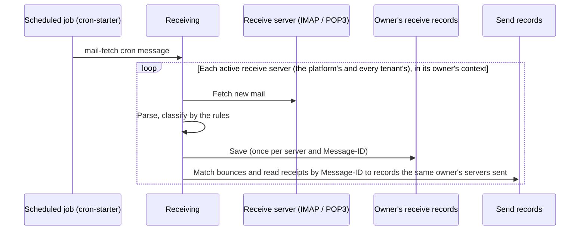

# Email

<Lead>

Mail goes out over SMTP. One email can have several recipients, CCs and BCCs, all sharing one send record. The platform and each tenant have their own send servers, templates and receive servers, in separate tables; a tenant with no send server has its mail relayed through the platform's default send server. With receiving configured, bounces and read receipts are also matched back to the send record of the original mail.

</Lead>

## Sending mail

<Lead>

Call `MessageService.sendMail`, with the content itself or with a template and its variables. The id returned points at a record waiting to be sent; rendering and the SMTP send both happen in the delivery loop, and the outcome is on the record.

</Lead>

```java
@Autowired
private MessageService messageService;

// Plain text.
SendMailDTO plain = new SendMailDTO();
plain.setTo(List.of("alice@example.com"));
plain.setSubject("Hello");
plain.setTextBody("Welcome to Softa.");
Long recordId = messageService.sendMail(plain);

// Several recipients share one MIME message and one send record.
SendMailDTO offer = new SendMailDTO();
offer.setTo(List.of("a@x.com", "b@x.com"));
offer.setCc(List.of("manager@example.com"));
offer.setSubject("Offer Letter");
offer.setHtmlBody("<p>Dear Alice...</p>");
offer.setAttachments(List.of(attachment)); // FileInfo from file-starter
messageService.sendMail(offer);

// A template, rendered at delivery with these variables.
SendMailDTO welcome = SendMailDTO.ofTemplate(List.of("alice@example.com"), "USER_WELCOME",
        Map.of("name", "Alice", "activationUrl", "https://app.example.com/activate/abc123"), MessageScope.TENANT);
messageService.sendMail(welcome);

// Independent messages in one call: one record each, ids in input order.
List<Long> ids = messageService.sendMailBatch(List.of(
        SendMailDTO.ofTemplate(List.of("alice@example.com"), "ORDER_CONFIRMATION", Map.of("orderNo", "SO-1001"), MessageScope.TENANT),
        SendMailDTO.ofTemplate(List.of("bob@example.com"), "ORDER_CONFIRMATION", Map.of("orderNo", "SO-1002"), MessageScope.TENANT)));
```

> [!NOTE]
>
> Mail can only be sent asynchronously. An SMTP `250 OK` only means the server accepted the message, not that the user has it; the user often still waits seconds to minutes. Problems such as no server or a missing template show on the record (<Status>Failed</Status>, with the reason); the caller gets no exception.

| Field | Description |
|---|---|
| `to` / `cc` / `bcc` | Recipient lists; at least one `to` |
| `subject`, `htmlBody`, `textBody` | Content given directly. With a subject given, the subject is not rendered; with either body given, neither body is rendered from the template |
| `bodyMode` | The shape of the body, see [Body modes](#body-modes); when not given, inferred from which bodies are given |
| `templateCode` / `templateId`, `templateVariables` | The template and its variables; `templateId` names the exact row and takes precedence over `templateCode`. Both are looked up in the send scope's tier |
| `attachments` | Attachments: upload them through file-starter first, then pass in the resulting `FileInfo`; only its `fileId` is used to read the content, see [Attachments](#attachments) |
| `serverConfigId` | Names the send server, looked up in the send scope's table, see [Send servers](#send-servers) |
| `replyTo`, `readReceiptRequested`, `priority` | Reply-to address, whether to request a read receipt, priority. When not given, the reply-to address comes from the template's setting, then the server's; the priority from the template's; the read receipt from the server's setting |
| `scope` | `TENANT` (default) or `PLATFORM`: decides which tier's template and send server are used; the record is filed under the tenant the call is made in, whatever the scope, see [Tenant tier and platform tier](./index#tenant-tier-and-platform-tier) |

### Address rules

Addresses are checked at acceptance. A wrong address is an error straight away, naming the field and the entry, rather than an SMTP failure that only turns up on the record at send time.

- Each entry of `to`, `cc` and `bcc` must be exactly one mailbox address, which may carry a display name (`Alice <alice@x.com>`); an entry holding several addresses is refused.
- `replyTo` is one string holding one or more addresses, separated by commas, semicolons or newlines, and normalized to a comma-separated list at acceptance. Input separated by commas only is never rewritten, so quoted display names containing commas (`"Smith, John" <j@x.com>`) stay intact.

### Attachments

Attachments go out by fileId: each one's content is read from storage by its `fileId` when the mail is sent, and `FileInfo.url` is not used. Do not put file addresses in the body either: a `FileInfo.url` either opens only for the account it was given to or expires after an hour (see [File addresses and keys](../file#file-addresses-and-keys)). For the recipient to see a file later, send it as an attachment, or link to the record's page, where the recipient signs in and reads the record.

In a flow, use the Send Email node's `attachments`: a list of fileIds, each of which may be a `{{ }}` template, such as a Generate File node's result `{{ generated.fileId }}` (`generated` being that node's Output variable); see [Generated files and email attachments](../flow/automation#generated-files-and-email-attachments).

## Send servers

<Lead>

An email goes through one server only: the one the caller names, else the one its template prefers, else the default server. Once chosen, the server is fixed on the record: a failed send is retried on the same server only and never switches to another.

</Lead>

1. `SendMailDTO.serverConfigId`: named by the caller.
2. The template's `preferredServerConfigId`: the template's preference.
3. The default server: for `TENANT`, the current tenant's enabled default server, the one with the smallest `sequence` when there are several; when the tenant has none, its mail is relayed through the platform's default server. `PLATFORM` uses only the platform's default server and never goes through the tenant's own servers.
4. None of these: the record fails with `CONFIG_NOT_RESOLVABLE`.

A server named in step 1 or 2 is looked up in the send scope's table: `TENANT` takes only the current tenant's own servers, `PLATFORM` only the platform's; an id from the other table counts as not found, and the record fails with `CONFIG_NOT_RESOLVABLE`. A server named by id is used even when it is disabled. Once one is chosen, the record keeps the server's owner, `serverOwner` (`Tenant` / `Platform`), and `serverConfigId`, and retries find the same server by the two.

The tenant's `MailSendServerConfig` and the platform's `PlatformMailSendServer` have the same fields, and so do the tenant's `MailTemplate` and the platform's `PlatformMailTemplate`.

| Field | Used for | Not used for |
|---|---|---|
| The send server's `isDefault` | Marking the owner's (the tenant's or the platform's) default server; when the standard write endpoints save one as default, the owner's previous default is cleared | Failover: only the first default is taken |
| The send server's `sequence` | Deciding which one to use when several are default; also the list order | Failover priority |
| The template's `preferredServerConfigId` | The template's preferred server: a tenant template can choose only one of its tenant's servers, a platform template only one of the platform's, checked on every write | A hard binding: a server the caller names still comes first |
| The send server's `dailySendLimit`, `rateLimitPerMinute` | This server's daily and per-minute windows, all tenants together, see [Rate limits](./delivery#rate-limits) | Tenants' send quotas |

Common uses of a template's preferred server: marketing templates through a provider with open tracking and transactional mail through a high-deliverability one; a split by sender domain (HR templates from `hr@company.com` through the corporate Exchange, brand templates from `noreply@brand.com`); legal disclosure templates locked to an internal server. It is a preference, not a requirement: during a provider outage, operators can name a backup server at the call site without changing the templates one by one.

### Connection reuse and authentication

- **Sender**: the from address and name come from the server configuration (its from address, or the username when it has none), read at each send.
- **When changes take effect**: at once, on save. Server configs are cached in Redis for 5 minutes, but every write, a save in the admin UI included, evicts that server's entry and its owner's default when it commits.
- **Connection reuse**: consecutive mail through the same server reuses the logged-in connection, so the TCP connection, the TLS handshake and AUTH happen only once. When a server does not accept a second message on the same connection, turn off `connectionReuseEnabled` on its config (on by default), and each message through it opens and closes its own connection.
- **Authentication**: user name and password. Where a provider takes an API key as the SMTP credential (SendGrid, Amazon SES, Postmark, Mailgun), put the key in the password. Where the mailbox has two-step verification, use an app password issued by the mailbox provider. A self-hosted MTA (such as Stalwart or Postfix) takes its account and password as usual.
- **Connectivity test**: `POST /MailSendServerConfig/testConnectivity?id=` (for a platform server, `POST /PlatformMailSendServer/testConnectivity?id=`) opens a new connection with this server's settings and returns whether it could connect and log in.

<Dev title="SMTP connection pool and config cache">

`SmtpMailTransport` keeps a small connection pool for each server config. An idle connection is probed with `NOOP` before it is reused; a connection that has had an error, has sent 100 messages or has been idle for more than 30 seconds is closed instead. This idle limit is below the idle timeout of common NATs and load balancers; should a connection be dropped silently anyway, only the probe's read times out, and nothing is sent wrongly. The pool is keyed by the settings the connection was opened with, so once a changed config (a new host, a new password) is read, a new connection is opened. For a server with connection reuse turned off, its existing pool is closed on the next send.

Server configs are cached in Redis for 5 minutes, the tenants' and the platform's under separate keys (`MailConfigCache`, its defaults keyed by tenant; `PlatformMailConfigCache`) that never overlap. Whatever endpoint creates, updates or deletes a server, `ConfigCacheEvictor` evicts its by-id entry and its owner's default once the write commits, so the next send reads the new config. A tenant's server read from the by-id cache is also checked to be the current tenant's before it is used. The field is called `sequence`, not `priority`: on the mail side it only orders the defaults and the list, and is not a retry chain; the SMS side calls it `priority` because country routing and template bindings both pick providers by it.

</Dev>

### Tenant server hosts

With multi-tenancy on, a tenant's own send and receive servers must be on the internet: a host that is, or resolves to, an address inside the deployment is refused. Such addresses include loopback, link-local (the cloud metadata address `169.254.169.254` among them), private ranges, carrier-grade NAT (`100.64.0.0/10`), multicast and IPv6 unique local addresses. Without this, a tenant could aim the application's SMTP, IMAP and POP3 clients at internal services and read their replies and errors back through the connectivity test.

- **On save**, checked once: a host resolving to an internal address cannot be saved; a host that does not resolve yet is let through.
- **Before every connection**, checked again: before sending, fetching and the connectivity test, a host resolving to an internal address is refused, which also catches a name that resolves inward only later. A send stopped here fails its record with `CONFIG_NOT_RESOLVABLE`, not retried automatically. A host that does not resolve is not stopped here: the connection itself fails and is retried like any connection error.
- The platform's servers are not checked, nor is anything with multi-tenancy off.
- Where tenants' servers really sit on a private network (a test environment whose tenants send through a local mail catcher, say), set `softa.message.mail.block-private-tenant-hosts` to false.

## Templates

<Lead>

Reusable content goes into templates. A tenant's templates are in `MailTemplate`, the platform's in `PlatformMailTemplate`. A code lives in one tier and is looked up by the send scope: `TENANT` looks only at the current tenant's templates, `PLATFORM` only at the platform's, and a template not found in one tier is not looked for in the other.

</Lead>

- The subject gets a simple `{{ variable }}` substitution, leaving a placeholder as it is when its variable is missing; the body is rendered with Pebble, so `` loops can be used, and variables output in an HTML body are escaped automatically (use `| raw` where HTML really must be output).
- Date and time variables print as the API writes them: a `LocalDateTime` as `2026-11-12 13:00:40`, a `LocalDate` as `2026-11-12`, in the server's local time with no zone. The caller passes the date object itself, not its `toString()`, which would be printed as the ISO text `2026-11-12T13:00:40.123456789`. The variables are stored with the send record as JSON, so the template receives that text; for another format, give the `date` filter the stored one: `{{ time | date("dd/MM/yyyy HH:mm", existingFormat="yyyy-MM-dd HH:mm:ss") }}`.
- A lookup by code only finds active templates; given a `templateId`, that row is used whether or not it is active (for test sends from the editor).
- A missing template or a rendering error fails the record with `TEMPLATE_NOT_RESOLVABLE`; the caller gets no exception. A code that lives in the other tier fails the same way, with a message naming the scope to send it with.
- A tenant template may not take a code a platform template already has: every write path refuses it, the template pages, import and seed loading included. Platform templates are maintained on the platform's pages only; tenants can neither see nor change them.

```bash
POST /MailTemplate/createOne
{
  "code": "USER_WELCOME",
  "name": "User Welcome Email",
  "subject": "Welcome, {{ name }}!",
  "bodyHtml": "<h1>Welcome, {{ name }}</h1><p><a href='{{ activationUrl }}'>Activate</a></p>",
  "bodyMode": "HTML",
  "active": true
}
```

### Body modes

`bodyMode` sets the MIME shape of a template (and of every record sent from it): the editor shows the inputs that go with it, and the send assembles the MIME from it.

| bodyMode | Sent as | HTML body | Plain-text body |
|---|---|---|---|
| `HTML` | single `text/html` | authored | — |
| `PLAIN` | single `text/plain` | — | authored |
| `HTML_WITH_DERIVED_PLAIN` | `multipart/alternative` | authored | derived from the HTML when the template is rendered on the first attempt |
| `HTML_WITH_AUTHORED_PLAIN` | `multipart/alternative` | authored | authored; when empty, derived from the HTML instead, and the record is truthfully marked `HTML_WITH_DERIVED_PLAIN` |

Switching `bodyMode` in the editor moves the existing body into the input the new mode actually uses (HTML to text, text to escaped HTML paragraphs; a target input that already has content is not overwritten) and clears the input the new mode does not use. This changes only the form: nothing is stored before saving, and Cancel restores it.

### Editor tools

The template editor's Preview & Send Test dialog is backed by three operations. `id` targets the row being edited, with no resolution and no active-status filter, so a disabled template can be fully checked and test-sent before it is enabled; `code`, for programmatic callers, is looked up in the tier the endpoint serves.

- `GET /api/mail/templates/variables?id=|code=`: the variables the template uses, in order of first appearance and classified for the input UI: `VARIABLE` (a plain name, one line of text), `COLLECTION` (a collection a loop iterates, entered as JSON), `EXPRESSION` (an operand in an expression, entered as JSON), `RESERVED_FIELD` (resolved server-side). Names internal to the template — loop variables, Pebble's built-in `loop`, the targets of `` — are not listed.
- `POST /api/mail/templates/preview`: renders the subject and body with the given variables, without sending.
- Test send: `SendMailDTO.templateId` names this row and goes through the full production path: what was previewed is what goes out.

The two `/api/mail/templates/…` endpoints read the tenant's templates. The platform's template editor uses `GET /PlatformMailTemplate/variables` and `POST /PlatformMailTemplate/preview`, which take the same parameters; a platform template's test send also goes through `/api/mail/send`, with its `templateId` and `scope = PLATFORM`.

## Receiving, bounces and read receipts

<Lead>

With a receive server configured, a scheduled job pulls new mail into receive records: what a tenant's receive server fetches is stored as that tenant's `MailReceiveRecord`, what the platform's fetches as `PlatformMailReceiveRecord`. Bounce reports and read receipts are matched to the original send record by Message-ID: a bounce changes <Status>Sent</Status> to <Status>Failed</Status> and records the bounce code; a read receipt records when the mail was read.

</Lead>

Received mail belongs to the owner of the receive server it arrived through, and neither side falls back to the other: a tenant receives only through its own receive servers, the platform only through the platform's. Bounces and read receipts can be matched only to records the same owner's send servers carried:

- **The platform's receive servers** match the platform's own mail and the tenants' mail it relayed (records whose `serverOwner` is `Platform`). When relayed mail bounces, the tenant sees the bounce flag and code in its own send log; the bounce itself is stored as `PlatformMailReceiveRecord` and stays with the platform, which watches the bounce rate of its own servers in one place.
- **A tenant's receive servers** match only that tenant's mail sent through its own servers (`serverOwner` is `Tenant`). A tenant with a send server but no receive server gets no bounces or read receipts for that mail.

The fetch endpoints are split by owner too:

- When the tenant has no active default receive server, `fetchNewMails()` (`POST /MailReceiveRecord/fetch`) fails with "not configured" instead of using the platform's server.
- `fetchNewMails(serverConfigId)` (`POST /MailReceiveRecord/fetchByServer`) takes only the tenant's own servers; a platform server's id counts as not found.
- The platform receives through the `PlatformMailReceiveRecord` endpoints: `POST /PlatformMailReceiveRecord/fetch`, `/fetchByServer`, `/markAsRead` and `/markAsReadBatch`.
- Earlier releases used the platform's default receive server for a tenant that had none, which stored mail from the platform's mailbox under the tenant. A tenant that was fetching that way now needs a receive server of its own to go on receiving; the mail it already holds stays where it is.



- **Scheduled fetch** needs cron-starter: register a cron job in it whose name starts with `mail-fetch`. It fires through the `cron-task` topic, and each run fetches every active receive server of the platform and of every tenant: the platform's in the platform's context, stored as `PlatformMailReceiveRecord`; a tenant's in that tenant's, stored as its `MailReceiveRecord`. This one global cron job sets the cadence; a cadence per inbox is not supported.
- **Manual fetch**: inject `MailReceiveService`.

```java
@Autowired
private MailReceiveService mailReceiveService;

// The current tenant's receive servers; never the platform's.
int fetched = mailReceiveService.fetchNewMails();                // the tenant's default receive server
int fromOne = mailReceiveService.fetchNewMails(serverConfigId);  // one of the tenant's own servers
mailReceiveService.markAsRead(recordId);
mailReceiveService.markAsRead(List.of(id1, id2, id3));

// The platform's receive servers.
int platformFetched = mailReceiveService.fetchPlatformMails();
mailReceiveService.markPlatformAsRead(List.of(id1, id2));
```

- **Classification**: each message is checked against the rules in turn, and the first rule that recognizes it decides its type; a few flag checks then add flags such as encrypted, mailing list and spam.

| Type | What it is | Effect on the send record |
|---|---|---|
| `ReadReceipt` | A read receipt (MDN) | The original send record is marked read, with the time it was read |
| `CalendarInvite` | A calendar invitation | — |
| `AutoReply` | An automatic or out-of-office reply | — |
| `Bounce` | A bounce report (DSN); mail from mailer-daemon or postmaster; mail whose subject or body contains words such as Undeliverable, rejected or 未送达 | When matched to its original send record, that record goes from <Status>Sent</Status> to <Status>Failed</Status>, with the bounce code recorded. A DSN reporting only a delay or a success, no failure, is stored but not matched |
| `Normal` | Ordinary mail: no rule recognized it | — |
| `Unknown` | A rule failed with an error during classification | — |

<Dev title="How fetching works, and the classification rules">

IMAP keeps a UID watermark per folder (a tenant's in `MailFetchImapWatermark`, the platform's in `PlatformMailFetchWatermark`). Before fetching, it takes a soft lease so that two instances do not fetch the same folder at once (a lease held for over 1 hour means its holder is taken to be down); when UIDVALIDITY changes, the watermark goes back to zero, and duplicate messages are removed by Message-ID. POP3 deletes what it fetches. Each run handles at most 100 messages per folder.

`MailClassifier` is a chain of responsibility over the `MailClassificationRule` beans; the built-in rules, in `@Order`, are: read receipt (10) → calendar invite (15) → auto-reply (18) → DSN (20) → mailer-daemon (30) → keywords (99). For bounces and receipts, `BounceReceiptLinker` finds the send records by Message-ID in one batch, only among those the same owner's send servers carried (`findByMessageIds(ids, carriedBy)`: what the platform receives is matched across tenants, what a tenant receives only against its own records), then moves each on with a version check (`markBounced`, `markReadReceiptReceived`).

The original mail's Message-ID is read by `MailClassificationSupport.extractOriginalMessageId`, for all three paths (standard bounce, read receipt, non-standard bounce), in this order, the first found winning:

1. the bounce's or receipt's own `In-Reply-To`, then the first entry of `References`;
2. a read receipt's `Original-Message-ID` field, in its `message/disposition-notification` part (RFC 8098);
3. the returned original's headers: the `Message-ID` in a `text/rfc822-headers` or `message/rfc822` part. RFC 3464 does not ask a bounce for either header of step 1, so most standard bounces are matched here; so is a non-standard bounce that attaches the original.

The value read is the one the send record stores: JavaMail's `<id@host>`, angle brackets kept and case untouched, since `findByMessageIds` matches it exactly. Steps 2 and 3 look at the message's direct parts only and skip a part that cannot be read. A bounce whose original headers are in none of these places, or whose Message-ID a relay rewrote, is stored but matches no send record.

A DSN is matched only when a recipient's `Action` is `failed`: `delayed` means the MTA is still retrying, and `delivered`, `relayed` and `expanded` report success, so matching them would mark the record bounced and <Status>Failed</Status>; they are stored only. The DSN fields are read from the text of the `message/delivery-status` part: Jakarta Mail has no content handler for that type, so its `getContent()` is a raw stream.

To recognize a provider's own formats (an older Exchange's bounces, the bounce formats of Chinese ISPs), add a rule:

```java
@Component
@Order(25)  // between DsnRule (20) and MailerDaemonRule (30)
public class ExchangeNdrRule implements MailClassificationRule {
    @Override
    public Optional<MailClassification> match(MimeMessage message) throws Exception {
        // ... return MailClassification.bounce(info) if it matches
        return Optional.empty();
    }
}
```

There is no HTTP callback for receiving delivery events. For delivery events a provider pushes (an ESP's mail events), the application adds a controller that calls the send record service's status transitions.

</Dev>

## Status reference

For the statuses of a **send record**, see [Send record statuses](./index#send-record-statuses). Mail records have a few more fields: `bounced` and `bounceCode` (written when a bounce arrives), `readReceiptReceived` and `readReceiptReceivedAt` (written when a read receipt arrives), `messageId` (the SMTP Message-ID, which bounces and receipts are matched by), `serverOwner` (`Tenant` / `Platform`: whose send server carried the mail, written on the first attempt), and `sentAt` and `sendDurationMs` (when the successful attempt was sent, and how long it took).

A tenant's send log page uses `TenantMailSendRecord` and lists only the records filed under the tenant, the platform's notices made for it included (security notices about its accounts, the sign-in codes and password resets of people with an account in that one company, subscription reminders): recipients, subject, template code, status, error code and reason, send time, bounce and read receipt, `serverOwner` and the like, with no bodies, template variables or attachments.

**Receive records** (the same for a tenant's `MailReceiveRecord` and the platform's `PlatformMailReceiveRecord`):

| Status | Meaning |
|---|---|
| `Unread` | Newly fetched mail |
| `Read` | Read |
| `Archived` | Archived |
| `Deleted` | Deleted |
