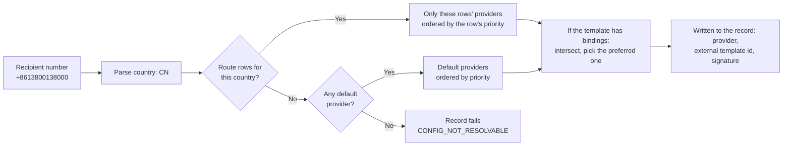

# SMS

<Lead>

An SMS goes to one number. The recipient's country decides which provider sends it: when the country has routes, the choice is among those providers only, and the default provider is used only when it has none; a template can also have its own template id and signature at each provider. One provider is chosen on the first attempt and written to the record; retries replay it as it is and never change provider.

</Lead>

SMS is a service the platform provides: providers, country routes, SMS templates and template bindings exist once, on the platform, in tables with no tenant column; tenants can neither see nor configure them. The SMS send log, too, is read on the platform's pages only, with no tenant view.

## Sending SMS

<Lead>

Call `MessageService.sendSms` with the number in E.164 format (`+` followed by the country code). Give the content directly, or a template and its variables. The id returned points at a record waiting to be sent; rendering, routing and the provider call all happen in the delivery loop.

</Lead>

```java
@Autowired
private MessageService messageService;

// Plain text to one number.
SendSmsDTO shipped = new SendSmsDTO();
shipped.setPhoneNumber("+12015550123");
shipped.setContent("Order #1234 has been shipped.");
Long id = messageService.sendSms(shipped);

// A template, rendered at delivery with these variables.
messageService.sendSms(SendSmsDTO.ofTemplate("+8613800138000", "VERIFY_CODE",
        Map.of("code", "123456", "minutes", 5), MessageScope.TENANT));

// One DTO and one send record per number; each number gets its own variables.
List<Long> ids = messageService.sendSmsBatch(List.of(
        SendSmsDTO.ofTemplate("+12015550123", "ORDER_STATUS", Map.of("orderId", "A001", "status", "Shipped"), MessageScope.TENANT),
        SendSmsDTO.ofTemplate("+12015550124", "ORDER_STATUS", Map.of("orderId", "B002", "status", "Delivered"), MessageScope.TENANT)));
```

| Field | Description |
|---|---|
| `phoneNumber` | One E.164 number; at acceptance its format is checked, and its country must be recognizable |
| `content` | Content given directly; when given, no template is rendered |
| `templateCode`, `templateVariables` | The template and its variables |
| `providerConfigId` | Names the provider, skipping routing by country |
| `externalTemplateId`, `signName` | The provider-side template id and signature; when the template's binding sets them, the binding wins |
| `scope` | `TENANT` (default) or `PLATFORM`: has no effect for SMS and is only recorded on the send. Templates and provider routing exist once, on the platform; the record is filed under, and draws on the quotas of, the tenant the call is made in, see [Tenant tier and platform tier](./index#tenant-tier-and-platform-tier) |

The batch method takes 1 to 500 independent messages, each with one number and one record; it checks them all before writing any, and returns the ids in input order.

## Templates

<Lead>

SMS templates exist once, on the platform, each `code` unique across the table; a template is looked up by `code`, whatever the send scope. Placeholders use `{{ variable }}`.

</Lead>

```bash
POST /SmsTemplate/createOne
{
  "code": "VERIFY_CODE",
  "name": "Verification Code",
  "content": "Your verification code is {{ code }}. Valid for {{ minutes }} minutes.",
  "active": true
}
```

Some providers (Aliyun and Tencent Cloud, for example) require sending with a template and signature they have approved. For these, give the template **provider bindings** (`SmsTemplateProviderBinding`): one row per provider, stating the external template id and signature, optionally limited to a country, and with its own priority. Such a provider is sent the template variables rather than the rendered text: Aliyun fills them by name, Tencent Cloud by position, `{1}`, `{2}`… taking the variables in the order the softa SMS template's content names them (fixed on the first attempt, the same on every retry). A missing template or a rendering error fails the record with `TEMPLATE_NOT_RESOLVABLE`, and empty rendered content with `CONTENT_INVALID`.

## Provider routing

<Lead>

First, does the recipient's country have route rows? If it does, the choice is only among the providers those rows point to; only if it does not are the providers marked default used; with neither, the record fails with `CONFIG_NOT_RESOLVABLE`. There is no implicit "any active provider will do".

</Lead>



| Table | Purpose | Per-row data |
|---|---|---|
| `sms_provider_config` | Provider accounts and credentials | API key, sender number, `isDefault`, `priority` |
| `sms_provider_region` | Routing by country | `region_code` (ISO 3166-1 alpha-2 country code), `dial_code`, `priority` |

One provider account usually serves many countries, so routing has a table of its own, and each country's priority is on its route row. When route rows are written through the service, country codes are validated against the country table of `reference-data-starter`; `dial_code` (the international calling code) is filled in by the framework from the country code, and lists show a route as "CN (+86) → Aliyun"; do not edit `dial_code` by hand.

- **An exact match wins outright.** As soon as any route row matches the recipient's country, only the providers of the matching rows are used; the default providers are not merged in. When the providers the route rows point to are all disabled or missing, the country is treated as having no route, and the default providers are used instead.
- **Defaults are used only when there are no route rows.** There is no wildcard row such as `region_code = '*'`; "every other country" is expressed by `isDefault = true`.
- **To have a default provider also serve a configured country, add another route row for that country.** That way a country configured explicitly never goes out through another channel by mistake (SMS to Taiwan never goes through a mainland-China-only line, for example).
- **Not split by tenant.** There is one set of routes, the platform's, and every tenant's SMS goes by it, `PLATFORM`-scope SMS too.

For example, with this configuration:

| `sms_provider_config` | id | name | provider_type | is_default | priority |
|---|---|---|---|---|---|
|  | 1 | Aliyun-China | Aliyun | false | 10 |
|  | 2 | Tencent-China | Tencent | false | 20 |
|  | 3 | Twilio-Global | Twilio | true | 1 |
|  | 4 | Infobip-Backup | Infobip | true | 2 |

| `sms_provider_region` | provider_config_id | region_code | priority |
|---|---|---|---|
|  | 1 | CN | 10 |
|  | 2 | CN | 20 |
|  | 3 | TW | 10 |

| Recipient | Candidate providers | Notes |
|---|---|---|
| `+8613800138000` (CN) | Aliyun, Tencent | Exact match, ordered by the route rows' priority |
| `+886912345678` (TW) | Twilio | Exact match; Infobip is not added as a fallback |
| `+33123456789` (FR) | Twilio, Infobip | No route row for FR, so the default providers |
| A country with no route rows and no default provider | — | The record fails with `CONFIG_NOT_RESOLVABLE`; retry once the configuration is filled in |

### Picking one provider

1. The caller gave `providerConfigId`: it is the only candidate, without looking at country routing; when the template has provider bindings, it too must have a usable binding, or the record fails with `CONFIG_NOT_RESOLVABLE`.
2. Content given directly (no template), or a template with no provider bindings at all: the first provider among the candidates; the external template id and signature are the ones the caller gave.
3. A template with provider bindings: only the candidate providers' bindings count, and only bindings either not limited to a country or limited to the recipient's country. When one provider has several bindings, one limited to the country wins over one that is not; between providers, the binding's `priority` decides (lower first), ties going by candidate order. The external template id and signature come from the binding. When no candidate has a usable binding, the record fails with `CONFIG_NOT_RESOLVABLE`.

The chosen provider, external template id and signature are written to the record's `provider_config_id`, `provider_type`, `external_template_id` and `sign_name`. Later retries replay them as they are, and a provider error never switches to another provider: the failure is retried or stops by the rules in [Failures and retries](./delivery#failures-and-retries).

<Dev title="Built-in providers and implementation">

Built-in adapters: Twilio, Infobip, Bird, CM, Sinch, Aliyun, Tencent Cloud (`SmsProvider`). [libphonenumber](https://github.com/google/libphonenumber) parses the country from the E.164 number by the longest prefix, so `+886…` is TW and is not mistaken for CN because of `+86`. `SmsProviderDispatcher` gives the candidates, and `SmsRoutingPlanner` intersects them with the template's bindings. `SmsProviderConfig`, `SmsProviderRegion`, `SmsTemplate` and `SmsTemplateProviderBinding` are none of them multi-tenant models and have no `tenant_id` column. Provider configs are cached in Redis for 5 minutes, and every write, a save in the admin UI included, evicts the entry when it commits, so a change takes effect at once. A provider's `apiKey` and `apiSecret` are stored encrypted and masked when read through the API; leave them out of an update to keep the stored values. message-starter requires `reference-data-starter` on the classpath; country routing cannot work without it.

</Dev>

## Delivery receipts

A record is <Status>Sent</Status> as soon as the provider accepts the message. Whether the SMS really reached the phone is in the record's `deliveryStatus` (`Unknown`, `Delivered`, `Undelivered`, `Failed`) and `deliveryStatusUpdatedAt`: the framework does not receive providers' receipt pushes, and unless the application writes receipts back to the record, `deliveryStatus` stays `Unknown`. To take receipts, add a controller to the application that receives the provider's pushes and updates the record's `deliveryStatus` and `deliveryStatusUpdatedAt` itself; the send record service has no ready-made method for this.

## Status reference

SMS send records have the same statuses as mail, see [Send record statuses](./index#send-record-statuses); SMS has no bounces, so <Status>Sent</Status> is final. A record's `tenantId` says whom it is filed under and whose quota it was charged to; `SmsSendRecord` is not split by tenant, and its list, detail and retry endpoints refuse a tenant caller.
