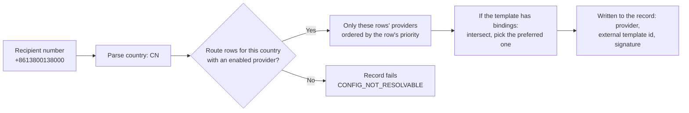

# SMS

<Lead>

An SMS goes to one number. The recipient's country decides which provider sends it: the choice is only among the providers the country's routes point to, and a country with no route cannot be sent to; a template can also have its own template id and signature at each provider. One provider is chosen on the first attempt and written to the record; retries replay it as it is and never change provider.

</Lead>

SMS is a service the platform provides: providers, country routes, SMS templates and template bindings exist once, on the platform, in tables with no tenant column; tenants can neither see nor configure them. The SMS send log, too, is read on the platform's pages only, with no tenant view.

## Sending SMS

<Lead>

Call `MessageService.sendSms` with the number in E.164 format (`+` followed by the country code). Give the content directly, or a template and its variables. The id returned points at a record waiting to be sent; rendering, routing and the provider call all happen in the delivery loop.

</Lead>

```java
@Autowired
private MessageService messageService;

// Plain text to one number.
SendSmsDTO shipped = new SendSmsDTO();
shipped.setPhoneNumber("+12015550123");
shipped.setContent("Order #1234 has been shipped.");
Long id = messageService.sendSms(shipped);

// A template, rendered at delivery with these variables.
messageService.sendSms(SendSmsDTO.ofTemplate("+8613800138000", "VERIFY_CODE",
        Map.of("code", "123456", "minutes", 5), MessageScope.TENANT));

// One DTO and one send record per number; each number gets its own variables.
List<Long> ids = messageService.sendSmsBatch(List.of(
        SendSmsDTO.ofTemplate("+12015550123", "ORDER_STATUS", Map.of("orderId", "A001", "status", "Shipped"), MessageScope.TENANT),
        SendSmsDTO.ofTemplate("+12015550124", "ORDER_STATUS", Map.of("orderId", "B002", "status", "Delivered"), MessageScope.TENANT)));
```

| Field | Description |
|---|---|
| `phoneNumber` | One number with its country code, such as `+6591234567`. Spaces, dashes and brackets are dropped: the record stores, and the provider is sent, E.164. Acceptance refuses a number without its country code, one with letters or an extension, one with the wrong number of digits for its country, and one whose country cannot be told (a range libphonenumber does not know yet under a calling code several countries share, such as +1, +7, +44 or +61). Whether the range is assigned is not checked: a range a country opens can be sent to before libphonenumber is upgraded, and a number in an unassigned range is the provider's to refuse |
| `content` | Content given directly; when given, no template is rendered |
| `templateCode`, `templateVariables` | The template and its variables |
| `providerConfigId` | Names the provider, skipping routing by country |
| `externalTemplateId`, `signName` | The provider-side template id and signature; when the template's binding sets them, the binding wins |
| `category` | The message category, overriding the template's; the only way to give one to direct content, see [Message category](#message-category) |
| `scope` | `TENANT` (default) or `PLATFORM`: has no effect for SMS and is only recorded on the send. Templates and provider routing exist once, on the platform; the record is filed under, and draws on the quotas of, the tenant the call is made in, see [Tenant tier and platform tier](./index#tenant-tier-and-platform-tier) |

The batch method takes 1 to 500 independent messages, each with one number and one record; it checks them all before writing any, and returns the ids in input order.

A screen about to text a code to a number the person just typed calls `MessageService.canSendSms(phoneNumber)` first: it is true only when the number would be accepted and its country has a usable route, so the screen can say the country is not supported before sending. `sendSms` itself does not refuse a number for want of a route: the record fails with `CONFIG_NOT_RESOLVABLE` on its first attempt, and a retry once the route is added recovers it.

## Templates

<Lead>

SMS templates exist once, on the platform, each `code` unique across the table; a template is looked up by `code`, whatever the send scope. Placeholders use `{{ variable }}`. A date or time variable is passed as the date object itself and prints as the API writes it (`2026-11-12 13:00:40`), as in mail templates.

</Lead>

A template may name, in `variableSetName`, the set of variables it is written against; the rules are those of a mail template's [variable source](./email#where-a-templates-variables-come-from): on save, a name the set does not have is refused; on send, an object (`SendSmsDTO.ofTemplate(phoneNumber, code, variables, scope)`) of another set throws a `BusinessException`. Empty means unchecked. An SMS template has no loops or conditions.

One difference from mail: a component with no value is **not sent**, rather than sent empty. A provider that fills its own registered template is handed the variables themselves, some by position, and would refuse one more than its template takes.

```bash
POST /SmsTemplate/createOne
{
  "code": "VERIFY_CODE",
  "name": "Verification Code",
  "content": "Your verification code is {{ code }}. Valid for {{ minutes }} minutes.",
  "category": "OTP",
  "active": true
}
```

### Message category

`category` says what a message is for, in the terms carriers and regulators sort traffic by: `OTP` (a verification code), `Transactional` (sent because of the recipient's own business: approvals, payslips, account changes), `Marketing` (promotion). The template carries a default, and a sender may override it with `SendSmsDTO.category`; the first attempt fixes it on the record and retries keep it. A provider that routes or prices by it is told in its own words by its adapter, so far only Aliyun Global (`Type`); the others do not read it. It may be left empty anywhere, and then none is sent.

Some providers (Aliyun Mainland and Tencent Cloud, for example) require sending with a template and signature they have approved. For these, give the template **provider bindings** (`SmsTemplateProviderBinding`): one row per provider, stating the external template id and signature, optionally limited to a country, and with its own priority. Such a provider is sent the template variables rather than the rendered text: Aliyun fills them by name, Tencent Cloud by position, `{1}`, `{2}`… taking the variables in the order the softa SMS template's content names them (fixed on the first attempt, the same on every retry). Every other provider, Aliyun Global included, is sent the rendered text and needs no binding. A missing template or a rendering error fails the record with `TEMPLATE_NOT_RESOLVABLE`, and empty rendered content with `CONTENT_INVALID`.

## Provider routing

<Lead>

First, does the recipient's country have route rows? If it does, the choice is only among the enabled providers those rows point to; if it does not, sending to that country is not supported yet and the record fails with `CONFIG_NOT_RESOLVABLE`. There is no default provider, and no implicit "any active provider will do".

</Lead>



| Table | Purpose | Per-row data |
|---|---|---|
| `sms_provider_config` | Provider accounts and credentials | API key, sender number or sender ID, rate limits |
| `sms_provider_region` | Routing by country | `region_code` (ISO 3166-1 alpha-2 country code), `dial_code`, `priority` |

One provider account usually serves many countries, so routing has a table of its own, and each country's priority is on its route row. Route rows are edited per provider on the provider's Country Routing tab, or queried per country on the SMS Country Routing list; deleting a provider deletes its route rows with it. A provider has at most one route row per country, disabled ones included: re-enable that row to use it again. Every write (both pages, import, seed, a direct call) validates country codes against the country table of `reference-data-starter`; `dial_code` (the international calling code) is filled in by the framework from the country code, and lists show a route as "CN (+86) → Aliyun"; do not edit `dial_code` by hand.

The recipient's country is parsed from the number by its number ranges (libphonenumber), not from the country table's calling codes: calling codes are shared, +1 by the United States, Canada and others, +64 by New Zealand and the Pitcairn Islands, so a calling code alone cannot tell the country.

- **Only route rows send.** A provider serves a country only through an enabled route row for that country, and only while the provider itself is enabled. There is no wildcard row such as `region_code = '*'` and no default provider: a country without routes is not supported, and when the providers its route rows point to are all disabled or missing, the record fails the same way.
- **Candidate order.** A country's candidates are ordered by the route row's `priority` (lower first), ties going by the provider config's id.
- **Switching to a backup is manual.** A record keeps the provider chosen on its first attempt, and retries do not change it; a provider further down is used only once the route rows or providers above it are disabled.
- **To have a provider serve a country, add a route row of its own for that country.** That way the channel each country goes out through is configured explicitly (SMS to Taiwan never goes through a mainland-China-only line, for example).
- **Not split by tenant.** There is one set of routes, the platform's, and every tenant's SMS goes by it, `PLATFORM`-scope SMS too.

For example, with this configuration:

| `sms_provider_config` | id | name | provider_type |
|---|---|---|---|
|  | 1 | Aliyun-China | Aliyun |
|  | 2 | Tencent-China | Tencent |
|  | 3 | Twilio-Global | Twilio |

| `sms_provider_region` | provider_config_id | region_code | priority |
|---|---|---|---|
|  | 1 | CN | 10 |
|  | 2 | CN | 20 |
|  | 3 | TW | 10 |
|  | 3 | US | 10 |

| Recipient | Candidate providers | Notes |
|---|---|---|
| `+8613800138000` (CN) | Aliyun, Tencent | Ordered by the route rows' priority |
| `+886912345678` (TW) | Twilio | An account serving several countries has a route row for each |
| `+33123456789` (FR) | — | No route row for FR, so not supported: the record fails with `CONFIG_NOT_RESOLVABLE`; retry once a route row is added |

### Picking one provider

1. The caller gave `providerConfigId`: it is the only candidate, without looking at country routing; when the template has provider bindings, it too must have a usable binding, or the record fails with `CONFIG_NOT_RESOLVABLE`.
2. Content given directly (no template), or a template with no provider bindings at all: the first provider among the candidates; the external template id and signature are the ones the caller gave.
3. A template with provider bindings: only the candidate providers' bindings count, and only bindings either not limited to a country or limited to the recipient's country. When one provider has several bindings, one limited to the country wins over one that is not; between providers, the binding's `priority` decides (lower first), ties going by candidate order. The external template id and signature come from the binding. When no candidate has a usable binding, the record fails with `CONFIG_NOT_RESOLVABLE`.

The chosen provider, external template id and signature are written to the record's `provider_config_id`, `provider_type`, `external_template_id` and `sign_name`. Later retries replay them as they are, and a provider error never switches to another provider: the failure is retried or stops by the rules in [Failures and retries](./delivery#failures-and-retries).

<Dev title="Built-in providers and implementation">

Built-in adapters: Twilio, Infobip, Bird, CM, Sinch, ClickSend, BytePlus, Aliyun Mainland, Aliyun Global, Tencent Cloud, OneWaySMS (`SmsProvider`). [libphonenumber](https://github.com/google/libphonenumber) parses the country from the E.164 number by the longest prefix, so `+886…` is TW and is not mistaken for CN because of `+86`. `SmsProviderDispatcher` gives the candidates, and `SmsRoutingPlanner` intersects them with the template's bindings. `SmsProviderConfig`, `SmsProviderRegion`, `SmsTemplate` and `SmsTemplateProviderBinding` are none of them multi-tenant models and have no `tenant_id` column. Provider configs are cached in Redis for 5 minutes, and every write, a save in the admin UI included, evicts the entry when it commits, so a change takes effect at once. A provider's `apiKey` and `apiSecret` are stored encrypted and masked when read through the API; leave them out of an update to keep the stored values. message-starter requires `reference-data-starter` on the classpath; country routing cannot work without it.

</Dev>

### Configuring an Infobip account

Infobip goes through its v3 API, `POST {apiEndpoint}/sms/3/messages`, and sends the rendered text as it is; the external template id and signature on a template binding do not apply to it.

| Field | What to fill in |
|---|---|
| `apiKey` | The API key generated in the Infobip portal, sent as `Authorization: App <apiKey>` |
| `apiEndpoint` | Required: the account's own base URL, such as `https://xxxxx.api.infobip.com`, without a path; when it is empty the record fails with `INFOBIP_ENDPOINT_MISSING` |
| `senderNumber` | A numeric sender: an E.164 long number, or a short code (such as a 4–6 digit New Zealand code), entered as the provider issued it. Used first when both are set |
| `senderId` | An alphanumeric sender such as a brand name; used only when `senderNumber` is empty. Some countries require it to be registered first; Singapore requires SSIR registration |
| `apiSecret`, `accountId`, `extConfig` | Not used; leave them empty |

With neither set, the request carries no `sender` and Infobip decides which sender to use. A config has one sender, so when countries need different senders, create one config per sender; they can share an API key. For example, a Singapore config with only `senderId`, and a New Zealand config with the short code in `senderNumber`, each with its own country's routing row.

The recipient number and a numeric sender are sent without the leading `+`. When the Infobip API answers with an HTTP error, the record's error code is `HTTP_` followed by the status (`HTTP_401`, say) and its message carries the response's `errorCode`, `description` and first `violations` entry; an SMS refused at submission has Infobip's status name as the code (`REJECTED_SOURCE`, say). Which codes are retried is in [Failures and retries](./delivery#failures-and-retries).

### Configuring an Aliyun account

Aliyun comes as two provider types that send to different numbers; configure each on its own:

| Type | Operation | Sends to | What is sent |
|---|---|---|---|
| Aliyun Mainland (code `Aliyun`) | `SendSms` (2017-05-25) | The Chinese mainland | A template Aliyun has approved: the template needs a provider binding with the external template id (starting `SMS_`) and the signature |
| Aliyun Global (code `AliyunGlobal`) | `SendMessageToGlobe` (2018-05-01) | Hong Kong, Macao, Taiwan and countries outside the Chinese mainland; **not the Chinese mainland** | The rendered text; no template binding |

| Field | What to fill in |
|---|---|
| `apiKey`, `apiSecret` | The Aliyun AccessKey ID and AccessKey Secret. Prefer a RAM user granted only the send operation (`dysms:SendSms` or `dysms:SendMessageToGlobe`) |
| `apiEndpoint` | The endpoint of the account's region. Mainland defaults to `https://dysmsapi.aliyuncs.com`; Global defaults to Singapore, `https://dysmsapi.ap-southeast-1.aliyuncs.com`, with Frankfurt `dysmsapi.eu-central-1.aliyuncs.com` and Jakarta `dysmsapi.ap-southeast-5.aliyuncs.com` besides. The endpoint alone decides the region |
| `senderId` or `senderNumber` | Global only, sent as `From`, optional. Letters and digits: up to 11 characters with letters, up to 15 digits; a number loses its leading `+`. Singapore needs a sender ID registered with SSIR |
| `accountId`, `extConfig` | Not used; leave empty. The `regionId` Mainland once read from `extConfig` is no longer read and may stay |

Both sign with Alibaba Cloud's V3 algorithm (`ACS3-HMAC-SHA256`) and send every parameter in the query, with an empty body.

Global sends the record's [message category](#message-category) as `Type`: OTP → `OTP`, Transactional → `NOTIFY`, Marketing → `MKT`; with no category none is sent and Aliyun treats the message as `NOTIFY`.

Route Chinese mainland numbers to a Mainland provider. Saving a route does not stop CN being routed to Global; such a record fails with Aliyun's `isv.DOMESTIC_NUMBER_NOT_SUPPORTED` and is not retried. Aliyun Global bills a message once it accepts it, even when the carrier later reports it undelivered.

Aliyun may refuse under HTTP 200 as well as 4xx/5xx; the record's error code is Aliyun's `ResponseCode` or `Code` (`isv.AMOUNT_NOT_ENOUGH`, say) with its description as the message, and `HTTP_` followed by the status when the answer carries no code. Which codes are retried is in [Failures and retries](./delivery#failures-and-retries).

### Configuring a OneWaySMS account

OneWaySMS (code `OneWaySMS`) sends the rendered text through its HTTP API, `GET {apiEndpoint}/api.aspx`. It needs no template binding and sends no [message category](#message-category).

| Field | What to fill in |
|---|---|
| `apiKey`, `apiSecret` | The API username and API password from the account's API page; they are not the web login |
| `apiEndpoint` | The scheme and host of the MT URL on the account's API page, without `/api.aspx`; empty means `https://gatewayv5.onewaysms.sg` |
| `senderId` or `senderNumber` | Sent as `senderid`, up to 11 letters and digits; `senderNumber` first when both are set, none sent when neither is |
| `accountId`, `extConfig` | Not used; leave them empty |

In Singapore OneWaySMS is run by EC Web Pte Ltd, an SSIR participating aggregator: when registering a Sender ID with SGNIC, choose EC Web Pte Ltd as the aggregator.

Text of printable ASCII characters and line breaks only goes as plain text (160 characters a part); any other character (Chinese, `£`, curly quotes and so on) sends it as Unicode (70 a part), each character written as four hex digits. The gateway joins a long message; OneWaySMS recommends 3 parts at most, that is 459 characters of plain text or 201 of Unicode. The recipient's number is sent without its leading `+`.

This API takes the username, the password and the text in the query of the URL. When the call fails to connect, times out or runs out of retries, the adapter cuts the query from the error message it records and logs, leaving `{apiEndpoint}/api.aspx`.

The gateway answers with a number: a positive one is the MT ID, recorded as the provider message id; a negative one is a refusal, recorded with the error code `ONEWAYSMS_` followed by the number: `-100` wrong username or password, `-200` invalid senderid, `-300` invalid number, `-400` invalid languagetype, `-500` invalid characters in the text, `-600` insufficient credit. An answer that is not a number (the gateway's error page, say) has no error code and quotes the start of the answer; an HTTP error is recorded as `HTTP_` followed by the status. Whether each code is retried is in [Failures and retries](./delivery#failures-and-retries). Leave the DN URL (delivery notification) of the OneWaySMS account empty: the framework takes no receipts, see below.

## Delivery receipts

A record is <Status>Sent</Status> as soon as the provider accepts the message. Whether the SMS really reached the phone is in the record's `deliveryStatus` (`Unknown`, `Delivered`, `Undelivered`, `Failed`) and `deliveryStatusUpdatedAt`: the framework does not receive providers' receipt pushes, and unless the application writes receipts back to the record, `deliveryStatus` stays `Unknown`. To take receipts, add a controller to the application that receives the provider's pushes and updates the record's `deliveryStatus` and `deliveryStatusUpdatedAt` itself; the send record service has no ready-made method for this.

## Status reference

SMS send records have the same statuses as mail, see [Send record statuses](./index#send-record-statuses); SMS has no bounces, so <Status>Sent</Status> is final. A record's `tenantId` says whom it is filed under and whose quota it was charged to; `SmsSendRecord` is not split by tenant, and its list, detail and retry endpoints refuse a tenant caller.
