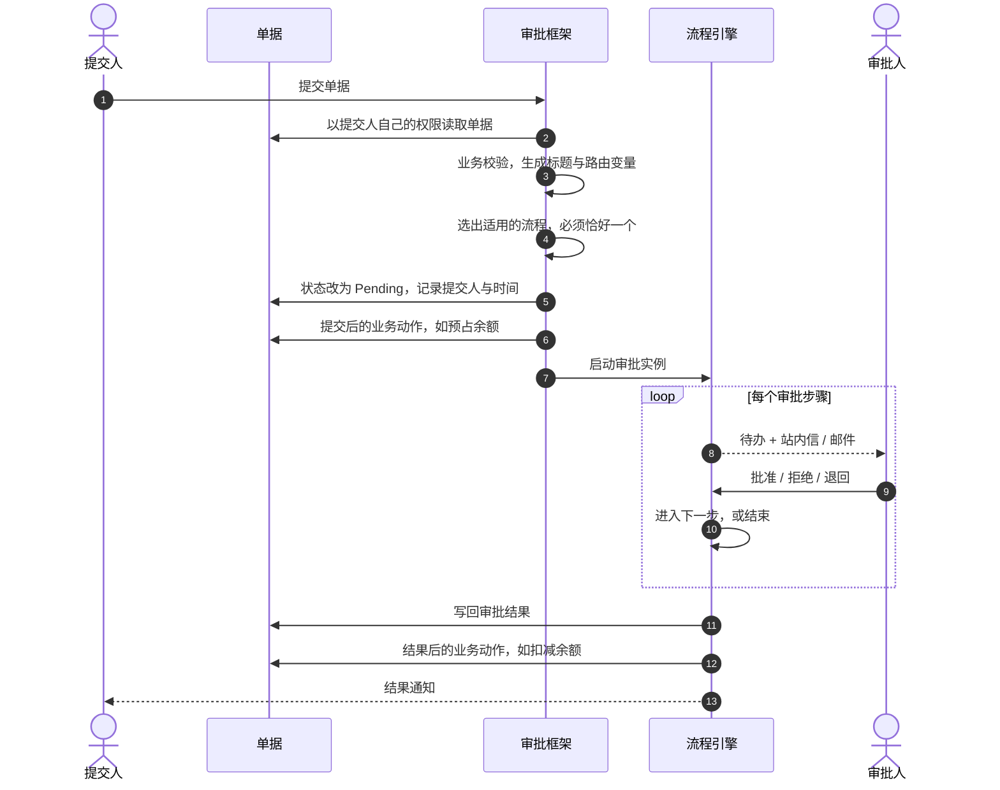
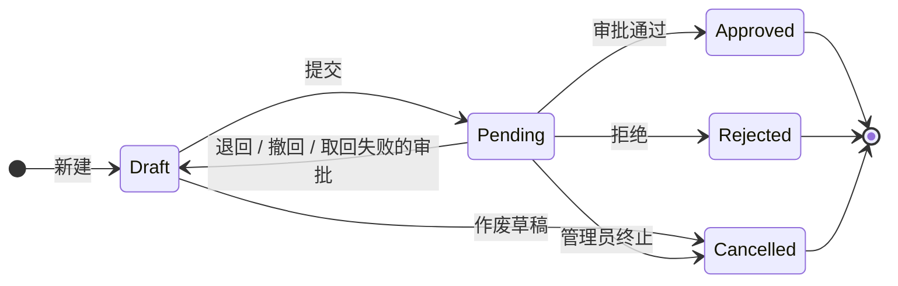
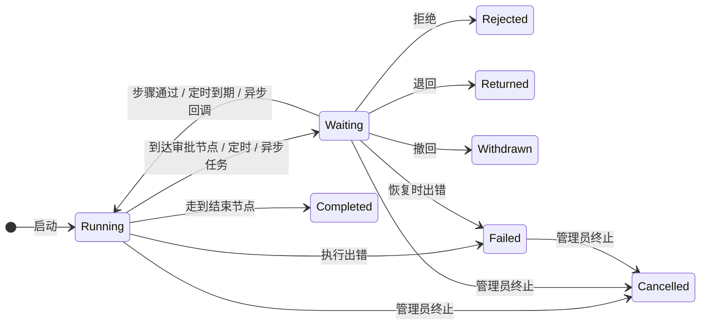

# 审批流

审批流（场景 `APPROVAL`）审批一张业务单据：提交人提交单据，框架选出适用的审批流并启动审批，审批人逐步处理，结果写回单据，再由业务模块做后续动作。本页按这个顺序讲；让业务模型接入审批见[业务接入](./integration)。

## 参与者

| 角色 | 是谁 | 能做什么 |
|---|---|---|
| 提交人（发起人） | 点「提交」的用户，即实例的 `initiator` | 提交、按撤回策略撤回、催办、评论、作废草稿；被退回后修改并重新提交 |
| 当事人 | 单据所涉及的员工，默认是单据的 `employeeId` | 不一定是提交人（代他人提交时不同）。按组织找审批人时以他为起点 |
| 审批人 | 当前步骤解析出的登录账号 | 批准、拒绝、退回、转交、委托、加签、抄送、评论；批量批准 / 退回 / 拒绝 |
| 抄送人 | 审批人手动抄送的人，或流程设置里的抄送规则抄送到的人 | 查看、标记已读、评论 |
| 受托人 | 委托规则指定的代理人 | 委托生效期间，原本派给委托人的任务改派给他 |
| 管理员 | 持有监控台权限的用户，按 `FlowInstance` 数据范围 | 监控实例；终止、转派、代人委托、管理员催办 |

## 主链路

1–7 在一次提交里完成：任何一步出错，整次提交回滚，单据仍是草稿。8–10 每个审批步骤重复一次。审批人的那次操作与随后的 11、12 一起提交或一起回滚：12 抛出异常会否决这次操作。3、6、12 分别由审批处理器的 `validate` / `submission`、`afterSubmitted`、`afterOutcome` 实现（见[业务接入](./integration#审批业务记录)）；虚线是通知。

## 单据的审批状态

所有审批模型共用同一个状态机，`approvalStatus` 只由框架写。

| `approvalStatus` | 可以发生什么 | 去向 |
|---|---|---|
| `Draft` | 编辑；提交；由申请人作废 | 提交 → `Pending`；作废 → `Cancelled` |
| `Pending` | 冻结。审批人批准、拒绝或退回；其提交人在流程的 `withdrawPolicy` 范围内撤回；管理员终止 | 批准 → 下一步骤或 `Approved`；拒绝 → `Rejected`；退回或撤回 → 重新成为 **`Draft`**；终止 → `Cancelled` |
| `Approved`、`Rejected`、`Cancelled` | 最终且冻结：不再编辑、提交或作废 | — |

退回或撤回不是记录会停留的状态：记录重新成为草稿，修改后作为新的审批提交，其审批历史保留发生过的一切。管理员终止其审批（`POST /flow/monitor/instances/terminate`）会使记录变为 `Cancelled`。记录审批之后的情况——已付款、已生效、已作废——不是审批状态，应放在模型自己的状态字段中；对延期生效的变更，处理器的 `effectStatuses` 告诉监控台其进展。若处理器的模型在元数据中缺少这三个字段，启动会失败。

### 审批锁

`ApprovalLockValidator`（一个 `ModelWriteValidator`，order 10）作用于写入根，所有写入通道都在此汇合——记录的表单、通用端点、导入、流程的写入节点：

- 非草稿记录——`Pending`、`Approved`、`Rejected`、`Cancelled`——既不能修改也不能删除，它所拥有的东西也不能：即那些通过直接指向它、且级联删除（`onDelete = CASCADE`）的多对一字段归属于它的模型记录，例如报销单的明细行——也不能在它下面新增此类记录；
- 审批字段属于框架：新记录是没有提交人的 `Draft`，任何写入都不能改变它们。回传已存储的值不算修改。

关闭权限检查的写入不受限制：写入器自己的写入、审批步骤允许其审批人编辑的字段（*审批人的写入*）、处理器的后续动作。审批锁只规定何时任何人都不能修改记录；在其他状态下谁可以修改它——其所有者、在哪些状态下——仍由模型自己的校验器决定。审批字段在元数据中不是 `readonly`，否则框架自己的写入也会被丢弃；表单把它们显示为只读。

## 审批实例的状态

`Running`、`Waiting` 期间单据保持 `Pending`。实例一结束，结果写回单据：`Completed` → `Approved`，`Rejected` → `Rejected`，`Returned` / `Withdrawn` → `Draft`，`Cancelled` → `Cancelled`；`Failed` 不写回，单据保持 `Pending`。

已定义的 `FlowExecutionStatus` 值：

- `Pending`
- `Running`
- `Waiting` — 停在一个或多个等待上（待审批和/或定时器 / 异步回调）。具体原因位于实例的待审批列表和等待令牌列表中，因此单一状态可同时覆盖因不同原因挂起的并行分支。
- `Rejected`
- `Returned` — 退回给发起人；像拒绝一样结束实例，但其记录重新成为草稿。发起人修改后再次提交，从头启动一个新实例
- `Withdrawn` — 由发起人撤回；结束实例，其记录重新成为草稿
- `Cancelled` — 由管理员结束（*终止*，见[监控](./api#监控)）；记录的审批会连同其记录一起作废
- `Completed`
- `Failed` — 某个步骤无法运行。除非管理员将其终止（→ `Cancelled`），否则保持失败；记录审批的提交人也可以改为把记录取回（见[审批业务记录](./integration#审批业务记录)）

状态转换由 `FlowStatusTransitions` 统一校验：任何状态都可以进入 `Failed`，同一状态自转合法（并行分支再停一处仍是 `Waiting`）；其余只允许上图列出的转换，否则抛出 `Illegal flow status transition`。拒绝、退回、撤回、终止会关闭所有并行分支上仍在等待的步骤。

> [!NOTE]
> 审批人操作时，后续节点出错（例如下一步解析不到审批人）**不会**让实例失败：这次操作被拒绝并回滚，实例停在原步骤，审批人看到错误信息。

## 流程设置

流程级设置在设计器的「流程设置」面板里（画布上不选中任何节点时显示），它们只属于审批流，放到其他场景会编译失败。

| 审批设置 | 取值 | 默认值 |
|---|---|---|
| `withdrawPolicy` | 发起人可以撤回到何时：`Never`、`BeforeFirstAction`（直到审批人第一次批准、拒绝、退回、转交、委托或加签——自动通过不算）、`UntilCompleted` | `Never` |
| `urgeEnabled` | 发起人能否催办；管理员不受这个开关限制 | 开启 |
| `urgeIntervalMinutes` | 每个等待中的步骤多久能催一次（分钟），发起人和管理员共用；至少为 1 | `240` |
| `approverDedup` | `Global`、`Contiguous`、`None`——见[审批人解析](#审批人解析) | `Global` |
| `selfApproval` | `AutoApprove`、`RequireApproval`——见[审批业务记录](./integration#审批业务记录) | `AutoApprove` |
| `emailNotification` | 是否同时以邮件发送通知——见[通知](#通知) | 开启 |
| `cc` | 抄送规则：提交时、通过后、驳回后抄送给谁——见[抄送](#抄送) | 不抄送 |

流程的 `withdrawPolicy` 决定提交人可以撤回到何时：`Never`（默认）、`BeforeFirstAction`——直到审批人在任一步骤第一次批准、拒绝、退回、转交、委托或加签；自动通过不算——或 `UntilCompleted`。无论哪种策略，只有发起人可以撤回，且只能在审批等待审批人期间撤回。`WithdrawPolicyGuard` 是唯一的规则：撤回动作据此执行，预览、`GET /flow/instances/{instanceId}/withdraw` 和实例搜索的 `withdrawable` 据此报告，因此“撤回”按钮恰好在撤回会被接受时出现。

### 抄送

抄送是整个审批的设置，只在流程设置里配置，审批步骤本身没有抄送配置。规则（`cc`，一组 `FlowCcRule`）随流程版本发布，实例按它运行的版本执行。每条规则写明：

- **何时**：提交时（`OnSubmit`）；通过后（`OnApproved`，整个审批以批准结束时）；驳回后（`OnRejected`，整个审批以拒绝结束时——一票拒绝还没到步骤的拒绝门槛不算）。
- **抄送谁**：指定的人（`recipients`），或像配审批人一样按规则查找（`recipientSource`，与审批步骤的 `approverSource` 同形——当事人的上级、部门负责人、角色、岗位、部门成员……），二者择一。按[审批人解析](#审批人解析)的方式查找，不受提交人数据权限的限制。

规则抄送与手动抄送记录方式相同：每个接收人一条 `CC` 记录，没有操作人（不是某个人发的），落在开始节点（提交时；所有步骤都自动通过时的通过后也在这里）或结束审批的那一步上，位于该节点的当前周期。接收人因此在「抄送我」里有一条待阅、收到站内通知，并成为参与者：可以查看、评论。同一节点同一周期已经抄送过的人——不论是规则还是手动——不会重复抄送。

审批人也可以在审批时手动抄送，一次选一人或多人——见[审批动作](#审批动作)。

### 一张单据只匹配一个流程

提交时，框架在租户**生效中**的 Approval 流程里，找 `Submit` 触发器指向该模型、且条件对这张单据成立的流程：

- 恰好一个：用它启动审批；
- 一个都没有：拒绝提交，提示没有为该单据配置审批流；
- 多于一个：拒绝提交，并列出命中的流程，请管理员收窄条件。

想按条件走不同流程（例如请假超过 3 天走另一个流程），就建多个流程，用互斥的条件区分；也可以在一个流程内用带条件的连线分流。每次提交都重新选流程，所以退回后再提交，可能因单据内容变化而走到另一个流程。

## 审批模型

### 审批与拒绝阈值

- 审批模式：`ANY_ONE`、`UNANIMOUS`、`MIN_COUNT`、`PERCENTAGE`
- 拒绝模式：`ANY_ONE`、`UNANIMOUS`、`MIN_COUNT`、`PERCENTAGE`
- 同一 actor 在每个周期只能投一次有效票。
- 编译时校验器会拒绝不可能的阈值组合。

- 票数在步骤开始时算好：`MIN_COUNT` 取配置的人数（`minCount` / `rejectMinCount`），动态审批人不按实际解析到的人数封顶；`PERCENTAGE` 为审批人数 × 百分比 ÷ 100 向上取整。加签后按新的人数重算；转交、委托不变；管理员转派把两人合并为一个位置时，所需批准票数不超过剩余人数。
- 批准和拒绝各自计票，**先达到门槛的一方决定结果**；只有计票的一方会拒绝重复投票——例如「全员通过 + 任一人拒绝」时，已批准的人仍可拒绝并结束审批。
- 动态审批人少于门槛时（例如要求至少 3 人只解析到 2 人），这一步会一直等待，只能退回、撤回、终止或靠超时处理。

### 审批人解析

审批节点支持：

- 通过 `config.approvers` 配置静态审批人
- 通过 `config.approverSource` 配置动态审批人
- 通过 `config.emptyApproverStrategy` 配置空审批人策略

支持的动态源类型：

- 来自启动变量：`VariableList`、`Expression`、`InitiatorManager`（`initiatorManagerId`）、`Role`（`roleApprovers`）
- 来自组织：`Supervisor`（第 N 级上级）、`DeptLeader` 和 `DeptHrbp`（某个部门的）、`RoleQuery`（由 `roleIds`、`roleCodes` 或两者共同指定的角色的持有人——可选地收窄到某个部门）、`Position`、`Department`（其成员）

组织关系相对于记录的**当事人**——记录所涉及的员工（*审批业务记录*）——读取，因此代他人提交的申请会交给当事人的审批人，而不是提交人的。`Supervisor` 接受 `relativeTo`：`SUBJECT`（默认）或 `INITIATOR`。基于部门的源接受一个 `deptScope`：

| `deptScope` | 部门 | 默认用于 |
|---|---|---|
| `SUBJECT_DEPT` | 当事人的部门 | `DeptLeader`、`DeptHrbp` |
| `INITIATOR_DEPT` | 提交人的部门 | |
| `SPECIFIC_DEPT` | `deptId` 指定的部门（`Department` 用 `deptIds`） | `Department` |
| `VARIABLE_DEPT` | `deptVariable` 所指变量中的部门 id——例如调动的调入部门 | |
| `ALL` | 不限部门：所有持有人（仅 `RoleQuery`） | `RoleQuery` |

无法确定的部门——没有当事人部门、变量为空——解析为无人，而不会变成所有持有人；该步骤随后按其空审批人策略处理。没有记录的实例（调试运行）没有当事人，从其发起人开始解析。编译器会拒绝某个源不接受的范围，以及缺少必需信息的范围（`INVALID_DEPT_SCOPE`、`MISSING_DEPT_IDS`、`MISSING_DEPT_VARIABLE`、`INVALID_RELATIVE_TO`）。

审批人是**登录账号 id**。组织通过 `OrganizationService` SPI 读取，其默认实现 `FlowOrgService` 遵循 permission-starter 已在使用的 HR 约定，因此基于这些模型的应用无需任何配置：

| 用途 | Model.field |
|---|---|
| 账号 → 员工（发起人的） | `Employee.userId` |
| 姓名、部门、岗位 | `Employee.fullName`、`departmentId`、`jobPositionId` |
| 上级（员工 id） | `Employee.piEmployeeId` |
| 部门负责人、HRBP（员工 id）、上级部门、名称 | `Department.picEmpId`、`hrbpEmpId`、`parentId`、`name` |
| 角色持有人、角色编码 | `UserRoleRel.userId` / `roleId`、`Role.code` |

没有账号的员工视为无人，因此只解析到这类员工的步骤为空，按其空审批人策略处理；角色持有人本身就是账号，即使没有员工档案也能审批。没有负责人（或 HRBP）的部门沿用其上级部门的。查询跳过行范围——由谁审批不能取决于发起人能看到什么。所有模型名和字段名都可以在 `softa.flow.org.*`（`OrganizationServiceProperties`）下覆盖；使用其他组织体系的应用提供自己的 `OrganizationService` bean。

与角色 id 不同，角色编码在每个租户中都相同，因此下发到多个租户的流程用编码（`roleCodes`）指定内置角色；设计器同时提供两种列表，因为管理员自建的角色没有编码，需要按 id 选择。

审批人去重（`approverDedup`）：默认策略为 **`Global`**——已在先前节点审批过的用户在后续节点自动通过（记为 `AUTO_APPROVE`）。残余风险：流程中途的表单编辑仍会被该先前审批自动背书；在需要重新审阅的流程上，将策略设为 `Contiguous` 或 `None`。

### 审批人的写入

一旦 actor 被确认为该节点的审批人，审批的表单编辑以及它所恢复执行的每个节点都会搁置该 actor 自己的行范围来运行。审批本身就是授权：审批人很少对其所审批的记录持有更新权限，而在按动作授予行范围的情况下（permission-starter），这会连审批本身都被拒绝。在引擎之外执行审批的宿主端点也同样处理，并先做一次入口检查，确认审批人能看到该申请（`@RequirePermission`）。因此，记录的写入规则（`ModelWriteValidator`）会把这些写入视为系统写入：在记录处于审批中时冻结记录的审批锁（`ApprovalLockValidator`，见*审批业务记录*）仍会放行节点标为可编辑的字段。

搁置指的是**所有**权限检查，而不仅是行范围——包括敏感字段的写入检查。节点的表单配置（其字段权限 `formPermissions`）是审批人所编辑字段的唯一授权。只有标为 `EDITABLE` 或 `REQUIRED` 的字段会被回写；批准请求 `formData` 中的其他键——`HIDDEN` 或 `READONLY` 字段，或节点未列出的字段——都会被丢弃，没有 `formPermissions` 的节点什么也不写。`REQUIRED` 字段在编辑落地后必须有值——要么是提交的值，要么是记录已存的值——因此当记录缺少该值时，什么都不提交的批准仍会被拒绝。写入之后，记录的审批会根据编辑后的记录重新读取路由变量——先是记录自身的字段，再叠加处理器的 `submission`——并替换流程启动时的变量：后续路由能看到审批人所做的修改，包括被清空的字段。因此，即使审批人的角色没有覆盖某个字段的敏感字段集，只要节点表单把它设为可编辑，审批人仍能写入它。流程设计者不得在审批表单上把敏感字段（薪资、银行信息、证件号码……）设为可编辑，除非该节点可能解析到的每位审批人都应当能编辑它；应设为只读，或不放在表单上。

### 审批动作

所有动作的操作人都取当前登录用户；实例必须在等待审批，操作人必须是当前步骤的审批人，并且轮到他（没有被前置加签挡住）。

| 动作 | 额外条件 / 必填 | 效果 | 通知 |
|---|---|---|---|
| 批准 | 意见可选；可带字段（只写回可编辑 / 必填字段） | 先写回字段并重新计算路由变量；计票模式下记一票，到门槛或「任一人」即进入下一步。同一人重复批准原样返回 | 下一步的审批人收到待办；结束时通知发起人 |
| 拒绝 | 意见必填 | 到门槛 → 实例 `Rejected`，所有分支结束，单据 `Rejected` | 发起人 |
| 退回 | 步骤开启 `returnEnabled`；意见必填 | 实例 `Returned`，单据回到草稿。总是退回给提交人，不能退到中间步骤 | 发起人 |
| 转交 / 委托 | 本人还没投票；对象不能是本人，也不能已在该步骤 | 对象接替他的位置，所需票数不变；两者只在记录与任务状态上不同（`Transferred` / `Delegated`） | 新审批人 |
| 前加签 / 后加签 | 本人还没投票；对象不在该步骤；一步同时只能有一对未完成的加签 | 加签人插在他前面（他要等加签人批准）或后面（加签人要等他批准）；这一步即使是「任一人」也需加签双方都批准 | 不单独通知加签人 |
| 抄送 | 本人还没投票；一次选一人或多人。已经能从这一步看到审批的人——该步骤的审批人（包括本人）、本周期已在这一步被抄送过的人——自动跳过，一个都不剩时拒绝 | 对象成为参与者，可查看、评论 | 抄送人（仅站内信） |
| 评论 | 参与者即可；实例未结束 | 只写一条记录，不改变状态 | 无 |

发起人能做的：

| 动作 | 条件 | 结果 |
|---|---|---|
| 撤回 | 只有发起人；实例在等待审批；`withdrawPolicy` 允许 | 实例 `Withdrawn`，单据回到草稿，未处理的任务关闭；**不发任何通知** |
| 取回失败的审批 | 只有提交人；实例 `Failed`；不受撤回策略限制 | 单据回到草稿；失败的实例保留供排查 |
| 催办 | 只有发起人；实例在等待审批；流程的 `urgeEnabled` 没有关闭 | 提醒当前步骤尚未处理的审批人。每个步骤在流程的 `urgeIntervalMinutes`（默认 240 分钟）内只催一次，与管理员共用这个间隔 |
| 评论 | 参与者；实例未结束 | 写入审批记录 |
| 修改后重新提交 | 退回或撤回后单据是草稿 | 新的实例，从第一步开始，重新选流程 |

管理员能做的（在[监控台](./api#监控)，按调用方在 `FlowInstance` 上的权限）：

| 动作 | 条件 | 结果 |
|---|---|---|
| 终止 | 实例运行中、等待中或失败；理由必填；一次最多 100 个 | 关闭待审批，实例 `Cancelled`，单据作废；记一条 `TERMINATE`；通知发起人 |
| 转派 | 原审批人、新审批人（不能相同）和理由；可先预览受影响的任务数 | 把原审批人当前的待审批任务移交给新审批人，记为原审批人的 `TRANSFER`（管理员为 `operatorId`）；新审批人已在同一步时合并为一个位置；尚未到达的步骤不受影响 |
| 代人委托 | 单独的权限，不受数据范围限制 | 替某位审批人建委托规则，他在自己的委托里能看到、能取消 |
| 管理员催办 | 能读取该实例；不受流程的 `urgeEnabled` 限制 | 同发起人催办，共用间隔 |

### 批量操作

`POST /flow/instances/batch/{approve,return,reject}`（`BatchApprovalExecutor`）以同一条意见对调用方最多 100 个待办任务执行同一种审批人动作——退回或拒绝时意见必填。每个任务都是一次独立的引擎调用，因此各在自己的事务中：一个被拒绝的任务不影响其他任务，且每条引擎规则都与单个操作时一样生效。批量操作不填写任何内容，因此在调用引擎之前会跳过所在步骤有 `REQUIRED` 字段的任务——要填的字段需要打开单据填写——退回时还会跳过没有开启 `returnEnabled`（该步骤是否允许退回给发起人）的步骤——与设置任务 `batchable` 标志的规则相同。结果（`FlowBatchActionResult`）给出成功 / 跳过 / 失败计数，以及按请求顺序排列的每个任务的结果与原因。

### 超时处理

审批节点的 `timeout` 给这一步设一个时限：步骤开始后 `timeoutHours` 小时到期；不填 `timeoutHours` 就没有时限，`timeout` 里的其他设置都不生效。到期时按 `timeoutStrategy` 处理：

| 策略 | 到期时 | 用到的设置 |
|---|---|---|
| `Remind`（默认） | 提醒尚未处理的审批人，之后每 `remindIntervalHours` 小时再提醒，最多 `maxRemindTimes` 次（不填为 3）；不填间隔就只在到期时提醒一次。不做任何自动处理 | `remindIntervalHours`、`maxRemindTimes` |
| `AutoApprove` | 替尚未处理的审批人通过 | — |
| `AutoReject` | 驳回这个审批 | — |
| `Escalate` | 把这一步交给 `escalateToUserId`，并重新计时 | `escalateToUserId`（必填） |

到期前不发任何提醒。提醒只属于 `Remind`：在其他策略上设置会编译失败（`REMINDERS_OUTSIDE_REMIND`），设计器在换成其他策略时也会清掉它们；间隔或最多次数小于 1 同样编译失败（`INVALID_REMIND_INTERVAL`、`INVALID_MAX_REMINDERS`）。提醒是一条「审批已超时」的站内信，不发邮件。

`ApprovalTimeoutScheduler` 针对已持久化的待审批，处理已经过了时限的步骤。

它由 cron 行 `flow_approval_timeout_handle` 驱动。starter 的维护 cron（审批超时、委托到期、定时器扫描、卡住实例扫描、调试 bundle 清理、自动化运行清理）以关闭状态随 `data-system/SysCron.FlowMaintenance.json` 发布。应用需要在其 `seed-manifest.yml` 的 `platform` 下列出该文件，否则这些行根本不存在；然后开启所需的那些。

## 结果写回

结果通过一个监听器 `ApprovalOutcomeListener` 和一个写入器 `ApprovalStatusWriter` 到达记录：当记录的审批完成、被拒绝、退回、撤回或作废（由管理员终止）时，写入器把 `approvalStatus` 设为结果——退回或撤回后为 `Draft`——并调用 `handler.afterOutcome(record, outcome)`，传入类型、做出决定的用户及其意见（自动通过时没有；终止时为管理员及其理由）——在该动作的事务中、跳过权限检查执行，因此抛出异常的处理器会否决该动作。结果只会落到仍为 `Pending` 的记录上：已结束的实例再次保存（因评论或抄送已读）不会改变任何东西，`afterOutcome` 对每个结果只运行一次。只在其中做属于该结果、写入本数据库的操作；任何离开本数据库的事——付款、外部系统——放到提交之后。失败的实例不写入任何东西，其记录保持 `Pending`，有两种出路：其提交人通过撤回取回记录（重新成为草稿），或由管理员终止该审批（记录变为 `Cancelled`）。记录在实例启动之前就变为 `Pending`，因为没有审批步骤的流程会在启动时就完成。审批人解析为无人的步骤会在运行时按其空审批人策略失败（默认 `Error`）；记录的审批预览会在任何人提交之前指出失败位置。

### 自动通过

在提交流程上，记录本人默认代为通过：当某个步骤的审批人中包含提交人，或记录所涉员工对应的用户时，他们被视为已批准——在审批历史中记为 `AUTO_APPROVE`（"Auto-approved (submitter)" / "Auto-approved (subject)"）——其余由该步骤的审批模式决定：任一人通过的步骤直接通过，需全员通过的步骤仍等待其他人。由流程设置 `selfApproval` 决定：`AutoApprove`（默认）或 `RequireApproval`，后者像对待其他审批人一样询问他们。策略为 `AutoApprove` 的空步骤也以同样方式记录，但没有 actor（"Auto-approved (no approver)"）。

## 预览记录的审批

`GET /flow/instances/preview?modelName=&rowId=`（`FlowClient.previewRecord`）回答现在提交该记录会发生什么，而不真正提交——供记录页面在任何人按下“提交”之前展示审批路径。它执行提交本身的检查与流程选择：记录的审批状态及其审批、以请求者自己的权限执行 `handler.validate` 和 `handler.submission`、提交触发器。拒绝、没有适用流程或有多个适用流程都在 `status`（`Refused`、`NoFlow`、`SeveralFlows`，适用的流程列在 `candidates` 中）和 `message`——提交会被拒绝时的那条消息——中报告，而不是抛出。`afterSubmitted` 从不被调用。

对审批正在进行中的记录，预览是该审批的剩余部分（`InProgress`）：当前等待的步骤及其现状（`current`，附带仍被询问的审批人），然后是之后的步骤，按下文方式基于实例自身的变量和审批、在实例的副本上推演——从不触碰实例本身。`withdrawable` 说明请求者现在能否撤回该记录：其提交人，在审批等待审批人且流程的 `withdrawPolicy` 允许时（`WithdrawPolicyGuard`），或在其审批失败之后——因此“撤回”按钮不需要自己的规则。

当恰有一个流程适用时（`Ready`），`ApprovalPathPreviewer` 按引擎的运行方式从开始节点推演，假定每个审批步骤都被批准：路由由 `FlowGatewayRouter` 基于提交将带入的变量决定，审批人由 `PendingApprovalFactory`（含自动委托）决定，自动通过由 `ApproverDedupService` 决定，所用状态从不保存。`steps` 按审批到达的顺序列出审批步骤，每个步骤带有一个 `outcome`：

| Outcome | 该步骤 |
|---|---|
| `Waiting` | 等待 `approvers`，其中需要 `requiredApprovals` 人批准 |
| `AutoApproved` | 自动通过：`autoApprovals` 把提交人（`Submitter`）、记录所涉员工（`Subject`）——依流程的 `selfApproval`——或在先前步骤批准过的人——依流程的审批人去重（`EarlierApproval`）——视为已批准 |
| `NoApproverApproved`、`NoApproverSkipped` | 解析为无人；其空审批人策略将其记为通过或跳过 |
| `NoApproverFails` | 在 `Error` 策略下解析为无人：审批会停在这里，如 `failure` 所述 |
| `Undetermined` | 由谁审批，或是否自动通过，取决于只有审批运行时才知道的数据 |

不做任何猜测。预览不运行任何节点：推演一旦经过脚本、任务或子流程，该节点写入的变量就是未知的——对没有输出变量的任务和异步任务而言是其写入的全部变量——而实例 id 从一开始就是未知的。条件读取了未知变量的路由列在 `undecided` 中，且不被沿用；在这种节点之后到达、审批人来自动态源的步骤为 `Undetermined`；开启审批人去重时，其审批人可能批准过、也可能没批准过先前步骤（多个可能通过它的人之一）的步骤同样如此。引擎会因之失败的错误——路由不匹配任何边或匹配多条边、条件无法求值——会以 `failure` 结束推演。

不写入任何东西：没有实例、任务、账本行或通知，也不计入任何委托的使用。能以自己的权限读取该记录的人才可以预览（`FlowInstanceAccessGuard.requireRecordReader`），且从不豁免行范围；参与过该记录先前的审批是不够的。用户的显示方式与审批历史相同。它不在自己的事务中运行，`FlowClient.previewRecord` 应在事务之外调用：通过事务方法抛出的拒绝会把它所加入的事务标记为只能回滚。

## 约束与异常

### 发布时拦下的配置

设计器的「校验」和「发布」都会编译一遍，错误逐条定位到节点，有错误就不能发布：

- **结构**：缺流程名或场景；画布为空；开始节点不是恰好一个；节点或连线的 id 缺失、重复，或连线指向不存在的节点；图中有环。
- **场景与触发器**：节点不能用在该场景；缺触发器或触发器不属于该场景；`Submit` 没写模型；cron 表达式为空或无法解析；非审批流设置了审批设置（含抄送）；催办间隔小于 1；抄送规则没写时机、没写抄送谁，或同时写了指定的人和查找规则；`sync` 放错场景、sync 流程含会等待的节点、开了 `rollbackOnFail` 却没开 `sync`。
- **审批节点**：审批人源类型未知；上级层级小于 1 或 `relativeTo` 非法；部门范围不适用于该源，或缺少它需要的部门、变量、角色、岗位；静态审批人为空或重复；计票模式没有审批人；`minCount` 不在 1 到人数之间；百分比不在 1–100；批准门槛 + 拒绝门槛大于人数 + 1；超时小时数 ≤ 0；提醒间隔或最多提醒次数小于 1；`Remind` 以外的超时策略设置了提醒；升级却没指定人（不填超时小时数时，其余超时设置不检查）。
- **路由**：连线表达式语法错误；一条连线同时有规则和表达式；流程不基于记录启动却使用规则；规则读取记录没有的字段、审批不路由的字段或一对多/多对多字段，对选项或关联比较大小，或使用 `PARENT OF` / `CHILD OF`；网关出边或汇聚入边少于两条；默认边多于一条。
- **任务节点**：缺配置、配置格式错误、缺必填输入；使用了尚不支持的节点类型。

编译时**不检查**、运行时才暴露的：节点是否从开始可达；定时节点配置；子流程目标及其触发器；脚本、返回值、表达式源、触发条件的语法；审批节点完全没配审批人（运行时按空审批人策略处理）；字段权限里的字段名是否存在；`declaredOutputs`。

编译错误码

- 结构：`MISSING_FLOW_NAME` `MISSING_SCENARIO` `EMPTY_GRAPH` `NO_START_NODE` `MULTIPLE_START_NODES` `DUPLICATE_NODE_ID` `DUPLICATE_EDGE_ID` `UNKNOWN_EDGE_SOURCE` `UNKNOWN_EDGE_TARGET` `GRAPH_CYCLE`
- 场景与触发器：`INVALID_SCENARIO_NODE` `MISSING_TRIGGER` `TRIGGER_NOT_ALLOWED` `SUBMIT_MISSING_MODEL` `CRON_MISSING_EXPRESSION` `CRON_INVALID_EXPRESSION` `APPROVAL_SETTING_OUTSIDE_APPROVAL` `INVALID_URGE_INTERVAL` `INVALID_CC_RULE` `SYNC_OUTSIDE_AUTOMATION` `SYNC_FLOW_WAITS` `ROLLBACK_WITHOUT_SYNC`
- 审批节点：`UNKNOWN_APPROVER_SOURCE_TYPE` `INVALID_SUPERVISOR_LEVEL` `INVALID_RELATIVE_TO` `INVALID_DEPT_SCOPE` `MISSING_DEPT_IDS` `MISSING_DEPT_VARIABLE` `MISSING_ROLE_IDS` `MISSING_POSITION_IDS` `BLANK_APPROVER` `DUPLICATE_APPROVER` `*_NEEDS_APPROVERS` `INVALID_MIN_COUNT` `INVALID_PERCENTAGE` `DEADLOCK_THRESHOLD` `INVALID_TIMEOUT_HOURS` `INVALID_REMIND_INTERVAL` `INVALID_MAX_REMINDERS` `REMINDERS_OUTSIDE_REMIND` `MISSING_ESCALATE_TARGET`
- 路由：`INVALID_CONDITION_EXPR` `CONFLICTING_EDGE_CONDITIONS` `RULE_WITHOUT_RECORD` `INVALID_RULE_CONDITION` `INSUFFICIENT_GATEWAY_EDGES` `MULTIPLE_DEFAULT_EDGES`
- 任务节点：`MISSING_TASK_CONFIG` `INVALID_TASK_CONFIG` `MISSING_REQUIRED_INPUT` `UNSUPPORTED_NODE_TYPE`

### 运行时规则

| 规则 | 违反时 |
|---|---|
| 只有草稿能提交、能作废；一张单据同时只有一个进行中的审批 | 拒绝提交 / 作废 |
| 非草稿单据冻结，它级联拥有的明细同样冻结，也不能在其下新建 | 写入被审批锁拒绝 |
| 审批字段只由框架写；新单据一定是没有提交人的草稿 | 拒绝写入（回传原值不算修改） |
| 提交需要恰好匹配一个生效流程；当事人不能为空 | 拒绝提交并说明原因 |
| 只有当前步骤的审批人、轮到他时才能操作；同一人同一周期只算一票 | 拒绝操作 |
| 拒绝、退回、终止、转派必须写意见或理由 | 拒绝操作 |
| 退回只在步骤开启 `returnEnabled` 时可用，一律退回给提交人 | 拒绝操作；批量退回跳过该任务 |
| 撤回只限发起人，且在 `withdrawPolicy` 允许的时间内 | 拒绝操作 |
| 催办每个步骤有间隔 | 拒绝催办，返回下次可催时间 |
| 评论只限参与者，实例结束后不能评论 | 拒绝操作 |
| 终止只对运行中、等待中、失败的实例；终止、转派只在调用方数据范围内 | 逐个返回失败原因 |
| 批量：有必填字段的步骤不可批量；一次最多 100 个 | 跳过该任务 |
| 审批人写回只写可编辑 / 必填字段；必填字段写回后必须有值 | 其他字段丢弃；必填为空拒绝批准 |

### 出错时怎样处理

| 情况 | 框架怎样处理 | 怎样恢复 |
|---|---|---|
| 提交被拒：没有适用流程、多个流程、当事人为空、业务校验失败、已在审批中、已是终态 | 拒绝提交并返回原因，不建实例 | 按提示修正配置或单据 |
| 提交时流程出错（如某步解析不到审批人且策略为 `Error`） | 提交整体回滚，单据仍是草稿；另存一条失败实例供排查；立即通知发起人和失败通知角色 | 修正流程或组织数据后重新提交 |
| 审批人操作后，后续节点出错 | 这次操作被拒绝并回滚，实例停在原步骤；不产生失败实例、不发失败通知 | 修正后重新操作，或由管理员转派、终止 |
| 定时、异步任务恢复时出错 | 实例 `Failed`，单据保持 `Pending`；通知发起人和失败通知角色 | 提交人取回（回到草稿），或管理员终止（作废） |
| 处理器 `afterSubmitted` / `afterOutcome` 抛出异常 | 否决这次动作：提交、批准、拒绝、退回、撤回、终止、作废都可能被否决，全部回滚，操作人看到原因 | 处理业务问题后重试 |
| 两人同时操作同一实例 | 乐观锁：后保存的一方失败，提示数据已被修改 | 刷新后重试 |
| 同一人重复批准 / 拒绝 | 原样返回当前状态，不报错、不重复记录 | — |
| 同一单据并发提交 | 唯一索引挡住第二次 | — |
| 动态审批人少于计票门槛 | 这一步一直等待 | 退回、撤回、终止或超时 |
| 通知发送失败 | 只记日志，不影响动作；动作回滚时根本不发 | 查日志 |

常见报错原文

| 场景 | 消息 |
|---|---|
| 重复提交 | `This record is already in approval.` |
| 没有 / 多个适用流程 | `No approval flow is configured for this {0} record. Ask your administrator to set one up.` / `Several approval flows apply to this {0} record ({1}). Ask your administrator to narrow their submit conditions so that exactly one applies.` |
| 当事人为空 | `This record names no employee in {0}, so its approvers cannot be found.` |
| 终态单据再提交 | `This record is approved and cannot be submitted again.`（拒绝、作废的单据会加上 `Raise a new one.`） |
| 修改 / 删除审批中的单据 | `This record is in approval and cannot be changed. Withdraw it first to edit it.` / `A record in approval cannot be deleted. Withdraw it first.` |
| 作废审批中的单据 | `This record is in approval. Withdraw it first, then cancel the draft.` |
| 拒绝 / 退回没写意见 | `A comment is required to reject approval node: {node}`（退回同理） |
| 步骤不允许退回 | `Approval node does not allow return: {node}` |
| 撤回被拒 | `Flow instance does not allow initiator withdrawal: {id}` / `An approver has already acted on this approval, so it can no longer be withdrawn: {id}` |
| 解析不到审批人 | `Approval node '{node}' resolved an empty approver list (strategy=ERROR)` |
| 并发冲突 | `Data version does not match, may have been modified, please refresh and try again!` |

接口一律返回 HTTP 200，错误码在响应体里：参数或规则不满足为 `BAD_REQUEST`，无权限为 `PERMISSION_DENIED`，运行时错误为 `ERROR`。

## 谁能查看

- **默认可见**：发起人，以及实例给过任务的人（审批人，无论是否已处理；抄送人；转交、委托、加签的对象）。
- **其他人**按标准的角色与数据范围：能以自己的权限读取这条 `FlowInstance`，或（记录的审批）能读取这张单据本身。
- 审批人读取单据时越过他自己的行权限，但按当前步骤的字段权限隐藏字段。
- 能不能操作由动作处理器按身份判断，与数据权限无关；身份一律从登录上下文解析，客户端传来的会被忽略。

接口层面的细节见[实例 API](./api#实例-api)与[监控](./api#监控)。

## 通知

默认的 `ApprovalNotificationService` 是 `CompositeApprovalNotificationService`，它分别通知两个通道——一个通道失败既不会让另一个沉默，也不会影响动作本身：

- **收件箱**（`InboxApprovalNotificationService`），只发「需要知道的事」：经由 message-starter 发送 Workflow 类型的站内消息，指向流程实例（`sourceModel` = `FlowInstance`，`sourceId` = 其实例 id；客户端打开实例并从那里继续）。超过收件箱 200 字符上限的标题会被截断；文本翻译为租户的默认语言。「待处理的事」——要审批的任务、要阅读的抄送——不进收件箱：它们列在「我的待办」里，客户端顶栏显示其数量，同一件事不会被算两次。
- **邮件**（`MailApprovalNotificationService`），在 `emailNotification` 未关闭的流程上发送：经由 message-starter 发往每个接收人的账号邮箱（`UserAccount.email`；没有邮箱的接收人跳过），措辞来自租户中该通知代码对应的邮件模板（见[邮件](../message/email)）。模板变量为 `subject`（实例标题，否则为流程名）、`content`（意见或理由，如有）、`flowName`、`recordCode` 和 `link`——审批页面，即 `system.site-url` + `/approvals/{instanceId}`，未配置站点 URL 时为空。flow-starter 不附带任何邮件模板：没有该代码模板的租户收不到邮件，失败会记入日志。

由一个映射（`ApprovalNotices`）决定在两个通道上通知谁、通知什么，以及它是待办还是消息：

| 事件 | 通知对象 | 收件箱 | 邮件模板 |
|---|---|---|---|
| 步骤中尚未处理的审批人被指派；任务被转交、委托或转派给某人 | 尚未处理的审批人；新的任务持有人 | 不发——是待办，在「我的待办」里 | `flow.task-assigned` |
| 抄送 | 其接收人 | 不发——是待办，在「我的待办」里 | —（不发邮件） |
| 催办 | 被催办的审批人 | 发 | `flow.urged` |
| 步骤已过时限，且超时策略为 `Remind` | 其尚未处理的审批人 | 发 | —（不发邮件） |
| 已批准；被拒绝或退回（附意见） | 发起人 | 发 | `flow.approved`、`flow.rejected`、`flow.returned` |
| 被管理员终止，或某个步骤被管理员转派（附理由） | 发起人 | 发 | `flow.terminated`、`flow.reassigned` |
| 记录的审批失败（附错误） | 发起人，以及 `flow.notification.failure-role-codes`（默认 `TENANT_ADMIN`）中角色的持有人 | 发 | `flow.failed` |

只有 Approval 流程会通知其完成：自动化运行不是写入触发它的用户要求得知的事，而失败的自动化运行由运维人员关注。消息在动作提交之后、在其自己的事务中写入：回滚的动作不发送任何东西，无法写入的消息会记入日志而不使动作失败。失败会立即通知，因为失败那次尝试自身的事务会回滚。

`InboxReadMarker` 让收件箱保持最新：一旦审批人对某个审批采取行动——批准、拒绝、退回、转交、委托、加签或阅读抄送——其关于该实例的未读站内消息（催办、超时提醒）会在动作提交后被标记为已读，因此铃铛只统计对他们仍是新消息的事项（催办、评论或发出抄送不算采取行动）。任务本身从不进收件箱：“我的待办”是工作清单。

应用提供的 `ApprovalNotificationService` bean 会替换默认实现，连同两个通道一起；若要增加通道——短信、IM——请声明自己的 `CompositeApprovalNotificationService`，把收件箱和邮件通道与你的通道一并列入。
