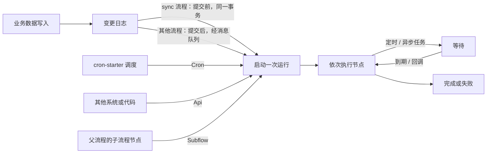
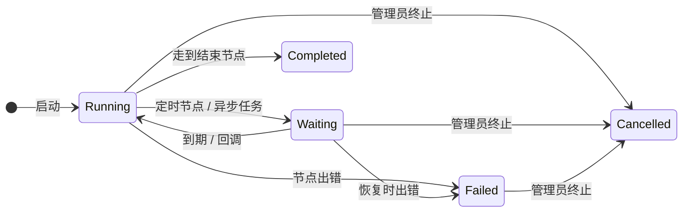

# 自动化

自动化流程（场景 `AUTOMATION`）在数据变化、按时间表、被显式调用或被父流程调用时自动运行，没有人工审批步骤：同步业务数据、发通知、调用外部系统、生成文件等。和审批流一样，每次运行都是一个持久化的实例，可以中途等待（定时、异步回调）再继续；结束的运行保留一段时间后清理。



## 怎样启动

一个自动化流程只声明一种触发器，也只从这一个入口启动：

| 触发器 | 什么时候启动 | 说明 |
|---|---|---|
| `EntityChange` | 指定模型的数据被新增、修改或删除 | 可只监听其中几种事件（`events`，为空即全部），可加条件表达式（AviatorScript），成立才启动。由变更日志驱动：`@Model(enableAuditLog = false)` 的模型不会触发。同一条变更日志对同一个流程最多启动一次 |
| `Cron` | 到达流程自己的 Quartz 调度 | 需要 cron-starter 与 `mq.topics.cron-task.topic`；每次执行都是新的运行，见 [Cron 触发的流程](#cron-触发的流程) |
| `Api` | 被显式按 id 启动 | `POST /flow/instances/start`，或进程内 `FlowClient.start` / `publishAndStart`；不匹配任何事件 |
| `Subflow` | 被父流程的子流程节点调用 | 必须同步跑完；不能递归调用 |

`POST /flow/automation/trigger` 可以手动投递一个触发事件（`Submit`、`Cron`、`Api`、`Subflow` 类型会被拒绝）；草稿的调试运行不看触发器。

## 同步与异步

由数据变更启动的自动化流程默认**异步**运行；打开 `sync` 后在业务事务里同步运行：

| | 异步（默认） | 同步（`sync = true`） |
|---|---|---|
| 什么时候运行 | 业务事务提交之后，经消息队列 | 业务事务提交之前，在同一个事务里 |
| 出错时 | 只有这次运行失败，业务写入不受影响 | 默认只记录失败；同时打开 `rollbackOnFail` 时，异常抛给调用方，触发它的写入一起回滚 |
| 能用的节点 | 定时、异步任务、子流程等都可以 | 不能包含定时、异步任务或审批节点（会等待的节点） |
| 依赖 | `mq.topics.change-log.topic`；再配置 `mq.topics.flow-event.topic` 后，流程匹配与执行在事件消费者的线程池里进行 | 无 |

同步流程适合「必须随写入一起成功」的联动或校验；其余用异步，避免拖慢或拖垮业务写入。写入上下文关闭了流程触发（`triggerFlow = false`）时，两种都不会启动。

## 运行、等待与恢复



- **定时等待**（`Timer`）：按时长、cron（Spring 6 段格式，不是触发器用的 Quartz）或截止时间等待，到期后由 `mq.topics.flow-timer.topic` 上的消息唤醒。模块只带唤醒的消费端，发布 `FlowTimerMessage` 的调度端需要宿主应用提供；维护 cron 里的到期定时器扫描可以补上错过的唤醒。
- **异步任务**（`AsyncTask`）：把任务交给外部处理（`mq.topics.flow-async-task.topic`），收到回调后从原处继续。
- **子流程**（`Subflow`）：调用一个带 `Subflow` 触发器的自动化流程，运行时用它当时的生效修订版；子流程必须同步跑完——它一旦进入等待，父流程就失败。
- **并行**：`ParallelFork` 的分支按固定顺序依次执行，表达的是路由拓扑，不是并发。
- 定时与异步任务的恢复都在进程内直接调用引擎，没有 REST 端点。

## 出错、重试与排查

- 节点出错时按节点的 `errorStrategy`：`Fail`（默认）直接让运行失败；`Retry` 立即重试 `retryCount` 次，仍失败再失败。只能在流程 JSON 里配置。
- 失败的运行保持 `Failed`，直到管理员终止；`GET /flow/monitor/health` 给出各状态的实例数与逾期的定时器。
- 每次触发都记一条事件日志（`FlowEvent`，见[事件日志](./api#事件日志)）：匹配了哪个流程、是否成功；单条事件带原始触发参数，用于排查「为什么没跑 / 跑了几次」。
- 结束的自动化运行连同 trace、并行分支和事件日志，在 `flow.automation.retention-days`（默认 30）天后由维护 cron 清理；审批实例长期保留。
- 自动化运行不发完成通知：写入触发它的用户不需要得知，失败由运维人员在监控台关注。
- 设计器可以用当前草稿做调试运行：不进修订版列表，但**写操作是真实的**，`flow.debug.retention-days`（默认 7）天后清理。

## 校验与计算流程

`VALIDATION`、`COMPUTE` 两种场景是**即时求值**的流程：引擎按同样的方式遍历节点，但不建实例、不留 trace、不写事件日志；任务节点产生的业务写入仍加入调用方事务，因此求值失败会回滚。两种场景都要声明输出变量名（`declaredOutputs`），并用 `ReturnValue` 节点结束、返回结果。

| 场景 | 用途 | 触发器 | 调用方式 |
|---|---|---|---|
| `VALIDATION` | 保存前的同步校验 | `EntityChange`、`Cron` | `POST /flow/automation/validate`：针对候选行数据运行，按 `flowId` 返回各流程声明的输出 |
| `COMPUTE` | 同步计算、表单字段联动（onchange） | `FieldChange`、`EntityChange`、`Cron` | `POST /flow/automation/onchange`：返回变量差异 |

## 任务执行模型

由执行器支持的任务节点使用 `TaskNodeConfig`。节点的 **`FlowNodeType`** 选择执行器——config 中没有单独的 `executor` 字段。

```json
{
  "input": {
    "to": ["{{ applicantEmail }}"],
    "subject": "Order {{ orderId }} confirmed",
    "htmlBody": "<h1>Thank you for your order!</h1>"
  },
  "outputVariable": "taskResult"
}
```

- `input` 支持 `{{ expr }}` 插值；解析由执行器负责（数据执行器按类型感知，自由形态 payload 递归插值）
- `options` 为执行器特定配置
- `outputVariable` 若存在，将原始执行器结果存入该变量名

每种任务节点类型在 `TaskConfigTypes` 中注册有**类型化 input config DTO**：编译器在发布时将 `config.input` 解析为该 DTO，并拒绝缺失的必填键（`MISSING_REQUIRED_INPUT`），因此配置错误的节点在发布时失败，而非执行中途。`DefaultTaskExecutorRegistry` 在启动时断言每个已注册执行器的节点类型都有对应条目。

### 内置任务执行器

| 节点类型 | 执行器 bean | 说明 |
|---|---|---|
| `CREATE_RECORD` | `CreateDataTaskExecutor` | 内置 |
| `GET_RECORD` | `GetDataTaskExecutor` | 内置 |
| `UPDATE_RECORD` | `UpdateDataTaskExecutor` | 内置 |
| `DELETE_RECORD` | `DeleteDataTaskExecutor` | 内置 |
| `QUERY_RECORDS` | `QueryRecordsTaskExecutor` | 内置；可通过 `flow.task.builtin.query-records.enabled=false` 退出以注册自定义执行器 |
| `VALIDATE_DATA` | `ValidateDataTaskExecutor` | 内置 |
| `TRANSFORM` | `ExtractTransformTaskExecutor` | 内置 |
| `CALL_WEBHOOK` | `WebHookTaskExecutor` | 内置 |
| `CALL_SERVICE` | `CallServiceTaskExecutor` | **默认禁用**。通过 `flow.task.builtin.call-service.enabled=true` 启用；随后必须提供非空的 `flow.task.call-service.allow-list`（允许的 bean 名前缀） |
| `SEND_EMAIL` | `SendEmailTaskExecutor` | 仅在 `MessageService` 可用时注册 |
| `SEND_SMS` | `SendSmsTaskExecutor` | 仅在 `MessageService` 可用时注册 |
| `SEND_INBOX_NOTIFICATION` | `SendInboxNotificationTaskExecutor` | 仅在 `MessageService` 可用时注册 |
| `QUERY_AI` | `QueryAiTaskExecutor` | 仅在 `AiRobotService` 可用时注册 |
| `ASYNC_TASK` | `AsyncTaskExecutor` | 仅在 `FlowAsyncTaskProducer` 可用时注册 |
| `GENERATE_FILE` | `GenerateFileTaskExecutor` | 仅在 `DocumentTemplateService`（file-starter）可用时注册 |

当前模块说明：

- `CALL_SERVICE` 附带内置执行器但**默认禁用**：它按名称调用任意 Spring bean 方法，因此必须显式启用并给出非空的 bean 名允许列表。

## 触发与消息集成

支持的触发源（`TriggerSource` sealed 子类型），每种都是声明它的流程的启动契约（各场景可用哪些，见 [Flow 场景](./index#flow-场景)）：

- `EntityChange` —— 模型的一条变更日志。每条变更日志对每个流程最多启动一次运行：它的 `uuid` 作为事件 id 写入 `FlowInstance.triggerEventId`（与流程组合唯一），因此重投的变更日志会返回它已启动的那次运行，而同一行的不同变更各自启动自己的运行
- `Cron` —— 流程自己的 Quartz 调度；只能由它启动（见[Cron 触发的流程](#cron-触发的流程)）：其他 cron 任务的触发不会启动它，`POST /flow/automation/trigger` 也拒绝该类型
- `FieldChange`（仅 COMPUTE 场景）
- `Api`（仅 AUTOMATION 场景）—— 只能按 id 显式启动；不匹配任何事件，`POST /flow/automation/trigger` 拒绝该类型
- `Subflow`（仅 AUTOMATION 场景）—— 只能由父流程的 Subflow 节点运行；同样不能作为事件触发
- `Submit`（仅 APPROVAL 场景）—— 指明流程审批哪个模型的记录，可选地附带对记录的条件。只能由提交记录启动（见审批业务记录）；变更日志永远不会产生它，`POST /flow/automation/trigger` 也拒绝它

`EntityChange` 由变更日志触发，因此声明为 `@Model(enableAuditLog = false)` 的模型永远不会触发它，同步、异步都不会——见[审计日志开关](../../backend_dev/model_dev/annotation#审计日志开关enableauditlog)。

Pulsar 相关组件按条件注册：

| 属性 | 组件 | 用途 |
|---|---|---|
| `mq.topics.flow-event.topic` | `FlowEventProducer`、`FlowEventConsumer` | 异步触发投递与消费 |
| `mq.topics.flow-async-task.topic` | `FlowAsyncTaskProducer`、`FlowAsyncTaskConsumer` | 异步任务分发与回调恢复 |
| `mq.topics.change-log.topic` | `ChangeLogFlowConsumer` | 实体变更驱动的流程触发 |
| `mq.topics.cron-task.topic` | `CronFlowJobProvider`、`CronTaskFlowConsumer` | 按 cron 调度 Cron 触发的流程，并启动它们 |
| `mq.topics.flow-timer.topic` | `FlowTimerConsumer` | 定时器唤醒的消费侧 |

重要定时器说明：

- 模块包含定时器恢复消费者。
- 发布 `FlowTimerMessage` 的调度器或生产者仍需由宿主应用或其他集成模块提供。

### Cron 触发的流程

Cron 触发的流程拥有自己的调度：触发器的 `cronExpression`，采用 cron-starter 运行的 Quartz 格式（`second minute hour day-of-month month day-of-week [year]`，例如 `0 0 9 ? * MON-FRI` 表示工作日 09:00，按调度器所在时区）。发布时按调度器的方式解析它：表达式为空时以 `CRON_MISSING_EXPRESSION` 失败，调度器无法运行的表达式以 `CRON_INVALID_EXPRESSION` 失败。Automation、Validation 和 Compute 流程可以按调度运行，Approval 流程不可以（见 [Flow 场景](./index#flow-场景)）；按调度运行的 Validation 或 Compute 流程与它们的其他运行一样瞬态求值。

- **调度。** `CronFlowJobProvider` 是 cron-starter 的 `CronJobProvider`：调度 leader 在开始调度时以及之后每 30 秒读取每个租户活动的 Cron 触发修订版（`FlowBundle.cronExpression`，发布时从触发器复制），并为每个修订版运行一个名为 `flow:<bundleId>` 的任务。因此发布、激活另一个修订版（回滚或向前滚动）以及切换到其他触发器，都会在 30 秒内移动或移除调度，无论是哪个实例执行的——其间到期的执行会被跳过，绝不会运行两次；不会写入任何 `SysCron` 行。未配置 `mq.topics.cron-task.topic` 时不进行任何调度。
- **租户。** 租户的流程在该租户的上下文中运行，且仅在租户处于活动状态时运行；平台共享流程（`tenantId = 0`）在每个活动租户中各运行一次，每次运行都在该租户的上下文中。未启用多租户时（`system.enable-multi-tenancy=false`），每个流程运行一次，没有租户。
- **启动。** `CronTaskFlowConsumer` 启动 `flow:<bundleId>` 消息所指的修订版（`FlowAutomationService.fireCron`），且仅当它仍是其流程的活动修订版时：被替换的修订版在 leader 下次读取之前触发的任务不会启动任何东西。其他所有 cron 消息——维护 cron、其他模块的任务、任何名称的 `SysCron` 行——都被忽略，也没有触发事件会匹配 Cron 流程。流程启动时没有发起人，调度触发的时间作为变量 `triggerTime`，Automation 流程的这次触发与其他触发一样记录在 `FlowEvent` 中。
- **每次执行都启动自己的运行**，即使上一次仍在运行或等待。执行不携带事件 id，因此与变更日志不同，重投的 cron 消息不会被识别为已运行过。
