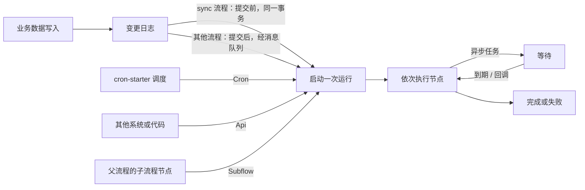
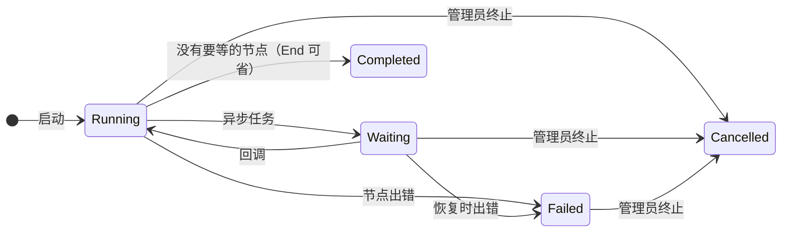

# 自动化

<Lead>

自动化流程（场景 `AUTOMATION`）在数据变化、按时间表、被显式调用或被父流程调用时自动运行，没有人工审批步骤：同步业务数据、发通知、调用外部系统、生成文件等。

</Lead>

<RoleCards>
<RoleCard title="管理员" href="#怎样启动">选触发器、同步还是异步；异步任务怎样等待、怎样继续，子流程怎样在调用方里一次跑完</RoleCard>
<RoleCard title="运维" href="#出错与排查">失败的运行、事件日志，以及结束的运行何时清理</RoleCard>
<RoleCard title="开发者" href="#任务执行模型">任务节点的配置与发布检查、内置执行器、触发源与消息主题</RoleCard>
</RoleCards>

和审批流一样，每次运行都是一个持久化的实例，可以中途等待（异步回调）再继续；结束的运行保留一段时间后清理。



## 怎样启动

<Lead>

一个自动化流程只声明一种触发器，也只从这一个入口启动：数据变化、自己的调度、按 id 显式启动，或被父流程调用。

</Lead>

| 触发器 | 什么时候启动 | 说明 |
|---|---|---|
| `EntityChange` | 指定模型的数据被新增、修改或删除 | 可只监听其中几种事件（`events`，为空即全部），可加一个条件——按记录字段写的规则，或 AviatorScript 表达式，二选一——成立才启动；修改时条件只看得到被修改字段的新值。这个条件只读变化记录自身的字段；流程里连线的规则还可以经关联往下读，最多两层，启动时读取（见[条件的两种写法](./index#条件的两种写法)）。条件无法求值时不启动，事件日志里记一次失败。由变更日志驱动：`@Model(enableAuditLog = false)` 的模型不会触发。同一条变更日志对同一个流程最多启动一次 |
| `Cron` | 到达流程自己的 Quartz 调度 | 需要 cron-starter 与 `mq.topics.cron-task.topic`；每次执行都是新的运行，见 [Cron 触发的流程](#cron-触发的流程) |
| `Api` | 被显式按 id 启动 | `POST /flow/instances/start`；不匹配任何事件 |
| `Subflow` | 被父流程的子流程节点调用 | 在调用方里一次跑完：不能含异步任务这类会等待的节点（发布时检查，`SUBFLOW_WAITS`）；不能调回上层正在运行的流程 |

### Cron 触发的流程

Cron 触发的流程拥有自己的调度：触发器的 `cronExpression`，采用 cron-starter 运行的 Quartz 格式（`second minute hour day-of-month month day-of-week [year]`，例如 `0 0 9 ? * MON-FRI` 表示工作日 09:00，按调度器所在时区）。Automation 流程可以按调度运行，Approval 流程不可以（见 [Flow 场景](./index#flow-场景)）。

- **每分钟最多运行一次**：秒位只能是单个值（比如 `0`），所以 `* * * * * ?`、`0/10 * * * * ?` 都会被拒绝。发布时按调度器的方式解析表达式：为空、调度器无法运行、一分钟触发不止一次或再也不会触发的表达式都不能发布。这是发布时的判断：这条规则之前发布的修订版保持原来的调度，直到再次发布。
- **设计器里给出同样的判断**：就在表达式旁，连同它的文字含义和在服务器时区里接下来的几次运行。
- **调度随流程变化**：只调度启用中的流程。发布、激活另一个修订版（回滚或向前滚动）、切换到其他触发器以及停用或启用流程，都会在 30 秒内移动、新增或移除调度，无论是哪个实例执行的——其间到期的执行会被跳过，绝不会运行两次。
- **租户**：租户的流程在该租户的上下文中运行，且仅在租户处于活动状态时运行；平台共享流程（`tenantId = 0`）在每个活动租户中各运行一次，每次运行都在该租户的上下文中。未启用多租户时（`system.enable-multi-tenancy=false`），每个流程运行一次，没有租户。
- **只由自己的调度启动**：其他 cron 任务的触发都不会启动它，也没有触发事件会匹配 Cron 流程。流程启动时没有提交人，调度触发的时间作为变量 `triggerTime`；Automation 流程的这次触发与其他触发一样记录在 `FlowEvent`（事件日志）中。
- **每次执行都启动自己的运行**，即使上一次仍在运行或等待。执行不携带事件 id，因此与变更日志不同，重投的 cron 消息不会被识别为已运行过。

<Dev title="诊断码与调度实现（CronFlowJobProvider、CronTaskFlowConsumer）">

- 发布时，表达式为空以 `CRON_MISSING_EXPRESSION` 失败；调度器无法运行——或一分钟触发不止一次、再也不会触发——的表达式以 `CRON_INVALID_EXPRESSION` 失败。设计器里的判断来自 `GET /flow/cron/preview`。
- **调度。** `CronFlowJobProvider` 是 cron-starter 的 `CronJobProvider`：调度 leader 在开始调度时以及之后每 30 秒读取每个租户活动的 Cron 触发修订版（`FlowBundle.cronExpression`，发布时从触发器复制），并为每个修订版运行一个名为 `flow:<bundleId>` 的任务，只调度启用中的流程；不会写入任何 `SysCron` 行。未配置 `mq.topics.cron-task.topic` 时不进行任何调度。
- **启动。** `CronTaskFlowConsumer` 启动 `flow:<bundleId>` 消息所指的修订版（`FlowAutomationService.fireCron`），且仅当它仍是其流程的活动修订版时：被替换的修订版在 leader 下次读取之前触发的任务不会启动任何东西。其他所有 cron 消息——维护 cron、其他模块的任务、任何名称的 `SysCron` 行——都被忽略。

</Dev>

## 同步与异步

<Lead>

由数据变更启动的自动化流程默认在业务事务提交之后异步运行；打开 `sync` 后，在提交之前、同一个事务里同步运行。

</Lead>

| | 异步（默认） | 同步（`sync = true`） |
|---|---|---|
| 什么时候运行 | 业务事务提交之后，经消息队列 | 业务事务提交之前，在同一个事务里 |
| 出错时 | 只有这次运行失败，业务写入不受影响 | 默认只记录失败；同时打开 `rollbackOnFail` 时，异常抛给调用方，触发它的写入一起回滚 |
| 能用的节点 | 异步任务、子流程等都可以 | 不能包含异步任务或审批节点（会等待的节点） |

同步流程适合「必须随写入一起成功」的联动或校验；其余用异步，避免拖慢或拖垮业务写入。写入上下文关闭了流程触发（`triggerFlow = false`）时，两种都不会启动。

<Dev title="依赖的消息主题">

异步运行依赖 `mq.topics.change-log.topic`：流程匹配与执行就在 change-log 的流程订阅线程里进行，和落库变更日志的订阅各走各的，慢的流程不会拖住落库。同步运行没有额外依赖。

</Dev>

## 运行、等待与恢复

<Lead>

运行遇到异步任务就停下等待，收到回调后从原处继续；子流程在调用方里一次跑完，并行分支按固定顺序依次执行。

</Lead>



- **异步任务**（`AsyncTask`）：经 `mq.topics.flow-async-task.topic` 把任务交给外部处理，收到回调后从原处继续（见[消息主题](#消息主题)）。
- **子流程**（`Subflow`）：调用一个启用中、带 `Subflow` 触发器的自动化流程，运行时用它当时的生效修订版。子流程是一个普通的自动步骤，在调用方里一次跑完：设计器只列能调用的流程；被调用的流程发布时不能含异步任务节点（`SUBFLOW_WAITS`）。运行时仍跑不起来的——目标后来停用或改了触发方式、调回上层正在运行的流程——会报错，和其他步骤出错一样让这次自动化运行失败。
- **并行**：`ParallelFork` 的分支按固定顺序依次执行，表达的是路由拓扑，不是并发。
- 异步任务的恢复在进程内直接调用引擎，没有 REST 端点。

## 出错与排查

<Lead>

出错的节点让运行失败；失败的运行留着等管理员终止，每次触发都有一条事件日志，可以查「为什么没跑 / 跑了几次」。

</Lead>

- 节点出错即让运行失败，引擎不重试：一条 SQL 失败后整个事务已经中止，在同一个事务里再跑注定失败；调用外部的节点（如 `CallWebhook`）由 HTTP 客户端自己重试。
- 失败的运行保持 <Status>Failed</Status>，直到管理员终止（重跑只适用于审批之后的步骤出错的审批，见[审批之后的步骤出错](./approval#审批之后的步骤出错)）。
- 每次触发都记一条事件日志（`FlowEvent` 模型，经通用模型 API 读取，见[事件日志](./api#事件日志)）：匹配了哪个流程、是否成功，以及原始触发参数，用于排查「为什么没跑 / 跑了几次」。
- 结束的自动化运行连同 trace 和事件日志，在 `flow.automation.retention-days`（默认 30）天后由维护 cron `flow_automation_purge` 清理——这个任务随种子以关闭状态下发，要先开启才会清理；审批实例长期保留。
- 自动化运行不发完成通知：写入触发它的用户不需要得知，失败由运维人员在监控台关注。
- 自动化流程没有测试运行：运行一次就会真的执行节点的动作。设计器的 Test run 只用于审批流（见[测试草稿](./approval#测试草稿)）。

## 任务执行模型

<Lead>

任务节点的执行器由节点类型选定；参数里的占位符和必填参数在发布时就按运行时的方式检查，配置错误的节点在发布时失败，而非执行中途。

</Lead>

由执行器支持的任务节点使用 `TaskNodeConfig`。节点的 **`FlowNodeType`** 选择执行器——config 中没有单独的 `executor` 字段。

```json
{
  "input": {
    "to": ["{{ applicantEmail }}"],
    "subject": "Order {{ orderId }} confirmed",
    "htmlBody": "<h1>Thank you for your order!</h1>"
  },
  "outputVariable": "taskResult"
}
```

- `input` 支持 `{{ expr }}` 插值；解析由执行器负责（数据执行器按类型感知，自由形态 payload 递归插值）。发布时按运行时的方式检查任何节点设置里的每个占位符：能编译的表达式、变量路径或保留引用 `{{ @name }}`，且已闭合、不为空——否则拒绝发布，并指出节点和设置项
- `outputVariable`：执行器的结果整个存入这个变量，之后的节点和路由按这个名字读；设计器里每个任务节点都有这一项（Output variable）。不填时结果的键直接写进变量——`GetRecord`、`Transform` 都写 `result`，两个这样的节点会互相覆盖
- 参数也可以直接平铺在 config 顶层，每个字段一个键，和节点自己的键（`outputVariable`）并列——设计器就是这样写的，按执行器描述（`getConfigSchema`）列出的字段逐个写入

每种任务节点类型都注册有类型化的参数定义：编译器在发布时按它解析参数，并拒绝缺失的必填项，按字段实际所在的位置报出，因此配置错误的节点在发布时失败，而非执行中途。一项参数都没填的节点也一样，逐项报出缺的必填项。

记录节点（`CreateRecord`、`GetRecord`、`UpdateRecord`、`DeleteRecord`、`QueryRecords`）还要按模型的元数据检查：模型必须是本应用的；筛选、排序、取数字段写的路径，要是这次查询用得上的——字段名写错、经过走不通的关联、按一对多字段排序、拿没有存储列的字段做条件，都在发布时报出，指到对应的设置项，而不是等运行到这个节点才失败。值里的占位符运行时才解析，不影响这项检查。

<Dev title="参数解析与发布检查（NodeConfigParser、TemplatePlaceholderValidator、TaskConfigTypes）">

- 没有 `input` 时，顶层其余的键就是参数（`NodeConfigParser`）；两种写法外面都可以再包一层 `task`。以前只从 `input` 读，设计器建的任务节点运行时拿不到参数，发布时也不检查必填项。
- 占位符由 `TemplatePlaceholderValidator` 检查，不合格报 `INVALID_TEMPLATE_PLACEHOLDER`，指出的设置项形如 `to[1]`、`templateVariables.owner`。
- 每种任务节点类型在 `TaskConfigTypes` 中注册有**类型化 input config DTO**：编译器在发布时将参数解析为该 DTO，并拒绝缺失的必填键（`MISSING_REQUIRED_INPUT`），按字段实际所在的位置报出——嵌套写法是 `config.input.url`，设计器的写法是 `config.url`。没有参数（config 为空，或只有节点自己的键）时按空参数检查，每个缺的必填键各报一条。以前只有 `CallWebhook`、`SendEmail`、`SendInboxNotification`、`AsyncTask` 等几种报 `MISSING_TASK_CONFIG`，其余类型直接通过，运行到节点才失败；这个诊断码已经去掉。
- `DefaultTaskExecutorRegistry` 在启动时断言每个已注册执行器的节点类型都有对应条目。
- 记录节点的检查也在 `TaskConfigValidator`：模型不存在报 `UNKNOWN_MODEL`（`config.modelName`）；路径交给 softa-orm 的 `FieldPaths`，筛选按 WHERE、排序按 ORDER BY、取数字段按读取的规则判断，不能用的每条报一个 `INVALID_FIELD_PATH`（`config.filters` / `config.orders` / `config.fields`）；筛选或排序按执行器的方式（`AbstractTaskExecutor`）读不出来报 `INVALID_TASK_CONFIG`。`FieldPaths` 与查询构建器的规则由 softa-orm 的 `FieldPathsMatchBuildersTest` 保持一致。

</Dev>

### 内置任务执行器

| 节点类型 | 执行器 bean | 说明 |
|---|---|---|
| `CREATE_RECORD` | `CreateDataTaskExecutor` | 内置 |
| `GET_RECORD` | `GetDataTaskExecutor` | 内置 |
| `UPDATE_RECORD` | `UpdateDataTaskExecutor` | 内置 |
| `DELETE_RECORD` | `DeleteDataTaskExecutor` | 内置 |
| `QUERY_RECORDS` | `QueryRecordsTaskExecutor` | 内置 |
| `VALIDATE_DATA` | `ValidateDataTaskExecutor` | 内置 |
| `TRANSFORM` | `ExtractTransformTaskExecutor` | 内置 |
| `CALL_WEBHOOK` | `WebHookTaskExecutor` | 内置 |
| `SEND_EMAIL` | `SendEmailTaskExecutor` | 仅在 `MessageService` 可用时注册 |
| `SEND_INBOX_NOTIFICATION` | `SendInboxNotificationTaskExecutor` | 仅在 `MessageService` 可用时注册 |
| `QUERY_AI` | `QueryAiTaskExecutor` | 仅在 `AiRobotService` 可用时注册 |
| `ASYNC_TASK` | `AsyncTaskExecutor` | 仅在 `FlowAsyncTaskProducer` 可用时注册 |
| `GENERATE_FILE` | `GenerateFileTaskExecutor` | 仅在 `DocumentTemplateService`（file-starter）可用时注册 |

没有调用 Spring bean 的任务节点：流程要联动业务时，在单据的审批处理器（`ModelApprovalHandler`）里用代码写，或者发 WebHook。

没有发短信节点：短信全部归平台，流程不发短信。原来的 `SendSms` 节点已经去掉。存量设计里如果还留着它，升级后会读不出来，所以升级前要先把它从流程里删掉、重新发布。

## 触发与消息集成

<Lead>

每种触发源都是声明它的流程的启动契约，只认自己的那条入口；Pulsar 相关组件只在配置了对应主题时注册。

</Lead>

支持的触发源是 `TriggerSource` 的 sealed 子类型，各场景可用哪些见 [Flow 场景](./index#flow-场景)：

| 触发源 | 启动契约 |
|---|---|
| `EntityChange` | 模型的一条变更日志。每条变更日志对每个流程最多启动一次运行：重投的变更日志会返回它已启动的那次运行，而同一行的不同变更各自启动自己的运行 |
| `Cron` | 流程自己的 Quartz 调度；只能由它启动（见 [Cron 触发的流程](#cron-触发的流程)）：其他 cron 任务的触发不会启动它 |
| `Api`（仅 AUTOMATION 场景） | 只能按 id 显式启动（`POST /flow/instances/start`）；不匹配任何事件 |
| `Subflow`（仅 AUTOMATION 场景） | 只能由父流程的 Subflow 节点运行；同样不能作为事件触发 |
| `Submit`（仅 APPROVAL 场景） | 流程模型（它的单据）的记录被提交时启动，可以再用条件写明它审批哪些记录。只能由提交记录启动（见[审批业务记录](./integration#审批业务记录)）；变更日志永远不会产生它 |

`EntityChange` 由变更日志触发，因此声明为 `@Model(enableAuditLog = false)` 的模型永远不会触发它，同步、异步都不会——见[审计日志开关](../../backend_dev/model_dev/annotation#审计日志开关enableauditlog)。

<Dev title="怎样认出重投的变更日志">

每条变更日志的 `uuid` 作为事件 id 写入 `FlowInstance.triggerEventId`（与流程组合唯一），重投时据此找到它已启动的那次运行。

</Dev>

### 消息主题

Pulsar 相关组件按条件注册：

| 属性 | 组件 | 用途 |
|---|---|---|
| `mq.topics.flow-async-task.topic` | `FlowAsyncTaskProducer`、`FlowAsyncTaskConsumer` | 异步任务分发与回调恢复 |
| `mq.topics.change-log.topic` | `ChangeLogFlowConsumer` | 实体变更驱动的流程触发：异步流程在它的订阅线程里运行 |
| `mq.topics.cron-task.topic` | `CronFlowJobProvider`、`CronTaskFlowConsumer` | 按 cron 调度 Cron 触发的流程，并启动它们 |
