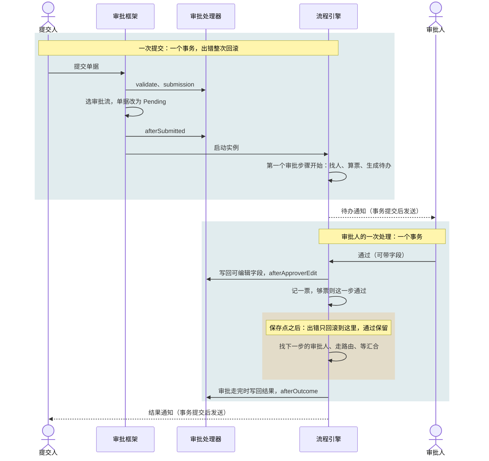

# 设计要点

<Lead>

本页把审批流的几处设计画成图、归纳成表：一次提交和一次审批各在哪个事务里，分支怎样走，审批步骤开始时按什么顺序决定派给谁；另附术语、已知限制和测试要点。

</Lead>

规则本身以[审批流](./approval)、[概览](./index)、[自动化](./automation)、[业务接入](./integration)和[接口与数据](./api)为准，这里不重复，只给出处。

## 术语

<Lead>

下表是 Flow 各页用到的说法和它们在代码里的名字；其中提交人和当事员工不一定是同一个人：HR 替员工提交时，提交人是 HR，按组织找审批人时却从当事员工找起。

</Lead>

| 术语 | 代码里叫 | 说明 |
|---|---|---|
| 流程（草稿） | `FlowDesign` | 设计器里编辑的那一份；它的 id 就是各处引用的 `flowId` |
| 修订版 | `FlowBundle` | 每次发布生成一个，不可变；实例启动时记住所用的修订版，之后再发布不影响它 |
| 实例 | `FlowInstance` | 一次运行；单据每提交一次就是一个新实例 |
| 场景 | `FlowScenario` | 审批流（`Approval`）或自动化流（`Automation`），新建时选定，之后不能改 |
| 触发器 | `trigger` | 流程唯一的启动方式，配在开始节点上 |
| 步骤 | 审批节点；运行时为 `PendingApproval` | 审批节点在实例中的一次停留 |
| 轮次 | `cycle` | 流程图不允许有环，一个实例里每个节点只进入一次，轮次实际总是 1（字段保留） |
| 提交人 | 单据上 `submitterId`，实例上 `initiatorId` | 点「提交」的账号，可能是替员工提交的 HR。撤回、催办、取回失败的审批都只有他能做 |
| 当事员工 | 处理器的 `subject()`（默认 `employeeId`），实例上 `subjectId` | 单据所涉及的员工，按组织找审批人时以他为起点：他的上级、他的部门。不叫「申请人」：HR 发起的单据（调薪、调动）里，员工本人并没有申请 |
| 审批人 | 登录账号 id | 当前步骤找到的人，必须有能登录的账号 |
| 抄送人 | 抄送待办（`Cc`） | 审批人手动抄送的人，或抄送规则抄送到的人 |
| 参与者 | `FlowParticipants` | 提交人和实例派过待办的人：不需要授权就能查看实例，实例运行中可以评论。管理员的动作不让他成为参与者 |
| 委托规则、受托人 | `FlowDelegation` | 在起止时间内，把新到达委托人名下的待办改派给受托人；已经在手上的待办不动 |
| 默认审批流 | `Submit` 触发器没有条件 | 一张单据没写提交条件的审批流；写了条件的都不成立时由它接手。启用中的最多一个 |
| 生效中 | `enabled` + 生效的修订版 | 已发布且已启用；提交时只在这些审批流里选 |
| 默认线 | 默认边（设计器显示 Other） | 没有条件的出线，总是最后判断 |
| 填写步骤 | 待办上的 `fillIn` | 有必填字段的步骤：审批人的按钮叫「提交」（记录仍算通过），不能批量处理 |
| 取回 | `takesBack` | 审批失败后，提交人把单据拿回草稿，不受撤回策略限制 |
| 重跑 | `RETRY`、`retryAfterNodeId` | 管理员让审批之后出错的实例从出错前那个审批步骤之后继续 |
| 转给角色 | `AssignToRole` | 找不到审批人时，交给选定角色里能处理的人，任一人决定 |
| 摘要 | `summary` | 处理器给的一行说明（最长 256 字），提交时快照在实例和待办上 |
| 审批锁 | `ApprovalLockValidator` | 冻结非草稿单据及其级联明细的写入校验 |
| 审批处理器 | `ModelApprovalHandler` | 业务模块为每个审批模型实现的接入接口，见[业务接入](./integration) |
| 失败通知角色 | `flow.notification.failure-role-codes` | 审批失败时，除提交人外还通知哪些角色，默认 `TENANT_ADMIN` |

## 事务边界

<Lead>

一次提交是一个事务，审批人的一次处理是另一个事务；审批人通过之后的后续步骤在同一个事务里另设了保存点，出错只回滚到保存点，这次通过保留。

</Lead>

- **提交**：业务校验、选流程、改状态、提交后动作、启动实例、第一个审批步骤开始，都在调用方的同一个事务里。任何一步出错——业务校验不过、没有适用的审批流、某一步找不到审批人且设置为报错——整次回滚：单据仍是草稿，不留实例，也不通知任何人。见[主链路](./approval#主链路)。
- **审批人的一次处理**：写回的字段过不了 `afterApproverEdit`，或 `afterOutcome` 抛出异常（如余额不足），整次处理被拒，单据和审批都回到处理之前。审批人自己能改正的问题（这一步已被别人处理、必填项没填）同样直接拒绝。
- **例外：保存点之后的后续步骤**（橙色块）。下一步找不到审批人、没有可走的路线、分支汇合不对，只回滚到保存点：这次通过保留，实例转为 <Status>Failed</Status>，单据保持 <Status>Pending</Status>，审批人这次请求照常成功。审批流只放人和路由，后续步骤不写数据、不调外部、不发消息。见[审批之后的步骤出错](./approval#审批之后的步骤出错)。
- **通知**在动作的事务提交之后、用独立事务发送：动作回滚就不发，发送失败只记日志。失败通知例外：出错时立即发送，因为失败的那次尝试本身会回滚。
- **管理员的终止、重跑、改派**和**批量审批**都逐条执行，每条一个事务，一条失败不影响其他条。

## 分支规则图解

<Lead>

普通节点的多条出线按顺序只走一条，包含分支走所有成立的线，并行拆分全部都走；可能同时走的分支只能在汇聚或结束节点相遇。

</Lead>

规则见[概览 · 路由：连线条件](./index#路由连线条件)和[发布时拦下的配置](./approval#发布时拦下的配置)。

<FlowFigure name="branches">

每一行是一个例子，对应下面的一条规则。菱形是网关：里面画圆圈的是包含分支，画加号的是并行拆分，右边与它配对的菱形是汇聚。虚线是这次没走的线。

</FlowFigure>

- **普通节点的多条出线：按顺序选一条。** 按线上的序号逐条判断，走第一条成立的，后面的不再判断；都不成立走默认线 Other。有多条条件线的节点必须有默认线。
- **包含分支：成立的都走，再汇到一处。** Other 只在一条都不成立时走。没走的分支在配对的汇聚处算已到，汇聚只等走了的那几条，只往下走一次。
- **并行：全部都走，汇聚等齐。** 并行拆分不看条件，所有出线都走（实际按固定顺序依次执行）；汇聚等所有进线到齐才往下走。
- **不能发布：分支不经汇聚就碰到一起。** 可能同时走的分支（并行拆分的各条线、包含分支的条件线）只能在汇聚或结束节点相遇，否则报 `CONCURRENT_BRANCHES_MEET`：图中的「HR 复核」每来一条分支就执行一次，复核人会被问两次。应先进汇聚，再到复核。

## 审批步骤开始时

<Lead>

审批步骤开始时，系统依次按规则找人、算票数、把有委托的人换成受托人、按设置让提交人和前面步骤已通过的人自动通过，再给还没处理的人生成待办；这些都在推进到这一步的那次请求里完成（提交时就在提交的事务里）。

</Lead>

<FlowFigure name="stepStart">

从左往右是这一步依次做的事。有两种情况这一步不用等人，不生成待办，直接进入下一步：一个人都没找到且设置为自动通过；或者自动通过的票已经够了。

</FlowFigure>

1. **按规则找人**：各组找到的人合在一起，同一个人只算一次；账号不能登录的悄悄去掉，上级、部门负责人不能审批时往上找。见[审批人解析](./approval#审批人解析)。
2. **找不到人**：按这一步的「找不到审批人时」处理——报错（默认）、自动通过（记录写明 `Auto-approved (no approver)`）、或转给角色（角色里能处理的人，去掉提交人和当事员工，任一人决定，接着算票）。只配了指定人员的步骤一律按报错处理。
3. **算票数**：按通过方式算出要几票同意，再按实际人数封顶。见[通过门槛](./approval#通过门槛)。
4. **委托替换**：审批人有生效中的委托规则时，待办派给受托人，票数不变；受托人账号不能用、或已是这一步的审批人时不替换。
5. **提交人与去重**：提交人在审批人里时，按「提交人是审批人时」的设置自动算通过（别人代提交时，当事员工本人不算）；前面步骤已经通过的人按去重设置自动通过。见[自动通过](./approval#自动通过)。
6. **生成待办**：给还没处理的审批人生成待办并通知，实例进入等待中。

## 已知限制

<Lead>

下表列出已知的限制和建议的处理办法，其中报错与提示的几处小问题待排期；明确暂不做的需求列在表后。

</Lead>

| 事项 | 现状 | 建议 |
|---|---|---|
| 敏感字段不进路由变量 | 加密、读取时脱敏的字段不交给流程，连线规则读不到，经关联读也一样 | 需要按这类字段分支时，由审批处理器另算一个不敏感的值放进路由变量（见[路由变量](./integration#路由变量)） |
| 账号后来不能用 | 已派给后来离职、冻结的人的待办不会自动转走；委托对象后来不能用时委托不生效，只记执行轨迹、不通知 | 由管理员改派 |
| 以前发布的修订版 | 照旧运行，重新发布才会被拒：审批流里还带人和路由以外的节点的，这些节点照常执行，出错时审批失败（通过保留），重跑时出错前已发的邮件、webhook 可能再发一次；秒位不是单个值的定时规则照旧按原表达式跑 | 升级后找出这类流程，重新发布前删掉这些节点，把审批通过后要做的事改成审批结果触发的自动化流程；定时规则改为最多每分钟一次 |
| 老审批没有列表快照 | 当事员工、部门、生效日、编号、摘要在提交时快照到实例和待办上，只对之后提交的审批有值；没有部门的老审批，按部门授权的管理员看不到 | 由应用的发版脚本补齐这些列 |
| 报错与提示的小问题 | 提交条件运行时算不出来（如拿文本和数字比大小）、检查加入前发布的老版本分支出错时，只返回系统错误，原因在日志里；驳回、退回缺意见的报错写节点编号，不是名称；单据接口的撤回（`POST /{Model}/withdraw`）意见不受 256 字限制；设计器里节点表达式控件的占位仍写 `{{ amount > 1000 }}`（效果和不加括号相同，只是和连线的写法不一致） | 待排期 |

### 暂不做

- 退回到中间某一步继续审批：退回一律回到提交人，修改后重新提交，从第一步审起。
- 超时后自动处理（沉默即同意、自动驳回、自动转交）、按工作日计时、到期前预警、最后一次提醒同时通知管理员：超时只发提醒，见[超时提醒](./approval#超时提醒)。
- 长时间没人处理自动作废。
- 「被驳回」页签和「待提交人处理」这类单独的待办类型。
- 通用工作流表和全局审批流水号。
- 跨单据类型汇总草稿。
- 管理员评论：管理员的动作不让他成为参与者。
- 改写审批中还没走到的步骤：还没走到的步骤到达时才按配置找人。
- 邮件里一键审批。
- 其他通知渠道（如钉钉）：需要时由应用接入，见[通知](./approval#通知)。

## 测试要点

<Lead>

按「状态 × 角色 × 配置」组合设计用例，每条对应一条规则。

</Lead>

### 单据状态

- 草稿可改、可删、可提交、可作废；审批中的单据改、删、在下面新增明细都被拒绝。
- 已通过、已驳回、已作废是终态，任何修改都被拒绝。
- 退回、撤回后回到草稿；重新提交开始新的审批，从第一步审起，编号不变。
- 审批失败：单据保持审批中；提交人取回 → 草稿；管理员终止 → 已作废；审批之后的步骤出错的，管理员重跑 → 继续审批。

### 提交与选流程

- 没有适用的流程、多个适用的流程、当事员工为空：分别给出明确的拒绝原因。
- 默认审批流：写了条件的都不成立时走没写条件的那个；复制默认审批流、给副本加上条件后，命中条件的走副本，其余仍走原流程；没有默认审批流又都不成立时拒绝提交。
- 两个启用中的审批流条件完全相同（或都没写条件）时，发布、启用、回滚被拒。
- 提交时某一步找不到审批人（设置为报错）：提交失败、单据仍是草稿；不留失败的审批、不发通知；提示写明是哪一步、为什么。
- 预览出现找不到审批人的步骤时，表单的「提交」直接显示原因。
- 同一张单据同时提交两次：只有一次成功。
- 提交人用有修改权限的角色范围找不到的单据不能提交、不能作废（只读范围不够），提示单据不存在。
- 审批路径预览与实际提交后的步骤一致。

### 找审批人

- 上级第 N 级，从当事员工或从提交人算起（代提交时两者不同）；这一级不能审批时往上找第一个能审批的人。
- 部门负责人缺失或不能审批时取上级部门的；按角色、按岗位、部门成员。
- 账号不能登录（没有账号、未激活、未接受邀请、冻结、离职）的算找不到人；找不到人时的三种设置：报错、自动通过、转给角色（「跳过」不再提供，已存的照常按自动通过运行）。
- 只配了指定人员的步骤，这些人都不能处理时一律报错。
- 转给角色：角色成员任一人决定，提交人和当事员工被排除。
- 委托生效期间，新到达的待办落到受托人；受托人账号不能用时不委托；手上已有的待办不受影响。

### 计票与自动通过

- 任一人、全部、至少 N 人、按百分比只管通过，且只在这一步可能有多个审批人时显示和生效；只有一个指定的人，或上级、部门负责人、部门 HRBP 时，一人同意即通过。
- 一人驳回即驳回，不看这一步要几票通过；已经同意过这一步的人不能再驳回。
- 按规则找到的人少于门槛时按实际人数封顶，不会卡住。
- 同一个人同一轮只算一票。
- 提交人是审批人：自动通过、正常审批两种设置；总经理自己提交、步骤只配了总经理，默认直接通过。别人替员工提交、员工本人是某一步的审批人时，不论设置都要他自己审批。
- 审批人去重：全局、相邻、不去重。

### 审批动作

- 通过时修改字段：只保存可编辑、必填字段；必填为空被拒；隐藏字段看不到；`afterApproverEdit` 不通过时整次被拒。
- 有必填字段的步骤，按钮是「提交」，记录仍算通过，不能批量。
- 驳回、退回必须写意见；意见超过 256 字被拒；流程不允许退回时没有退回按钮，接口也拒绝。
- 转交、抄送（一次可选多人，已在这一步的人自动跳过）与已读；对象账号不能用时拒绝并写明原因；审批人的菜单里没有加签、委托。
- 别人已处理后再操作，提示刷新。
- 评论只限参与者，审批结束后不能再评论；管理员不能评论。

### 审批之后出错

- 下一步找不到人、没有可走的路线、分支汇合出错：审批人的通过成功，实例失败，单据仍审批中，提交人和失败通知角色收到通知。
- 提交人可以取回，单据回到草稿。
- 管理员重跑后继续，跑完照常写回，发「已通过」通知和「通过后」抄送。
- 取回或重新提交后不能重跑。

### 撤回与催办

- 撤回策略三档；「首个审批人处理前」在第一次人工处理后关闭，自动通过不算。
- 只有提交人能撤回；撤回按钮的显示与接口结果一致。
- 催办间隔（小时，默认 4）内再催被拒，并告知下次可催的时间；流程关掉催办时提交人不能催，管理员仍可催。

### 批量审批

- 有必填字段、审批不在等待中、不是本人待处理的任务不能批量，界面写明原因。
- 逐条执行、逐条返回结果：成功的离开列表，跳过、失败的保留。
- 批量退回时，流程不允许退回的审批被跳过，并提前提示数量。
- 一次最多 100 条。

### 管理员

- 监控列表只显示数据范围内的审批；按部门授权（实例上快照的当事员工部门）时只看到、只能操作这些部门员工的审批；没有部门的审批（自动化运行、老审批）只有「全部」范围能看到。
- 终止只对运行中、等待中、已失败的审批；原因必填；单据作废，提交人收到通知；被终止清掉的审批人仍能从邮件打开审批。
- 改派：预览受影响的待办数；原因必填；原审批人可以选到离职的人；新审批人已在这一步时合并，合并后够票（如「全部通过」的 A、B、C，A、B 已通过，把 C 改派给 A）这一步当场通过并往下走；记录里显示操作的管理员。
- 代人委托：委托人在自己的委托里能看到并取消。

### 通知与抄送

- 每类事件的收件人与内容；流程关闭邮件后只发站内信。
- 没有邮箱的用户只收站内信；没配站点地址时邮件里没有链接；租户没有对应邮件模板时不发邮件。
- 审批启动之后的失败立即通知提交人和失败通知角色；提交时的失败不通知。
- 处理完审批、或打开审批页后，本人关于这个审批的未读站内信变为已读，抄送变为已读。
- 抄送规则：提交时、通过后、驳回后三个时机；按规则找收件人；规则抄送没有操作人。
- 「通过后」抄送不论审批怎样走完都发（最后一票同意、重跑、改派后直接通过），记在最后完成的审批步骤上。

### 设计器与发布

- 节点没名称、有走不到的节点、审批节点没审批人、字段权限没选权限、转给角色没选角色，不能发布。
- 按条件选路的节点没有默认线、默认线排在条件线前，不能发布；条件线按顺序判断，默认线永远最后（显示 Other）。
- 分支不经汇聚汇到同一节点、包含分支汇合没配对、汇聚多条出线、并行分支绕过汇聚，不能发布。
- 新建流程只能选审批流、自动化流；审批流里有人和路由以外的节点，不能发布。
- 定时规则每分钟不止一次（`* * * * * ?`、`0/10 * * * * ?`）不能发布，设计器的预览直接提示；秒位写 `0` 可以。
- 审批人和抄送的来源只有指定的人、上级、部门负责人、部门 HRBP、角色、岗位、部门成员。
- 单据没有审批处理器时不能新建审批流，也不能发布。
- 指定审批人、抄送人账号不能用只出警告；审批流没有审批步骤只出警告。
- 旧草稿里存的 `ANY_ONE`、`ERROR` 这类值报「读不了」，重选后能发布。
- 发布新版本后，审批中的仍按旧版本走；回滚后新提交走旧版本；复制得到未发布草稿；有未结束实例时不能停用；已发布的流程不能删除。
- 打开流程即检查，诊断栏显示结果（没问题时显示 No issues）。
- 试运行（只有审批流）：换提交人、改字段值，路线和每一步的审批人跟着变；提交条件不成立时先提示；试运行后没有新的实例、待办、站内信、邮件，版本列表不变。

### 可见性与选人

- 步骤把敏感字段设为只读时，审批人能看到；隐藏字段对抄送人、之前的审批人也不可见；一对多被列为可见时明细完整。
- 选人框只列账号能登录的人，范围按角色在通讯录模型上的数据范围；没有对应页面权限直接调 `/flow/directory/people` 被拒。
- 既不是参与者、又读不到这条实例、也读不到单据的人打不开审批；只能读实例的管理员看得到审批，但打不开单据。
- 登录过期后打开审批链接 → 登录 → 回到原页面；外站地址不跳转。

### 边界值

- 批量审批一次最多 100 条，批量终止、批量重跑一次最多 100 个。
- 意见、原因、重跑备注最多 256 字；摘要最多 256 字（超出截断）；站内信标题超过 200 字截断。
- 超时提醒最多 3 次（不可配置）；催办间隔、提醒小时数至少 1。
- 通讯录每次最多返回 200 人（默认 20）。
- 定时触发最多每分钟一次。

<Dev title="其余报错原文（核对用）">

常见报错见[审批流 · 出错时怎样处理](./approval#出错时怎样处理)；下面是那里没有列的。

| 场景 | 消息 |
|---|---|
| 范围外 / 单据不存在 | `The {0} record {1} does not exist.` |
| 作废非草稿 | `Only a draft can be cancelled; this record is {0}.` |
| 改、删已结束的单据 | `This record is approved and cannot be changed.`（已驳回、已作废写作 `was rejected` / `was cancelled`）/ `An approved record cannot be deleted.`（`A rejected…` / `A cancelled…`） |
| 改审批中单据的明细 / 改审批字段 | `The record this belongs to is in approval and cannot be changed. Withdraw it first to edit it.` / `This field is set by the approval and cannot be edited.` |
| 新建不在自己的数据范围 | `The record is outside your data scope.` |
| 步骤已不在等待 | `This step no longer waits for approval: it may have been handled already. Refresh to see where the approval stands.` |
| 人与步骤 | `{name} is not an approver of step '{label}'.` / `{name} has already approved step '{label}'.`（驳回同理） |
| 抄送 | `Choose at least one person to CC` / `Nobody to CC: everyone chosen is an approver of this step or has been CC'd on it already` |
| 必填为空 | `Form validation failed: Field '{field}' is required`（多个以 `; ` 连接） |
| 原因、备注超长 / 批量超量 | `reason: The reason can be at most 256 characters`（终止、改派）/ `comment: The note can be at most 256 characters`（重跑）/ `tasks: At most 100 tasks can be acted on at once` |
| 批量跳过 | `This step has fields to fill in: open it to act on it.` / `This approval does not allow returns.` |
| 撤回被拒（其余） | `Flow instance is not waiting for approval and cannot be withdrawn: {id}` / `Only the initiator can withdraw this flow instance: {id}` / `This record has no approval in progress to withdraw.` / `Only the submitter can withdraw the record after its approval failed: {model} {rowId}` |
| 催办 | `The pending approvers of instance {id} were urged recently and may be urged again after {time}` / `Flow instance does not allow its initiator to urge the approvers: {id}` / `Only the initiator can urge the approvers of flow instance: {id}` |
| 评论 | `Flow instance has ended and takes no more comments: {id}` / `Only the initiator and the people flow instance {id} gives a task to may comment on it` |
| 终止 | `A reason is required to terminate flow instance {id}` / `Only an instance that is running, waiting or failed can be terminated; {id} is {status}` |
| 重跑 | `Only an approval whose steps after an approval failed can be run again; terminate any other failed instance instead.` / `The record was submitted again after this approval failed: it waits on its new approval, and this one cannot run again.` / `The record is no longer in this approval — its submitter took it back, or it was removed — so the approval cannot run again.` |
| 改派 | `A reason is required to reassign approval tasks` / `The new approver must be someone else` |
| 委托规则（其余） | `Choose the approval flow the delegation is for` / `Choose the approval step the delegation is for` |
| 流程管理 | `Flow '{0}' would take the same {1} records as '{2}': neither has a submit condition. Give it a condition of its own, or disable '{2}'.`（条件相同时写 `their submit conditions are the same`）/ `Flow '{0}' cannot be disabled: {n} of its instances have not finished — records still in approval among them. Let them finish, or end them in Flow Instances, first.` / `Flow '{0}' cannot be disabled: {callers} call it as a subflow. Disable or change them first.` / `A published flow cannot be deleted: its revisions, instances and approval history refer to it. Disable it instead.` |

</Dev>
