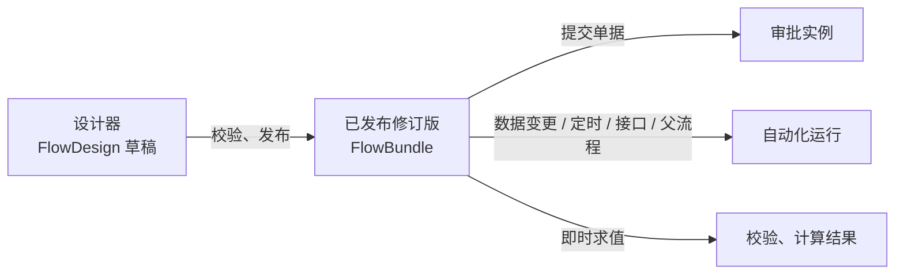

# Flow

`flow-starter` 是 Softa 的元数据驱动流程引擎 starter。涵盖：

- 供可视化编辑器使用的设计时图文档
- 编译时校验并转换为运行时 bundle
- 按 `flowId` 发布的 bundle 修订版
- 审批、自动化、校验和计算流程的运行时执行
- 实例、审批任务、审批记录、委托、抄送规则和触发事件的持久化投影
- 可选的基于 Pulsar 的触发与异步任务集成

本节各页记录 `flow-starter` 当前实现的后端契约：

| 页面 | 内容 |
|---|---|
| [审批流](./approval) | 单据怎样进入审批、状态怎样流转、审批人能做什么、结果怎样写回，以及约束、异常和通知 |
| [自动化](./automation) | 自动化流程怎样启动（数据变更、定时、接口、子流程）、同步与异步执行、等待与恢复、任务节点；校验与计算流程 |
| [业务接入](./integration) | 让业务模型走审批：模型、控制器、审批处理器、默认流程种子，以及宿主应用集成清单 |
| [接口与数据](./api) | REST 接口、实例搜索、审批投影、监控、持久化模型、节点描述符 |

## 当前模型

### 设计、发布、运行时

| 层级 | 主要类型 | 说明 |
|---|---|---|
| 设计时 | `DesignFlowDefinition`、`FlowGraphDocument`、`FlowGraphNode`、`FlowGraphEdge` | 面向编辑器的图 DTO |
| 发布时 | `FlowCompiler`、`CompiledFlowDefinition`、`FlowPublishService` | 编译、校验、发布修订版、回滚 |
| 运行时 | `FlowRuntimeEngine`、`FlowExecutionState` | 执行已发布 bundle、挂起/恢复、持久化投影 |

### Flow 身份与修订版

- `FlowDesign` 是草稿工作副本。它的 `id`（分布式字符串 id）就是流程在各处的身份：bundle、实例、待办、审批记录、事件、委托和抄送规则都以 `flowId` 引用它，列表通过这个引用显示流程名称。
- `flowName` 在租户内唯一；没有单独的 flow code。
- `FlowBundle` 是编译后的已发布快照；已发布修订版以 `flowId` 为键。
- `FlowStartRequest` 按以下顺序解析 bundle：
  1. `bundleId` — 固定到确切的已发布修订版
  2. `flowId` — 启动当前活动修订版
- 要启动特定历史修订版，通过修订版列表端点查找其 `bundleId` 并作为 `bundleId` 传入。
- `FlowBundle.designJson` 保留发布时使用的设计快照，以便编辑器恢复历史画布。

### Flow 场景

单一的 `FlowScenario` 枚举声明流程是什么。它在创建流程时选定，此后不可更改（`FlowDesign.scenario` 在更新时只读；设计文档跟随该列）。

| 场景 | 含义 | 可声明的触发器 |
|---|---|---|
| `APPROVAL` | 记录的审批：由提交记录启动，包含审批步骤，结果回写到记录。持久化实例，作为记录的审批历史保留 | `Submit` |
| `AUTOMATION` | 由变更、cron、显式启动或父流程启动；不含审批步骤。持久化运行，保留期过后清理 | `EntityChange`、`Cron`、`Api`、`Subflow` |
| `VALIDATION` | 无状态同步校验流程——瞬态求值：无实例行、无 trace、无事件日志 | `EntityChange`、`Cron` |
| `COMPUTE` | 无状态同步计算/onchange 流程——瞬态求值，同样零足迹规则 | `FieldChange`、`EntityChange`、`Cron` |

场景决定执行策略：`APPROVAL` / `AUTOMATION` 流程经 `FlowRuntimeEngine.start`（持久化、可恢复）；`VALIDATION` / `COMPUTE` 流程经 `evaluate`——相同遍历但零 flow 足迹。任务节点产生的业务写入仍加入调用方事务，因此求值失败会回滚。

每个流程都声明触发器，**触发器就是流程的启动契约**——每种只对应一条启动路径：

| 触发器 | 流程如何启动 |
|---|---|
| `Submit` | 只能由提交记录启动（`FlowClient.submitRecord`）——见[审批业务记录](./integration#审批业务记录) |
| `EntityChange` / `FieldChange` | 只能由各自的事件启动 |
| `Cron` | 只能按自己的调度启动——见[Cron 触发的流程](./automation#cron-触发的流程) |
| `Api` | 只能按 id 显式启动：`POST /flow/instances/start`、`FlowClient.start` / `publishAndStart` |
| `Subflow` | 只能被父流程的 Subflow 节点调用 |

显式启动和 Subflow 调用运行的都是 Automation 流程，因此 `Api` 和 `Subflow` 只属于 Automation。草稿的调试运行忽略触发器。

设置项也各属一个场景：`withdrawPolicy`、`approverDedup`、`selfApproval` 和 `emailNotification` 属于 Approval 流程；`sync` / `rollbackOnFail` 属于 Automation 流程，而 sync 流程在写数据的事务里运行，不能包含 Timer、AsyncTask 或 Approval 节点。违反任一规则的流程会被编译器拒绝。

### 节点类型

当前 `FlowNodeType` 值：

- 控制：`Start`、`End`、`Timer`
- 路由：`InclusiveGateway`、`ParallelFork`、`ParallelJoin`
- 人工：`Approval`、`HumanTask`*
- 任务：`Script`、`CreateRecord`、`GetRecord`、`UpdateRecord`、`DeleteRecord`、`QueryRecords`、`ValidateData`、`Transform`、`CallService`、`CallWebhook`、`SendEmail`、`SendSms`、`SendInboxNotification`、`QueryAI`、`AsyncTask`、`GenerateFile`
- 子流程：`Subflow`
- 数据：`ForEach`*、`ReturnValue`

\* `HumanTask` 和 `ForEach` 已定义但**尚未运行时支持**：它们从节点面板中省略，并在编译时被拒绝（`UNSUPPORTED_NODE_TYPE`），因此包含它们的流程无法发布。

每个 `FlowNodeType` 声明允许使用它的场景（`FlowNodeType.getScenarios()`）；节点面板和编译器（`INVALID_SCENARIO_NODE`）都以此为准：

| 节点类型 | 场景 |
|---|---|
| `Start`、`End`、`Script`、`ReturnValue`、`CreateRecord`、`GetRecord`、`UpdateRecord`、`DeleteRecord`、`QueryRecords`、`CallService`、`CallWebhook` | 四个场景 |
| `Timer`、各网关、`Subflow`、`ValidateData`、`Transform`、`SendEmail`、`SendSms`、`SendInboxNotification`、`QueryAI`、`AsyncTask`、`GenerateFile`、`ForEach` | Approval、Automation |
| `Approval`、`HumanTask` | Approval |

节点行为不变量：

- **`Subflow` 仅支持同步**：若子流程进入等待状态（`TIMER` / `ASYNC`），编排器会使父流程失败；递归子流程调用会被拒绝。子流程必须是带 `Subflow` 触发器的 Automation 流程，否则父流程失败。人工步骤应建模在 Approval 流程中，而非子流程。
- **`ParallelFork` 分支串行执行**（确定性顺序），而非墙钟并行——该网关建模路由拓扑，而非并发。

## Flow 概念

Flow 是业务流程的更广义概念。

关系：
Flow > BP = Workflow > BPMN

表达式引擎主要用于解决数据计算问题，实现类似 QLExpress 的计算引擎。BPMN 场景更适合工作流或规则引擎（如 Flowable）。例如 Flowable 集成 JUEL 以支持简单表达式解析。DMN 规则引擎更适合真/假决策场景，例如 BP 中的 sequenceFlow 路由条件。Drools 更侧重于规则配置与管理。

示例场景：
- 导入：更适合 BPMN。每个动作是数据更新节点；动作有顺序但可异步处理。
- 审批：BPMN + DMN。BPMN 处理审批流程与路径。DMN 处理复杂审批路由。DQL 解决复杂审批人查询。
