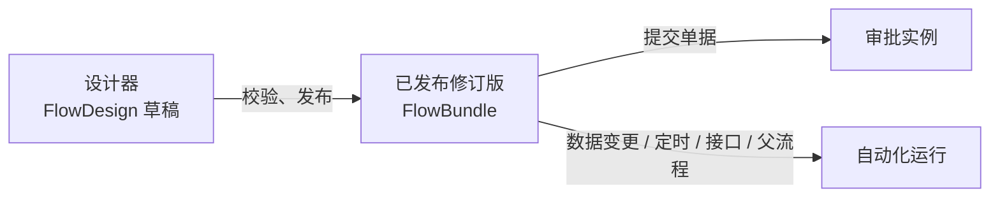

# Flow

<Lead>

Flow 是 Softa 的元数据驱动流程引擎（`flow-starter`）：流程在设计器里画好、发布后运行——审批流审批一张单据，自动化流程在数据变化、定时、被显式调用或被父流程调用时自动运行。

</Lead>

本节各页记录 `flow-starter` 当前实现的后端契约：

<RoleCards>
<RoleCard title="审批流" href="/zh-CN/docs/features/flow/approval/">审批一张单据：怎样进入审批、状态怎样流转、每一步由谁审批和流程设置、审批人能做什么、结果怎样写回，以及约束、异常和通知</RoleCard>
<RoleCard title="自动化" href="/zh-CN/docs/features/flow/automation/">没有人工审批的自动运行：怎样启动（数据变更、定时、接口、子流程）、同步与异步执行、等待与恢复、出错与排查、任务节点与消息主题</RoleCard>
<RoleCard title="业务接入" href="/zh-CN/docs/features/flow/integration/">写给研发：让业务模型走审批——模型、控制器、审批处理器、默认流程种子，以及宿主应用集成清单、配置项与扩展点</RoleCard>
<RoleCard title="接口与数据" href="/zh-CN/docs/features/flow/api/">供查阅：REST 接口、实例搜索、审批投影、监控、持久化模型、节点描述符</RoleCard>
<RoleCard title="设计要点" href="/zh-CN/docs/features/flow/design/">审批流的设计画成图、归纳成表：事务边界、分支规则图解、审批步骤开始时怎样派人，以及术语、已知限制与测试要点</RoleCard>
</RoleCards>

## 设计、发布、运行时

<Lead>

一个流程经过三层：设计时在设计器里编辑草稿，发布时编译、校验并发布成修订版，运行时执行已发布的修订版。

</Lead>

`flow-starter` 涵盖：

- 供可视化编辑器使用的设计时图文档
- 编译时校验并转换为运行时 bundle
- 按 `flowId` 发布的 bundle 修订版
- 审批与自动化流程的运行时执行
- 实例、审批任务、审批记录、委托和触发事件的持久化投影
- 可选的基于 Pulsar 的触发与异步任务集成

<Dev title="各层的主要类型">

| 层级 | 主要类型 | 说明 |
|---|---|---|
| 设计时 | `DesignFlowDefinition`、`FlowGraphDocument`、`FlowGraphNode`、`FlowGraphEdge` | 面向编辑器的图 DTO |
| 发布时 | `FlowCompiler`、`CompiledFlowDefinition`、`FlowPublishService` | 编译、校验、发布修订版、回滚 |
| 运行时 | `FlowRuntimeEngine`、`FlowExecutionState` | 执行已发布 bundle、挂起/恢复、持久化投影 |

</Dev>

## Flow 身份与修订版

<Lead>

流程的 id 就是它在各处的身份，流程名在租户内唯一；已发布的修订版是编译后的快照，启动时默认运行当前活动的修订版。

</Lead>

- `FlowDesign` 是草稿工作副本。它的 `id`（分布式字符串 id）就是流程在各处的身份：bundle、实例、待办、审批记录、事件和委托都以 `flowId` 引用它，列表通过这个引用显示流程名称。
- `flowName` 在租户内唯一；没有单独的 flow code。
- `FlowBundle` 是编译后的已发布快照；已发布修订版以 `flowId` 为键。
- `FlowBundle.designJson` 保留发布时使用的设计快照，以便编辑器恢复历史画布。

<Dev title="启动时怎样选修订版（FlowStartRequest）">

`FlowStartRequest` 按以下顺序解析 bundle：

1. `bundleId` — 固定到确切的已发布修订版
2. `flowId` — 启动当前活动修订版

要启动特定历史修订版，通过修订版列表端点查找其 `bundleId` 并作为 `bundleId` 传入。

</Dev>

## Flow 场景

<Lead>

场景决定流程是什么，在创建流程时选定、此后不可更改：审批流由提交单据启动、结果回写到单据，自动化流程由数据变更、定时、显式启动或父流程启动。

</Lead>

| 场景 | 含义 | 可声明的触发器 |
|---|---|---|
| `APPROVAL` | 记录的审批：由提交记录启动；步骤只有人和路由（见[节点类型](#节点类型)）；结果回写到记录。持久化实例，作为记录的审批历史保留 | `Submit` |
| `AUTOMATION` | 由变更、cron、显式启动或父流程启动；不含审批步骤。持久化运行，保留期过后清理 | `EntityChange`、`Cron`、`Api`、`Subflow` |

两种流程都持久化、可恢复。记录的校验属于它的模型（字段约束），由其他值算出的值属于计算字段——都不属于流程。审批结果要引发的事——调用 webhook、写一条记录、发一条消息——属于 Automation 流程，由记录的变化（其 `approvalStatus` 变为 `Approved`）启动。

每个流程都声明触发器，**触发器就是流程的启动契约**——每种只对应一条启动路径：

| 触发器 | 流程如何启动 |
|---|---|
| `Submit` | 只能由提交记录启动（`FlowClient.submitRecord`）——见[审批业务记录](./integration#审批业务记录) |
| `EntityChange` | 只能由它的事件启动 |
| `Cron` | 只能按自己的调度启动——见[Cron 触发的流程](./automation#cron-触发的流程) |
| `Api` | 只能按 id 显式启动：`POST /flow/instances/start` |
| `Subflow` | 只能被父流程的 Subflow 节点调用 |

显式启动和 Subflow 调用运行的都是 Automation 流程，因此 `Api` 和 `Subflow` 只属于 Automation。

设置项也各属一个场景：`withdrawPolicy`、`returnEnabled`、`urgeEnabled`、`urgeIntervalHours`、`remindAfterHours`、`approverDedup`、`selfApproval`、`emailNotification` 和 `cc` 属于 Approval 流程；`sync` / `rollbackOnFail` 属于 Automation 流程，而 sync 流程在写数据的事务里运行，不能包含 Timer、AsyncTask 或 Approval 节点。违反任一规则的流程会被编译器拒绝。

<Dev title="场景的实现与已去掉的场景">

- 场景是单一的 `FlowScenario` 枚举。`FlowDesign.scenario` 在更新时只读；设计文档跟随该列。
- 两种场景都经 `FlowRuntimeEngine.start` 运行。
- 记录的校验写在模型上：字段约束，或 `ModelWriteValidator`。原来代表校验和计算的 Validation 和 Compute 场景从未真正生效，已经连同它们用的 `FieldChange` 触发器和 `declaredOutputs` 一起去掉。

</Dev>

## 流程的起点：触发器与它写明的模型

<Lead>

一个流程只有一个触发器、一个开始节点——一份启动契约；基于记录启动的触发器写明记录的模型，还可以带条件，决定哪些记录启动这个流程。

</Lead>

触发器在开始节点上配置。同一段逻辑需要多种启动方式时，拆成几个只有触发器的小流程，共同调用一个子流程。基于记录启动流程的触发器写明**记录的模型**——审批流的单据、数据变化触发监听的模型；由定时、API 调用或父流程启动的触发器不基于记录，不写模型。

- **模型属于触发器。** 同时读写多个模型的流程——比如读一个模型、写另几个模型的自动化——没有自己的模型，由各节点写明各自的模型。启动时提供的变量、连线的规则条件、审批的字段权限都跟着触发器的模型。发布时拒绝没有写明模型的记录触发器。
- **换触发器可以换模型**——换成该场景的另一种触发方式，或监听另一个模型：下次发布时按新的模型检查画布（规则条件），运行中的实例仍按各自的版本执行。
- **审批流的单据不能改。** 单据在新建流程时选定，之后不变：不管草稿里写的是什么，每次保存和发布都把这张单据写回触发器；草稿给触发器的条件保留。

<Dev title="触发器的存放、模型与 FlowDesign.modelName">

- 触发器作为设计文档里与画布并列的 `trigger` 保存。
- 模型属于触发器：`SubmitTrigger.modelName`、`EntityChangeTrigger.modelName`（`TriggerSource.modelName()`；`onRecord()` 指明哪些触发器必须写明模型）。`CompiledFlowDefinition.getModelName()` 从触发器读取。没有写明模型的记录触发器报 `MISSING_MODEL`。
- `FlowDesign.modelName` 是把触发器的模型存成一列，供查询使用——流程列表、单据的审批流：每次保存和发布时写入，触发器不基于记录时为空。它不单独编辑。
- 审批流的单据由 `POST /flow/designs` 的 `modelName` 选定；每次保存和发布都按这一列把触发器的 `modelName` 写回去。只在触发器里写明单据的设计——比如种子里的——第一次发布时从触发器取得这一列。

</Dev>

**一张单据可以有多个审批流**，靠 `Submit` 触发器的条件区分——和连线一样分两种、只能用一种：按记录写的规则（发布时按单据审批会路由的字段检查），或 AviatorScript 表达式。条件读的是审批将要带着启动的变量（记录的字段和处理器给的变量）。提交时在这张单据启用中的审批流里找条件对这条记录成立的，必须恰好一个：

| 条件成立的审批流 | 结果 |
|---|---|
| 恰好一个 | 由它审批这条记录 |
| 多于一个 | 拒绝提交，并列出它们 |
| 一个都没有 | 记录交给没有条件的那个审批流，即这张单据的**默认审批流**；也没有默认审批流时，拒绝提交并说明原因 |

- 请假与销假就是 `LeaveRequest` 的两个这样的流程，每个国家或公司一个也是这样：复制默认审批流，给副本加上这个国家的条件，默认审批流照旧审批其他所有人。
- **流程复制出来是未发布的草稿**——审批流也可以，比如给另一个国家或公司用：副本审批同一张单据、条件也一样，要先改条件，才能和原流程一起发布。
- 条件互相重叠只在提交或预览某条记录时才看得出来；完全相同的条件——两个默认审批流，或规则、表达式一字不差——在这样的流程启用状态下发布、启用或回滚时就会被拒绝。
- 没有审批处理器的单据不能新建审批流；应用无法审批的模型上的审批流，发布时被拒绝，设计器的校验也会报告。新建审批流时从可审批的单据里选，列表同时给出每张单据已有审批流的名称。

**数据变化在条件成立时才启动流程。** `EntityChange` 触发器可以带一个条件，和连线一样分两种、只能用一种：按记录写的规则——和连线的规则一样按触发器模型字段的类型判断、发布时按同样方式检查——或 AviatorScript 表达式，发布时编译。两种条件读的都是流程将要带着启动的变量：这次变化的数据——新增、删除时是整行，**修改时只有被修改字段的新值**——以及 `_triggerType`、`_sourceModel`、`_sourceRowId`。无法求值的条件什么都不启动，也绝不悄悄当作「不成立」：这次触发在事件日志里记为失败，同步且 `rollbackOnFail` 的流程让触发它的写入失败。

一次触发「命中」什么，取决于场景：提交只交给它所属单据里条件成立的那一个审批流（都不成立时交给单据的默认审批流）；数据变化或定时会启动每个监听它的、启用中的 Automation 流程，各自独立运行。API 调用和父流程则点名要启动的流程。

<Dev title="条件的字段、校验与接口">

- 提交条件是 `SubmitTrigger` 的 `condition`（规则）或 `conditionExpression`（AviatorScript）；完全相同的条件由 `SubmitConditions` 拒绝。
- `POST /flow/designs` 拒绝为没有审批处理器的单据新建审批流；发布时拒绝应用无法审批的模型上的审批流（`MODEL_NOT_APPROVABLE`，来自 `ApprovableModelValidator`——一个 `FlowValidator` bean，所以设计器的校验也会报告）。`GET /flow/approvalModels` 列出可审批的单据，以及每张单据已有审批流的名称。
- 复制流程：`POST /flow/designs/{id}/duplicate`。
- `EntityChangeTrigger` 的规则写在 `condition`（平台的 `Filters` JSON），表达式写在 `conditionExpression`；两种同时写报 `CONFLICTING_TRIGGER_CONDITIONS`，任一不通过即 `INVALID_TRIGGER_CONDITION`。两种条件读的变量是 `FlowTriggerEvent.startVariables`；匹配以及条件无法求值时的处理在 `DefaultFlowTriggerRegistry.findMatches`。

</Dev>

## 节点类型

<Lead>

审批流只放人和路由的节点——开始、结束、审批和网关；定时、任务、子流程和返回值节点只能用在自动化流程里。

</Lead>

当前的节点类型：

- 控制：`Start`、`End`、`Timer`
- 路由：`InclusiveGateway`、`ParallelFork`、`ParallelJoin`（显示为「Join」：收拢分叉的分支，或包容网关的分支）
- 人工：`Approval`
- 任务：`Script`、`CreateRecord`、`GetRecord`、`UpdateRecord`、`DeleteRecord`、`QueryRecords`、`ValidateData`、`Transform`、`CallService`、`CallWebhook`、`SendEmail`、`SendSms`、`SendInboxNotification`、`QueryAI`、`AsyncTask`、`GenerateFile`
- 子流程：`Subflow`
- 数据：`ReturnValue`

每种节点都声明允许使用它的场景，节点面板和编译器都以此为准。**审批流只放人和路由：**

| 节点类型 | 场景 |
|---|---|
| `Start`、`End`、`InclusiveGateway`、`ParallelFork`、`ParallelJoin` | Approval、Automation |
| `Approval` | Approval |
| 其他所有节点——`Timer`、各任务节点、`Subflow`、`ReturnValue` | Automation |

所以审批之后的步骤只决定下一步由谁审批，能让它们停下的只有人或路由（见[审批之后的步骤出错](./approval#审批之后的步骤出错)）：审批里运行的东西不写数据、不调外部、不发消息、不等待，重跑也没有什么会重复。审批结果要引发的事，由记录的变化启动一个 Automation 流程来做。这条规则之前发布的修订版照旧运行，直到再次发布；审批流的草稿里有人和路由以外的节点，发布时被拒绝。

节点行为不变量：

- **`Subflow` 是一个普通步骤，一次跑完**：子流程必须是启用中、带 `Subflow` 触发器的 Automation 流程，不能调回上层正在运行的流程，也不能等待——带 `Subflow` 触发器的流程发布时不能含 `Timer`、`AsyncTask`，设计器也只列能调用的流程。运行时仍出的问题会报错，和其他步骤出错一样让这次自动化运行失败。人工步骤应建模在 Approval 流程中，而非子流程。
- **`ParallelFork` 分支串行执行**（确定性顺序），而非墙钟并行——该网关建模路由拓扑，而非并发。

图本身要满足以下几条。草稿可以违反——保存从不校验——但不能发布：

- 恰好一个 `Start` 作为入口——仅仅没有入边的节点不算。
- 没有环。
- 每个节点都能从 `Start` 沿连线到达。走不到的节点永远不会执行，而它连到的 `ParallelJoin` 会把它那条边计入要等待的到达数，导致每个实例都停在那里。
- 每个节点都有名称。节点名称就是用户看到的步骤名，审批中心、审计记录和实例的失败信息里都显示它。

校验诊断按用户在画布上看到的样子称呼对象：节点用名称，连线用它自己的名称，没有名称时用它连接的两个节点（`经理 → 财务`）——不用自动生成的 id。引擎自己的失败信息也这样称呼节点；只有要求名称之前发布的版本里，没有名称的节点才会显示 id。

<Dev title="场景声明、子流程目标与图的诊断码">

- 每个 `FlowNodeType` 用 `FlowNodeType.getScenarios()` 声明允许使用它的场景；节点放错场景报 `INVALID_SCENARIO_NODE`。
- 带 `Subflow` 触发器的流程含 `Timer`、`AsyncTask` 报 `SUBFLOW_WAITS`；设计器用 `GET /flow/designs?subflowTargets=true` 列出能调用的流程。
- 图的诊断：没有 `Start` 或有多个报 `NO_START_NODE` / `MULTIPLE_START_NODES`，有环报 `GRAPH_CYCLE`，走不到的节点报 `UNREACHABLE_NODE`，缺名称报 `MISSING_NODE_LABEL`（定位到节点的 `label` 字段）。
- 诊断仍把 id 放在 `nodeId` / `edgeId` 里，供编辑器定位；关于连线的诊断（条件、默认边）同时带 `edgeId` 和它出发的 `nodeId`。

</Dev>

## 路由：连线条件

<Lead>

条件写在连线上，节点本身不带条件：普通节点按顺序走第一条成立的出边、都不成立走默认边，包容网关走所有成立的边，并行拆分全部都走。

</Lead>

<FlowFigure name="branches">

四个例子，每行一个：按顺序选一条、包容网关（图中写作「包含分支」）、并行拆分，以及一个不能发布的画法。菱形是网关：里面画圆圈的是包容网关，画加号的是并行拆分，右边与它配对的菱形是汇聚。虚线是这次没走的线。

</FlowFigure>

### 按顺序选一条

每个节点对其出边做**排他**路由，并且按顺序：按条件边的 `priority`（1 最先；没设的排在设了的后面，按画线的先后）逐条判断，走第一条成立的——它后面的条件不再读——都不成立时走那条没有条件的边（默认边，每个节点至多一条）。默认边总是最后判断，`priority` 不能把它排在条件边前面。例外是 `InclusiveGateway`，它和 BPMN 的包容网关一样走所有条件成立的边，只有一条都不成立时才走默认边（默认边同样至多一条）；`ParallelFork` 全部都走——两者都不读 `priority`。

- 按条件在多条出边里选一条的节点必须有默认边：没有的流程发布时被拒绝，所以每张单据都有路可走。只有一条出边、且这条边带条件的节点，条件不成立时这条分支就此结束。
- 有多条出边的节点什么都没走——包容网关的条件一条都不成立，或者这项校验之前发布的版本——时，以一条指出是哪一步、请补默认路线的信息停在那里：提交时拒绝这次提交（`400`）；审批之后走到这里时，审批保留，实例失败（见[审批之后的步骤出错](./approval#审批之后的步骤出错)）。
- 设计器在线上显示节点的顺序（1、2…，默认边显示「Other」），并可上下调整。

### 包容网关与汇聚

包容网关的各条分支要么各自结束，要么都汇到同一个 `ParallelJoin`——与它成对的汇合节点：每条分支（默认边也算）都进这个汇合节点，且只经一条边进入，中途不能结束或先到别的汇合节点；分支之间不共用节点，外面的边也不能插进分支或汇合节点。否则发布时被拒绝，并说明违反了哪一条。

网关路由时，没走的分支算作已经到达汇合节点，所以汇合节点只等走了的那几条，最后一条到了才往下走，而且只走一次——"超过 1000 加财务、出国加差旅、然后 HR" 只问一次 HR，在走了的那几条都批完之后。任何一路被拒绝，整单照旧结束。网关和分叉可以嵌套，每一层有自己的汇合节点。审批路径预览按同样的规则计数。

### 可能同时走的分支

可能同时走的分支——`ParallelFork` 的每条出边、`InclusiveGateway` 的每条条件边——只能在 `ParallelJoin` 或终点（`End`、`ReturnValue`）相遇，否则发布时被拒绝：在别的节点相遇，这个节点每来一条分支就执行一次，HR 会被问两次，它后面的步骤也都跑两次。

- 条件边和默认边不会同时走，所以"超过 1000 加一道财务审批、再到 HR"这种额外审批后回到默认路径的画法没问题；一条分支里自带的分叉或网关和它的汇合节点也会被看穿。
- 汇聚只能有一条出边：出边多了它就不再等待，每条分支各自往下走。
- 分叉的一条分支如果要进汇聚，每条路径都只经一条边进入，不能改走终点或另一个汇聚：汇聚要等到达数等于入边数，等不到的那次到达会让实例在那里直接完成。

这些校验之前发布的版本，在运行时拦下：同一个实例里，终点以外的节点第二次进入，或者已经没有可等的、汇聚却还没到齐，就报错并写明是哪个节点，不会让实例完成。提交单据时遇到，这次提交被拒绝并整笔回滚；审批之后遇到——审批保留——以及自动化启动、定时或异步回调时遇到，实例失败，和其他节点出错一样（见[审批之后的步骤出错](./approval#审批之后的步骤出错)）。

### 条件的两种写法

一条连线的条件是以下两种之一，不能同时有：

| 种类 | 字段 | 用途 | 判定方式 |
|---|---|---|---|
| 规则 | `condition`——平台 Filters JSON，`["days", ">", 3]` / `[[…], "AND", […]]` | 读取流程所基于记录的字段；设计器用该模型自己的筛选器来构建 | 与字段条件（`requiredWhen`）相同：按记录模型的字段类型判定，空值等同 `""`，比较大小需要两边都有值（`days` 为空时 `days < 3` 为假），选项按 item code 比较，关联按 id 比较 |
| 表达式 | `conditionExpression`——AviatorScript | 规则表达不了的：算术、函数、上游节点的输出 | 由 AviatorScript 在实例变量上求值，遵循它自己的语义（`nil` 小于任何数字） |

规则需要流程基于一条记录启动——`Submit` 或 `EntityChange` 触发器。发布时按字段条件的方式检查规则：模型没有的字段、一对多/多对多字段、对选项或关联比较大小、`PARENT OF` / `CHILD OF`（它们需要查询）、无法解析的占位符、`@mode` / `@userId`（它们描述的是一次写入）都会被拒绝；审批流的规则只能读取其审批会路由的字段（见[路由变量](./integration#路由变量)）。

规则还可以经记录的多对一、一对一关联往下读，最多两层，写成路径：`["employeeId.departmentId", "=", 30]` 是「请假单员工所在的部门是 30」，`["employeeId.departmentId.costCentreId", "=", 7]` 是「请假单员工所在部门的成本中心是 7」。路径经过的每个关联都要是所在记录会路由的字段，末端要是最后一条关联记录上会路由的字段——身份、记账、审批状态和敏感字段在关联记录上同样不读，发布时按它到达的字段检查（对关联比较大小照样拒绝）。再往下一层的路径发布时拒绝。

- **什么时候读**：路径的值在流程启动时从关联记录读取，和记录自身的值一起存进实例变量。审批流在提交时读：选流程时读所有候选流程提交条件用到的路径，启动时读选中流程的规则用到的路径；审批人改单后再读一次，改了关联就读新的记录。数据变化流程在启动时读；更新事件只带改了的字段，事件里没有的关联从存储的记录读。
- **按快照判断**：之后每条路由都按这份快照判断，不再去查关联记录——员工在审批中途调部门不会让审批改道，提交时预览的路线就是实际走的路线。
- **只读用到的**：只读流程规则里写到的路径，不把关联记录的所有字段放进变量；读取时不按提交人的数据权限，和读记录本身一样。
- **触发器条件除外**：数据变化触发器自己的条件在任何运行开始之前按这次变化判断，只读变化记录自身的字段，不能写路径；审批流的提交条件可以。

<Dev title="编译顺序、汇合计数与诊断码">

- 默认边被 `priority` 排在某条条件边前面报 `DEFAULT_EDGE_NOT_LAST`；按条件在多条出边里选一条的节点没有默认边报 `NO_DEFAULT_EDGE`；什么都没走时抛出 `FlowActionValidationException`。
- 编译时每个节点的 `outgoingEdgeIds` 就按判断的顺序排；加优先级之前编译的版本按画线的先后排，两条条件同时成立也不再让实例失败，而是走先画的那条。
- 包容网关的分支没配成一对报 `INCLUSIVE_JOIN_UNPAIRED`。编译时在网关上记下配对的汇合节点（`CompiledFlowNode.pairedJoinId`）；网关路由时，引擎把没走的分支当作已经到达（`joinArrivalCounts`）。
- 可能同时走的分支在汇聚和终点以外相遇报 `CONCURRENT_BRANCHES_MEET`；汇聚有多条出边报 `JOIN_MULTIPLE_OUTGOING`；分叉的分支用多条边进同一个汇聚、或改走终点或另一个汇聚，分别报 `BRANCH_ENTERS_JOIN_TWICE`、`BRANCH_SKIPS_JOIN`。
- 运行时拦下旧版本的是 `FlowExecutionOrchestrator`，抛出 `FlowRuntimeException`。
- 规则发布时不通过报 `INVALID_RULE_CONDITION`；数据变化触发器的条件写了路径报 `INVALID_TRIGGER_CONDITION`。
- 路径的规则是 `RecordVariables.routedPathField`（最多 `RecordVariables.MAX_HOPS` 层，每层经会路由的关联，末端是会路由的字段），读取是 `RecordVariables.readPaths`（逐层读：每一层每个关联查一次，只取这一层用到的字段）；一个流程用到的路径由 `CompiledFlowDefinition.rulePaths()` 给出（连线规则加审批流的提交条件），选流程时的路径由 `DefaultFlowTriggerRegistry.submitConditionPaths` 给出。变量目录在每个会路由的关联变量上列出 `ruleFields`，设计器据此展开关联。

</Dev>

## 启用与停用

<Lead>

流程有一个启停开关，和「哪个修订版生效」互不相干：停用后什么都不会再启动它，但只有流程里什么都不在运行时才能停用。

</Lead>

流程新建时为启用。

- **停用后**，什么都不会再启动它：提交时不会选中它，数据变化和定时都不会触发它，通过 API 启动（按 `flowId`，或固定到某个修订版的 `bundleId`）和父流程的子流程节点都会被拒绝——「从未发布，或已停用」。多实例部署时，提交选流程和数据变化触发读的是各实例自己的缓存：做停用的那个实例立即生效，其他实例最多在 `flow.trigger-cache-ttl-seconds`（默认 60 秒）后跟上。
- 生效的修订版保持不变，再启用时运行的还是它；激活另一个修订版、发布新修订版都不改变启停状态——可以在停用状态下准备并发布好，再启用上线。
- **流程里什么都不在运行时才能停用**：只要还有没走完的实例——等待中、运行中、挂起，审批中的单据都算——就拒绝停用；自动化流程还要看谁会把它当子流程调用：启用中的流程的生效修订版，或别的流程没走完的实例所用的修订版（实例一直按启动时的修订版运行），有就拒绝。拒绝信息会说明还剩几个实例，或列出调用方。失败的实例已经结束，不算在内。
- **发布过的流程不能删除**：它的修订版、实例和审批记录都引用它；从未发布过的流程可以直接删除。

<Dev title="开关、接口与删除守卫">

- 开关是 `FlowDesign.enabled`。用 `POST /flow/designs/{id}/disable` / `enable` 切换，`GET /flow/designs/{id}/status` 返回当前状态。
- 没走完的实例由 `FlowInstanceService.countUnfinished` 统计。
- 不能删除发布过的流程，这条规则是一个写入校验器（`PublishedFlowDeleteGuard`），对通用的 `/FlowDesign` 接口和 `POST /flow/designs/{id}/delete` 同样生效。

</Dev>

## Flow 概念

<Lead>

Flow 是业务流程的更广义概念，关系是 Flow > BP = Workflow > BPMN。

</Lead>

表达式引擎主要用于解决数据计算问题，实现类似 QLExpress 的计算引擎。BPMN 场景更适合工作流或规则引擎（如 Flowable）。例如 Flowable 集成 JUEL 以支持简单表达式解析。DMN 规则引擎更适合真/假决策场景，例如 BP 中的 sequenceFlow 路由条件。Drools 更侧重于规则配置与管理。

示例场景：

- 导入：更适合 BPMN。每个动作是数据更新节点；动作有顺序但可异步处理。
- 审批：BPMN + DMN。BPMN 处理审批流程与路径。DMN 处理复杂审批路由。DQL 解决复杂审批人查询。
