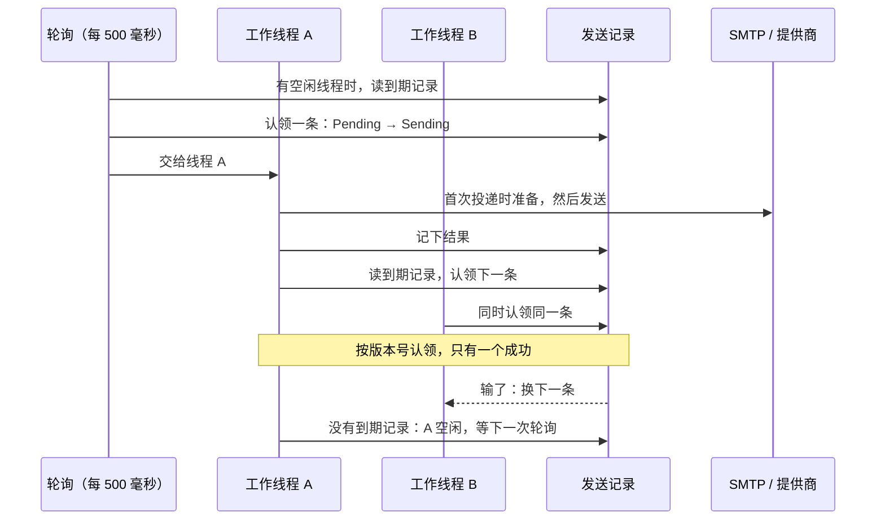

# 投递与重试

<Lead>

邮件和短信的发送记录由投递循环在后台发出。本页先讲一条记录怎样被认领、准备和发送，失败后怎样按原因重试或停下，卡住了怎样恢复；再讲运维能做的事：手动重发、处理死信、调整额度和限流、看指标、排查「没收到」。

</Lead>

## 投递循环

<Lead>

每个实例、每个渠道各有一组工作线程，默认邮件 4 个、短信 10 个。线程发完一条，立刻去认领下一条到期的记录；没有到期记录时才空闲，由每 500 毫秒一次的轮询把新到期的记录交给空闲的线程。

</Lead>

- **到期**：<Status>Pending</Status>，或 <Status>Retry</Status> 且 `next_retry_at` 已到。
- **认领**：按记录的版本号把它改为 <Status>Sending</Status>。两个线程或两个实例同时认领同一条，只有一个成功，输的换下一条，所以多实例部署不会重复发送。每次扫描给每个线程多读几条，按随机顺序尝试，线程之间不会都去抢最老的那一条。
- **吞吐**：积压在每个实例上按「并发数 ÷ 单条耗时」消化。要更快就调大 `softa.message.mail.send-concurrency` / `softa.message.sms.send-concurrency`；邮件不要超过服务器对单个账号允许的并发连接数，每个邮件线程占一个连接。
- **停机**：实例关闭时不再认领，正在发的最多等 30 秒；没发完的留在 <Status>Sending</Status>，由[卡住清理](#卡住的发送)放回重试。
- 投递不经消息队列，也不用 Spring `@Async`。

<Dev title="扫描怎样读，为什么是两条查询">

每次扫描是两条读取：<Status>Pending</Status> 按 `updated_time` 从旧到新（就是写入时间，认领之前没有东西会改它），到期的 <Status>Retry</Status> 按 `next_retry_at`。各自沿以状态开头的索引（邮件是 `idx_mail_send_status_updated`、`idx_mail_send_status_retry`，短信是 `idx_sms_send_status_updated`、`idx_sms_send_status_retry`）只读出要返回的几行，两边再按「已经到期多久」合并，取前 n 条：轮询时 n 是空闲线程数 × 4，线程自己认领下一条时 n 是 4。扫描跨租户，认领和投递在记录自己的租户里、以提交请求时的 trace id 进行，跳过权限检查。

不能合成一条按 id 排序的 `status = ? OR (status = ? AND next_retry_at <= ?)`：在 PostgreSQL 上，同一条语句执行几次后，JDBC 驱动改用服务端预编译，规划器随之采用看不到参数值的通用计划，它沿主键从最老的记录扫起，把全部历史过滤一遍才找到要的几条，空闲时每秒也要这样扫几次。扫描在每发一封之后都要跑，它的代价必须与历史量无关。

</Dev>

## 首次投递：准备记录

<Lead>

记录第一次被投递时，处理器把调用方的请求变成可以发送的消息，并写回记录。重试原样重放，不再渲染、不再选服务器、不再扣额度。准备不出来的记录直接变为 <Status>Failed</Status>，用标记码说明原因。

</Lead>

| 顺序 | 邮件 | 短信 |
|---|---|---|
| 1 | 找模板，在发送范围那一层：给了 `templateId` 就用那一行（编辑器试发：预览什么发什么，停用的模板也行）；否则按 `templateCode` 找启用的模板 | 按 `templateCode` 找启用的模板；短信模板只有平台一份，与发送范围无关 |
| 2 | 渲染调用方没给的主题和正文；补上模板的优先级、Reply-To、附件和首选服务器，调用方给的值总是优先 | 调用方没给内容时，用模板渲染 |
| 3 | 检查内容：有正文、不超过长度上限、Reply-To 格式正确 | 有内容 |
| 4 | 选服务器：调用方指定的、模板首选的，否则发送范围的默认服务器（租户没有时由平台代发）；记下服务器的所有者 `serverOwner`；补上服务器的 Reply-To 和已读回执设置；发件人地址和名称每次发送时按服务器配置读取 | 按收件人国家选提供商，与模板的提供商绑定求交，定下提供商、外部模板 id 和签名 |
| 5 | 经平台的发件服务器发出时扣当天和当月的额度，代发的租户邮件也扣；租户自己的服务器不扣。放在最后，发不出去的消息不占额度 | 每条都扣当天和当月的额度，同样放在最后 |
| 6 | 写回记录 | 同左 |

| 标记码 | 什么时候 | 怎么办 |
|---|---|---|
| `TEMPLATE_NOT_RESOLVABLE` | 模板不存在、按 code 找时没有启用的，或渲染出错；邮件模板在另一层时，错误信息写明应改用哪个范围 | 建好、启用或修正模板；或改用正确的发送范围 |
| `CONFIG_NOT_RESOLVABLE` | 没有可用的发件服务器；指定的服务器不在发送范围那一层；服务器既没有发件地址也没有用户名；租户服务器的主机在部署内部；收件人所在国家没有短信提供商 | 补好配置 |
| `DAILY_QUOTA_EXCEEDED` | 今天的上限已用完 | 第二天 Retry，或调高每日上限，见[发送额度](#发送额度) |
| `MONTHLY_QUOTA_EXCEEDED` | 本月额度已用完 | 调高额度，见[发送额度](#发送额度) |
| `CONTENT_INVALID` | 渲染出空内容、正文超过上限、Reply-To 格式不对 | 修正模板或调用方给的内容 |
| （没有标记码） | 准备时数据库或缓存出错 | 按错误信息里的关键词归类，多数是未知错误，会自动重试 |

带标记码的失败都打 ERROR 日志，带记录 id 和租户，日志告警能通知到开发人员。修好原因后在记录上点 Retry：准备前就失败的记录会重新准备。准备的结果只在准备完成时写回：准备不出来的记录没有渲染出的正文，也没有选定的服务器或提供商；受理时存下的模板代码和模板变量说明了它是什么消息。

## 失败与重试

<Lead>

发送失败时先把错误归类，再按类别处理：临时性的错误退避后重试，最多 5 次；重试也不会好的直接 <Status>Failed</Status>；5 次重试都失败的进 <Status>DeadLetter</Status>。

</Lead>

| 类别 | 怎样归到这一类 | 处理 |
|---|---|---|
| `TRANSIENT` 临时 | SMTP 回复码 4xx（`SMTP_421`、`SMTP_451` 等），没有回复码的 `SMTP_MailSendException`（连不上服务器之类），或错误码以 421、450–452 开头；错误信息含 timeout、connection reset、unavailable、try again（额度计数的并发冲突属于这一类） | 重试 |
| `QUOTA` 限流 | 错误码含 LIMIT、QUOTA、THROTTL（本地限流窗口满时为 `QUOTA_EXCEEDED`）；错误信息含 rate limit、too many requests、quota、throttle | 重试，至少等 5 分钟 |
| `UNKNOWN` 未知 | 认不出的错误 | 重试 |
| `PERMANENT` 永久 | SMTP 回复码 5xx（`SMTP_550`、`SMTP_554` 等，下面两类除外），或错误码以 550、551、553 开头；错误信息含 no such user、user unknown、does not exist | <Status>Failed</Status> |
| `INVALID_INPUT` 输入错误 | `SMTP_552`（邮件过大）、`SMTP_AddressException`，错误码以 552 开头，或是 `CONTENT_INVALID`；错误信息含 invalid address、malformed、bad recipient、no recipient | <Status>Failed</Status> |
| `AUTH` 认证 | `SMTP_530`、`SMTP_534`、`SMTP_535`、`SMTP_538`、`SMTP_MailAuthenticationException`，或错误码以 530、535 开头；错误信息含 unauthorized、forbidden、invalid credentials、authentication failed | <Status>Failed</Status> |
| `CONFIG` 配置 | 标记码 `CONFIG_NOT_RESOLVABLE`、`TEMPLATE_NOT_RESOLVABLE`、`DAILY_QUOTA_EXCEEDED`、`MONTHLY_QUOTA_EXCEEDED` | <Status>Failed</Status> |

先看错误码，错误码认不出时才看错误信息。邮件经 Spring 发送，SMTP 的失败会被包装成 `MailSendException` 或 `MailAuthenticationException`；`SmtpMailTransport` 从被拒的邮件和异常链里取出服务器的回复码，错误码记成 `SMTP_` 加回复码（如收件人不存在为 `SMTP_550`），取不到回复码时记成 `SMTP_` 加异常类名。所以收件人被拒收、认证失败会直接 <Status>Failed</Status>，临时拒收（4xx）照常重试。

错误码超过 100 字、错误信息超过 1000 字时，写入记录前截断并以「…」结尾，免得因为太长而记不下这次失败；死信表的 `last_error_msg` 也按 1000 字截断。

| 第几次重试 | 大约等待 |
|---|---|
| 1 | 30 秒 |
| 2 | 1 分钟 |
| 3 | 2 分钟 |
| 4 | 4 分钟 |
| 5 | 8 分钟 |
| 第 5 次仍失败 | 进死信，约在首次失败后一刻钟 |

每次等待随机浮动 ±50%，限流类至少等 5 分钟。每次失败的错误码和原因写在记录的 `error_code`、`error_message` 上，已重试次数在 `retry_count` 上；重试打 WARN 日志，<Status>Failed</Status> 和 <Status>DeadLetter</Status> 打 ERROR 日志。

<Dev title="分类与重试的实现">

`ErrorClassifier` 先看错误码：标记码、`SMTP_<异常类名>`（`AuthenticationFailedException` → AUTH，`SendFailedException` → PERMANENT，`MessagingException` / `MailSendException` / `MailException` → TRANSIENT，其他 → UNKNOWN）、以 SMTP 回复码开头的错误码、提供商错误码里的 LIMIT / QUOTA / THROTTL；错误码没有认出类别时，再看错误信息里的关键词（timeout、try again → TRANSIENT，rate limit、quota → QUOTA，unauthorized → AUTH 等）；都认不出为 UNKNOWN。`ExponentialBackoffPolicy` 按类别和已重试次数给出 `RetryDecision`（`Retry` / `Fail` / `DeadLetter`，密封类型，处理处的 `switch` 是穷尽的）。`SendFailureHandler` 执行转换：重试写 `next_retry_at`、`retry_count + 1`；死信同时归档进 `dead_letter_message`。转换按版本号进行，版本已被别的更新抢先时什么都不做，也不重复记指标和日志。

</Dev>

## 卡住的发送

<Lead>

认领之后实例宕机或重启，记录会停在 <Status>Sending</Status>。每个实例每分钟检查一次：卡住超过 5 分钟的，放回 <Status>Retry</Status> 并立即到期；重试次数已经用完的，直接进 <Status>DeadLetter</Status>。

</Lead>

- 5 分钟远长于任何一次发送：连接超时默认 5 秒，读取超时默认 30 秒。一个渠道的连接超时加读取超时超过 2 分 30 秒（窗口的一半），或有一个设为 0（不限时），应用就不启动：否则一次只是慢的发送会在发送中被当成卡住，再发一次。
- **至少一次。** 服务器已经接收，记录却没来得及改成 <Status>Sent</Status>（写库失败或实例宕机），5 分钟后会再发一次。写 <Status>Sent</Status> 失败不算发送失败：不走重试，只打 ERROR 日志，留给卡住清理。

<Dev title="ZombieRecordSweeper">

每分钟整点（`0 * * * * *`）在每个实例上运行，跨租户读 `status = Sending AND updated_time < 当前时间 - 5 分钟` 的记录（按 `updated_time`，每次最多 200 条），在记录自己的租户里转换：放回重试的错误码为 `ZOMBIE_RECOVERED`；`retry_count` 已达 5 的转为死信，错误码 `ZOMBIE_EXHAUSTED`，同样归档进死信表。几个实例同时读到同一条时，按版本号只有一个转换成功。

</Dev>

## 手动重试

<Lead>

修好原因之后，在发送记录上点 Retry 重发。记录改回 <Status>Retry</Status> 并立即到期，下一次轮询就会被认领；准备前就失败的会重新准备。重发用的是记录里原来的变量：登录验证码这类有时效的消息，过期后再发，收到的是一个已经失效的码。

</Lead>

- **单条**：平台的页面用 `POST /MailSendRecord/retry?id=` / `POST /SmsSendRecord/retry?id=`，租户的邮件发送记录页用 `POST /TenantMailSendRecord/retry?id=`。<Status>Pending</Status>、<Status>Retry</Status>、<Status>Failed</Status>、<Status>DeadLetter</Status> 都可以重试；<Status>Sent</Status> 和正在发的 <Status>Sending</Status> 会被拒绝。
- **批量**：`POST /MailSendRecord/retryByIds` / `POST /SmsSendRecord/retryByIds` / `POST /TenantMailSendRecord/retryByIds`，请求体 `{"ids": [...]}`。能重试的重新排队，<Status>Sent</Status>、<Status>Sending</Status> 和期间被工作线程认领的跳过，不报错；返回实际重新排队的条数。邮件服务器恢复后、或补好缺失的配置后，用它一次重发一批。
- **谁能重试哪些记录**：平台在平台的页面上能重试所有记录，这两个接口（`/MailSendRecord`、`/SmsSendRecord`）拒绝租户调用方。租户在自己的邮件发送记录页（`/TenantMailSendRecord`）只能重试记在本租户名下的记录，别的租户的记录按不存在处理，批量时跳过。
- 重复点击是安全的：认领按版本号进行，不会重复发送。
- `retry_count` 继续累计，手动重试本身也算一次。重试已经用完的记录（比如死信）只有这一次机会，再失败回到 <Status>DeadLetter</Status>；还没用完的，之后遇到临时失败照常自动重试，直到累计 5 次。

管理界面在发送记录的详情页和列表行上都有 Retry；列表页还能勾选多条一起 Retry，确认框会写明有几条会被跳过。这些动作都需要该页面的 Retry 权限。

## 死信

<Lead>

重试用完的发送记录变为 <Status>DeadLetter</Status>，同时在死信表 `dead_letter_message` 里留一行，供运维集中处理；Pulsar 消费者处理不了的毒消息也进这张表。

</Lead>

| 来源 `source` | 什么时候 | 行里有什么 |
|---|---|---|
| `SendExhausted` | 邮件、短信的重试用完，或卡住清理时重试已用完 | 记录 id（`event_id`），渠道、提供商、错误码和原因、尝试次数（`payload`） |
| `BrokerPoison` | Pulsar 消费者在 broker 重投 `softa.message.dlq.max-redeliver` 次后仍处理不了 | 原始消息 |

- 死信行的处理状态：`Pending` → `Resolved` 或 `Discarded`。把死信行标为已处理不会重发消息；重发用发送记录的 Retry。
- 毒消息归档时，如果配置了 `softa.message.dlq.alert.recipients`，会给这些地址发一封提醒邮件。要接入其他告警（Slack、PagerDuty），消费 DLQ 主题或监视这张表。
- 监听器要把毒消息送进死信表，在 `@PulsarListener` 上用 `deadLetterPolicy = "commonDlqPolicy"`，并设置 `softa.message.dlq.topic`。

## 发送额度

<Lead>

平台可以给每个租户设两种邮件、短信发送上限：每月的额度和每天的上限，计的都是经平台基础设施的发送。发送记录在准备时同时扣当天和当月的额度，重试不再扣。当天用完后，新的发送以 `DAILY_QUOTA_EXCEEDED` 失败；当月用完后，以 `MONTHLY_QUOTA_EXCEEDED` 失败。第二天或调高额度后，点 Retry 重发。

</Lead>

- 额度在 `TenantMessageQuota` 上按租户设置（`mailMonthlyLimit`、`smsMonthlyLimit`、`mailDailyLimit`、`smsDailyLimit`），由平台运营方维护：所有写入都只允许平台调用，单条、批量和导入都一样（`TenantMessageQuotaWriteValidator`）；租户没有设置时，用 `softa.message.quota.mail-monthly-default` / `sms-monthly-default` / `mail-daily-default` / `sms-daily-default`，不设就是不限（仍然计数，供报表使用）。
- **为什么要有每日上限**：平台的发件服务器和短信提供商由所有租户共用，它们自己的日限额（见[速率限制](#速率限制)）算的是所有租户的合计。没有每个租户自己的一天，一个租户集中发一批就可能占满当天的量，别的租户到半夜都发不出去。
- **哪些发送计入**：每条短信；经平台的发件服务器发出的邮件，包括平台自己的和代发的租户邮件。租户经自己的发件服务器发的邮件不占平台的资源，不计入。
- 计数的桶是记录所在的租户，不看发送范围：平台为某个租户发的通知（它的账户的安全通知、只在这一家公司有账户的人的登录验证码和重置密码、订阅提醒）也扣这个租户的额度，用完同样拒发。确定不了租户的发送扣平台自己的额度（`tenant_id = -1`，设一个很大的值即可，它的作用是兜住失控或恶意的批量发送）。
- 这是商业上限，不是限流：超额不会排队或延后，直接失败。当天的计数过了零点（服务器时区）重新开始。
- `GET /TenantMessageQuota/usage?tenantId=` 返回某个桶本月和今天的用量，以及当前生效的上限；租户只能查自己的桶。每个桶每月一行用量记录，永不清除，历史用量就是一次普通查询；每天的用量不留历史。

<Dev title="计数怎样实现，冲突怎样处理">

计数落在数据库：每桶每个日历月一行 `TenantMessageUsage`，按 ORM 的乐观锁（`versionLock`）读出、检查上限、加一，每次尝试在自己的 `REQUIRES_NEW` 事务里。一个桶的发送集中准备时，所有实例的所有工作线程都在更新同一行，输掉竞争是常事：输了重读再试，连续输 5 次时这次准备按临时错误放弃，记录进 <Status>Retry</Status>，不会被当成额度用完。扣过额度、准备结果却没能写回时，这一次计数保留：少量多计，可以和发送记录对账。

每天的计数在 Redis 里：每个桶每个渠道每天一个键（`quota:{channel}:daily:{tenantId}:{yyyy-MM-dd}`，两天后过期），检查上限和加一在同一个 Lua 脚本里完成，多个实例共用。先扣当天再扣当月：当天拒绝的发送不占当月额度；当月拒绝的发送、计数冲突时放弃的发送，会把当天的计数退回。Redis 被清空时，当天的计数从零开始。

</Dev>

## 速率限制

<Lead>

每台发件服务器、每个短信提供商可以设两个窗口：每日发送上限和每分钟发送上限。窗口满了，这次发送按限流失败，至少 5 分钟后再试。

</Lead>

- 字段是发件服务器（租户的 `MailSendServerConfig`、平台的 `PlatformMailSendServer`）和 `SmsProviderConfig` 上的 `daily_send_limit` 和 `rate_limit_per_minute`；为空或为 0 表示不限这个窗口。
- 计数在 Redis 里，按配置计（`rl:{channel}:{daily|min}:{configId}:{window}`），多个实例共用，不分租户：平台的发件服务器和短信提供商被多个租户共用时，上限限的是经它发出的总量。每个租户能发多少由[发送额度](#发送额度)管。
- 检查发生在准备之后、发送之前：被限流的记录已经准备好，再试时直接发送。
- 它保护的是外部服务的配额。每个租户能占多少，由[发送额度](#发送额度)里的每日上限管。

## 监控与排查

### 指标

classpath 上有 Micrometer 时，`MessageMetrics` 发出两类计数器：

| 名称 | 标签 | 什么时候加一 |
|---|---|---|
| `softa.message.sent` | `channel`（mail / sms）、`provider` | 服务器或提供商接收了一次发送 |
| `softa.message.failed` | `channel`、`provider`、`outcome`（retry / failed / dead_letter） | 一次尝试失败，包括准备时失败 |

`softa.message.failed{outcome=dead_letter}` 持续增长，说明有一批消息发不出去，先看对应的死信行和错误码。

### 日志

重试打 WARN；<Status>Failed</Status>、<Status>DeadLetter</Status> 打 ERROR，带记录 id 和租户；写 <Status>Sent</Status> 失败、准备时意外出错也打 ERROR，带记录 id。投递虽然在提交请求的 trace id 下运行（上下文里带着它），但后台线程的日志不会自动带上 trace id；记录上存着提交请求的 `trace_id`，可以按它把记录和业务请求对上。

### 用户说没收到

1. 找到那条记录：租户在自己的邮件发送记录（`TenantMailSendRecord`）里找；平台在 Mail Send Record（或 SMS Send Record）里找，短信记录只在平台这边。邮件按收件人或主题搜，短信按号码筛选。
2. 看状态：
   - <Status>Pending</Status> 或 <Status>Sending</Status> 停了很久：确认投递循环在运行、工作线程没有被慢的服务器占满；<Status>Sending</Status> 超过 5 分钟会被自动放回重试。
   - <Status>Retry</Status>：看错误码和原因，`next_retry_at` 到了会再试。
   - <Status>Sent</Status>：服务器已经接收，问题在之后的环节。邮件看记录上的退信标记（收到退信时状态会变为 <Status>Failed</Status>），再让用户查垃圾箱。退信要有同一所有者的收信服务器才对得上：经租户自己的服务器发出的邮件，租户没配收信服务器就看不到退信；平台代发的，退信邮件在平台的收信记录里。短信看提供商的回执。
   - <Status>Failed</Status> 或 <Status>DeadLetter</Status>：按错误码修好原因，见[首次投递：准备记录](#首次投递准备记录)和[失败与重试](#失败与重试)。
3. 修好之后点 Retry。
