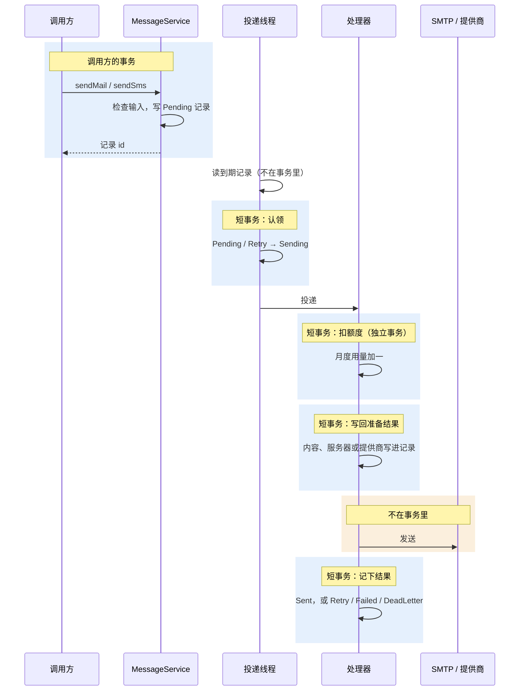

# 设计要点

<Lead>

本页把消息模块的几处设计归纳成表、画成图：各页用到的术语，受理和投递各在哪个事务里，为什么发送记录本身就是队列；另附已知限制和测试要点。

</Lead>

规则本身以[概览](./index)、[投递与重试](./delivery)、[邮件](./email)、[短信](./sms)和[收件箱](./inbox)为准，这里不重复，只给出处。

## 术语

| 术语 | 代码里叫 | 说明 |
|---|---|---|
| 发送记录 | `MailSendRecord`、`SmsSendRecord` | 一条邮件或短信的全部经过；它本身就是投递队列 |
| 受理 | `MessageService.sendMail` / `sendSms` | 检查调用方的输入，写一条 <Status>Pending</Status> 记录并返回 id；在调用方的事务里 |
| 投递循环 | `DeliveryPoller` | 每个实例、每个渠道一组工作线程，认领到期的记录并交给处理器 |
| 到期 | `PENDING`，或 `RETRY` 且 `next_retry_at <= now` | 可以被认领的记录 |
| 认领 | `markSending` | 按版本号把记录从 <Status>Pending</Status> / <Status>Retry</Status> 改为 <Status>Sending</Status>；同时认领只有一个成功 |
| 准备 | `prepare` + `markPrepared` | 首次投递时渲染模板、选服务器或提供商、扣额度，写回记录；重试原样重放 |
| 标记码 | `CONFIG_NOT_RESOLVABLE` 等 | 准备失败的原因，见[首次投递：准备记录](./delivery#首次投递准备记录) |
| 错误类别 | `ErrorCategory` | 决定一次失败是重试、失败还是死信，见[失败与重试](./delivery#失败与重试) |
| 卡住清理 | `ZombieRecordSweeper` | 把卡在 <Status>Sending</Status> 超过 5 分钟的记录放回重试 |
| 死信 | `DEAD_LETTER` 状态、`dead_letter_message` 表 | 重试用完的记录，以及 Pulsar 处理不了的毒消息 |
| 发送范围 | `MessageScope`：`TENANT`、`PLATFORM` | 在哪一层找模板、扣哪个额度；邮件没有指定服务器时，还决定用哪一层的默认服务器 |
| 平台层 | `tenant_id = -1` | 平台运营方的配置和模板，对租户不可见 |
| 额度桶 | `TenantMessageUsage` 的一行 | 某个租户（或平台）某个月的用量计数 |
| 发送窗口 | `dailySendLimit`、`rateLimitPerMinute` | 每台服务器、每个提供商的日、分钟上限，计数在 Redis |
| 路由行 | `SmsProviderRegion` | 某个国家可以用哪些短信提供商 |
| 提供商绑定 | `SmsTemplateProviderBinding` | 短信模板在某家提供商那里的模板 id 和签名 |

## 事务边界

<Lead>

受理在调用方的事务里；之后投递循环里的每一次写入各是一个短事务，向外部服务发送不在任何事务里。所以调用方回滚就没有记录，而一次慢的发送不会占着数据库连接。

</Lead>

- **受理**：检查和写记录都在调用方的事务里。调用方回滚，记录随之消失，不会发出。邮件、短信的拒绝在写入之前抛出，不会让调用方的事务只能回滚。
- **认领**：按版本号的条件更新，一个短事务。两个线程或实例同时认领同一条，只有一个更新成功。
- **扣额度**在自己的事务里提交，与之后的写回分开：扣过额度、写回却失败时，计数保留（少量多计，可对账）。
- **写回准备结果**、**记下结果**各是一个短事务，都带版本号：记录在此期间被别的更新改过（例如卡住清理已把它放回重试），这次写入不生效，以较新的状态为准。
- **发送**不在事务里，发送期间不占数据库连接。发送成功、记结果却失败时，记录留在 <Status>Sending</Status>，由卡住清理放回重试：这是「至少一次」的代价。

## 为什么发送记录就是队列

早期版本在受理时就准备记录，再经 `message_outbox` 表和 Pulsar 主题把记录 id 交给发送消费者。现在受理只写记录，投递循环直接读记录表：

- **少一套状态。** outbox 行和发送记录各有一套状态，两者要靠事务和补偿保持一致；现在只有发送记录这一套，一条消息在哪一步、为什么停下，看记录就够了。
- **吞吐不受影响。** 吞吐的上限在 SMTP 连接数和提供商的速率上，不在队列上；工作线程发完一条立即认领下一条，积压按「并发数 ÷ 单条耗时」消化。
- **多实例安全。** 认领是记录上的版本号比较，不需要分布式锁，也不需要 broker 的消费组。
- **扫描的代价与历史量无关。** 每发一封都要扫一次到期记录，扫描用两条各自沿状态索引的查询，只读出要返回的行，见[投递循环](./delivery#投递循环)。

## 已知限制

- **不切换服务器或提供商。** 一条记录选定服务器或提供商后，失败只在同一家上重试，已经准备好的记录手动重试也还走它。服务商长时间故障时，改默认服务器或模板的首选服务器只影响还没准备的发送；已准备的邮件要换通道，只能把它们用的那台服务器配置改到备用服务商（主机和凭证），重试时按新的设置发出。
- **邮件的永久失败目前也会重试。** SMTP 的失败经 Spring 包装后只剩异常类名，认证失败、收件人被拒收都按未知或临时错误处理，重试 5 次后进死信，见[失败与重试](./delivery#失败与重试)。
- **界面上改服务器、提供商配置，最长 5 分钟后才生效。** 配置缓存 5 分钟，管理界面的保存不清除缓存。
- **至少一次。** 发送成功、记结果失败时会再发一次。
- **没有同步发送。** 调用方拿不到「已发出」的结果，只能查记录。
- **配置问题不在受理时报。** 没有服务器、模板缺失、额度用完都在投递时让记录失败，调用方不会收到异常；靠 ERROR 日志告警发现。
- **短信回执、服务商的邮件事件不自动接入。** 需要应用自己加接收推送的接口。
- **收信的节奏是全局的。** 所有收件箱共用一个 `mail-fetch` 定时任务。
- **一条短信一个号码，批量最多 500 条。**

## 测试要点

### 受理

- 没有收件人、地址或号码格式错、既没内容也没模板：抛错，什么都不写，调用方的事务还能提交。
- 调用方回滚后，记录不存在，也不会被投递。
- 批量里有一条不合格：整批拒绝，一条都不写；合格时按输入顺序返回 id。
- 在 `ContextUtils.inTenantContext` 里发：记录属于指定的租户；无租户上下文发 `PLATFORM`：记录在平台层。

### 准备与发送

- `TENANT` 只用当前租户的模板和服务器，租户没有默认服务器时用平台层的；`PLATFORM` 用平台层的模板和额度，邮件没有指定服务器时只用平台层的默认服务器。
- 模板缺失、服务器缺失、额度用完、渲染出空内容：记录 <Status>Failed</Status>，标记码正确，打 ERROR 日志；补好后 Retry，记录重新准备并发出。
- 重试时不再渲染、不再选服务器、不再扣额度：修改模板后，已准备的记录仍按旧内容发出。
- 邮件 `templateId` 指向停用的模板时照样发出；`templateCode` 只找启用的。
- 短信：有国家路由时不用默认提供商；没有路由也没有默认时失败；模板绑定的外部模板 id 和签名写进记录。

### 失败、重试与恢复

- 临时错误按 30 秒、1 分钟、2 分钟、4 分钟、8 分钟（±50%）重试，第 5 次重试仍失败进 <Status>DeadLetter</Status> 并在死信表留一行。
- 提供商返回认证失败、地址无效等错误码或信息：直接 <Status>Failed</Status>，不重试；邮件目前例外，见[已知限制](#已知限制)。
- 限流窗口满：按限流重试，至少等 5 分钟。
- 停掉一个正在发送的实例：记录 5 分钟后被放回重试并发出。
- 手动 Retry：<Status>Sent</Status>、<Status>Sending</Status> 被拒绝；批量 Retry 跳过它们并返回实际条数；`retry_count` 继续累计。

### 并发

- 两个实例同时运行：每条记录只发一次。
- 同一个租户集中发一批：月度用量与发出的条数一致；计数冲突的记录进 <Status>Retry</Status> 而不是 <Status>Failed</Status>。

### 收信

- 同一封邮件拉两次只存一条。
- 退信把对应的 <Status>Sent</Status> 改为 <Status>Failed</Status> 并记下退信码；已读回执记下读取时间。
