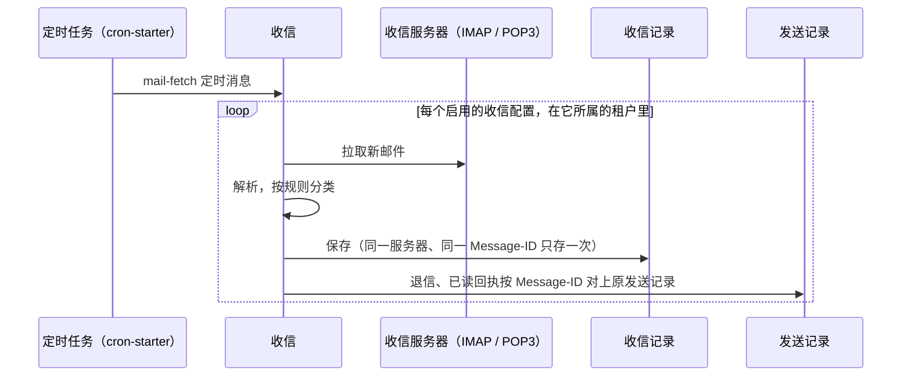

# 邮件

<Lead>

邮件经 SMTP 发出。一封邮件可以有多个收件人、抄送和密送，共用一条发送记录。发件服务器、模板和收信服务器都由各租户自己维护；配置了收信，退信和已读回执还会对上原来的发送记录。

</Lead>

## 发送邮件

<Lead>

调用 `MessageService.sendMail`：内容可以直接给，也可以给模板和变量。返回的 id 指向一条待发送记录，渲染和 SMTP 发送都在投递循环里进行，结果看记录。

</Lead>

```java
@Autowired
private MessageService messageService;

// Plain text.
SendMailDTO plain = new SendMailDTO();
plain.setTo(List.of("alice@example.com"));
plain.setSubject("Hello");
plain.setTextBody("Welcome to Softa.");
Long recordId = messageService.sendMail(plain);

// Several recipients share one MIME message and one send record.
SendMailDTO offer = new SendMailDTO();
offer.setTo(List.of("a@x.com", "b@x.com"));
offer.setCc(List.of("manager@example.com"));
offer.setSubject("Offer Letter");
offer.setHtmlBody("<p>Dear Alice...</p>");
offer.setAttachments(List.of(attachment)); // FileInfo from file-starter
messageService.sendMail(offer);

// A template, rendered at delivery with these variables.
SendMailDTO welcome = SendMailDTO.ofTemplate(List.of("alice@example.com"), "USER_WELCOME",
        Map.of("name", "Alice", "activationUrl", "https://app.example.com/activate/abc123"), MessageScope.TENANT);
messageService.sendMail(welcome);

// Independent messages in one call: one record each, ids in input order.
List<Long> ids = messageService.sendMailBatch(List.of(
        SendMailDTO.ofTemplate(List.of("alice@example.com"), "ORDER_CONFIRMATION", Map.of("orderNo", "SO-1001"), MessageScope.TENANT),
        SendMailDTO.ofTemplate(List.of("bob@example.com"), "ORDER_CONFIRMATION", Map.of("orderNo", "SO-1002"), MessageScope.TENANT)));
```

> [!NOTE]
>
> 邮件只能异步发送。SMTP 返回 `250 OK` 只说明服务器接收了，不等于用户收到；用户往往还要等几秒到几分钟。没有服务器、模板缺失这类问题会体现在记录上（<Status>Failed</Status> 加原因），调用方不会收到异常。

| 字段 | 说明 |
|---|---|
| `to` / `cc` / `bcc` | 收件人列表，至少一个 `to` |
| `subject`、`htmlBody`、`textBody` | 直接给的内容。给了主题就不再渲染主题；给了任一种正文，两种正文都不再由模板渲染 |
| `bodyMode` | 正文形态，见[正文模式](#正文模式)；不给时按给了哪些正文推断 |
| `templateCode` / `templateId`、`templateVariables` | 模板和变量；`templateId` 指定确切的那一行，优先于 `templateCode` |
| `attachments` | 附件，先经 file-starter 上传，再传入得到的 `FileInfo` |
| `serverConfigId` | 指定发件服务器，见[发件服务器](#发件服务器) |
| `replyTo`、`readReceiptRequested`、`priority` | 回复地址、是否请求已读回执、优先级。不给时：回复地址依次取模板、服务器上的设置，优先级取模板的，已读回执取服务器的设置 |
| `scope` | `TENANT`（默认）或 `PLATFORM`，见[租户层与平台层](./index#租户层与平台层) |

### 地址规则

地址在受理时检查。写错的地址直接报错，指明是哪个字段、哪一项，而不是等到发送时才在记录上看到 SMTP 失败。

- `to`、`cc`、`bcc` 的每一项必须恰好是一个邮箱地址，可以带显示名（`Alice <alice@x.com>`）；一项里写多个地址会被拒绝。
- `replyTo` 是一个字符串，可以写一个或多个地址，用逗号、分号或换行分隔，受理时统一成逗号分隔。只用逗号分隔的输入不会被改写，带引号、含逗号的显示名（`"Smith, John" <j@x.com>`）得以保留。

## 发件服务器

<Lead>

一封邮件只走一台服务器：调用方指定的、模板首选的，否则用默认服务器。选定后就固定在记录上，发送失败只在同一台上重试，不会切换到别的服务器。

</Lead>

1. `SendMailDTO.serverConfigId`：调用方指定。
2. 模板的 `preferredServerConfigId`：模板首选。
3. 默认服务器：当前租户标为默认的服务器，有多台时取 `sequence` 最小的；租户没有时用平台层的默认服务器。`PLATFORM` 范围的发送在没有指定服务器时，只用平台层的默认服务器，不会落到租户自己的服务器上。
4. 都没有：记录以 `CONFIG_NOT_RESOLVABLE` 失败。

调用方指定的服务器优先于发送范围，可以是平台层的，也可以是当前租户自己的；按 id 指定的服务器即使已停用也照样使用。

| 字段 | 用于 | 不用于 |
|---|---|---|
| `MailSendServerConfig.isDefault` | 标出默认服务器的候选 | 故障切换：只取第一个默认 |
| `MailSendServerConfig.sequence` | 多台默认时决定用哪台，也是列表顺序 | 故障切换的优先级 |
| `MailTemplate.preferredServerConfigId` | 模板首选的服务器；只能选模板所在租户自己的服务器 | 强制绑定：调用方指定的服务器仍然优先 |
| `MailSendServerConfig.dailySendLimit`、`rateLimitPerMinute` | 这台服务器的发送窗口，见[速率限制](./delivery#速率限制) | 月度额度 |

模板首选服务器的常见用法：营销模板走带打开跟踪的服务商、事务邮件走高送达率的服务商；按发件域名分开（HR 模板走企业 Exchange 的 `hr@company.com`，品牌模板走 `noreply@brand.com`）；法律披露模板锁定内部服务器。它只是首选而不是强制：服务商故障期间，运维可以在调用处指定备用服务器，不用逐个改模板。

### 连接复用与认证

- **发件人**：发件人地址和名称取自服务器配置（发件地址，没有时用用户名），每次发送时读取。
- **修改何时生效**：服务器配置缓存 5 分钟。在管理界面改了主机、密码、启用状态或连接复用后，最长 5 分钟才用于发送。
- **连接复用**：经同一台服务器连续发信时复用已登录的连接，TCP 连接、TLS 握手和 AUTH 只做一次。某台服务器不接受同一个连接上的第二封信时，在它的配置上关掉 `connectionReuseEnabled`（默认开），经它的每封信各自开、关连接。
- **认证**：用户名加密码。服务商把 API key 当 SMTP 凭证时（SendGrid、Amazon SES、Postmark、Mailgun），把 key 填在密码里；邮箱开了两步验证时，用邮箱服务商签发的应用密码。自建的 MTA（如 Stalwart、Postfix）照常用账号和密码。
- **连通性测试**：`POST /MailSendServerConfig/testConnectivity?id=` 用这台服务器的设置开一个新连接，返回能否连上和登录。

<Dev title="SMTP 连接池与配置缓存">

`SmtpMailTransport` 给每台服务器配置维护一个小连接池。空闲连接复用前先发 `NOOP` 探测；出过错、发满 100 封或空闲超过 30 秒的连接直接关闭。这个空闲上限低于常见 NAT 和负载均衡的空闲超时；万一连接被悄悄断开，也只会让探测读超时，不会发错。连接池以建立连接时的设置为键，读到改过的配置（换了主机、换了密码）就开新连接。关掉连接复用的服务器，原有的连接池在下次发送时关闭。

服务器配置在 Redis 里缓存 5 分钟。只有经 `MailSendServerConfigService.updateOne` / `deleteById` 的修改会清除缓存；管理界面的保存接口直接写库、不清除，所以界面上的修改最长 5 分钟后才用于发送（把一台服务器设为默认时，旧的默认服务器经服务降级，那一步会清除默认服务器的缓存）。平台默认服务器缓存在平台的键下，不读也不污染租户自己的默认缓存。字段叫 `sequence` 而不是 `priority`：邮件这边它只用于默认项和列表排序，不是重试链；短信那边叫 `priority`，因为国家路由和模板绑定都按它选提供商。

</Dev>

## 模板

<Lead>

可复用的内容做成模板，按 `code` 在发送范围那一层找：`TENANT` 只找当前租户自己的模板，`PLATFORM` 只找平台层的，找不到不会去另一层兜底。

</Lead>

- 主题按 `{{ 变量名 }}` 做简单替换，变量缺失时原样留着；正文用 Pebble 渲染，可以用 `` 循环，HTML 正文里输出的变量会自动转义（确实要输出 HTML 时用 `| raw`）。
- 按 code 找时只认启用的模板；给了 `templateId` 时用那一行，不管是否启用（编辑器试发用）。
- 模板缺失或渲染出错，记录以 `TEMPLATE_NOT_RESOLVABLE` 失败，调用方不会收到异常。

```bash
POST /MailTemplate/createOne
{
  "code": "USER_WELCOME",
  "name": "User Welcome Email",
  "subject": "Welcome, {{ name }}!",
  "bodyHtml": "<h1>Welcome, {{ name }}</h1><p><a href='{{ activationUrl }}'>Activate</a></p>",
  "bodyMode": "HTML",
  "active": true
}
```

### 正文模式

`bodyMode` 决定模板（以及由它发出的每条记录）的 MIME 形态：编辑器据此显示对应的输入框，发送时据此组装 MIME。

| bodyMode | 发出的形态 | HTML 正文 | 纯文本正文 |
|---|---|---|---|
| `HTML` | 单一 `text/html` | 作者编写 | — |
| `PLAIN` | 单一 `text/plain` | — | 作者编写 |
| `HTML_WITH_DERIVED_PLAIN` | `multipart/alternative` | 作者编写 | 首次投递渲染模板时从 HTML 生成 |
| `HTML_WITH_AUTHORED_PLAIN` | `multipart/alternative` | 作者编写 | 作者编写；为空时改为从 HTML 生成，记录如实标为 `HTML_WITH_DERIVED_PLAIN` |

在编辑器里切换 `bodyMode` 时，已有正文会挪到新模式实际使用的输入框（HTML 转文本、文本转为转义后的 HTML 段落；目标框已有内容时不覆盖），新模式不用的框被清空。这只改表单，保存前不落库，取消即恢复。

### 编辑器工具

模板编辑器的「预览与试发」用到三个操作。`id` 指向正在编辑的那一行，不经解析、不受启用状态限制，所以停用的模板启用之前就能完整检查和试发；`code` 在调用方自己那一层解析，供程序调用。

- `GET /api/mail/templates/variables?id=|code=`：模板用到的变量，按首次出现排序并分类，供输入界面使用：`VARIABLE`（普通名字，一行文本）、`COLLECTION`（循环的集合，填 JSON）、`EXPRESSION`（表达式里的操作数，填 JSON）、`RESERVED_FIELD`（由服务端解析）。循环变量、Pebble 内置的 `loop`、`` 的目标这些模板内部的名字不列出。
- `POST /api/mail/templates/preview`：用给定变量渲染主题和正文，不发送。
- 试发：`SendMailDTO.templateId` 指定这一行，走完整的生产链路：预览什么，发出去就是什么。

## 收信、退信与已读回执

<Lead>

配置收信服务器后，定时任务把新邮件拉进收信记录 `MailReceiveRecord`。退信报告和已读回执会按 Message-ID 对上原来的发送记录：退信把 <Status>Sent</Status> 改为 <Status>Failed</Status> 并记下退信码，已读回执记下读取时间。

</Lead>



- **定时拉取**需要 cron-starter：在其中注册一个名字以 `mail-fetch` 开头的定时任务，它经 `cron-task` 主题触发，每次拉取所有租户的全部启用收信配置，每个配置在它自己的租户里拉。节奏由这一个全局定时任务决定，不支持每个收件箱各自的节奏。
- **手动拉取**：注入 `MailReceiveService`。

```java
@Autowired
private MailReceiveService mailReceiveService;

int fetched = mailReceiveService.fetchNewMails();                // the tenant's default receive config, else the platform default
int fromOne = mailReceiveService.fetchNewMails(serverConfigId);  // one config
mailReceiveService.markAsRead(recordId);
mailReceiveService.markAsRead(List.of(id1, id2, id3));
```

- **分类**：每封邮件按规则依次判断，第一个认出来的规则决定类型；再由几个标记检测补上加密、邮件列表、垃圾邮件等标记。

| 类型 | 是什么 | 对发送记录的影响 |
|---|---|---|
| `ReadReceipt` | 已读回执（MDN） | 原发送记录记下已读和读取时间 |
| `CalendarInvite` | 日程邀请 | — |
| `AutoReply` | 自动回复、外出回复 | — |
| `Bounce` | 退信报告（DSN）；mailer-daemon、postmaster 发来的邮件；主题或正文含 Undeliverable、rejected、未送达等字样的邮件 | 对上原发送记录时，由 <Status>Sent</Status> 改为 <Status>Failed</Status>，记下退信码 |
| `Normal` | 普通邮件：没有规则认出它 | — |
| `Unknown` | 分类时有规则出错 | — |

<Dev title="拉取的实现与分类规则">

IMAP 按文件夹记 UID 水位：拉取前先拿一个软租约，防止两个实例同时拉同一个文件夹（租约超过 1 小时视为持有者已宕机）；UIDVALIDITY 变化时水位归零，重复的邮件靠 Message-ID 去重。POP3 是取走即删。每次每个文件夹最多处理 100 封。

`MailClassifier` 是对 `MailClassificationRule` bean 的责任链，内置规则按 `@Order` 依次为：已读回执（10）→ 日程邀请（15）→ 自动回复（18）→ DSN（20）→ mailer-daemon（30）→ 关键词（99）。退信、回执由 `BounceReceiptLinker` 一次批量按 Message-ID 找到发送记录，再按版本号转换（`markBounced`、`markReadReceiptReceived`）。要识别服务商特有的形态（老版 Exchange 的退信、国内 ISP 的退信格式），加一条新规则：

```java
@Component
@Order(25)  // between DsnRule (20) and MailerDaemonRule (30)
public class ExchangeNdrRule implements MailClassificationRule {
    @Override
    public Optional<MailClassification> match(MimeMessage message) throws Exception {
        // ... return MailClassification.bounce(info) if it matches
        return Optional.empty();
    }
}
```

不提供接收投递事件的 HTTP 回调。服务商推送的投递事件（ESP 的邮件事件），由应用加控制器，调用发送记录服务的状态转换。

</Dev>

## 状态参考

**发送记录**的状态见[发送记录的状态](./index#发送记录的状态)。邮件另有几个字段：`bounced`、`bounceCode`（收到退信时写入），`readReceiptReceived`、`readReceiptReceivedAt`（收到已读回执时写入），`messageId`（SMTP 的 Message-ID，退信和回执靠它对上），`sentAt` 和 `sendDurationMs`（成功那次的发送时间和耗时）。

**收信记录**：

| 状态 | 含义 |
|---|---|
| `Unread` | 新拉到的邮件 |
| `Read` | 已读 |
| `Archived` | 已归档 |
| `Deleted` | 已删除 |
