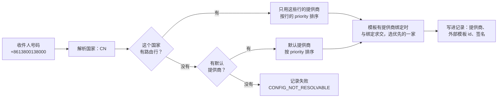

# 短信

<Lead>

一条短信发给一个号码。走哪家提供商由收件人的国家决定：有这个国家的路由就只在这些提供商里选，没有才用默认提供商；模板在各提供商那里还可以有自己的模板 id 和签名。首次投递时选定一家并写进记录，重试原样重放，不会换提供商。

</Lead>

## 发送短信

<Lead>

调用 `MessageService.sendSms`，号码用 E.164 格式（`+` 加国家码）。内容可以直接给，也可以给模板和变量。返回的 id 指向一条待发送记录，渲染、路由和调用提供商都在投递循环里进行。

</Lead>

```java
@Autowired
private MessageService messageService;

// Plain text to one number.
SendSmsDTO shipped = new SendSmsDTO();
shipped.setPhoneNumber("+12015550123");
shipped.setContent("Order #1234 has been shipped.");
Long id = messageService.sendSms(shipped);

// A template, rendered at delivery with these variables.
messageService.sendSms(SendSmsDTO.ofTemplate("+8613800138000", "VERIFY_CODE",
        Map.of("code", "123456", "minutes", 5), MessageScope.TENANT));

// One DTO and one send record per number; each number gets its own variables.
List<Long> ids = messageService.sendSmsBatch(List.of(
        SendSmsDTO.ofTemplate("+12015550123", "ORDER_STATUS", Map.of("orderId", "A001", "status", "Shipped"), MessageScope.TENANT),
        SendSmsDTO.ofTemplate("+12015550124", "ORDER_STATUS", Map.of("orderId", "B002", "status", "Delivered"), MessageScope.TENANT)));
```

| 字段 | 说明 |
|---|---|
| `phoneNumber` | 一个 E.164 号码；受理时检查格式，并要求能识别出所属国家 |
| `content` | 直接给的内容；给了就不再用模板渲染 |
| `templateCode`、`templateVariables` | 模板和变量 |
| `providerConfigId` | 指定提供商，跳过按国家的路由 |
| `externalTemplateId`、`signName` | 提供商侧的模板 id 和签名；模板绑定上有设置时以绑定为准 |
| `scope` | `TENANT`（默认）或 `PLATFORM`：决定用哪一层的模板、扣哪个额度；提供商照常按国家路由，见[租户层与平台层](./index#租户层与平台层) |

批量方法接受 1 到 500 条独立消息，一条一个号码、一条记录，先全部检查再写，按输入顺序返回 id。

## 模板

<Lead>

短信模板按 `code` 在发送范围那一层找：`TENANT` 只找当前租户自己的模板，`PLATFORM` 只找平台层的，不会跨层兜底。占位符用 `{{ 变量名 }}`。

</Lead>

```bash
POST /SmsTemplate/createOne
{
  "code": "VERIFY_CODE",
  "name": "Verification Code",
  "content": "Your verification code is {{ code }}. Valid for {{ minutes }} minutes.",
  "active": true
}
```

有的提供商要求用它那边审核过的模板和签名发送（如阿里云、腾讯云）。这时给模板加**提供商绑定** `SmsTemplateProviderBinding`：每家提供商一行，写明外部模板 id、签名，可以限定国家，并有自己的优先级。模板缺失或渲染出错，记录以 `TEMPLATE_NOT_RESOLVABLE` 失败；渲染出空内容，以 `CONTENT_INVALID` 失败。

## 提供商路由

<Lead>

先看收件人所在的国家有没有路由行：有，就只在这些行指向的提供商里选；没有，才用标为默认的提供商；两者都没有，记录以 `CONFIG_NOT_RESOLVABLE` 失败。不会隐式地「随便找一家启用的」。

</Lead>



| 表 | 用途 | 每行有什么 |
|---|---|---|
| `sms_provider_config` | 提供商账户和凭证 | API key、发信号码、`isDefault`、`priority` |
| `sms_provider_region` | 按国家的路由 | `region_code`（ISO 3166-1 二字母国家码）、`dial_code`、`priority` |

一个提供商账户通常服务很多国家，所以路由单独一张表，每个国家的优先级写在路由行上。经服务写入时，国家码由 `reference-data-starter` 的国家表校验，`dial_code`（国际区号）由框架从国家码带出，列表里显示成「CN (+86) → Aliyun」，不要手工改。

- **精确匹配完全优先。** 只要有一条路由行匹配收件人国家，就只用这一层的提供商，不会再并入默认提供商。路由行指向的提供商都已停用或不存在时，按没有路由处理，改用默认提供商。
- **默认只在没有路由行时使用。** 没有 `region_code = '*'` 这种通配行，「其他国家」由 `isDefault = true` 表达。
- **要让默认提供商也服务某个已配置的国家，就给这个国家再加一条路由行。** 这样已经明确配置过的国家不会误走别的通道（比如台湾的短信不会走大陆专线）。
- **租户优先。** 对收件人的国家，先用租户自己的路由行，租户没有给这个国家配置时才用平台层的；默认提供商也是先租户、后平台。路由按记录所在的租户进行，`PLATFORM` 范围的短信也一样。

例如下面的配置：

| `sms_provider_config` | id | name | provider_type | is_default | priority |
|---|---|---|---|---|---|
|  | 1 | Aliyun-China | Aliyun | false | 10 |
|  | 2 | Tencent-China | Tencent | false | 20 |
|  | 3 | Twilio-Global | Twilio | true | 1 |
|  | 4 | Infobip-Backup | Infobip | true | 2 |

| `sms_provider_region` | provider_config_id | region_code | priority |
|---|---|---|---|
|  | 1 | CN | 10 |
|  | 2 | CN | 20 |
|  | 3 | TW | 10 |

| 收件人 | 候选提供商 | 说明 |
|---|---|---|
| `+8613800138000`（CN） | Aliyun、Tencent | 精确匹配，按路由行的优先级排序 |
| `+886912345678`（TW） | Twilio | 精确匹配；Infobip 不会作为后备加进来 |
| `+33123456789`（FR） | Twilio、Infobip | 没有 FR 的路由行，用默认提供商 |
| 没有路由行、也没有默认提供商的国家 | — | 记录以 `CONFIG_NOT_RESOLVABLE` 失败，补好配置后重试 |

### 在候选里选一家

1. 调用方给了 `providerConfigId`：候选只有它，不看国家路由；模板有提供商绑定时，它也必须有可用的绑定，否则记录以 `CONFIG_NOT_RESOLVABLE` 失败。
2. 直接给内容（不用模板），或模板没有任何提供商绑定：用候选里排第一的提供商；外部模板 id 和签名取调用方给的。
3. 模板有提供商绑定：只看候选提供商的绑定，且绑定要么没有限定国家，要么限定的就是收件人的国家。同一家提供商有几条绑定时，限定国家的优先于没有限定的；不同提供商之间按绑定的 `priority` 选（越小越优先），相同时按候选的顺序。外部模板 id 和签名以绑定为准。候选里没有一家有可用的绑定时，记录以 `CONFIG_NOT_RESOLVABLE` 失败。

选定的提供商、外部模板 id 和签名写进记录的 `provider_config_id`、`provider_type`、`external_template_id`、`sign_name`。之后的重试原样重放，提供商出错也不会换一家：失败按[失败与重试](./delivery#失败与重试)的规则重试或停下。

<Dev title="内置的提供商与实现">

内置适配器：Twilio、Infobip、Bird、CM、Sinch、阿里云、腾讯云（`SmsProvider`）。国家由 [libphonenumber](https://github.com/google/libphonenumber) 从 E.164 号码按最长前缀解析，所以 `+886…` 是 TW，不会被 `+86` 误认为 CN。候选由 `SmsProviderDispatcher` 给出，与模板绑定求交由 `SmsRoutingPlanner` 完成；绑定跟随模板所在的层：平台模板的绑定是平台层的行。提供商配置在 Redis 里缓存 5 分钟，修改或删除时自动清除。message-starter 要求 classpath 上有 `reference-data-starter`，国家路由离不开它。

</Dev>

## 投递回执

提供商接收即记为 <Status>Sent</Status>。短信是否真的送到手机，看记录上的 `deliveryStatus`（`Unknown`、`Delivered`、`Undelivered`、`Failed`）和 `deliveryStatusUpdatedAt`：框架不接收提供商的回执推送，应用没有把回执写回记录时，`deliveryStatus` 一直是 `Unknown`。要接回执，在应用里加控制器接收提供商的推送，自己更新记录的 `deliveryStatus` 和 `deliveryStatusUpdatedAt`；发送记录服务没有现成的方法。

## 状态参考

短信发送记录的状态与邮件相同，见[发送记录的状态](./index#发送记录的状态)；短信没有退信，<Status>Sent</Status> 是终态。
