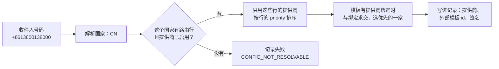

# 短信

<Lead>

一条短信发给一个号码。走哪家提供商由收件人的国家决定：只在这个国家的路由指向的提供商里选，没有路由的国家发不了；模板在各提供商那里还可以有自己的模板 id 和签名。首次投递时选定一家并写进记录，重试原样重放，不会换提供商。

</Lead>

短信是平台提供的服务：提供商、国家路由、短信模板和模板绑定都只有平台一份，表里没有租户列，租户看不到也配不了。短信发送记录也只在平台的页面上看，没有租户视图。

## 发送短信

<Lead>

调用 `MessageService.sendSms`，号码用 E.164 格式（`+` 加国家码）。内容可以直接给，也可以给模板和变量。返回的 id 指向一条待发送记录，渲染、路由和调用提供商都在投递循环里进行。

</Lead>

```java
@Autowired
private MessageService messageService;

// Plain text to one number.
SendSmsDTO shipped = new SendSmsDTO();
shipped.setPhoneNumber("+12015550123");
shipped.setContent("Order #1234 has been shipped.");
Long id = messageService.sendSms(shipped);

// A template, rendered at delivery with these variables.
messageService.sendSms(SendSmsDTO.ofTemplate("+8613800138000", "VERIFY_CODE",
        Map.of("code", "123456", "minutes", 5), MessageScope.TENANT));

// One DTO and one send record per number; each number gets its own variables.
List<Long> ids = messageService.sendSmsBatch(List.of(
        SendSmsDTO.ofTemplate("+12015550123", "ORDER_STATUS", Map.of("orderId", "A001", "status", "Shipped"), MessageScope.TENANT),
        SendSmsDTO.ofTemplate("+12015550124", "ORDER_STATUS", Map.of("orderId", "B002", "status", "Delivered"), MessageScope.TENANT)));
```

| 字段 | 说明 |
|---|---|
| `phoneNumber` | 一个带国家码的号码，如 `+6591234567`。空格、横线、括号会被去掉，记录里存的、发给提供商的都是 E.164。受理时拒收：没有国家码的、带字母或分机号的、位数不符合所属国家的，以及认不出国家的（+1、+7、+44、+61 这类多国共用国家码下、libphonenumber 还不认识的号段）。不检查号段是否已分配：国家新开的号段在升级 libphonenumber 之前照样能发，没分配的号段由提供商拒收 |
| `content` | 直接给的内容；给了就不再用模板渲染 |
| `templateCode`、`templateVariables` | 模板和变量 |
| `providerConfigId` | 指定提供商，跳过按国家的路由 |
| `externalTemplateId`、`signName` | 提供商侧的模板 id 和签名；模板绑定上有设置时以绑定为准 |
| `category` | 短信分类，覆盖模板上的分类；直接给内容时只能从这里给，见[短信分类](#短信分类) |
| `scope` | `TENANT`（默认）或 `PLATFORM`：对短信没有作用，只记在记录上。模板和提供商路由都只有平台一份；记录记在调用时所在的租户名下、扣它的额度，见[租户层与平台层](./index#租户层与平台层) |

批量方法接受 1 到 500 条独立消息，一条一个号码、一条记录，先全部检查再写，按输入顺序返回 id。

要给刚输入的号码发验证码的界面，发送前先调 `MessageService.canSendSms(phoneNumber)`：号码受理得了、并且这个国家有可用的路由，才返回 true，这样可以在发送前告诉用户这个国家暂不支持。`sendSms` 本身不因为没有路由而拒收：记录在首次投递时以 `CONFIG_NOT_RESOLVABLE` 失败，补上路由后重试即可。

## 模板

<Lead>

短信模板只有平台一份，`code` 在整张表里唯一，按 `code` 找，与发送范围无关。占位符用 `{{ 变量名 }}`。日期和时间变量传日期对象本身，按接口的格式输出（`2026-11-12 13:00:40`），和邮件模板一样。

</Lead>

模板可以用 `variableSetName` 写明它是按哪一组变量写的，规则和邮件模板的[变量来源](./email#变量来源)相同：保存时内容里出现这组变量没有的名字会被拒绝；发送时传对象（`SendSmsDTO.ofTemplate(phoneNumber, code, variables, scope)`），对象不是这一组就抛出 `BusinessException`。不填就不校验。短信模板没有循环和判断。

和邮件有一点不同：对象里没有值的分量**不发送**，而不是按空串发送。有的提供商用自己那边登记的模板，拿到的是变量本身，其中有的按位置取，多出一个空的会被拒绝。

```bash
POST /SmsTemplate/createOne
{
  "code": "VERIFY_CODE",
  "name": "Verification Code",
  "content": "Your verification code is {{ code }}. Valid for {{ minutes }} minutes.",
  "category": "OTP",
  "active": true
}
```

### 短信分类

`category` 说明短信是做什么的，按运营商和监管通行的分法：`OTP`（验证码）、`Transactional`（因收件人自己的业务而发：审批、工资条、账号变更）、`Marketing`（推广）。模板上写默认值，调用方可以用 `SendSmsDTO.category` 覆盖；首次投递时定在记录上，重试沿用。按分类走通道或计价的提供商，由适配器换成它自己的写法，目前只有阿里云国际（`Type`）；其他提供商不读。哪里都可以不填，不填就不传。

有的提供商要求用它那边审核过的模板和签名发送（如阿里云国内、腾讯云）。这时给模板加**提供商绑定** `SmsTemplateProviderBinding`：每家提供商一行，写明外部模板 id、签名，可以限定国家，并有自己的优先级。这类提供商收到的是模板变量而不是渲染好的正文：阿里云按变量名填，腾讯云按位置填，`{1}`、`{2}`… 依次对应 softa 短信模板内容里变量出现的先后（首次投递时定下，重试不变）。其他提供商（包括阿里云国际）收到的是渲染好的正文，不需要绑定。模板缺失或渲染出错，记录以 `TEMPLATE_NOT_RESOLVABLE` 失败；渲染出空内容，以 `CONTENT_INVALID` 失败。

## 提供商路由

<Lead>

先看收件人所在的国家有没有路由行：有，就只在这些行指向的、已启用的提供商里选；没有，就是还不支持发到这个国家，记录以 `CONFIG_NOT_RESOLVABLE` 失败。没有默认提供商，也不会隐式地「随便找一家启用的」。

</Lead>



| 表 | 用途 | 每行有什么 |
|---|---|---|
| `sms_provider_config` | 提供商账户和凭证 | API key、发信号码或发送方 ID、限流 |
| `sms_provider_region` | 按国家的路由 | `region_code`（ISO 3166-1 二字母国家码）、`dial_code`、`priority` |

一个提供商账户通常服务很多国家，所以路由单独一张表，每个国家的优先级写在路由行上。路由行既可以在提供商页面的 Country Routing 标签页里按提供商编辑，也可以在 SMS Country Routing 列表里按国家查；删除提供商会连同它的路由行一起删除。同一提供商同一国家只能有一条路由行，停用的也算，要用就把那条重新启用。任何写入（两个页面、导入、种子、直接调用）都会用 `reference-data-starter` 的国家表校验国家码，`dial_code`（国际区号）由框架从国家码带出，列表里显示成「CN (+86) → Aliyun」，不要手工改。

收件人的国家由号码按号码段解析（libphonenumber），不看国家表的区号：区号有多国共用，比如 +1 是美国、加拿大等，+64 是新西兰和皮特凯恩群岛，单看区号认不出国家。

- **只有路由行能发。** 提供商要经由这个国家一条已启用的路由行、且自己也已启用，才服务这个国家。没有 `region_code = '*'` 这种通配行，也没有默认提供商：没配路由的国家不支持；路由行指向的提供商都已停用或不存在时，同样失败。
- **候选的顺序。** 同一国家的候选按路由行的 `priority` 排（越小越优先），相同时按提供商配置的 id。
- **备选靠手动切换。** 记录首次投递时选定一家，重试不换；排在后面的提供商，要等前面的路由行或提供商被停用后才会用到。
- **要让某个提供商服务一个国家，就给这个国家加一条它的路由行。** 这样每个国家走哪条通道都是明确配置的（比如台湾的短信不会走大陆专线）。
- **不分租户。** 路由只有平台这一份，每个租户的短信、`PLATFORM` 范围的短信都按它走。

例如下面的配置：

| `sms_provider_config` | id | name | provider_type |
|---|---|---|---|
|  | 1 | Aliyun-China | Aliyun |
|  | 2 | Tencent-China | Tencent |
|  | 3 | Twilio-Global | Twilio |

| `sms_provider_region` | provider_config_id | region_code | priority |
|---|---|---|---|
|  | 1 | CN | 10 |
|  | 2 | CN | 20 |
|  | 3 | TW | 10 |
|  | 3 | US | 10 |

| 收件人 | 候选提供商 | 说明 |
|---|---|---|
| `+8613800138000`（CN） | Aliyun、Tencent | 按路由行的优先级排序 |
| `+886912345678`（TW） | Twilio | 一个账户服务几个国家，就有几条路由行 |
| `+33123456789`（FR） | — | 没有 FR 的路由行，不支持：记录以 `CONFIG_NOT_RESOLVABLE` 失败，加上路由行后重试 |

### 在候选里选一家

1. 调用方给了 `providerConfigId`：候选只有它，不看国家路由；模板有提供商绑定时，它也必须有可用的绑定，否则记录以 `CONFIG_NOT_RESOLVABLE` 失败。
2. 直接给内容（不用模板），或模板没有任何提供商绑定：用候选里排第一的提供商；外部模板 id 和签名取调用方给的。
3. 模板有提供商绑定：只看候选提供商的绑定，且绑定要么没有限定国家，要么限定的就是收件人的国家。同一家提供商有几条绑定时，限定国家的优先于没有限定的；不同提供商之间按绑定的 `priority` 选（越小越优先），相同时按候选的顺序。外部模板 id 和签名以绑定为准。候选里没有一家有可用的绑定时，记录以 `CONFIG_NOT_RESOLVABLE` 失败。

选定的提供商、外部模板 id 和签名写进记录的 `provider_config_id`、`provider_type`、`external_template_id`、`sign_name`。之后的重试原样重放，提供商出错也不会换一家：失败按[失败与重试](./delivery#失败与重试)的规则重试或停下。

<Dev title="内置的提供商与实现">

内置适配器：Twilio、Infobip、Bird、CM、Sinch、ClickSend、BytePlus、阿里云国内（Aliyun Mainland）、阿里云国际（Aliyun Global）、腾讯云、OneWaySMS（`SmsProvider`）。国家由 [libphonenumber](https://github.com/google/libphonenumber) 从 E.164 号码按最长前缀解析，所以 `+886…` 是 TW，不会被 `+86` 误认为 CN。候选由 `SmsProviderDispatcher` 给出，与模板绑定求交由 `SmsRoutingPlanner` 完成。`SmsProviderConfig`、`SmsProviderRegion`、`SmsTemplate`、`SmsTemplateProviderBinding` 都不是多租户模型，没有 `tenant_id` 列。提供商配置在 Redis 里缓存 5 分钟，任何写入（管理界面的保存也一样）提交后都会清掉它的缓存，修改立即生效。提供商的 `apiKey`、`apiSecret` 加密存储，接口读取时打码；修改时不传这两个字段就保留原值。message-starter 要求 classpath 上有 `reference-data-starter`，国家路由离不开它。

</Dev>

### 配置 Infobip 账户

Infobip 走 v3 接口 `POST {apiEndpoint}/sms/3/messages`，直接发送渲染好的正文，模板绑定上的外部模板 id 和签名对它不起作用。

| 字段 | 填什么 |
|---|---|
| `apiKey` | Infobip 后台生成的 API key，请求时带 `Authorization: App <apiKey>` |
| `apiEndpoint` | 必填，账号自己的地址，如 `https://xxxxx.api.infobip.com`，不带路径；为空时记录以 `INFOBIP_ENDPOINT_MISSING` 失败 |
| `senderNumber` | 号码型发送方：E.164 长号码，或短码（如新西兰的 4–6 位短码），按供应商给的原样填。两个都填时先用它 |
| `senderId` | 字母发送方，如品牌名；`senderNumber` 为空时才用。部分国家要先报备，新加坡要在 SSIR 注册 |
| `apiSecret`、`accountId`、`extConfig` | 不用，留空 |

两个都不填时请求不带 `sender`，用哪个发送方由 Infobip 决定。一行配置只有一个发送方，各国要的发送方不同时就建几行配置，可以共用一个 API key：比如新加坡一行只填 `senderId`，新西兰一行在 `senderNumber` 填短码，各自配本国的路由行。

收件人号码和号码型发送方去掉开头的 `+` 再发。Infobip 接口回 HTTP 错误时，记录的错误码是 `HTTP_` 加状态码（如 `HTTP_401`），错误信息里是回包的 `errorCode`、`description` 和第一条 `violations`；受理时被拒绝的，错误码是 Infobip 的状态名（如 `REJECTED_SOURCE`）。各错误码重试与否见[失败与重试](./delivery#失败与重试)。

### 配置阿里云账户

阿里云有两种类型，发的号码范围不同，各配各的：

| 类型 | 接口 | 发到 | 发送内容 |
|---|---|---|---|
| Aliyun Mainland（阿里云国内，编码 `Aliyun`） | `SendSms`（2017-05-25） | 中国内地 | 阿里云审核过的模板：模板要有提供商绑定，写明外部模板 id（`SMS_` 开头）和签名 |
| Aliyun Global（阿里云国际，编码 `AliyunGlobal`） | `SendMessageToGlobe`（2018-05-01） | 港澳台和中国内地以外的国家，**不能发中国内地** | 渲染好的正文，不需要模板绑定 |

| 字段 | 填什么 |
|---|---|
| `apiKey`、`apiSecret` | 阿里云的 AccessKey ID 和 AccessKey Secret。建议用只授权了短信发送接口（`dysms:SendSms` 或 `dysms:SendMessageToGlobe`）的 RAM 用户 |
| `apiEndpoint` | 账号所在区域的接入地址。国内默认 `https://dysmsapi.aliyuncs.com`；国际默认新加坡 `https://dysmsapi.ap-southeast-1.aliyuncs.com`，另有法兰克福 `dysmsapi.eu-central-1.aliyuncs.com`、雅加达 `dysmsapi.ap-southeast-5.aliyuncs.com`。区域只由地址决定 |
| `senderId` 或 `senderNumber` | 只有国际用，对应 `From`，可以不填。字母和数字组成，含字母的最长 11 位，纯数字最长 15 位；号码前的 `+` 会去掉。新加坡要用在 SSIR 注册过的 Sender ID |
| `accountId`、`extConfig` | 不用，留空。国内以前在 `extConfig` 里填的 `regionId` 现在不读，留着也没关系 |

两种都用阿里云的 V3 签名（`ACS3-HMAC-SHA256`），参数全部放在查询串里，请求体为空。

国际会把记录的[短信分类](#短信分类)作为 `Type` 发出：OTP → `OTP`，Transactional → `NOTIFY`，Marketing → `MKT`；没有分类就不传，阿里云按 `NOTIFY` 处理。

中国内地号码要路由到国内类型。保存路由时不会拦，误把 CN 路由给国际时，记录以阿里云的 `isv.DOMESTIC_NUMBER_NOT_SUPPORTED` 失败，不重试。阿里云国际按提交成功计费，运营商回执是失败也照样收费。

阿里云在 HTTP 200 或 4xx/5xx 里都可能拒绝，记录的错误码是阿里云的 `ResponseCode` 或 `Code`（如 `isv.AMOUNT_NOT_ENOUGH`），错误信息是对应的说明；回包读不出错误码时记 `HTTP_` 加状态码。各错误码重试与否见[失败与重试](./delivery#失败与重试)。

### 配置 OneWaySMS 账户

OneWaySMS（编码 `OneWaySMS`）用 HTTP API `GET {apiEndpoint}/api.aspx` 直接发送渲染好的正文，不需要模板绑定，也不发[短信分类](#短信分类)。

| 字段 | 填什么 |
|---|---|
| `apiKey`、`apiSecret` | 账户 API 页面上的 API username 和 API password，和网页登录用的账号密码不是同一套 |
| `apiEndpoint` | 账户 API 页面上 MT URL 的协议和主机部分，不带 `/api.aspx`；不填时用 `https://gatewayv5.onewaysms.sg` |
| `senderId` 或 `senderNumber` | 对应 `senderid`，最多 11 位字母数字，两个都填时先用 `senderNumber`；都不填就不传 |
| `accountId`、`extConfig` | 不用，留空 |

OneWaySMS 新加坡由 EC Web Pte Ltd 运营，它是 SSIR 的参与聚合商：在 SGNIC 注册 Sender ID 时，聚合商选 EC Web Pte Ltd。

正文全部是可打印 ASCII 字符和换行时按普通文本发（每条 160 字符）；含其他字符（中文、`£`、弯引号等）时按 Unicode 发（每条 70 字符），每个字符转成 4 位十六进制。长短信由网关拼接，OneWaySMS 建议最多 3 条，即普通文本 459 字符、Unicode 201 字符。收件人号码去掉开头的 `+` 再发。

这套接口把用户名、密码和正文都放在 URL 的查询串里。连接失败、超时或重试用尽时，适配器记下的错误信息和日志会去掉查询串，只留 `{apiEndpoint}/api.aspx`。

网关回一个数字：正数是 MT ID，记为提供商消息 id；负数是拒绝，记录的错误码是 `ONEWAYSMS_` 加这个数：`-100` 用户名或密码错误，`-200` senderid 无效，`-300` 号码无效，`-400` languagetype 无效，`-500` 正文有无效字符，`-600` 余额不足。回的不是数字（比如网关的错误页）时错误码为空，错误信息带上回包的开头；HTTP 错误记 `HTTP_` 加状态码。各错误码重试与否见[失败与重试](./delivery#失败与重试)。OneWaySMS 账户里的 DN URL（送达回执）留空，框架不接收回执，见下文。

## 投递回执

提供商接收即记为 <Status>Sent</Status>。短信是否真的送到手机，看记录上的 `deliveryStatus`（`Unknown`、`Delivered`、`Undelivered`、`Failed`）和 `deliveryStatusUpdatedAt`：框架不接收提供商的回执推送，应用没有把回执写回记录时，`deliveryStatus` 一直是 `Unknown`。要接回执，在应用里加控制器接收提供商的推送，自己更新记录的 `deliveryStatus` 和 `deliveryStatusUpdatedAt`；发送记录服务没有现成的方法。

## 状态参考

短信发送记录的状态与邮件相同，见[发送记录的状态](./index#发送记录的状态)；短信没有退信，<Status>Sent</Status> 是终态。记录上的 `tenantId` 说明它记在谁名下、扣了谁的额度；`SmsSendRecord` 不分租户，它的列表、详情和重试接口拒绝租户调用方。
